# 58_TECHNICAL_CHALLENGES.md

# Aula Robótica Platform — Technical Challenges

## Parte 1/3 — Contexto, complejidad arquitectónica, IAM, autenticación, autorización, seguridad contextual, persistencia y evolución del dominio

---

# 1. Propósito del documento

Este documento identifica, analiza y estructura los principales retos técnicos encontrados durante el diseño y evolución de **Aula Robótica Platform**.

Su objetivo es preservar no solo:

```text
what was difficult
```

sino también:

```text
why it was difficult

which architectural boundaries were affected

which risks appeared

how the challenge influenced the platform

which principles should guide its resolution.
```

---

# 2. Nature of this Document

`58_TECHNICAL_CHALLENGES.md` representa:

```text
the engineering challenges
that shaped Aula Robótica Platform.
```

No es:

```text
a roadmap

a changelog

a list of completed features

or

a declaration that every described solution
is already implemented.
```

---

# 3. Main Question

Este documento debe permitir responder:

```text
Which technical problems required
the most architectural reasoning
during the evolution of the platform?
```

---

# 4. Historical Truth Principle

La existencia de un reto técnico puede significar diferentes cosas:

```text
the problem was encountered

the problem was partially solved

the problem remains active

a target solution was designed

a future solution was considered.
```

Estas situaciones no deben mezclarse.

---

# 5. Challenge vs Implementation

Debe mantenerse siempre:

```text
technical challenge

≠

implemented solution.
```

Ejemplo:

```text
database portability is a valid challenge

but

PostgreSQL migration did not happen.
```

---

# 6. Challenge Status Vocabulary

Para evitar ambigüedad se utilizan los siguientes estados:

```text
ADDRESSED
    The challenge has a verified implemented response.

PARTIAL
    A response exists but important gaps remain.

ONGOING
    The challenge continues as an active engineering concern.

TARGET
    A target solution has been defined but is not fully implemented.

PLANNED
    Implementation is expected but has not yet been completed.

FUTURE
    Possible later capability.

CONDITIONAL
    Only relevant if a specific trigger appears.

VERIFY
    Existing implementation or maturity requires verification.
```

---

# 7. Relationship with Platform Status

Estos estados son compatibles con la clasificación transversal:

```text
CURRENT

PARTIAL

TARGET

PLANNED

FUTURE

CONDITIONAL.
```

---

# 8. Evidence Principle

Cuando exista conflicto entre:

```text
documentation

and

verified application behavior
```

debe prevalecer:

```text
verified implementation evidence.
```

---

# 9. Current Technical Baseline

Los retos de este documento parten del siguiente baseline confirmado:

```text
Backend
    FastAPI

Persistence
    SQLAlchemy
    MariaDB

Architecture
    Modular Monolith
    Service Layer
    Repository Pattern

Frontend
    Jinja2 SSR
    Bootstrap / AdminLTE
    Modular JavaScript

Authentication
    JWT Access Token
    JWT Refresh Token
    HTTPOnly Cookies
    Explicit Refresh
    Automatic Access Refresh

Authorization
    Global RBAC
    Contextual Authorization PARTIAL

Realtime
    FastAPI WebSockets
    In-memory Connection Manager

Infrastructure
    Docker
    Docker Compose
    Nginx
    Ubuntu
    Hetzner VPS

Automation
    GitHub Actions
    Automated Testing
```

---

# 10. Non-current Architecture

No forman parte del baseline actual:

```text
PostgreSQL

SAML

Redis-backed distributed realtime

Kubernetes

Microservices

Object Storage

PWA

AI / RAG

Multi-tenancy.
```

Sus estados son:

```text
FUTURE

or

CONDITIONAL
```

según la capability.

---

# 11. Challenge Classification

Los retos se clasifican conceptualmente en:

```text
Architecture

Identity

Authentication

Authorization

Security

Persistence

Domain Modeling

Frontend

Realtime

Testing

Infrastructure

Operations

Observability

Maintainability.
```

---

# 12. Challenge Severity

No todos los retos tienen el mismo impacto.

Se utiliza:

```text
Low

Moderate

High

Critical.
```

---

# 13. Low Challenge

Un reto `Low`:

```text
has limited architectural impact

and

can normally be solved locally.
```

---

# 14. Moderate Challenge

Un reto `Moderate`:

```text
affects one or several modules

but

does not redefine a major platform boundary.
```

---

# 15. High Challenge

Un reto `High`:

```text
affects shared foundations

or

introduces significant security,
data,
reliability,
or maintainability risks.
```

---

# 16. Critical Challenge

Un reto `Critical`:

```text
can compromise

security

data integrity

platform availability

or

architectural viability.
```

---

# 17. Technical Challenge Matrix

| Área | Challenge | Impacto | Estado |
|---|---|---:|---|
| Architecture | Scope expansion | High | ADDRESSED / ONGOING |
| Architecture | Modular boundaries | High | ADDRESSED / ONGOING |
| IAM | User / Identity separation | High | ADDRESSED |
| Authentication | JWT lifecycle | High | CURRENT + HARDENING |
| Authentication | Cookie policy consistency | High | ONGOING |
| Authorization | Global RBAC limitations | Critical | IDENTIFIED |
| Authorization | Project Membership | Critical | TARGET / IN CONSOLIDATION |
| Authorization | Contextual permissions | Critical | PARTIAL |
| Authorization | Nested resources | Critical | PARTIAL / ONGOING |
| Security | Browser security | High | ONGOING |
| Persistence | Schema evolution | High | ONGOING |
| Persistence | Database portability | Moderate / High | CONDITIONAL |
| Persistence | Data integrity | High | ONGOING |
| Domain | Relationship complexity | High | ONGOING |
| Realtime | Reliable synchronization | Critical | PARTIAL / ONGOING |
| Testing | Multi-boundary validation | High | ONGOING |
| Operations | Recoverability | Critical | ONGOING |

---

# 18. Challenge 1 — Evolving Scope Without Rebuilding the Platform

Uno de los primeros grandes retos fue la ampliación del alcance.

---

# 19. Initial Scope

El sistema nació alrededor de:

```text
Eurobot Spain

+

Identity and Access Management.
```

---

# 20. Expanded Scope

Posteriormente evolucionó hacia:

```text
Aula Robótica transversal platform.
```

---

# 21. Technical Problem

Una arquitectura diseñada exclusivamente para:

```text
one application domain
```

podía convertirse rápidamente en una limitación.

---

# 22. Main Risk

El riesgo era construir:

```text
Eurobot-specific authentication

Eurobot-specific authorization

Eurobot-specific services

Eurobot-specific administration.
```

---

# 23. Consequence

Cada futuro módulo habría necesitado:

```text
duplicate infrastructure

or

major architectural rewrites.
```

---

# 24. Engineering Challenge

El reto consistió en determinar:

```text
which parts belonged to Eurobot

and

which parts were reusable platform capabilities.
```

---

# 25. Reusable Foundations Identified

Entre ellas:

```text
Users

Identities

Roles

Authentication

Authorization

Audit

Administration.
```

---

# 26. Architectural Response

La plataforma evolucionó hacia:

```text
shared foundations

+

domain modules.
```

---

# 27. Resulting Principle

```text
Domain-specific functionality
must depend on platform foundations,

not redefine them.
```

---

# 28. Challenge Impact

```text
Severity:
    High

Status:
    ADDRESSED architecturally
    + ONGOING as new domains appear.
```

---

# 29. Challenge 2 — Avoiding Premature Architectural Complexity

La ampliación del proyecto introdujo el riesgo contrario:

```text
over-engineering.
```

---

# 30. Possible Reaction

Ante una futura plataforma modular podría haberse intentado introducir inmediatamente:

```text
microservices

message brokers

distributed cache

SPA frontend

complex orchestration.
```

---

# 31. Why This Was Risky

Cada una de esas decisiones habría añadido:

```text
deployment complexity

operational complexity

network failure modes

distributed consistency concerns

more infrastructure

more debugging surfaces.
```

---

# 32. Architectural Question

El reto real era:

```text
How much architecture
does the current problem actually require?
```

---

# 33. Chosen Direction

La respuesta fue mantener:

```text
Modular Monolith.
```

---

# 34. Current Architecture

```text
FastAPI Modular Monolith

+

internal module boundaries

+

shared platform foundations.
```

---

# 35. Why It Fits

Este modelo permite:

```text
clear boundaries

shared transactions

simple deployment

lower operational cost

incremental refactoring.
```

---

# 36. Distributed Architecture Boundary

Actualmente:

```text
Microservices
    CONDITIONAL / NOT CURRENT

Redis
    CONDITIONAL / NOT CURRENT

Kubernetes
    CONDITIONAL / NOT CURRENT
```

---

# 37. Trigger Principle

Estas tecnologías solo deben evaluarse cuando aparezca:

```text
a concrete architectural or operational trigger.
```

---

# 38. Challenge Impact

```text
Severity:
    High

Status:
    ADDRESSED through pragmatic architecture
    + ONGOING governance concern.
```

---

# 39. Challenge 3 — Defining Modular Boundaries

Una vez adoptado el Modular Monolith apareció otro reto:

```text
where should module boundaries exist?
```

---

# 40. Wrong Extreme 1

Una aplicación monolítica puede degenerar en:

```text
everything imports everything.
```

---

# 41. Wrong Extreme 2

También puede caer en:

```text
artificial internal microservices
inside one process.
```

---

# 42. Required Balance

El objetivo es mantener:

```text
high cohesion

+

controlled coupling.
```

---

# 43. Platform Foundations

Las capabilities transversales incluyen:

```text
IAM

Security

Audit

Persistence

Administration

Realtime foundations.
```

---

# 44. Domain Modules

Los dominios funcionales incluyen, entre otros:

```text
Projects

Tasks

Activities

Attachments

Notifications

Dashboard

Activity Feed.
```

---

# 45. Dependency Direction

La dirección deseada es:

```text
Domain Modules

↓

Shared Platform Foundations
```

y no:

```text
Shared Foundations

↓

arbitrary domain internals.
```

---

# 46. Boundary Leakage

Una señal de deterioro arquitectónico sería:

```text
one module directly depending
on internal persistence details
of another module.
```

---

# 47. Better Interaction

Cuando sea necesario:

```text
Service API

or

explicit shared contract.
```

---

# 48. Challenge Impact

```text
Severity:
    High

Status:
    ONGOING.
```

---

# 49. Challenge 4 — Separating User, Identity and Role

IAM introdujo uno de los primeros retos de modelado importantes.

---

# 50. Simplistic Model

Una implementación básica podría asumir:

```text
User

=

Credentials

=

Authorization.
```

---

# 51. Why This Is Limiting

Estos conceptos representan responsabilidades diferentes.

---

# 52. User

Representa:

```text
the logical platform actor.
```

---

# 53. Identity

Representa:

```text
the authentication identity
associated with the actor.
```

---

# 54. Role

Representa:

```text
authorization classification.
```

---

# 55. Separation Benefit

Separarlos permite:

```text
authentication evolution

authorization evolution

administrative flexibility

clearer domain semantics.
```

---

# 56. External Identity Possibility

La separación puede permitir en el futuro integrar:

```text
external identity providers

OIDC

SAML

or other federation mechanisms.
```

---

# 57. Historical Boundary

Esta extensibilidad no significa que:

```text
SAML is currently implemented.
```

---

# 58. SAML Status

```text
SAML
    FUTURE / NOT IMPLEMENTED
```

---

# 59. Challenge Impact

```text
Severity:
    High

Status:
    ADDRESSED at domain-model level.
```

---

# 60. Challenge 5 — Supporting API and Browser Authentication

La coexistencia de:

```text
REST API

+

SSR browser interface
```

introdujo necesidades de autenticación diferentes.

---

# 61. API Perspective

Una API puede trabajar naturalmente con:

```text
token-based authentication.
```

---

# 62. Browser Perspective

Un browser añade concerns como:

```text
cookie transport

cookie attributes

CSRF

navigation

automatic credential inclusion.
```

---

# 63. Shared Security Requirement

Ambos canales deben converger en:

```text
one authoritative authentication model.
```

---

# 64. Current Authentication Model

La plataforma implementa:

```text
JWT access token

+

JWT refresh token

+

HTTPOnly cookies.
```

---

# 65. Access Token

El access token permite:

```text
authenticated access
to protected operations.
```

---

# 66. Refresh Token

El refresh token permite:

```text
renew authenticated access
without requiring full login
for every access-token expiration.
```

---

# 67. Browser Token Storage

Los tokens del flujo web se almacenan mediante:

```text
HTTPOnly cookies.
```

---

# 68. Security Benefit

`HttpOnly` reduce exposición directa del token frente a:

```text
client-side JavaScript access.
```

---

# 69. Challenge Impact

```text
Severity:
    High

Status:
    ADDRESSED functionally
    + security hardening remains ONGOING.
```

---

# 70. Challenge 6 — JWT Lifecycle

Uno de los retos más importantes no fue simplemente:

```text
creating JWTs.
```

Fue gestionar correctamente:

```text
their lifecycle.
```

---

# 71. Implemented Lifecycle

La aplicación dispone actualmente de:

```text
authentication

↓

access token

+

refresh token

↓

HTTPOnly cookies

↓

protected requests

↓

access expiration/failure

↓

refresh validation

↓

new access token

↓

continued authenticated session.
```

---

# 72. Explicit Refresh

Existe un flujo explícito de refresh que:

```text
reads refresh token

↓

validates refresh token

↓

creates new access token

↓

updates access cookie.
```

---

# 73. Automatic Refresh

También existe renovación automática desde middleware cuando:

```text
access validation fails

and

a valid refresh token exists.
```

---

# 74. Automatic Refresh Flow

Conceptualmente:

```text
Request

↓

Access Token Validation

↓

Invalid / Expired Access Token

↓

Read Refresh Token

↓

Validate Refresh Token

↓

Generate New Access Token

↓

Reconstruct Authenticated User Context

↓

Continue Request.
```

---

# 75. Logout

El logout elimina:

```text
access-token cookie

+

refresh-token cookie.
```

---

# 76. Verified Current Capabilities

```text
JWT Access Token
    CURRENT

JWT Refresh Token
    CURRENT

Access + Refresh Cookies
    CURRENT

HTTPOnly Cookies
    CURRENT

Explicit Refresh Endpoint
    CURRENT

Automatic Access Refresh
    CURRENT

Refresh-token Validation
    CURRENT

Logout Token Cleanup
    CURRENT
```

---

# 77. Important Distinction

Debe diferenciarse:

```text
refresh-token workflow

from

refresh-token security hardening.
```

---

# 78. Refresh-token Workflow Status

```text
Refresh-token Workflow
    CURRENT
```

---

# 79. Advanced Lifecycle Questions

Aún deben verificarse o consolidarse aspectos como:

```text
refresh-token rotation

server-side revocation

reuse detection

session/device management.
```

---

# 80. Refresh-token Rotation

La rotación implica:

```text
Refresh Token A

↓

used successfully

↓

Refresh Token A invalidated

+

Refresh Token B issued.
```

---

# 81. Why Rotation Matters

Puede reducir el impacto de:

```text
stolen long-lived refresh tokens.
```

---

# 82. Rotation Status

```text
Refresh-token Rotation
    VERIFY / HARDENING
```

No debe describirse como capability actual confirmada sin evidencia adicional.

---

# 83. Server-side Revocation

Otro problema consiste en poder invalidar sesiones antes de la expiración natural del token.

---

# 84. Revocation Status

```text
Server-side Revocation
    VERIFY / HARDENING
```

---

# 85. Reuse Detection

Una estrategia más avanzada puede detectar:

```text
reuse of an already rotated token.
```

---

# 86. Reuse Detection Status

```text
Reuse Detection
    VERIFY / FUTURE HARDENING
```

---

# 87. Device and Session Management

Capabilities como:

```text
list active sessions

revoke one device

revoke all sessions

session metadata
```

permanecen:

```text
FUTURE
```

---

# 88. Challenge Impact

```text
Severity:
    High

Status:
    Core lifecycle ADDRESSED
    + advanced security hardening ONGOING / VERIFY.
```

---

# 89. Challenge 7 — Maintaining a Consistent Cookie Security Policy

La existencia de varios caminos para emitir o renovar tokens introdujo un reto concreto:

```text
cookie configuration consistency.
```

---

# 90. Current Cookie Paths

Las cookies pueden ser modificadas durante:

```text
login

explicit refresh

automatic middleware refresh

logout.
```

---

# 91. Security Attributes

La política debe controlar consistentemente:

```text
HttpOnly

Secure

SameSite

Path

expiration.
```

---

# 92. Current Inconsistency

El flujo web principal configura cookies teniendo en cuenta el entorno:

```text
SameSite
    lax in DEBUG
    strict outside DEBUG

Secure
    false in DEBUG
    true outside DEBUG.
```

---

# 93. Automatic Refresh Difference

El flujo automático de middleware utiliza actualmente una configuración distinta para la nueva access cookie:

```text
SameSite = lax

Secure = false
```

---

# 94. Security Risk

Esto puede provocar que:

```text
automatic token renewal
```

reemita una cookie con atributos menos estrictos que:

```text
the original production login policy.
```

---

# 95. Correct Architectural Response

La política debería centralizarse:

```text
Cookie Policy

↓

Login

Explicit Refresh

Automatic Refresh

Other Token Issuance Paths.
```

---

# 96. Cookie Policy Principle

```text
Security attributes must not depend
on which code path issued the cookie.
```

---

# 97. Challenge Impact

```text
Severity:
    High

Status:
    ONGOING / HARDENING

Priority:
    High.
```

---

# 98. Challenge 8 — Moving Beyond Global RBAC

Global RBAC resolvió una parte importante de la autorización.

---

# 99. Global RBAC Question

RBAC responde bien:

```text
What may this role do
at platform level?
```

---

# 100. Collaborative Domain Problem

Cuando aparecieron Projects y recursos asociados surgió otra pregunta:

```text
What may this actor do
inside this specific Project?
```

---

# 101. Why Global RBAC Is Insufficient

Dos usuarios con el mismo global role pueden tener:

```text
different relationships
with different projects.
```

---

# 102. Example

```text
User A
    member of Project 1

User B
    member of Project 2

Both:
    same global role.
```

---

# 103. Required Authorization

La plataforma debe poder impedir:

```text
User A

↓

accessing Project 2 resources

solely because
the global role permits the operation.
```

---

# 104. Security Evolution

La autorización debe evolucionar desde:

```text
actor + global role
```

hacia:

```text
actor

+

global role

+

resource context

+

relationship

+

requested operation.
```

---

# 105. Current RBAC Status

```text
Global RBAC
    CURRENT / MATURE
```

---

# 106. Current Contextual Authorization Status

```text
Contextual Authorization
    PARTIAL / EVOLVING
```

---

# 107. Challenge Impact

```text
Severity:
    Critical

Status:
    PARTIAL / ONGOING.
```

---

# 108. Challenge 9 — Project Membership Modeling

La colaboración por proyectos requiere representar explícitamente:

```text
who belongs to which project.
```

---

# 109. Simplistic Relationship

Una relación directa insuficientemente expresiva puede dificultar representar:

```text
membership state

project role

permissions

invitation lifecycle

membership metadata.
```

---

# 110. Target Concept

El modelo evoluciona conceptualmente hacia:

```text
ProjectMembership.
```

---

# 111. ProjectMembership Responsibility

Debe representar explícitamente:

```text
User

↓

Membership

↓

Project.
```

---

# 112. Possible Membership Semantics

Según las necesidades finalmente aceptadas, puede permitir expresar:

```text
member identity

project identity

project-scoped role

membership status

membership lifecycle.
```

---

# 113. Important Status Boundary

La necesidad está identificada, pero no debe describirse todavía como:

```text
fully consolidated current architecture.
```

---

# 114. ProjectMembership Status

```text
ProjectMembership
    TARGET / IN CONSOLIDATION
```

---

# 115. Dependency Impact

Su consolidación afecta directamente a:

```text
contextual authorization

nested resource security

cross-project tests

WebSocket subscription authorization

future collaborative workflows.
```

---

# 116. Challenge Impact

```text
Severity:
    Critical

Status:
    TARGET / IN CONSOLIDATION.
```

---

# 117. Challenge 10 — Contextual Authorization

Una vez existe un contexto como Project, las decisiones de autorización dejan de depender únicamente de:

```text
identity.
```

---

# 118. Authorization Inputs

Una policy contextual puede necesitar:

```text
actor

global role

project

membership

resource

resource ancestry

requested action

resource state.
```

---

# 119. Contextual Authorization Question

```text
May this actor
perform this action
on this resource
inside this context?
```

---

# 120. Policy Complexity

Esta pregunta es considerablemente más compleja que:

```text
has_role("admin").
```

---

# 121. Example Policy

Conceptualmente:

```text
can_update_task(
    actor,
    project,
    task
)
```

puede requerir comprobar:

```text
task belongs to project

actor may access project

actor has required project capability

task state permits mutation.
```

---

# 122. Current State

Existen fundamentos y comprobaciones contextuales, pero la cobertura transversal no debe considerarse completa.

---

# 123. Contextual Authorization Status

```text
PARTIAL / EVOLVING
```

---

# 124. Target State

```text
explicit

centralized

reusable

deny-by-default

resource-aware

project-aware
authorization policies.
```

---

# 125. Challenge Impact

```text
Severity:
    Critical

Status:
    PARTIAL / ONGOING.
```

---

# 126. Challenge 11 — Centralizing Authorization Policies

Una vez aparecen reglas contextuales surge otro riesgo:

```text
authorization logic duplication.
```

---

# 127. Duplication Example

La misma regla puede terminar implementada de forma diferente en:

```text
SSR route

REST route

service

WebSocket handler.
```

---

# 128. Security Consequence

Una de las implementaciones puede olvidar:

```text
one critical check.
```

---

# 129. Policy Centralization

La respuesta arquitectónica debe tender hacia:

```text
Reusable Authorization Policy

↓

SSR

REST

Services

Realtime.
```

---

# 130. Desired Property

La misma regla debería producir:

```text
the same authorization decision
regardless of transport.
```

---

# 131. Deny-by-default Principle

Cuando no exista evidencia suficiente de autorización:

```text
deny.
```

---

# 132. Security Boundary Principle

```text
UI visibility
is not authorization.
```

---

# 133. Hidden Button Fallacy

Ocultar un botón no impide:

```text
direct HTTP request

crafted request

WebSocket message

or

API call.
```

---

# 134. Authoritative Enforcement

La autorización debe aplicarse:

```text
server-side.
```

---

# 135. Challenge Impact

```text
Severity:
    Critical

Status:
    ONGOING.
```

---

# 136. Challenge 12 — Nested Resource Authorization

La complejidad aumenta cuando un recurso depende de otro recurso protegido.

---

# 137. Example Hierarchy

```text
Project

↓

Task

↓

Attachment.
```

---

# 138. Direct Lookup Problem

Un endpoint puede recibir:

```text
attachment_id
```

y cargar correctamente el archivo.

---

# 139. But

La existencia del recurso no demuestra:

```text
actor authorization.
```

---

# 140. Required Authorization Chain

Puede ser necesario resolver:

```text
Attachment

↓

Task

↓

Project

↓

Membership / Authorization Context

↓

Actor Permission.
```

---

# 141. Insecure Pattern

```text
resource = get_by_id(id)

if resource:
    return resource
```

---

# 142. Secure Pattern

Conceptualmente:

```text
resource = get_by_id(id)

resolve resource context

authorize actor against context

only then expose resource.
```

---

# 143. Cross-project Leakage Risk

Este tipo de error puede producir:

```text
horizontal privilege escalation.
```

---

# 144. Example

```text
User has access to:

Project A

but guesses:

Task ID belonging to Project B.
```

---

# 145. Required Result

```text
Access denied.
```

---

# 146. Cross-project Test Requirement

Debe existir cobertura que pruebe explícitamente:

```text
authorized same-project access

+

denied cross-project access.
```

---

# 147. Challenge Impact

```text
Severity:
    Critical

Status:
    PARTIAL / ONGOING.
```

---

# 148. Challenge 13 — Browser Security with Cookie-based Authentication

La autenticación mediante cookies simplifica la experiencia del browser, pero introduce una frontera de seguridad adicional.

---

# 149. Browser Behavior

El browser puede enviar cookies automáticamente.

---

# 150. Consequence

Una operación mutadora autenticada por cookie puede estar expuesta a:

```text
Cross-Site Request Forgery.
```

---

# 151. CSRF Challenge

El reto consiste en proteger:

```text
POST

PUT

PATCH

DELETE

and equivalent state-changing browser operations.
```

---

# 152. Current CSRF Status

```text
Formal CSRF Protection
    IN PROGRESS / PLANNED
```

---

# 153. Security Requirement

La estrategia debe cubrir de forma coherente:

```text
SSR forms

JavaScript fetch requests

other cookie-authenticated mutations.
```

---

# 154. SameSite Is Not the Whole Model

Aunque `SameSite` ayuda, la estrategia no debería depender exclusivamente de:

```text
browser cookie defaults.
```

---

# 155. Browser Security Includes

```text
CSRF

cookie attributes

safe redirects

input validation

output escaping

authorization

security headers.
```

---

# 156. Challenge Impact

```text
Severity:
    High

Status:
    ONGOING / HARDENING.
```

---

# 157. Challenge 14 — Growing the Relational Model Safely

La expansión desde IAM hacia dominios colaborativos hizo crecer significativamente el modelo relacional.

---

# 158. Initial Persistence Focus

Las primeras entidades estaban principalmente relacionadas con:

```text
users

identities

roles.
```

---

# 159. Domain Expansion

Posteriormente aparecieron relaciones asociadas a:

```text
projects

tasks

activities

attachments

notifications

audit

other collaborative data.
```

---

# 160. Complexity Increase

El crecimiento introdujo:

```text
more foreign keys

more ownership rules

more lifecycle dependencies

more authorization-sensitive relationships.
```

---

# 161. Relational Challenge

El problema dejó de ser:

```text
Can this entity be stored?
```

y pasó a ser:

```text
Can the model preserve
the required domain invariants?
```

---

# 162. Important Invariants

Pueden incluir:

```text
referential integrity

uniqueness

required relationships

valid status values

safe deletion semantics.
```

---

# 163. MariaDB Baseline

Todo este crecimiento se ha producido sobre:

```text
MariaDB.
```

---

# 164. Current Database Status

```text
MariaDB
    CURRENT
```

---

# 165. Challenge Impact

```text
Severity:
    High

Status:
    ONGOING.
```

---

# 166. Challenge 15 — Schema Evolution and Migrations

Modificar modelos Python es relativamente sencillo.

Modificar una base de datos que contiene datos reales requiere mayor disciplina.

---

# 167. Early-development Assumption

Durante desarrollo temprano puede parecer aceptable:

```text
drop database

recreate schema.
```

---

# 168. Persistent-data Reality

Una vez existen datos valiosos:

```text
schema evolution must preserve them.
```

---

# 169. Migration Challenges

```text
new columns

non-null constraints

renames

relationship changes

data transformation

index creation

constraint introduction.
```

---

# 170. Dangerous Example

Añadir:

```text
NOT NULL
```

a una columna nueva sin resolver previamente las filas existentes.

---

# 171. Relationship Migration Example

La consolidación de:

```text
ProjectMembership
```

puede requerir en algún momento:

```text
schema evolution

+

data migration

+

authorization transition.
```

---

# 172. Safe Migration Pattern

```text
expand

↓

backfill

↓

validate

↓

enforce

↓

cleanup.
```

---

# 173. Expand Phase

Añadir estructuras compatibles sin romper el estado actual.

---

# 174. Backfill Phase

Transformar o completar datos existentes.

---

# 175. Validate Phase

Comprobar:

```text
new invariants hold.
```

---

# 176. Enforce Phase

Aplicar:

```text
constraints.
```

---

# 177. Cleanup Phase

Eliminar estructuras antiguas únicamente cuando:

```text
the new model is validated

and

rollback requirements are understood.
```

---

# 178. Migration Operational Concern

Una migration también debe considerar:

```text
deployment ordering

downtime

rollback

backup

restore.
```

---

# 179. Challenge Impact

```text
Severity:
    High

Status:
    Continuous engineering concern.
```

---

# 180. Challenge 16 — Database Portability and Possible Future PostgreSQL Evaluation

La portabilidad entre motores relacionales constituye un reto técnico válido.

Sin embargo, debe separarse claramente de una migración real.

---

# 181. Historical Database Truth

La plataforma utiliza actualmente:

```text
MariaDB.
```

---

# 182. Migration Status

No se ha realizado:

```text
MariaDB

↓

PostgreSQL.
```

---

# 183. PostgreSQL Status

```text
PostgreSQL
    FUTURE / CANDIDATE / CONDITIONAL
```

---

# 184. Correct Challenge

El reto no es:

```text
how the completed PostgreSQL migration was handled.
```

El reto correcto es:

```text
how to preserve reasonable relational portability

and

how to evaluate a database migration safely
if a future requirement justifies one.
```

---

# 185. ORM Advantage

SQLAlchemy reduce parte del acoplamiento entre:

```text
application code

and

database-specific SQL.
```

---

# 186. ORM Limitation

Pero:

```text
ORM abstraction

≠

identical database semantics.
```

---

# 187. Differences May Include

```text
data types

default expressions

SQL syntax

index behavior

constraint semantics

date/time handling

JSON capabilities

locking behavior

transaction semantics

migration details.
```

---

# 188. Portability Risk

Una aplicación que funciona correctamente en MariaDB no garantiza automáticamente:

```text
identical behavior in PostgreSQL.
```

---

# 189. Future Migration Validation

Si algún día se justificara la transición, debería validarse:

```text
schema

migrations

queries

constraints

transactions

indexes

tests

seed data

backup

restore

deployment

rollback.
```

---

# 190. Migration Trigger

Una evaluación futura debería comenzar únicamente ante:

```text
specific technical requirement

measurable operational benefit

feature requirement

scaling requirement

or

strategic constraint.
```

---

# 191. Invalid Trigger

No es suficiente:

```text
PostgreSQL is perceived
as more standard.
```

---

# 192. Database Decision Principle

```text
Stay on MariaDB

unless

a concrete requirement
justifies migration.
```

---

# 193. Portability Principle

```text
ORM abstraction reduces portability cost.

It does not eliminate database semantics.
```

---

# 194. Challenge Impact

```text
Severity:
    Moderate / High if migration is ever triggered

Status:
    CONDITIONAL / FUTURE

Current Database:
    MariaDB.
```

---

# 195. Challenge 17 — Data Integrity Across Application and Database

Otra decisión importante consiste en determinar:

```text
where each invariant should be enforced.
```

---

# 196. Application Validation

Es adecuada para:

```text
business-friendly errors

complex domain rules

workflow validation.
```

---

# 197. Database Validation

Es adecuada para:

```text
structural integrity

uniqueness

referential integrity

nullability.
```

---

# 198. Wrong Extreme 1

Depender únicamente de:

```text
application checks.
```

---

# 199. Concurrency Risk

Dos requests concurrentes pueden superar:

```text
check-then-insert logic.
```

---

# 200. Example

```text
Request A checks membership does not exist.

Request B checks membership does not exist.

A inserts.

B inserts.
```

---

# 201. Without Constraint

Resultado potencial:

```text
duplicate membership.
```

---

# 202. Correct Protection

```text
Application validation

+

UNIQUE database constraint.
```

---

# 203. Wrong Extreme 2

Depender únicamente de:

```text
database errors.
```

---

# 204. User-facing Risk

Puede producir:

```text
poor error semantics

and

persistence details leaking upward.
```

---

# 205. Better Pattern

```text
Application validates intent.

Database guarantees integrity.
```

---

# 206. Defense in Depth

Los invariantes críticos deben protegerse en:

```text
the strongest appropriate layer.
```

---

# 207. Challenge Impact

```text
Severity:
    High

Status:
    ONGOING.
```

---

# 208. Challenge 18 — Transaction Boundaries

A medida que una operación modifica varias entidades aparece la necesidad de definir:

```text
transaction boundaries.
```

---

# 209. Example Operation

Crear una Task podría implicar conceptualmente:

```text
create Task

assign relationship

write Audit

create Notification

publish realtime event.
```

---

# 210. Core Question

¿Qué partes deben ser:

```text
atomic?
```

---

# 211. Database Transaction

Los cambios persistentes que constituyen una única operación lógica pueden necesitar:

```text
one transaction boundary.
```

---

# 212. Partial Failure Risk

Sin una boundary clara puede ocurrir:

```text
Task created

but

related persistent operation fails.
```

---

# 213. External Side-effect Problem

Realtime introduce otra dificultad:

```text
database commit

and

WebSocket delivery
```

no forman automáticamente una única transacción.

---

# 214. Dangerous Sequence

```text
Publish Event

↓

Database Commit Fails
```

puede comunicar:

```text
state that never became authoritative.
```

---

# 215. Safer Principle

```text
Persist authoritative state first.

Then publish awareness.
```

---

# 216. Reliability Boundary

Para requisitos más fuertes podrían evaluarse patrones adicionales en el futuro, pero no deben introducirse sin necesidad.

---

# 217. Challenge Impact

```text
Severity:
    High

Status:
    ONGOING.
```

---

# 218. Challenge 19 — Concurrency

Una plataforma multiusuario debe asumir:

```text
multiple operations may occur concurrently.
```

---

# 219. Concurrency Examples

```text
two users update the same Task

two requests create the same relationship

two clients change status

two users modify related resources.
```

---

# 220. Lost Update Risk

```text
Client A reads state X.

Client B reads state X.

Client A writes X1.

Client B writes X2.

X1 may be lost.
```

---

# 221. Current Engineering Question

No todas las entidades necesitan el mismo nivel de:

```text
concurrency control.
```

---

# 222. Possible Strategies

Según el caso:

```text
database constraints

transaction isolation

optimistic locking

explicit version fields

domain-specific conflict handling.
```

---

# 223. Avoid Premature Complexity

No debe añadirse:

```text
distributed locking
```

si el problema puede resolverse con mecanismos relacionales más simples.

---

# 224. Challenge Impact

```text
Severity:
    High

Status:
    ONGOING / domain-dependent.
```

---

# 225. Challenge 20 — Modeling Domain Relationships

La expansión funcional añadió relaciones cada vez más complejas.

---

# 226. Initial Model

IAM podía representarse principalmente mediante:

```text
User

Identity

Role.
```

---

# 227. Expanded Model

La plataforma pasó a incluir relaciones entre:

```text
Users

Projects

Tasks

Activities

Attachments

Notifications

Audit records.
```

---

# 228. Domain Modeling Question

Para cada relación debe determinarse:

```text
Who owns it?

What lifecycle does it have?

Which context protects it?

What happens when a parent changes or disappears?
```

---

# 229. Ownership Is Not Always Database Ownership

Debe diferenciarse:

```text
foreign-key relationship

from

domain ownership.
```

---

# 230. Example

Una Task puede pertenecer a un Project.

Esto implica más que:

```text
task.project_id exists.
```

También afecta:

```text
authorization

deletion

queries

audit

realtime scope.
```

---

# 231. Challenge Impact

```text
Severity:
    High

Status:
    ONGOING.
```

---

# 232. Challenge 21 — Separating Audit, Activity and Notification Semantics

El crecimiento del sistema introdujo varios conceptos relacionados con:

```text
things that happened.
```

Pero no representan lo mismo.

---

# 233. Audit

Responde principalmente:

```text
Who performed which relevant operation
on which resource and when?
```

---

# 234. Activity

Representa:

```text
domain/product work information.
```

---

# 235. Activity Feed

Representa:

```text
user-facing awareness
of relevant activity.
```

---

# 236. Notification

Representa:

```text
an event requiring
or deserving user attention.
```

---

# 237. Wrong Model

Un único concepto:

```text
Event
```

utilizado indiscriminadamente para todo puede mezclar:

```text
security traceability

domain history

user UX

delivery semantics.
```

---

# 238. Better Separation

```text
Audit
    accountability

Activity
    domain work

Activity Feed
    awareness

Notification
    attention.
```

---

# 239. Why It Matters

Cada concepto tiene diferentes requisitos de:

```text
retention

visibility

authorization

presentation

delivery.
```

---

# 240. Challenge Impact

```text
Severity:
    High

Status:
    ADDRESSED conceptually
    + ONGOING as modules evolve.
```

---

# 241. Challenge 22 — Attachment Security

Los attachments introducen una combinación de:

```text
database metadata

+

physical file storage.
```

---

# 242. Security Problem

Un archivo no debe convertirse en accesible simplemente porque:

```text
its path

or

identifier
```

sea conocido.

---

# 243. Authorization Requirement

Debe comprobarse:

```text
which protected resource
the attachment belongs to.
```

---

# 244. Authorization Chain

Conceptualmente:

```text
Actor

↓

Attachment

↓

Parent Resource

↓

Project Context

↓

Authorization Policy.
```

---

# 245. Path Traversal Concern

El manejo de nombres y rutas también debe impedir:

```text
directory traversal

unsafe filenames

uncontrolled filesystem access.
```

---

# 246. Storage Current State

```text
Local / persistent attachment storage
    CURRENT
```

---

# 247. Object Storage Status

```text
Object Storage
    FUTURE / CONDITIONAL
```

---

# 248. Storage Trigger

Solo debería evaluarse cuando aparezcan necesidades como:

```text
multiple application instances

shared storage

higher durability requirements

storage scaling

externalized file lifecycle.
```

---

# 249. Challenge Impact

```text
Severity:
    High

Status:
    CURRENT concern
    + future storage evolution CONDITIONAL.
```

---

# 250. Challenge 23 — Time-related Domain Integrity

Tasks y Activities pueden incorporar información temporal.

---

# 251. Important Guardrail

La existencia de:

```text
timestamps

activities

task dates
```

no demuestra por sí sola que exista:

```text
a complete Time Tracking subsystem.
```

---

# 252. Temporal Invariants

Cuando existan intervalos temporales deben protegerse reglas como:

```text
start <= end

duration >= 0

valid actor

valid parent resource.
```

---

# 253. Server-side Rule

Estas reglas deben validarse en:

```text
server-side domain/application logic.
```

---

# 254. UI Is Not Enough

No es suficiente impedir visualmente:

```text
invalid temporal input.
```

---

# 255. Challenge Impact

```text
Severity:
    Moderate / High

Status:
    Domain-dependent / ONGOING.
```

---

# 256. Challenge 24 — Deletion Semantics

Eliminar una entidad puede afectar múltiples recursos relacionados.

---

# 257. Simple CRUD Assumption

```text
DELETE row
```

puede ser insuficiente.

---

# 258. Questions Before Deletion

```text
Does the resource have children?

Does it have audit value?

Should attachments disappear?

Should history remain?

Should deletion be reversible?

What should happen to notifications?
```

---

# 259. Soft Delete Question

Algunos recursos pueden requerir:

```text
logical deletion

or

archival.
```

---

# 260. Hard Delete Question

Otros pueden eliminarse definitivamente cuando:

```text
no historical or domain value requires preservation.
```

---

# 261. Domain Ownership

La decisión debe basarse en:

```text
domain semantics

not convenience.
```

---

# 262. Audit Consideration

La eliminación del recurso no debería destruir automáticamente:

```text
required audit evidence.
```

---

# 263. Challenge Impact

```text
Severity:
    High

Status:
    ONGOING as domains expand.
```

---

# 264. Challenge 25 — Consistent Error Semantics

Una plataforma con:

```text
REST

SSR

JavaScript

WebSockets
```

puede generar errores a través de múltiples transportes.

---

# 265. Error Categories

Conviene distinguir:

```text
validation error

authentication error

authorization error

not found

conflict

domain invariant violation

infrastructure failure.
```

---

# 266. API Requirement

REST necesita:

```text
consistent status codes

+

structured error responses.
```

---

# 267. SSR Requirement

SSR necesita:

```text
user-readable feedback

+

safe navigation.
```

---

# 268. JavaScript Requirement

Fetch-based interactions necesitan distinguir:

```text
network failure

authentication failure

authorization failure

validation failure

server failure.
```

---

# 269. Realtime Requirement

WebSockets necesitan contratos para:

```text
connection rejection

subscription rejection

message error

recoverable failure.
```

---

# 270. Challenge Impact

```text
Severity:
    High

Status:
    ONGOING.
```

---

# 271. Challenge 26 — Keeping SSR and API Behavior Consistent

Disponer de:

```text
SSR routes

+

REST routes
```

crea riesgo de duplicar comportamiento.

---

# 272. Duplication Risk

```text
SSR route validates one rule.

API route validates another.

Both mutate the same domain.
```

---

# 273. Consequence

La plataforma puede terminar con:

```text
transport-dependent business behavior.
```

---

# 274. Correct Direction

Ambos transportes deben reutilizar:

```text
services

authorization policies

domain validation

persistence boundaries.
```

---

# 275. Desired Architecture

```text
SSR Route ─┐
           ├──> Application / Service Layer
REST Route ┘
```

---

# 276. Transport Responsibility

Cada transporte debe encargarse principalmente de:

```text
request adaptation

response adaptation

transport-specific UX.
```

---

# 277. Domain Responsibility

Las reglas compartidas deben permanecer:

```text
below transport layer.
```

---

# 278. Challenge Impact

```text
Severity:
    High

Status:
    ONGOING.
```

---

# 279. Challenge 27 — Maintaining Authoritative State

La incorporación de:

```text
SSR

JavaScript

WebSockets
```

introduce múltiples representaciones del estado.

---

# 280. State Copies

Pueden coexistir:

```text
database state

server object state

rendered HTML

JavaScript state

realtime event state.
```

---

# 281. Core Question

¿Cuál es la autoridad?

---

# 282. Correct Answer

```text
validated persistent server state.
```

---

# 283. Client State

El cliente mantiene:

```text
a representation
of authoritative state.
```

---

# 284. Realtime Event

Un evento realtime representa:

```text
information about a state transition
```

pero no sustituye:

```text
the authoritative persisted state.
```

---

# 285. Why This Matters

Un cliente puede:

```text
miss events

disconnect

receive duplicates

become stale.
```

---

# 286. Convergence Requirement

Por ello debe poder:

```text
return to authoritative server state.
```

---

# 287. Authoritative State Principle

```text
Persistent server state is authoritative.

Client state must be able
to converge back to it.
```

---

# 288. Challenge Impact

```text
Severity:
    Critical

Status:
    Principle established
    + realtime convergence ONGOING.
```

---

# 289. Challenge 28 — Preserving Security Across Domain Growth

Cada nuevo dominio amplía:

```text
the authorization surface.
```

---

# 290. New Resource Questions

Para cada nueva entidad debe responderse:

```text
Who may create it?

Who may read it?

Who may update it?

Who may delete it?

Which Project protects it?

May it be exposed through realtime?
```

---

# 291. Security Regression Risk

Una feature funcionalmente correcta puede introducir:

```text
authorization regression.
```

---

# 292. Example

Un nuevo endpoint puede recuperar correctamente una Task pero olvidar:

```text
project access validation.
```

---

# 293. Security-by-design Requirement

Cada nueva capability debe incorporar:

```text
authorization analysis

before

implementation completion.
```

---

# 294. Challenge Impact

```text
Severity:
    Critical

Status:
    ONGOING.
```

---

# 295. Challenge 29 — Avoiding Target Architecture Becoming Current Architecture

La propia profundidad de la documentación introdujo un reto adicional:

```text
architecture-state drift.
```

---

# 296. Typical Failure

Una capability puede pasar documentalmente de:

```text
possible
```

a:

```text
planned
```

y posteriormente aparecer como:

```text
implemented
```

sin que exista evidencia de implementación.

---

# 297. Examples of High-risk Drift

```text
MariaDB
    incorrectly becoming PostgreSQL

JWT IAM
    incorrectly becoming SAML

WebSockets
    incorrectly becoming Redis-backed realtime

Docker Compose
    incorrectly becoming Kubernetes

Modular Monolith
    incorrectly becoming Microservices

Tasks
    incorrectly becoming completed Kanban.
```

---

# 298. Documentation Control

Debe utilizarse consistentemente:

```text
CURRENT

PARTIAL

TARGET

PLANNED

FUTURE

CONDITIONAL.
```

---

# 299. Reverse Evidence Rule

Cuando la documentación histórica y el código divergen:

```text
verified implementation wins.
```

---

# 300. Challenge Impact

```text
Severity:
    High

Status:
    ONGOING documentation governance concern.
```

---

# 301. Part 1 — Current Challenge Dependency Model

Los retos de esta primera parte están fuertemente relacionados.

---

# 302. Architecture Dependency Chain

```text
Scope Expansion

↓

Modular Boundaries

↓

Shared Foundations

↓

Domain Growth

↓

Contextual Security

↓

Operational Complexity.
```

---

# 303. IAM Dependency Chain

```text
User / Identity Separation

↓

Authentication

↓

JWT Lifecycle

↓

Cookie Policy

↓

Browser Security.
```

---

# 304. Authorization Dependency Chain

```text
Global RBAC

↓

Projects

↓

Project Membership

↓

Contextual Authorization

↓

Nested Resource Authorization

↓

Cross-project Security.
```

---

# 305. Persistence Dependency Chain

```text
MariaDB

↓

Domain Expansion

↓

More Relationships

↓

Schema Evolution

↓

Integrity

↓

Transactions

↓

Concurrency.
```

---

# 306. State Dependency Chain

```text
Persistent Domain State

↓

SSR / API Representations

↓

JavaScript State

↓

Realtime Awareness

↓

Convergence Requirement.
```

---

# 307. Challenge Dependency Map

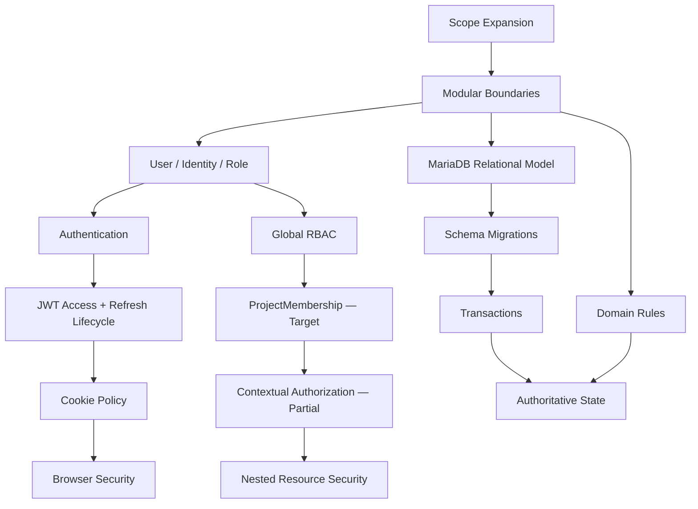

---

# 308. Security Challenge Map

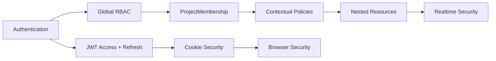

---

# 309. Persistence Challenge Map


---

# 310. Database Truth Guardrail

El diagrama anterior debe interpretarse como:

```text
MariaDB
    CURRENT

PostgreSQL
    FUTURE / CANDIDATE / CONDITIONAL
```

y nunca como:

```text
MariaDB
    ↓
PostgreSQL
    completed evolution.
```

---

# 311. Most Important Challenges in This Phase

Los retos de mayor prioridad arquitectónica de esta primera parte son:

```text
ProjectMembership

Contextual Authorization

Nested Resource Authorization

Cross-project Isolation

Browser Security

Refresh-token Security Hardening

Cookie Policy Consistency

Transaction Boundaries

Data Integrity

Authoritative State.
```

---

# 312. Current Security Priority

La cadena de mayor impacto inmediato es:

```text
ProjectMembership

↓

Contextual Authorization

↓

Nested Resource Security

↓

Cross-project Tests

↓

Realtime Authorization.
```

---

# 313. Current Authentication Priority

La autenticación no necesita reinventar el flujo de refresh.

El trabajo correcto es:

```text
preserve current refresh workflow

+

harden lifecycle

+

centralize cookie policy.
```

---

# 314. Current Database Priority

La prioridad no es:

```text
migrate to PostgreSQL.
```

Es:

```text
preserve MariaDB correctness

improve schema evolution

protect integrity

optimize measured queries

maintain reasonable portability.
```

---

# 315. Common Pattern

Muchos de estos retos aparecen porque la plataforma evolucionó desde:

```text
single-context administration
```

hacia:

```text
multi-user collaborative domains.
```

---

# 316. Security Pattern

La seguridad evoluciona desde:

```text
identity-based access
```

hacia:

```text
identity

+

relationship

+

resource

+

operation

+

state.
```

---

# 317. Authentication Pattern

La autenticación evolucionó desde:

```text
token issuance
```

hacia:

```text
access lifecycle

+

refresh lifecycle

+

browser transport

+

session hardening.
```

---

# 318. Data Pattern

La persistencia evoluciona desde:

```text
store entities
```

hacia:

```text
protect domain invariants.
```

---

# 319. Architecture Pattern

La arquitectura evoluciona desde:

```text
organize code
```

hacia:

```text
protect boundaries.
```

---

# 320. Challenge Resolution Principle

Los retos estructurales no deben resolverse mediante:

```text
local patches
```

cuando afectan:

```text
shared platform foundations.
```

---

# 321. Better Response

```text
Identify common rule

↓

define authoritative boundary

↓

centralize implementation

↓

test policy

↓

reuse across modules.
```

---

# 322. Security Resolution Principle

```text
Authorization must be explicit,
centralized,
context-aware,
and deny by default.
```

---

# 323. Authentication Resolution Principle

```text
Preserve the verified authentication workflow.

Harden the lifecycle
without rewriting current capabilities as missing.
```

---

# 324. Cookie Resolution Principle

```text
One security policy

↓

all cookie issuance paths.
```

---

# 325. Persistence Resolution Principle

```text
Application code expresses intent.

Database constraints protect integrity.
```

---

# 326. Database Evolution Principle

```text
Current database:
    MariaDB.

Future database change:
    only after explicit technical justification.
```

---

# 327. Domain Resolution Principle

```text
Domain rules belong on the server,
not only in the interface.
```

---

# 328. State Resolution Principle

```text
Persistent server state is authoritative.

Client state must be able
to converge back to it.
```

---

# 329. Simplicity Principle

```text
Use the simplest architecture
that safely satisfies
the current requirement.
```

---

# 330. Evidence Principle

```text
Implemented behavior

must be supported by evidence.

Designed behavior

must remain TARGET or PLANNED

until implementation is verified.
```

---

# 331. Part 1 Status Matrix

| Capability / Challenge | Current State |
|---|---|
| Modular Monolith | CURRENT |
| User / Identity separation | CURRENT |
| JWT Access Token | CURRENT |
| JWT Refresh Token | CURRENT |
| HTTPOnly Cookies | CURRENT |
| Explicit Refresh | CURRENT |
| Automatic Access Refresh | CURRENT |
| Refresh Rotation | VERIFY / HARDENING |
| Server-side Revocation | VERIFY / HARDENING |
| Reuse Detection | VERIFY / FUTURE HARDENING |
| Cookie Policy Consistency | HARDENING |
| Global RBAC | CURRENT |
| ProjectMembership | TARGET / IN CONSOLIDATION |
| Contextual Authorization | PARTIAL / EVOLVING |
| Cross-project Authorization | PARTIAL / HARDENING |
| Formal CSRF Protection | IN PROGRESS / PLANNED |
| MariaDB | CURRENT |
| PostgreSQL | FUTURE / CANDIDATE / CONDITIONAL |
| Local Attachment Storage | CURRENT |
| Object Storage | FUTURE / CONDITIONAL |
| Persistent Server State Authority | CURRENT PRINCIPLE |

---

# 332. Part 1 Summary

La primera categoría de retos técnicos muestra la transformación desde:

```text
simple IAM application concerns
```

hacia:

```text
platform-level architecture concerns.
```

Los principales retos analizados han sido:

```text
scope evolution

modular boundaries

User / Identity / Role separation

API + SSR authentication

JWT access + refresh lifecycle

refresh-token security hardening

cookie-policy consistency

global RBAC limitations

ProjectMembership

contextual authorization

centralized policies

nested resource security

cross-project isolation

browser security

relational growth

schema migrations

database portability

data integrity

transactions

concurrency

domain modeling

Audit / Activity / Notification separation

Attachment security

time-related integrity

deletion semantics

error consistency

SSR/API consistency

authoritative state

documentation-state integrity.
```

La corrección histórica más importante de esta sección es:

```text
MariaDB
    CURRENT

PostgreSQL
    FUTURE / CANDIDATE / CONDITIONAL
```

y la corrección de autenticación fundamental es:

```text
JWT Access + Refresh Workflow
    CURRENT

Refresh-token Security Hardening
    ONGOING / VERIFY.
```

---

# 333. Continuation

La **Parte 2/3** continúa con los retos asociados a:

```text
Frontend Architecture

SSR Evolution

Progressive Enhancement

JavaScript Modularity

Kanban — PLANNED

Drag and Drop — PLANNED

Accessibility

WebSockets — CURRENT

Connection Lifecycle

Realtime Authentication

Subscription Authorization

Event Contracts

Event Versioning

Duplicate Events

Out-of-order Events

Reconnect

Reconciliation

Multi-client Convergence

Notifications

Realtime Audit

Concurrency

Realtime Reliability

Horizontal Scaling Boundaries

Redis — CONDITIONAL.
```

---

# 58_TECHNICAL_CHALLENGES.md

# Aula Robótica Platform — Technical Challenges

## Parte 2/3 — Frontend Architecture, SSR, Progressive Enhancement, JavaScript modular, Kanban, accesibilidad, WebSockets, seguridad realtime, contratos de eventos, reconexión, reconciliación y escalado

---

# 334. Challenge 30 — Evolving the Frontend Without Replacing SSR

La evolución funcional de Aula Robótica Platform introdujo necesidades cada vez más interactivas.

El reto no consiste necesariamente en sustituir:

```text
Server-Side Rendering
```

por:

```text
Single Page Application.
```

Consiste en determinar:

```text
how much client-side behavior
each workflow actually requires.
```

---

# 335. Current Frontend Baseline

La arquitectura frontend actual se apoya en:

```text
Jinja2 SSR

+

Bootstrap

+

AdminLTE

+

Modular JavaScript.
```

Estado:

```text
CURRENT
```

---

# 336. SSR Strengths

SSR aporta:

```text
simple navigation

server-controlled authorization

predictable initial state

lower client complexity

direct integration with FastAPI

progressive enhancement possibilities.
```

---

# 337. Growing Interaction Requirements

La plataforma puede necesitar interacciones como:

```text
inline mutations

dynamic dialogs

filters

partial refreshes

notifications

realtime updates

interactive task management.
```

---

# 338. Architectural Question

El reto es decidir:

```text
Which interactions require JavaScript?

Which remain server-rendered?

Which benefit from realtime updates?
```

---

# 339. Wrong Reaction

No debe asumirse:

```text
more interactivity

↓

SPA rewrite.
```

---

# 340. SPA Status

```text
SPA Migration
    NOT CURRENT
    NOT REQUIRED
```

---

# 341. Current Direction

La estrategia adecuada es:

```text
SSR foundation

+

progressive enhancement

+

modular JavaScript

+

realtime where justified.
```

---

# 342. Challenge Impact

```text
Severity:
    High

Status:
    ONGOING.
```

---

# 343. Challenge 31 — Progressive Enhancement

Progressive Enhancement permite mantener:

```text
server-rendered core workflow
```

y añadir:

```text
client-side improvements.
```

---

# 344. Progressive Enhancement Model

```text
SSR page

↓

functional baseline

↓

JavaScript enhancement

↓

optional realtime enhancement.
```

---

# 345. Architectural Benefit

Este enfoque evita convertir:

```text
every user interaction
```

en:

```text
client-side application state.
```

---

# 346. Appropriate JavaScript Uses

JavaScript resulta especialmente útil para:

```text
dialogs

inline actions

dynamic filters

partial updates

drag and drop

realtime UI updates.
```

---

# 347. Server Authority

Incluso cuando JavaScript mejora la experiencia:

```text
server-side validation

authorization

and

persistent state
```

siguen siendo autoritativos.

---

# 348. Progressive Enhancement Principle

```text
JavaScript enhances the workflow.

It does not become
the security boundary.
```

---

# 349. Challenge Impact

```text
Severity:
    Moderate / High

Status:
    CURRENT architectural direction
    + ONGOING evolution.
```

---

# 350. Challenge 32 — JavaScript Modularity

A medida que aumenta la interacción del browser aparece otro riesgo:

```text
one large global JavaScript file.
```

---

# 351. Monolithic JavaScript Risk

Puede provocar:

```text
global state

implicit dependencies

duplicate fetch logic

duplicate error handling

difficult testing

fragile event listeners.
```

---

# 352. Current Direction

La plataforma utiliza:

```text
modular JavaScript.
```

Estado:

```text
CURRENT
```

---

# 353. Desired Module Boundaries

Los módulos deberían organizarse alrededor de responsabilidades como:

```text
API interaction

dialogs

notifications

task interactions

realtime client

shared UI utilities.
```

---

# 354. Shared Fetch Challenge

Si cada módulo implementa independientemente:

```text
fetch()

authentication handling

error parsing

redirect behavior
```

aparecen inconsistencias.

---

# 355. Shared Fetch Infrastructure

Una infraestructura compartida puede centralizar:

```text
request defaults

credentials

content type

error normalization

authentication failure behavior

CSRF integration.
```

---

# 356. Current Status

```text
Shared Fetch Infrastructure
    TARGET / PLANNED
```

---

# 357. CSRF Dependency

Su diseño debe ser compatible con:

```text
formal CSRF protection.
```

---

# 358. Challenge Impact

```text
Severity:
    Moderate / High

Status:
    Modular JS CURRENT
    + shared infrastructure evolving.
```

---

# 359. Challenge 33 — Replacing Native Browser Dialogs

Interfaces tempranas pueden utilizar:

```text
alert()

confirm()

prompt().
```

---

# 360. Why Native Dialogs Become Limiting

Presentan limitaciones en:

```text
visual consistency

accessibility control

error presentation

validation

application styling.
```

---

# 361. Better Direction

Migrar progresivamente hacia:

```text
application-controlled dialogs

or

Bootstrap/AdminLTE modal patterns.
```

---

# 362. Important Constraint

La migración no debe introducir:

```text
duplicated business logic
inside the frontend.
```

---

# 363. Current Status

```text
Native Dialog Migration
    PLANNED / ONGOING UI improvement.
```

---

# 364. Challenge Impact

```text
Severity:
    Moderate

Status:
    ONGOING.
```

---

# 365. Challenge 34 — Building Kanban Without Breaking the Architecture

La evolución de Tasks puede justificar una interfaz Kanban.

Pero debe distinguirse entre:

```text
Task status model
```

y:

```text
complete Kanban capability.
```

---

# 366. Current Historical Boundary

La documentación no debe asumir que:

```text
Kanban is already fully implemented.
```

---

# 367. Kanban Status

```text
Kanban
    PLANNED / TARGET
```

---

# 368. Existing Foundation

El dominio Task proporciona una base sobre la que puede construirse:

```text
status-oriented task visualization.
```

---

# 369. Planned Board

Un posible board SSR puede representar:

```text
TODO

DOING

DONE.
```

---

# 370. Important Distinction

La existencia de estados:

```text
TODO / DOING / DONE
```

no implica automáticamente:

```text
Kanban UI CURRENT.
```

---

# 371. Kanban Dependency Chain

```text
Task Domain

↓

Status Mutation

↓

SSR Board

↓

Client Interaction

↓

Drag and Drop

↓

Realtime Synchronization

↓

Live Kanban.
```

---

# 372. Security Dependency

Antes de mutar una Task debe resolverse:

```text
Who may move this Task
inside this Project?
```

---

# 373. Authorization Dependency

Por ello Kanban depende de:

```text
ProjectMembership

+

Contextual Authorization

+

Nested Resource Security.
```

---

# 374. Mutation Requirement

Un cambio de columna debe ser:

```text
a server-side domain mutation
```

y no simplemente:

```text
a DOM movement.
```

---

# 375. Correct Flow

```text
User Action

↓

Authorized HTTP Mutation

↓

Domain Validation

↓

Database Commit

↓

UI Update

↓

Optional Realtime Broadcast.
```

---

# 376. Wrong Flow

```text
Drag Card

↓

Move DOM Element

↓

Assume domain state changed.
```

---

# 377. Persistent Authority

El board debe reflejar:

```text
persisted Task state.
```

---

# 378. Kanban Failure Handling

Si la mutation falla:

```text
UI must recover

or

re-render authoritative state.
```

---

# 379. Challenge Impact

```text
Severity:
    High

Status:
    PLANNED / TARGET.
```

---

# 380. Challenge 35 — Drag and Drop

Drag and Drop parece inicialmente:

```text
a frontend interaction problem.
```

En realidad afecta:

```text
frontend

domain mutation

authorization

accessibility

failure recovery

realtime.
```

---

# 381. Drag Start

El cliente identifica:

```text
Task

+

current status.
```

---

# 382. Drop

El cliente propone:

```text
new status.
```

---

# 383. Server Validation

El servidor debe validar:

```text
authenticated actor

project access

task ownership/context

allowed transition

requested status.
```

---

# 384. Success

Solo tras éxito debe considerarse:

```text
the new state authoritative.
```

---

# 385. Failure

Ante fallo:

```text
restore previous UI

or

reload authoritative state.
```

---

# 386. Optimistic UI Question

Una UI optimista puede mejorar la percepción de velocidad.

---

# 387. Optimistic UI Risk

Puede mostrar temporalmente:

```text
state that the server rejects.
```

---

# 388. Conservative Initial Strategy

Para una primera implementación puede ser preferible:

```text
mutation

↓

server confirmation

↓

final UI state.
```

---

# 389. Drag and Drop Status

```text
Drag and Drop
    PLANNED
```

---

# 390. Challenge Impact

```text
Severity:
    High

Status:
    PLANNED.
```

---

# 391. Challenge 36 — Kanban Accessibility

Drag and Drop no puede ser el único mecanismo para cambiar estado.

---

# 392. Accessibility Requirement

Debe existir una alternativa mediante:

```text
keyboard

buttons

menus

or equivalent controls.
```

---

# 393. Accessibility Principle

```text
A visual interaction
must not become
the only domain operation path.
```

---

# 394. Screen Reader Concern

Los cambios de estado pueden necesitar comunicación mediante:

```text
accessible labels

status feedback

appropriate announcements.
```

---

# 395. Focus Management

Después de una interacción dinámica debe preservarse:

```text
predictable keyboard focus.
```

---

# 396. Accessibility Status

```text
Kanban Accessibility
    TARGET / PLANNED
```

---

# 397. Challenge Impact

```text
Severity:
    High

Status:
    Must be included
    before Kanban maturity.
```

---

# 398. Challenge 37 — Introducing Realtime Without Making It the Source of Truth

Aula Robótica Platform dispone de comunicación realtime mediante:

```text
FastAPI WebSockets.
```

Estado:

```text
CURRENT
```

---

# 399. Realtime Benefit

Permite comunicar:

```text
changes

notifications

activity

collaborative updates
```

sin depender exclusivamente de:

```text
manual refresh.
```

---

# 400. Fundamental Risk

El cliente podría comenzar a tratar:

```text
WebSocket events
```

como:

```text
authoritative state.
```

---

# 401. Correct Principle

```text
Realtime communicates change.

Persistent server state
remains authoritative.
```

---

# 402. Realtime Architecture

```text
Domain Mutation

↓

Database Commit

↓

Realtime Event

↓

Interested Clients

↓

UI Update.
```

---

# 403. Failure Tolerance

Si el realtime event no llega:

```text
persistent state must remain correct.
```

---

# 404. Realtime Is Enhancement

```text
Realtime

≠

database consistency mechanism.
```

---

# 405. Challenge Impact

```text
Severity:
    Critical

Status:
    Core WebSocket capability CURRENT
    + reliability ONGOING.
```

---

# 406. Challenge 38 — WebSocket Connection Lifecycle

Una conexión WebSocket no es permanente.

---

# 407. Connection Lifecycle

```text
connect

authenticate

subscribe

receive

disconnect

reconnect.
```

---

# 408. Failure Causes

Una conexión puede desaparecer por:

```text
network interruption

browser sleep

mobile connectivity

proxy timeout

server restart

deployment

application failure.
```

---

# 409. Wrong Assumption

```text
WebSocket connected once

=

WebSocket connected forever.
```

---

# 410. Client Requirement

El cliente debe poder detectar:

```text
disconnect.
```

---

# 411. Server Requirement

El servidor debe poder limpiar:

```text
dead connections.
```

---

# 412. Current Connection Manager

La arquitectura actual utiliza:

```text
in-memory Connection Manager.
```

---

# 413. Current Scaling Boundary

Esto es apropiado para:

```text
single-instance deployment.
```

---

# 414. Important Limitation

Un Connection Manager en memoria no comparte conexiones entre:

```text
multiple application instances.
```

---

# 415. Current Status

```text
In-memory Connection Manager
    CURRENT

Distributed Connection Coordination
    NOT CURRENT.
```

---

# 416. Challenge Impact

```text
Severity:
    High

Status:
    CURRENT mechanism
    + lifecycle reliability ONGOING.
```

---

# 417. Challenge 39 — WebSocket Authentication

Un WebSocket mantiene una conexión de larga duración.

Por ello:

```text
authentication must be established
at connection time.
```

---

# 418. HTTP Difference

En HTTP:

```text
Request

↓

Authentication

↓

Response

↓

Connection semantics end.
```

---

# 419. WebSocket Difference

En WebSocket:

```text
Connection

↓

Authentication

↓

Long-lived communication.
```

---

# 420. Security Question

Debe responderse:

```text
Who owns this connection?
```

---

# 421. Authentication Inputs

Dependiendo del diseño pueden utilizarse:

```text
authenticated cookies

token information

existing session context.
```

---

# 422. Invalid Connection

Una conexión no autenticada debe:

```text
be rejected
```

cuando el canal requiere autenticación.

---

# 423. Session Evolution Problem

Una sesión puede cambiar mientras:

```text
WebSocket remains open.
```

---

# 424. Examples

```text
user disabled

permissions changed

membership removed

session invalidated.
```

---

# 425. Security Maturity Requirement

La plataforma debe definir cómo afecta esto a:

```text
existing connections.
```

---

# 426. Current Status

```text
WebSocket Authentication
    CURRENT foundation
    + HARDENING / VALIDATION required.
```

---

# 427. Challenge Impact

```text
Severity:
    Critical

Status:
    ONGOING HARDENING.
```

---

# 428. Challenge 40 — WebSocket Subscription Authorization

Autenticar una conexión responde:

```text
Who is connected?
```

Pero no responde:

```text
Which events may this connection receive?
```

---

# 429. Example

Un usuario autenticado podría intentar suscribirse a:

```text
Project B
```

aunque solo pertenezca a:

```text
Project A.
```

---

# 430. Required Check

```text
Authenticated Connection

↓

Requested Subscription

↓

Resolve Resource Context

↓

Authorize Subscription

↓

Accept or Deny.
```

---

# 431. Security Rule

```text
Authenticated

≠

authorized for every realtime channel.
```

---

# 432. Dependency

La autorización de suscripciones depende de:

```text
ProjectMembership

+

Contextual Authorization.
```

---

# 433. Current Status

```text
Subscription Authorization
    TARGET / HARDENING

Dependency:
    contextual authorization maturity.
```

---

# 434. Cross-project Realtime Leakage

Sin esta protección puede producirse:

```text
cross-project information disclosure.
```

---

# 435. Challenge Impact

```text
Severity:
    Critical

Status:
    ONGOING / TARGET.
```

---

# 436. Challenge 41 — Designing Stable Realtime Event Contracts

Enviar JSON por WebSocket es sencillo.

Mantener un contrato consistente no lo es.

---

# 437. Weak Event

```json
{
  "message": "task changed"
}
```

es insuficiente para comportamiento complejo.

---

# 438. Event Contract Needs

Un contrato puede necesitar:

```text
event type

resource type

resource id

scope

payload

timestamp

version

metadata.
```

---

# 439. Conceptual Event

```json
{
  "type": "task.updated",
  "version": 1,
  "resource": {
    "type": "task",
    "id": 42
  },
  "scope": {
    "project_id": 7
  },
  "payload": {}
}
```

---

# 440. Important Note

El ejemplo anterior representa:

```text
target contract shape
```

y no prueba que:

```text
this exact schema
is already implemented.
```

---

# 441. Event Naming

Los nombres deben ser:

```text
stable

predictable

domain-oriented.
```

---

# 442. Example Naming

```text
task.created

task.updated

task.deleted

notification.created

activity.created.
```

---

# 443. Contract Benefit

Permite:

```text
client dispatching

testing

versioning

documentation

observability.
```

---

# 444. Current Status

```text
Realtime Event Contract
    PARTIAL / TARGET FOR NORMALIZATION
```

---

# 445. Challenge Impact

```text
Severity:
    High

Status:
    ONGOING.
```

---

# 446. Challenge 42 — Event Versioning

Cuando clientes y servidor evolucionan, un evento puede cambiar.

---

# 447. Breaking Change Example

```text
payload field renamed

or

semantic meaning changed.
```

---

# 448. Versioning Question

Debe decidirse cuándo utilizar:

```text
event version.
```

---

# 449. Simple Version Strategy

Puede ser suficiente comenzar con:

```json
{
  "version": 1
}
```

cuando el contrato esté formalizado.

---

# 450. Avoid Premature Complexity

No es necesario introducir inmediatamente:

```text
schema registry

complex event compatibility infrastructure

distributed event platform.
```

---

# 451. Appropriate Evolution

```text
stable documented contract

↓

version only when required

↓

compatibility strategy when real consumers demand it.
```

---

# 452. Challenge Impact

```text
Severity:
    Moderate / High

Status:
    TARGET / ONGOING design concern.
```

---

# 453. Challenge 43 — Duplicate Realtime Events

Los sistemas realtime deben asumir que un cliente puede recibir:

```text
duplicate information.
```

---

# 454. Possible Causes

```text
reconnect behavior

retry logic

multiple subscriptions

future broker semantics

application bugs.
```

---

# 455. Client Requirement

Cuando sea relevante, las operaciones de actualización de UI deberían ser:

```text
idempotent

or

duplicate-tolerant.
```

---

# 456. Example

Recibir dos veces:

```text
task.updated
```

no debería crear:

```text
two Task cards.
```

---

# 457. Event Identity

En casos que lo requieran puede evaluarse:

```text
event_id.
```

---

# 458. Current Status

```text
Duplicate Handling
    PARTIAL / TARGET
```

---

# 459. Challenge Impact

```text
Severity:
    High for collaborative realtime

Status:
    ONGOING.
```

---

# 460. Challenge 44 — Out-of-order Events

La llegada de eventos no siempre debe asumirse como:

```text
perfectly ordered.
```

---

# 461. Example

```text
task.updated(version 4)

arrives before

task.updated(version 3).
```

---

# 462. Current Single-instance Context

En una arquitectura sencilla muchos eventos pueden parecer ordenados en la práctica.

Pero no debe convertirse en:

```text
a permanent architectural assumption.
```

---

# 463. Possible Strategies

Según la complejidad real:

```text
resource version

timestamp

sequence number

state refetch

reconciliation.
```

---

# 464. Preferred Initial Strategy

Cuando exista incertidumbre:

```text
reconcile with authoritative server state.
```

---

# 465. Challenge Impact

```text
Severity:
    High

Status:
    ONGOING / increasingly relevant
    as realtime grows.
```

---

# 466. Challenge 45 — Reconnect Strategy

Una desconexión no es excepcional.

Debe tratarse como:

```text
normal realtime lifecycle.
```

---

# 467. Required Client Behavior

```text
detect disconnect

↓

wait/backoff

↓

reconnect

↓

reauthenticate if required

↓

restore subscriptions

↓

recover missed state.
```

---

# 468. Naive Reconnect

```text
while disconnected:
    reconnect immediately
```

puede provocar:

```text
reconnect storm.
```

---

# 469. Better Strategy

Puede utilizar:

```text
bounded retry

+

backoff

+

optional jitter.
```

---

# 470. But Reconnect Is Not Enough

Una nueva conexión no recupera automáticamente:

```text
events missed during disconnection.
```

---

# 471. Therefore

```text
Reconnect

≠

Recovery.
```

---

# 472. Current Status

```text
Reconnect Strategy
    TARGET / IN PROGRESS
```

---

# 473. Challenge Impact

```text
Severity:
    Critical for reliable collaboration

Status:
    ONGOING.
```

---

# 474. Challenge 46 — State Reconciliation

Después de una desconexión el cliente necesita responder:

```text
What changed while I was offline?
```

---

# 475. Simplest Reliable Strategy

Para muchos workflows:

```text
Reconnect

↓

Refetch authoritative state

↓

Replace/reconcile client representation.
```

---

# 476. Benefit

Este patrón evita depender de:

```text
perfect event delivery.
```

---

# 477. More Advanced Alternatives

Solo cuando exista necesidad real podrían evaluarse:

```text
event replay

cursor-based recovery

sequence checkpoints

durable event streams.
```

---

# 478. Current Architecture Need

La arquitectura actual no necesita asumir:

```text
durable distributed event streaming.
```

---

# 479. Current Status

```text
State Reconciliation
    TARGET / IN PROGRESS
```

---

# 480. Reconciliation Principle

```text
When realtime certainty is lost,
return to authoritative persistent state.
```

---

# 481. Challenge Impact

```text
Severity:
    Critical

Status:
    ONGOING.
```

---

# 482. Challenge 47 — Multi-client Convergence

En colaboración realtime pueden existir:

```text
Client A

Client B

Client C
```

observando el mismo recurso.

---

# 483. Convergence Goal

Después de una operación válida:

```text
all authorized clients
should eventually represent
the same authoritative state.
```

---

# 484. Example

```text
Client A moves Task 42.

Server validates and persists.

Client B receives event.

Client C disconnects.

Client C reconnects and reconciles.
```

Resultado esperado:

```text
A = B = C = server state.
```

---

# 485. Convergence Risks

```text
missed event

duplicate event

out-of-order event

stale local state

failed mutation

unauthorized subscription.
```

---

# 486. Testing Requirement

Este comportamiento requiere:

```text
multi-client tests.
```

---

# 487. Current Status

```text
Multi-client Convergence
    TARGET / PARTIAL

Multi-client Test Coverage
    EXPANSION REQUIRED.
```

---

# 488. Challenge Impact

```text
Severity:
    Critical

Status:
    ONGOING.
```

---

# 489. Challenge 48 — Realtime Notifications

Notifications combinan:

```text
persistent state

+

user attention

+

optional realtime delivery.
```

---

# 490. Current Notification Capability

La plataforma dispone de:

```text
persistent in-app notifications

read/unread state

realtime integration.
```

Estado:

```text
CURRENT
```

---

# 491. Persistence Requirement

Una notification importante no debe existir únicamente como:

```text
ephemeral WebSocket event.
```

---

# 492. Correct Model

```text
Persist Notification

↓

Commit

↓

Optionally notify connected client.
```

---

# 493. Offline User

Si el usuario está desconectado:

```text
notification remains persistent.
```

---

# 494. Reconnect

Al regresar:

```text
the persistent notification
can still be retrieved.
```

---

# 495. Future Notification Capabilities

No deben considerarse actuales sin implementación:

```text
email delivery

push notifications

notification preferences

digest delivery

background delivery pipelines.
```

---

# 496. Status

```text
In-app Notifications
    CURRENT

Realtime Notification Awareness
    CURRENT

Advanced Delivery Channels
    FUTURE / TARGET.
```

---

# 497. Challenge Impact

```text
Severity:
    High

Status:
    Core ADDRESSED
    + advanced delivery FUTURE.
```

---

# 498. Challenge 49 — Realtime Activity Feed

Activity Feed puede beneficiarse de actualizaciones realtime.

---

# 499. Current Capability

```text
Activity Feed
    CURRENT
```

---

# 500. Realtime Benefit

Permite mostrar actividad reciente sin:

```text
full page reload.
```

---

# 501. Security Requirement

Un cliente solo debe recibir:

```text
activity it is authorized to observe.
```

---

# 502. Reconciliation Requirement

El feed debe poder reconstruirse desde:

```text
persistent server data.
```

---

# 503. Event Loss

Perder un evento no debería destruir:

```text
historical activity truth.
```

---

# 504. Advanced Feed Features

Pueden permanecer como evolución:

```text
advanced filtering

pagination optimization

reconciliation improvements

aggregation.
```

---

# 505. Challenge Impact

```text
Severity:
    High

Status:
    Core CURRENT
    + advanced behavior ONGOING.
```

---

# 506. Challenge 50 — Audit and Realtime Must Remain Separate

Audit y realtime pueden originarse en la misma operación, pero tienen responsabilidades diferentes.

---

# 507. Audit Requirement

Audit busca:

```text
traceability

accountability

historical evidence.
```

---

# 508. Realtime Requirement

Realtime busca:

```text
immediate awareness.
```

---

# 509. Dangerous Coupling

No debe asumirse:

```text
if realtime event was delivered,
the operation was audited.
```

---

# 510. Nor

```text
if audit exists,
clients were notified.
```

---

# 511. Correct Separation

```text
Domain Operation

├──> Persistent State
├──> Audit
└──> Realtime Awareness
```

con responsabilidades diferenciadas.

---

# 512. Challenge Impact

```text
Severity:
    High

Status:
    Architectural separation established
    + ONGOING implementation discipline.
```

---

# 513. Challenge 51 — Concurrent Realtime Mutations

Realtime hace más visible un problema que ya existe en HTTP:

```text
concurrent mutations.
```

---

# 514. Example

```text
Client A moves Task 42 to DOING.

Client B moves Task 42 to DONE.
```

---

# 515. Realtime Does Not Solve Concurrency

WebSockets únicamente pueden comunicar:

```text
what happened.
```

No determinan automáticamente:

```text
which mutation should win.
```

---

# 516. Domain Responsibility

La resolución pertenece a:

```text
domain

+

persistence

+

transaction/concurrency strategy.
```

---

# 517. Possible Strategies

Según necesidad:

```text
last-write-wins

optimistic locking

version checks

explicit conflict rejection.
```

---

# 518. Avoid Universal Solution

No todas las entidades necesitan:

```text
the same conflict model.
```

---

# 519. Challenge Impact

```text
Severity:
    High

Status:
    ONGOING / domain-dependent.
```

---

# 520. Challenge 52 — Realtime Reliability Without Overengineering

Una vez aparecen:

```text
disconnects

duplicates

reconciliation

multiple clients
```

puede surgir la tentación de introducir inmediatamente:

```text
Redis

message broker

event streaming

distributed queues.
```

---

# 521. Current Need

La plataforma actual puede seguir utilizando:

```text
in-memory Connection Manager
```

mientras opere adecuadamente en:

```text
single-instance deployment.
```

---

# 522. Reliability Before Distribution

Primero deben resolverse correctamente:

```text
authentication

subscription authorization

event contracts

disconnect handling

reconnect

reconciliation

multi-client behavior.
```

---

# 523. Important Principle

```text
A distributed transport
does not fix
an undefined realtime contract.
```

---

# 524. Nor

```text
Redis
does not automatically solve
authorization or reconciliation.
```

---

# 525. Challenge Impact

```text
Severity:
    High

Status:
    ONGOING.
```

---

# 526. Challenge 53 — Horizontal Scaling Boundary

El actual realtime en memoria tiene una frontera clara.

---

# 527. Single-instance Model

```text
Client A ─┐
Client B ─┼──> FastAPI Instance
Client C ─┘        │
                   └── In-memory Connection Manager
```

---

# 528. Multi-instance Problem

Con dos instancias:

```text
Client A ──> Instance 1

Client B ──> Instance 2
```

la memoria de:

```text
Instance 1
```

no conoce automáticamente las conexiones de:

```text
Instance 2.
```

---

# 529. Scaling Trigger

Solo entonces aparece una necesidad concreta de:

```text
cross-instance realtime coordination.
```

---

# 530. Possible Future Response

Podría evaluarse:

```text
Redis Pub/Sub

Redis Streams

message broker

or another coordination mechanism.
```

---

# 531. Redis Status

```text
Redis
    CONDITIONAL / NOT CURRENT
```

---

# 532. Redis Trigger

Su introducción debe depender de:

```text
multiple application instances

or

another demonstrated infrastructure requirement.
```

---

# 533. Wrong Historical Narrative

No debe escribirse:

```text
Realtime evolved from
in-memory WebSockets
to Redis.
```

porque esa evolución:

```text
has not happened.
```

---

# 534. Correct Narrative

```text
Realtime currently uses
an in-memory Connection Manager.

Redis is a possible future response
if horizontal scaling requires
cross-instance coordination.
```

---

# 535. Challenge Impact

```text
Severity:
    Low currently
    / High if horizontal scaling is triggered

Status:
    CONDITIONAL.
```

---

# 536. Challenge 54 — Avoiding Premature Kubernetes Adoption

La misma lógica se aplica a orchestration.

---

# 537. Current Deployment

La plataforma utiliza:

```text
Docker

Docker Compose

Nginx

Ubuntu

Hetzner VPS.
```

Estado:

```text
CURRENT
```

---

# 538. Kubernetes Possibility

Kubernetes puede ser útil en escenarios con:

```text
many services

multiple replicas

automated orchestration needs

complex scaling

high availability requirements.
```

---

# 539. Current Requirement

No existe evidencia de que la plataforma necesite actualmente:

```text
Kubernetes.
```

---

# 540. Kubernetes Status

```text
Kubernetes
    CONDITIONAL / NOT CURRENT
```

---

# 541. Infrastructure Principle

```text
Do not introduce orchestration complexity
before operational requirements justify it.
```

---

# 542. Challenge Impact

```text
Severity:
    Low as current challenge

Status:
    CONDITIONAL.
```

---

# 543. Challenge 55 — Avoiding Premature Microservice Decomposition

La modularidad interna puede provocar una falsa conclusión:

```text
every module should become a service.
```

---

# 544. Why This Is Dangerous

Microservices introducirían:

```text
network boundaries

distributed transactions

service discovery

independent deployment

observability complexity

failure propagation

versioned inter-service contracts.
```

---

# 545. Current Architecture

```text
Modular Monolith
    CURRENT
```

---

# 546. Microservices Status

```text
Microservices
    CONDITIONAL / NOT CURRENT
```

---

# 547. Valid Future Trigger

Una extracción podría considerarse cuando exista:

```text
clear bounded context

independent scaling requirement

independent deployment requirement

organizational ownership need

or

measured architectural pressure.
```

---

# 548. Invalid Trigger

No es suficiente:

```text
microservices are modern.
```

---

# 549. Challenge Impact

```text
Severity:
    High if adopted prematurely

Status:
    CONDITIONAL.
```

---

# 550. Challenge 56 — Realtime Security Across Multiple Boundaries

Realtime combina varias capas de seguridad.

---

# 551. Security Chain

```text
Authenticate Connection

↓

Authorize Subscription

↓

Authorize Domain Mutation

↓

Filter Event Recipients

↓

Protect Payload

↓

Handle Permission Changes.
```

---

# 552. Missing One Layer

Una conexión correctamente autenticada puede seguir siendo insegura si:

```text
subscription authorization is missing.
```

---

# 553. Similarly

Una subscription válida puede filtrar información si:

```text
event recipient selection
ignores current authorization.
```

---

# 554. Security Invariant

```text
Every realtime boundary
must preserve
the same authorization model
as HTTP.
```

---

# 555. Challenge Impact

```text
Severity:
    Critical

Status:
    ONGOING HARDENING.
```

---

# 556. Challenge 57 — Permission Changes During Active Realtime Sessions

Las relaciones de autorización pueden cambiar mientras una conexión permanece abierta.

---

# 557. Example

```text
User connects to Project A.

Later:
    membership is removed.

Connection remains technically open.
```

---

# 558. Security Question

Debe definirse:

```text
Should existing subscription remain active?
```

---

# 559. Safe Direction

Una modificación relevante de autorización debería provocar:

```text
subscription invalidation

connection revalidation

or equivalent protection.
```

---

# 560. Complexity Boundary

No es necesario diseñar desde el principio:

```text
a globally distributed session invalidation system
```

si el despliegue actual no lo requiere.

---

# 561. But

El comportamiento debe estar:

```text
explicitly defined.
```

---

# 562. Challenge Impact

```text
Severity:
    Critical

Status:
    TARGET / HARDENING.
```

---

# 563. Challenge 58 — Event Payload Minimization

Un evento realtime no debería incluir:

```text
all available resource data
```

por comodidad.

---

# 564. Risks

Payloads excesivos aumentan:

```text
information disclosure risk

coupling

bandwidth

client dependency on internal models.
```

---

# 565. Better Principle

```text
Send the minimum information
required by the event contract.
```

---

# 566. Alternative

Cuando el cliente necesite estado completo:

```text
event indicates change

↓

client fetches authorized representation.
```

---

# 567. Security Benefit

La consulta posterior puede reutilizar:

```text
normal HTTP authorization.
```

---

# 568. Trade-off

Este modelo añade:

```text
additional request
```

pero reduce:

```text
event coupling.
```

---

# 569. Challenge Impact

```text
Severity:
    High

Status:
    ONGOING design concern.
```

---

# 570. Challenge 59 — Realtime Backpressure

Un cliente lento puede no procesar eventos al mismo ritmo que:

```text
the server produces them.
```

---

# 571. Potential Effects

```text
memory growth

delayed delivery

stale UI

connection instability.
```

---

# 572. Current Context

En el despliegue actual puede no constituir todavía:

```text
a measured production bottleneck.
```

---

# 573. Correct Status

```text
Backpressure Strategy
    FUTURE / VERIFY WHEN MEASURED
```

---

# 574. Avoid Premature Infrastructure

No debe utilizarse este riesgo hipotético para justificar automáticamente:

```text
Kafka

RabbitMQ

Redis Streams

or another broker.
```

---

# 575. Trigger

Primero debe existir:

```text
measurement

or

demonstrated reliability requirement.
```

---

# 576. Challenge Impact

```text
Severity:
    Potentially High

Current Priority:
    Low / CONDITIONAL.
```

---

# 577. Challenge 60 — Realtime Observability

Los fallos realtime pueden ser difíciles de diagnosticar porque:

```text
the initial HTTP request
may already have succeeded.
```

---

# 578. Useful Signals

Puede ser necesario observar:

```text
connections

disconnects

authentication failures

subscription denials

event publication

delivery failures

reconnect patterns.
```

---

# 579. Privacy Constraint

Los logs no deben exponer innecesariamente:

```text
tokens

sensitive payloads

personal information.
```

---

# 580. Correlation

Cuando sea posible, resulta útil correlacionar:

```text
domain operation

↓

audit/log context

↓

realtime event.
```

---

# 581. Current Status

```text
Realtime Observability
    PARTIAL / ONGOING
```

---

# 582. Challenge Impact

```text
Severity:
    High

Status:
    ONGOING.
```

---

# 583. Challenge 61 — Testing Realtime Behavior

Realtime requiere probar más que:

```text
connection succeeds.
```

---

# 584. Functional Tests

Deben cubrir progresivamente:

```text
authorized connection

unauthorized connection

valid subscription

invalid subscription

event delivery

disconnect.
```

---

# 585. Reliability Tests

También:

```text
reconnect

reconciliation

duplicates

multiple clients.
```

---

# 586. Security Tests

Especialmente:

```text
cross-project subscription denial

cross-project event isolation

permission change behavior.
```

---

# 587. Multi-client Test Example

```text
Client A
    authorized for Project 1

Client B
    authorized for Project 2

Mutation in Project 1

Expected:
    A receives relevant event
    B does not.
```

---

# 588. Current Status

```text
Realtime Tests
    CURRENT foundation

Coverage Expansion
    REQUIRED / ONGOING.
```

---

# 589. Challenge Impact

```text
Severity:
    Critical

Status:
    ONGOING.
```

---

# 590. Challenge 62 — Live Kanban

Live Kanban representa la combinación de múltiples retos anteriores.

---

# 591. Live Kanban Is Not One Feature

Depende de:

```text
Task Domain

Kanban UI

Status Mutation

Contextual Authorization

Drag and Drop

Accessibility

WebSocket Authentication

Subscription Authorization

Event Contract

Reconnect

Reconciliation

Multi-client Convergence.
```

---

# 592. Current Historical Boundary

```text
Live Kanban
    NOT CURRENT
```

---

# 593. Live Kanban Status

```text
PLANNED / TARGET
```

---

# 594. Why Premature Implementation Is Risky

Implementar primero:

```text
drag-and-drop + broadcast
```

sin resolver:

```text
authorization

recovery

convergence
```

puede producir una demo atractiva pero una capability frágil.

---

# 595. Correct Dependency Order

```text
ProjectMembership

↓

Contextual Authorization

↓

Task Mutation Security

↓

Kanban SSR

↓

Drag and Drop

↓

Realtime Authorization

↓

Event Contract

↓

Reconnect

↓

Reconciliation

↓

Live Kanban.
```

---

# 596. Live Kanban Reliability Invariant

```text
A client may temporarily become stale.

It must not become permanently divergent
from authoritative server state.
```

---

# 597. Live Kanban Security Invariant

```text
A client must never receive
or mutate Task state
outside its authorized Project context.
```

---

# 598. Live Kanban Accessibility Invariant

```text
Drag and Drop
must not be
the only interaction mechanism.
```

---

# 599. Challenge Impact

```text
Severity:
    Critical

Status:
    PLANNED / TARGET.
```

---

# 600. Frontend Challenge Map

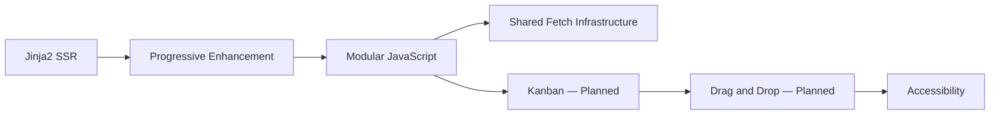

---

# 601. Realtime Challenge Map

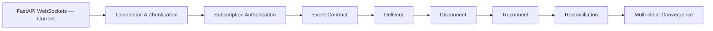

---

# 602. Live Kanban Dependency Map

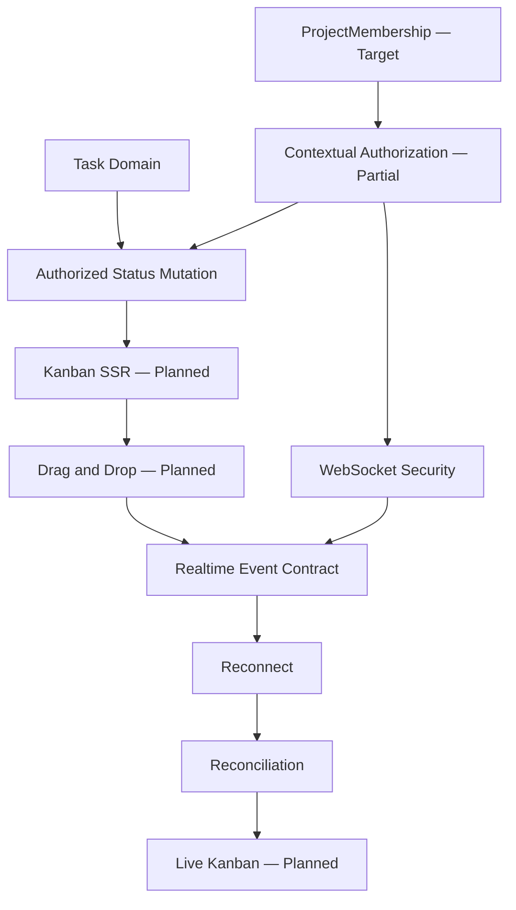

---

# 603. Horizontal Scaling Map

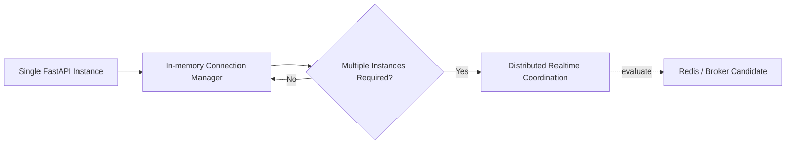

---

# 604. Realtime Truth Guardrail

El diagrama anterior debe interpretarse como:

```text
FastAPI WebSockets
    CURRENT

In-memory Connection Manager
    CURRENT

Redis
    CONDITIONAL

Distributed Realtime
    FUTURE / CONDITIONAL.
```

---

# 605. Frontend Truth Guardrail

```text
Jinja2 SSR
    CURRENT

Bootstrap / AdminLTE
    CURRENT

Modular JavaScript
    CURRENT

Kanban
    PLANNED

Drag and Drop
    PLANNED

Live Kanban
    PLANNED.
```

---

# 606. Infrastructure Truth Guardrail

```text
Docker
    CURRENT

Docker Compose
    CURRENT

Nginx
    CURRENT

Ubuntu
    CURRENT

Hetzner VPS
    CURRENT

Kubernetes
    CONDITIONAL / NOT CURRENT.
```

---

# 607. Architecture Truth Guardrail

```text
Modular Monolith
    CURRENT

Microservices
    CONDITIONAL / NOT CURRENT.
```

---

# 608. Current Highest-risk Realtime Dependency

```text
ProjectMembership

↓

Contextual Authorization

↓

WebSocket Subscription Authorization

↓

Project-isolated Event Delivery.
```

---

# 609. Current Highest-risk Reliability Dependency

```text
Stable Event Contract

↓

Reconnect

↓

Reconciliation

↓

Multi-client Convergence.
```

---

# 610. Current Highest-risk Kanban Dependency

```text
Authorized Task Mutation

↓

Reliable UI State

↓

Realtime Security

↓

Reconciliation

↓

Live Collaboration.
```

---

# 611. Frontend Resolution Principle

```text
Keep SSR as the foundation.

Add client complexity
only where user interaction requires it.
```

---

# 612. JavaScript Resolution Principle

```text
Modularize behavior.

Centralize cross-cutting browser concerns.

Do not duplicate domain rules.
```

---

# 613. Kanban Resolution Principle

```text
Kanban is a representation
of Task domain state.

It is not
an independent state system.
```

---

# 614. Realtime Resolution Principle

```text
Realtime communicates state changes.

It does not replace
persistent authoritative state.
```

---

# 615. Reconnect Resolution Principle

```text
Reconnect restores communication.

Reconciliation restores confidence.
```

---

# 616. Security Resolution Principle

```text
Authenticate the connection.

Authorize the subscription.

Authorize the mutation.

Filter the recipients.
```

---

# 617. Scaling Resolution Principle

```text
Solve current reliability first.

Distribute only
when actual scale requires it.
```

---

# 618. Infrastructure Resolution Principle

```text
Do not introduce Redis,
Kubernetes,
or microservices

to solve problems
that do not currently exist.
```

---

# 619. Accessibility Resolution Principle

```text
Interactive enhancement
must preserve
an accessible operation path.
```

---

# 620. Convergence Resolution Principle

```text
Every authorized client
must be able to return
to authoritative server state.
```

---

# 621. Part 2 Status Matrix

| Capability / Challenge | Current State |
|---|---|
| Jinja2 SSR | CURRENT |
| Bootstrap / AdminLTE | CURRENT |
| Modular JavaScript | CURRENT |
| Progressive Enhancement | CURRENT DIRECTION |
| Shared Fetch Infrastructure | TARGET / PLANNED |
| Native Dialog Migration | ONGOING / PLANNED |
| Kanban | PLANNED / TARGET |
| Drag and Drop | PLANNED |
| Kanban Accessibility | TARGET |
| FastAPI WebSockets | CURRENT |
| In-memory Connection Manager | CURRENT |
| WebSocket Authentication | CURRENT FOUNDATION + HARDENING |
| Subscription Authorization | TARGET / HARDENING |
| Realtime Event Contract | PARTIAL / NORMALIZATION TARGET |
| Event Versioning | TARGET |
| Duplicate Handling | PARTIAL / TARGET |
| Out-of-order Handling | ONGOING DESIGN CONCERN |
| Reconnect | TARGET / IN PROGRESS |
| Reconciliation | TARGET / IN PROGRESS |
| Multi-client Convergence | PARTIAL / TARGET |
| Persistent Notifications | CURRENT |
| Realtime Notifications | CURRENT |
| Activity Feed | CURRENT |
| Realtime Activity Feed | CURRENT FOUNDATION |
| Redis | CONDITIONAL / NOT CURRENT |
| Distributed Realtime | FUTURE / CONDITIONAL |
| Kubernetes | CONDITIONAL / NOT CURRENT |
| Microservices | CONDITIONAL / NOT CURRENT |
| Live Kanban | PLANNED / TARGET |

---

# 622. Part 2 Priority Matrix

| Priority | Challenge | Reason |
|---|---|---|
| P1 | Contextual Authorization dependency | Security foundation |
| P1 | WebSocket Authentication Hardening | Protect connection identity |
| P1 | Subscription Authorization | Prevent cross-project leakage |
| P1 | Realtime Event Contract | Required for predictable clients |
| P1 | Reconnect | Required for reliable realtime |
| P1 | Reconciliation | Required for convergence |
| P1 | Multi-client Testing | Proves isolation and recovery |
| P1 | Live Kanban prerequisites | Prevent fragile collaboration |
| P2 | Shared Fetch Infrastructure | Browser consistency |
| P2 | Native Dialog Migration | UI maintainability |
| P2 | Accessibility | Required for mature interaction |
| P2 | Realtime Observability | Operational diagnosis |
| P3 | Redis | Only after scaling trigger |
| P3 | Kubernetes | Only after orchestration trigger |
| P3 | Microservices | Only after decomposition trigger |

---

# 623. Pre-Kanban Gate

Antes de considerar el Kanban suficientemente maduro:

```text
[ ] Task status mutation contract defined.

[ ] Project context validated.

[ ] Contextual authorization applied.

[ ] Server-side domain validation applied.

[ ] CSRF protection integrated for browser mutation.

[ ] Failure behavior defined.

[ ] Accessible non-drag alternative available.

[ ] UI can recover authoritative state.
```

---

# 624. Pre-Live-Kanban Gate

Antes de considerar Live Kanban suficientemente maduro:

```text
[ ] ProjectMembership defined.

[ ] Contextual Task authorization consolidated.

[ ] CSRF applied to mutations.

[ ] WebSocket authentication validated.

[ ] Subscription authorization validated.

[ ] Event contract stable.

[ ] Reconnect strategy implemented.

[ ] Reconciliation implemented.

[ ] Duplicate handling defined.

[ ] Multi-client tests pass.

[ ] Keyboard alternative available.

[ ] Failure UI recovers correctly.
```

---

# 625. Pre-horizontal-scaling Gate

Antes de introducir infraestructura distribuida:

```text
[ ] Single-instance limitations measured.

[ ] Multiple application instances actually required.

[ ] Cross-instance realtime requirement demonstrated.

[ ] Current event contract stable.

[ ] Reconnect and reconciliation already reliable.

[ ] Operational ownership defined.

[ ] Added infrastructure cost justified.
```

---

# 626. Redis Adoption Gate

Redis no debería introducirse únicamente porque:

```text
realtime exists.
```

Debe existir al menos una necesidad concreta como:

```text
cross-instance event coordination

shared ephemeral state

distributed synchronization

or another measured use case.
```

---

# 627. Kubernetes Adoption Gate

Kubernetes no debería introducirse únicamente porque:

```text
containers exist.
```

Debe existir:

```text
orchestration pressure

scaling requirement

availability requirement

deployment complexity

or equivalent operational trigger.
```

---

# 628. Microservice Adoption Gate

Un módulo no debería extraerse del Modular Monolith únicamente porque:

```text
it has a clear folder.
```

Debe existir una razón como:

```text
independent scaling

independent lifecycle

strong bounded context

organizational ownership

or measured coupling pressure.
```

---

# 629. Current Frontend Strategic Challenge

La pregunta central del frontend es:

```text
How can the platform become
more interactive

without losing

SSR simplicity

server authority

security consistency

and maintainability?
```

---

# 630. Current Realtime Strategic Challenge

La pregunta central de realtime es:

```text
How can multiple authorized clients
remain synchronized

despite

disconnects

missed events

duplicates

concurrent changes

and evolving permissions?
```

---

# 631. Current Scaling Strategic Challenge

La pregunta no es:

```text
How do we distribute the platform now?
```

Es:

```text
How do we preserve
a clean scaling boundary

without paying
distributed-system complexity
before it is required?
```

---

# 632. Part 2 Summary

La segunda categoría de retos técnicos muestra la evolución desde:

```text
server-rendered interaction
```

hacia:

```text
progressively enhanced,
realtime-aware,
collaborative interaction.
```

Los principales retos analizados han sido:

```text
SSR evolution

Progressive Enhancement

JavaScript modularity

shared browser infrastructure

native dialog migration

Kanban design

drag and drop

accessibility

WebSocket lifecycle

WebSocket authentication

subscription authorization

event contracts

event versioning

duplicate events

out-of-order events

reconnect

reconciliation

multi-client convergence

persistent notifications

Activity Feed realtime behavior

Audit / realtime separation

concurrent mutations

realtime reliability

horizontal scaling boundaries

Redis adoption boundaries

Kubernetes adoption boundaries

microservice boundaries

permission changes

payload minimization

backpressure

realtime observability

realtime testing

Live Kanban prerequisites.
```

Las correcciones de estado fundamentales son:

```text
WebSockets
    CURRENT

In-memory Connection Manager
    CURRENT

Kanban
    PLANNED / TARGET

Live Kanban
    PLANNED / TARGET

Reconnect
    TARGET / IN PROGRESS

Reconciliation
    TARGET / IN PROGRESS

Redis
    CONDITIONAL / NOT CURRENT

Kubernetes
    CONDITIONAL / NOT CURRENT

Microservices
    CONDITIONAL / NOT CURRENT.
```

---

# 633. Continuation

La **Parte 3/3** continúa con los retos asociados a:

```text
Testing Strategy

Unit Testing

Integration Testing

HTTP Testing

Authorization Testing

UI Testing

Realtime Testing

Performance

Query Optimization

N+1 Problems

Pagination

Caching Boundaries

Observability

Logging

Monitoring

Health Checks

Deployment

CI/CD

Configuration

Secrets

Database Operations

Backup

Restore

Disaster Recovery

Developer Experience

Documentation

Technical Debt

Architecture Governance

Operational Maturity

Challenge Prioritization

Pre-production Gates

Pre-1.0 Gates

Final Technical Challenge Model.
```

---

# 58_TECHNICAL_CHALLENGES.md

# Aula Robótica Platform — Technical Challenges

## Parte 3/3 — Testing, rendimiento, observabilidad, operaciones, CI/CD, configuración, backups, recuperación, mantenibilidad, deuda técnica y gobierno arquitectónico

---

# 634. Challenge 63 — Testing a Growing Platform

A medida que Aula Robótica Platform evoluciona, el testing deja de consistir únicamente en comprobar:

```text
Does this function return
the expected value?
```

La plataforma necesita validar simultáneamente:

```text
domain behavior

persistence

HTTP contracts

authentication

authorization

SSR behavior

JavaScript interactions

realtime behavior

operational assumptions.
```

---

# 635. Testing Complexity Growth

La complejidad aumenta porque una misma capability puede atravesar:

```text
Route

↓

Authentication

↓

Authorization

↓

Service

↓

Repository

↓

Database

↓

Audit

↓

Notification

↓

Realtime.
```

---

# 636. Testing Objective

El objetivo no debe ser simplemente:

```text
maximize number of tests.
```

Debe ser:

```text
maximize confidence
in critical platform behavior.
```

---

# 637. Testing Pyramid

Una estrategia equilibrada puede combinar:

```text
Unit Tests

Integration Tests

HTTP/API Tests

Authorization Tests

UI Tests

Realtime Tests

Operational Validation.
```

---

# 638. Current Testing Status

```text
Automated Testing
    CURRENT

Coverage
    INCOMPLETE / EXPANDING
```

---

# 639. Challenge Impact

```text
Severity:
    Critical

Status:
    ONGOING.
```

---

# 640. Challenge 64 — Unit Testing Without Testing Implementation Details

Los unit tests deben validar:

```text
behavior

rules

transformations

policy decisions.
```

---

# 641. Fragile Unit Test

Un test demasiado acoplado puede verificar:

```text
exact internal method calls

private implementation details

incidental object structure.
```

---

# 642. Consequence

Refactorizaciones seguras pueden provocar:

```text
large numbers of meaningless failures.
```

---

# 643. Better Principle

```text
Test observable behavior
at the smallest useful boundary.
```

---

# 644. Good Unit-test Candidates

```text
domain validation

authorization policy decisions

state transitions

utility functions

mapping logic

pure transformations.
```

---

# 645. Challenge Impact

```text
Severity:
    Moderate / High

Status:
    ONGOING.
```

---

# 646. Challenge 65 — Integration Testing Persistence

Repository y Service Layer reducen acoplamiento, pero:

```text
mocked tests
```

no prueban completamente:

```text
real relational behavior.
```

---

# 647. Persistence Integration Concerns

Deben verificarse aspectos como:

```text
relationships

foreign keys

unique constraints

transactions

query behavior

cascade behavior

database defaults.
```

---

# 648. Database Fidelity

Cuando un comportamiento depende de:

```text
database semantics
```

el test debe ejecutarse con suficiente fidelidad al entorno real.

---

# 649. Important Database Boundary

La base actual es:

```text
MariaDB.
```

Por tanto:

```text
PostgreSQL-specific test assumptions
```

no deben formar parte del baseline actual.

---

# 650. Challenge Impact

```text
Severity:
    High

Status:
    ONGOING.
```

---

# 651. Challenge 66 — HTTP Contract Testing

Los endpoints constituyen contratos externos o semiexternos.

---

# 652. HTTP Tests Should Validate

```text
status codes

request validation

response structure

authentication

authorization

not-found behavior

conflict behavior.
```

---

# 653. Happy-path-only Risk

Probar únicamente:

```text
200 OK
```

deja sin validar las fronteras más importantes.

---

# 654. Negative-path Testing

Debe incluir:

```text
401

403

404

409

422

and relevant domain errors.
```

---

# 655. Security Value

Los tests negativos permiten comprobar:

```text
what the platform refuses to do.
```

---

# 656. Challenge Impact

```text
Severity:
    High

Status:
    ONGOING.
```

---

# 657. Challenge 67 — Authorization Testing

La autorización contextual requiere una estrategia específica.

---

# 658. Insufficient Test

```text
Admin can update Task.
```

no demuestra:

```text
project isolation.
```

---

# 659. Required Matrix

Una capability contextual debería considerar:

```text
authorized actor
authorized project
authorized resource

unauthorized actor
wrong project
wrong resource
insufficient role
missing membership.
```

---

# 660. Cross-project Test

Ejemplo esencial:

```text
User A belongs to Project A.

Task belongs to Project B.

User A requests Task.

Expected:
    access denied.
```

---

# 661. Nested Resource Test

También:

```text
User A belongs to Project A.

Attachment belongs to Task
inside Project B.

Expected:
    access denied.
```

---

# 662. Current Dependency

La cobertura completa depende de consolidar:

```text
ProjectMembership

+

Contextual Authorization.
```

---

# 663. Authorization Test Status

```text
Cross-project Authorization Tests
    TARGET / EXPANSION REQUIRED
```

---

# 664. Challenge Impact

```text
Severity:
    Critical

Status:
    ONGOING.
```

---

# 665. Challenge 68 — UI Testing

SSR y JavaScript modular introducen comportamiento que no siempre puede validarse únicamente mediante:

```text
backend tests.
```

---

# 666. UI Testing Scope

Puede incluir:

```text
page rendering

navigation

forms

dialogs

dynamic actions

error presentation

accessibility-critical workflows.
```

---

# 667. Avoid Testing Everything End-to-end

Los tests UI son:

```text
slower

more fragile

more expensive.
```

---

# 668. Appropriate Use

Deben concentrarse en:

```text
critical user journeys

integration boundaries

browser-specific behavior.
```

---

# 669. Current Status

```text
UI Testing
    CURRENT FOUNDATION

Coverage
    EXPANSION REQUIRED.
```

---

# 670. Future Kanban Testing

Cuando Kanban exista deberá incluir:

```text
status mutation

failure recovery

keyboard alternative

drag and drop

authorized project isolation.
```

---

# 671. Challenge Impact

```text
Severity:
    High

Status:
    ONGOING.
```

---

# 672. Challenge 69 — Realtime Testing

Realtime añade condiciones que no aparecen en HTTP tradicional.

---

# 673. Realtime Test Dimensions

```text
connection

authentication

subscription

event delivery

isolation

disconnect

reconnect

reconciliation

multiple clients.
```

---

# 674. Security Test

```text
Client A authorized for Project A.

Client B authorized for Project B.

Project A changes.

Expected:
    A receives relevant event.
    B receives nothing.
```

---

# 675. Reliability Test

```text
Client disconnects.

Server state changes.

Client reconnects.

Client reconciles.

Expected:
    client converges to server state.
```

---

# 676. Duplicate Test

```text
same event processed twice

↓

no duplicate domain representation.
```

---

# 677. Current Status

```text
Realtime Testing
    CURRENT FOUNDATION

Advanced Coverage
    EXPANSION REQUIRED.
```

---

# 678. Challenge Impact

```text
Severity:
    Critical

Status:
    ONGOING.
```

---

# 679. Challenge 70 — Keeping the Test Suite Fast Enough

A growing suite can eventually become:

```text
too slow for frequent execution.
```

---

# 680. Slow-suite Consequence

Developers may:

```text
run fewer tests

delay feedback

avoid full validation.
```

---

# 681. Test Segmentation

Puede resultar útil distinguir:

```text
fast unit tests

integration tests

UI tests

realtime tests

operational tests.
```

---

# 682. CI Strategy

El pipeline puede ejecutar diferentes capas según:

```text
cost

risk

change type.
```

---

# 683. But

La optimización del pipeline no debe provocar:

```text
critical tests never running.
```

---

# 684. Challenge Impact

```text
Severity:
    Moderate / High

Status:
    ONGOING as test coverage grows.
```

---

# 685. Challenge 71 — Performance Without Premature Optimization

A medida que crece la plataforma aparece presión para optimizar.

---

# 686. Wrong Approach

```text
optimize everything
before measuring anything.
```

---

# 687. Better Approach

```text
Measure

↓

Identify bottleneck

↓

Optimize

↓

Measure again.
```

---

# 688. Performance Areas

```text
database queries

SSR rendering

API latency

static assets

WebSocket fan-out

file operations.
```

---

# 689. Performance Principle

```text
Optimization should follow evidence.
```

---

# 690. Challenge Impact

```text
Severity:
    High when bottlenecks appear

Status:
    ONGOING / measurement-driven.
```

---

# 691. Challenge 72 — N+1 Query Problems

ORMs facilitan navegar relaciones.

También pueden ocultar:

```text
unexpected query multiplication.
```

---

# 692. Example

```text
Load 100 Tasks.

For each Task:
    load Project separately.
```

Resultado:

```text
1 + 100 queries.
```

---

# 693. SSR Risk

Este problema puede aparecer especialmente en:

```text
lists

dashboards

feeds

nested templates.
```

---

# 694. Detection

Debe utilizarse:

```text
query inspection

logging

profiling

performance tests.
```

---

# 695. Possible Solutions

```text
eager loading

joined loading

select-in loading

query redesign.
```

---

# 696. Rule

No debe aplicarse una estrategia global sin considerar:

```text
actual access pattern.
```

---

# 697. Challenge Impact

```text
Severity:
    High

Status:
    ONGOING.
```

---

# 698. Challenge 73 — Pagination

Listados crecientes no deberían cargar:

```text
all records.
```

---

# 699. Pagination Candidates

```text
Projects

Tasks

Activities

Notifications

Audit

Activity Feed.
```

---

# 700. Pagination Benefit

```text
lower memory usage

smaller responses

faster rendering

predictable queries.
```

---

# 701. Pagination Strategy

Según el caso:

```text
offset pagination

or

cursor/keyset pagination.
```

---

# 702. Avoid Premature Sophistication

No todos los listados necesitan inmediatamente:

```text
cursor pagination.
```

---

# 703. Challenge Impact

```text
Severity:
    Moderate / High

Status:
    ONGOING as datasets grow.
```

---

# 704. Challenge 74 — Caching Boundaries

Caching puede mejorar rendimiento.

También puede introducir:

```text
stale state

invalidation complexity

authorization leakage.
```

---

# 705. Security Concern

No debe reutilizarse una respuesta protegida entre:

```text
users with different authorization contexts.
```

---

# 706. Current Architecture

No debe asumirse:

```text
Redis-backed application cache CURRENT.
```

---

# 707. Redis Cache Status

```text
Redis Cache
    FUTURE / CONDITIONAL
```

---

# 708. Cache Adoption Rule

```text
Measure first.

Cache second.

Define invalidation before deployment.
```

---

# 709. Challenge Impact

```text
Severity:
    Potentially High

Status:
    CONDITIONAL.
```

---

# 710. Challenge 75 — Dashboard Performance

Dashboard concentra información procedente de:

```text
multiple modules

multiple queries

aggregations.
```

---

# 711. Current Dashboard Status

```text
Dashboard
    CURRENT
```

---

# 712. Performance Risk

Un dashboard puede convertirse en:

```text
one page triggering
many expensive queries.
```

---

# 713. Optimization Options

Solo cuando se necesiten:

```text
query consolidation

aggregations

indexes

selective eager loading

pagination

limited caching.
```

---

# 714. Advanced Dashboard Architecture

No debe asumirse como actual:

```text
precomputed analytics

distributed cache

background aggregation.
```

---

# 715. Challenge Impact

```text
Severity:
    Moderate / High

Status:
    CURRENT capability
    + performance evolution ONGOING.
```

---

# 716. Challenge 76 — Observability

Cuando una plataforma deja de ser una colección pequeña de endpoints, necesita responder:

```text
What is happening?

Why did it fail?

Where is the bottleneck?

Which user-facing capability is affected?
```

---

# 717. Observability Dimensions

```text
logs

metrics

health

errors

traces where justified

operational events.
```

---

# 718. Observability Goal

No consiste en:

```text
collect everything.
```

Consiste en:

```text
collect enough evidence
to understand platform behavior.
```

---

# 719. Challenge Impact

```text
Severity:
    High

Status:
    PARTIAL / ONGOING.
```

---

# 720. Challenge 77 — Structured Logging

Los logs deben permitir entender:

```text
what happened
```

sin depender de:

```text
ad hoc print statements.
```

---

# 721. Useful Context

Según el evento:

```text
timestamp

severity

component

request correlation

resource

operation

result.
```

---

# 722. Security Constraint

Nunca deberían registrarse innecesariamente:

```text
passwords

JWTs

refresh tokens

secrets

sensitive personal data.
```

---

# 723. Authentication Logging

Puede registrarse:

```text
authentication success/failure metadata
```

sin registrar:

```text
credential material.
```

---

# 724. Authorization Logging

Los eventos relevantes pueden ayudar a detectar:

```text
repeated denied access

cross-project attempts

unexpected policy failures.
```

---

# 725. Challenge Impact

```text
Severity:
    High

Status:
    ONGOING.
```

---

# 726. Challenge 78 — Monitoring

Logging permite investigar.

Monitoring debe permitir detectar:

```text
that something is wrong.
```

---

# 727. Useful Signals

```text
availability

HTTP error rate

latency

resource usage

database connectivity

WebSocket failures

disk usage.
```

---

# 728. Alerting Principle

Una métrica es útil operacionalmente cuando puede conducir a:

```text
a meaningful action.
```

---

# 729. Avoid Alert Noise

Demasiadas alertas producen:

```text
alert fatigue.
```

---

# 730. Challenge Impact

```text
Severity:
    High

Status:
    ONGOING operational maturity.
```

---

# 731. Challenge 79 — Health Checks

Un proceso ejecutándose no implica:

```text
application healthy.
```

---

# 732. Liveness

Responde:

```text
Is the application process alive?
```

---

# 733. Readiness

Responde:

```text
Can the application
serve meaningful traffic?
```

---

# 734. Dependencies

Readiness puede depender de:

```text
database connectivity

critical configuration

required storage.
```

---

# 735. Avoid Excessive Coupling

Un health check tampoco debería depender de:

```text
every optional external capability.
```

---

# 736. Challenge Impact

```text
Severity:
    High

Status:
    ONGOING.
```

---

# 737. Challenge 80 — CI/CD Maturity

Automatizar tests y checks reduce:

```text
manual release risk.
```

---

# 738. Current Automation Baseline

```text
GitHub Actions
    CURRENT

Automated Testing
    CURRENT
```

---

# 739. CI Responsibilities

Puede incluir:

```text
install dependencies

run tests

run quality checks

validate build

produce artifacts where required.
```

---

# 740. CD Boundary

No debe confundirse:

```text
CI exists
```

con:

```text
every deployment step is fully automated.
```

---

# 741. Deployment Automation Status

La madurez exacta del CD puede seguir:

```text
EVOLVING.
```

---

# 742. Challenge Impact

```text
Severity:
    High

Status:
    CI CURRENT
    + CD maturity ONGOING.
```

---

# 743. Challenge 81 — Safe Deployment

Un despliegue puede modificar:

```text
application code

database schema

static assets

configuration

container images.
```

---

# 744. Deployment Risk

Una release funcionalmente correcta puede fallar por:

```text
missing environment variable

migration failure

database incompatibility

proxy configuration

storage permissions.
```

---

# 745. Current Deployment Baseline

```text
Docker

Docker Compose

Nginx

Ubuntu

Hetzner VPS.
```

---

# 746. Deployment Sequence

Conceptualmente:

```text
Validate Release

↓

Backup if required

↓

Deploy Application

↓

Apply Compatible Schema Changes

↓

Verify Health

↓

Run Smoke Checks

↓

Observe.
```

---

# 747. Rollback Question

Antes de desplegar debe conocerse:

```text
How do we recover
if this deployment fails?
```

---

# 748. Challenge Impact

```text
Severity:
    Critical

Status:
    ONGOING.
```

---

# 749. Challenge 82 — Configuration Management

Una aplicación tiene configuración diferente para:

```text
development

testing

production.
```

---

# 750. Configuration Examples

```text
database URL

JWT settings

cookie security

logging level

storage paths

allowed origins

application mode.
```

---

# 751. Hardcoded Configuration Risk

```text
environment-specific values
inside source code
```

dificultan:

```text
safe deployment

testing

security.
```

---

# 752. Configuration Principle

```text
Code defines behavior.

Environment defines deployment configuration.
```

---

# 753. Cookie Policy Example

La configuración debe evitar divergencias como:

```text
login uses production-safe cookie flags

but

automatic refresh uses hardcoded development flags.
```

---

# 754. Centralization Need

Configuraciones críticas deberían tener:

```text
one authoritative source.
```

---

# 755. Challenge Impact

```text
Severity:
    High

Status:
    ONGOING.
```

---

# 756. Challenge 83 — Secrets Management

Secrets incluyen:

```text
JWT secrets

database credentials

API credentials

private keys.
```

---

# 757. Security Rule

Nunca deberían almacenarse en:

```text
Git repository

documentation examples with real values

client-side JavaScript

container image source.
```

---

# 758. Runtime Configuration

Los secrets deben proporcionarse mediante:

```text
secure environment configuration

or

appropriate secret-management mechanism.
```

---

# 759. Rotation

Debe ser posible cambiar un secret sin:

```text
rewriting application source.
```

---

# 760. Future Infrastructure

Una futura infraestructura más compleja puede requerir mecanismos adicionales.

Eso no implica que:

```text
Kubernetes Secrets
```

formen parte del baseline actual.

---

# 761. Challenge Impact

```text
Severity:
    Critical

Status:
    Continuous security concern.
```

---

# 762. Challenge 84 — Production Database Operations

Una base de datos en producción requiere más que:

```text
ORM models.
```

---

# 763. Operational Concerns

```text
backups

restore

schema migrations

storage

permissions

performance

connection limits

data integrity.
```

---

# 764. Current Engine

```text
MariaDB
    CURRENT
```

---

# 765. Operational Truth

Todos los procedimientos actuales deben diseñarse para:

```text
MariaDB.
```

---

# 766. PostgreSQL Boundary

PostgreSQL solo sería relevante operacionalmente si en el futuro:

```text
a migration is explicitly approved
and implemented.
```

---

# 767. Challenge Impact

```text
Severity:
    Critical

Status:
    ONGOING.
```

---

# 768. Challenge 85 — Backup Strategy

Un backup debe responder:

```text
What data must survive
a catastrophic failure?
```

---

# 769. Backup Scope

Puede incluir:

```text
MariaDB data

uploaded attachments

critical configuration

deployment information.
```

---

# 770. Backup Is Not Just a File

Un backup útil debe ser:

```text
complete

consistent

recoverable

protected

retained appropriately.
```

---

# 771. Database Backup

Debe preservar:

```text
authoritative relational data.
```

---

# 772. Attachment Backup

Si los attachments se almacenan localmente:

```text
database backup alone
is not sufficient.
```

---

# 773. Consistency Concern

Debe considerarse la relación entre:

```text
attachment metadata

and

physical files.
```

---

# 774. Challenge Impact

```text
Severity:
    Critical

Status:
    ONGOING operational requirement.
```

---

# 775. Challenge 86 — Restore Testing

Un backup que nunca se ha restaurado proporciona:

```text
unverified confidence.
```

---

# 776. Restore Principle

```text
Backup success

≠

Recovery success.
```

---

# 777. Restore Test

Debe validarse periódicamente:

```text
backup can be located

backup can be decrypted if applicable

database can be restored

files can be restored

application can start

critical data is usable.
```

---

# 778. Recovery Documentation

El proceso debe ser suficientemente claro para responder:

```text
Who restores?

From where?

In which order?

How is success verified?
```

---

# 779. Challenge Impact

```text
Severity:
    Critical

Status:
    ONGOING.
```

---

# 780. Challenge 87 — Disaster Recovery

Restore cubre recuperación de datos.

Disaster Recovery amplía la pregunta:

```text
How does the platform return
to service after major failure?
```

---

# 781. Failure Examples

```text
VPS loss

database corruption

filesystem loss

failed deployment

configuration loss.
```

---

# 782. Recovery Components

```text
infrastructure recreation

application deployment

database restore

attachment restore

configuration restore

verification.
```

---

# 783. Recovery Objectives

Con mayor madurez pueden formalizarse:

```text
RPO

Recovery Point Objective

RTO

Recovery Time Objective.
```

---

# 784. Avoid False Precision

No deben inventarse:

```text
RPO/RTO values
```

sin requisitos operativos reales.

---

# 785. Challenge Impact

```text
Severity:
    Critical

Status:
    ONGOING operational maturity.
```

---

# 786. Challenge 88 — Local Attachment Storage and Recoverability

El almacenamiento local es adecuado para:

```text
current deployment architecture.
```

---

# 787. Current Status

```text
Local / Persistent Attachment Storage
    CURRENT
```

---

# 788. Operational Consequence

Los archivos deben incluirse en:

```text
backup

restore

disk monitoring

capacity planning.
```

---

# 789. Horizontal Scaling Boundary

Si en el futuro existen:

```text
multiple application instances
```

el almacenamiento local puede convertirse en:

```text
a coordination problem.
```

---

# 790. Possible Future Response

```text
Object Storage
```

puede evaluarse entonces.

---

# 791. Object Storage Status

```text
FUTURE / CONDITIONAL
```

---

# 792. Challenge Impact

```text
Severity:
    Moderate currently
    / High if scaling changes

Status:
    CURRENT local solution
    + CONDITIONAL evolution.
```

---

# 793. Challenge 89 — Developer Experience

Una arquitectura técnicamente sólida puede seguir siendo difícil de mantener si:

```text
developers cannot understand
how to work with it.
```

---

# 794. Developer Experience Includes

```text
project setup

local environment

test execution

module conventions

debugging

documentation

common commands.
```

---

# 795. Onboarding Goal

Un nuevo contributor debería poder responder:

```text
How do I run the platform?

How do I run tests?

Where does this code belong?

How do I add a feature safely?
```

---

# 796. Docker Benefit

Docker y Docker Compose ayudan a reducir:

```text
environment drift.
```

---

# 797. Documentation Benefit

La suite documental ayuda a preservar:

```text
architectural context

engineering decisions

operational knowledge.
```

---

# 798. Challenge Impact

```text
Severity:
    High

Status:
    ONGOING.
```

---

# 799. Challenge 90 — Documentation Scale

Aula Robótica Platform dispone de una documentación técnica extensa.

Esto genera un nuevo reto:

```text
documentation coherence.
```

---

# 800. Documentation Failure Mode

Cuantos más documentos existen, mayor es el riesgo de:

```text
duplicate statements

stale status

contradictory architecture

broken references

future capabilities appearing as current.
```

---

# 801. Example

Una decisión futura puede aparecer primero como:

```text
candidate.
```

Después otro documento puede describirla como:

```text
target.
```

Y finalmente un documento histórico puede asumirla erróneamente como:

```text
implemented.
```

---

# 802. Known High-risk Terms

La documentación debe revisar especialmente:

```text
PostgreSQL

SAML

Redis

Kubernetes

Microservices

ProjectMembership

Kanban

Live Kanban

Refresh Token

Object Storage.
```

---

# 803. Documentation Governance

Los documentos deben distinguir:

```text
descriptive current state

from

normative target state.
```

---

# 804. Challenge Impact

```text
Severity:
    High

Status:
    ONGOING.
```

---

# 805. Challenge 91 — Cross-reference Integrity

Una suite documental grande depende de:

```text
stable document references.
```

---

# 806. Known Naming Corrections

Deben mantenerse coherentes referencias como:

```text
37_LOGGING.md
```

en lugar de:

```text
37_LOGGIN.md
```

cuando se complete la normalización del nombre.

---

# 807. Challenge Filename

Debe utilizarse:

```text
58_TECHNICAL_CHALLENGES.md
```

y no:

```text
58_TECHNICAL_CHALLENGE.md.
```

---

# 808. Document 61

El documento real es:

```text
61_LESSONS_LEARNED.md
```

y no:

```text
61_ARCHITECTURE_REVIEW.md.
```

---

# 809. Cross-reference Audit

Tras completar la revisión documental debe ejecutarse:

```text
reference search

+

filename validation

+

status consistency validation.
```

---

# 810. Challenge Impact

```text
Severity:
    Moderate

Status:
    CLEANUP REQUIRED.
```

---

# 811. Challenge 92 — Technical Debt

No toda deuda técnica representa:

```text
bad code.
```

---

# 812. Technical Debt Can Be

```text
known simplification

delayed hardening

missing test coverage

temporary duplication

architectural transition

operational gap.
```

---

# 813. Healthy Debt

Puede ser razonable cuando:

```text
explicit

bounded

documented

prioritized.
```

---

# 814. Dangerous Debt

Se vuelve problemática cuando:

```text
hidden

unowned

security-critical

or

repeatedly deferred.
```

---

# 815. Current High-value Debt Areas

Entre los principales focos se encuentran:

```text
contextual authorization maturity

CSRF protection

refresh-token hardening

cookie-policy consistency

WebSocket hardening

reconnect

reconciliation

test expansion

performance verification.
```

---

# 816. Challenge Impact

```text
Severity:
    High

Status:
    ACTIVELY MANAGED.
```

---

# 817. Challenge 93 — Distinguishing Debt from Future Architecture

No debe registrarse automáticamente como deuda técnica:

```text
everything the platform does not have.
```

---

# 818. Example

No tener:

```text
Kubernetes
```

no es deuda si:

```text
Kubernetes is not required.
```

---

# 819. Similarly

No tener:

```text
Redis

Microservices

PostgreSQL

Object Storage
```

no constituye deuda por sí mismo.

---

# 820. Debt Definition

Existe deuda cuando:

```text
the current architecture
has a known deficiency
against current requirements.
```

---

# 821. Future Definition

Una capability futura responde:

```text
to possible later requirements.
```

---

# 822. Challenge Impact

```text
Severity:
    High governance value

Status:
    Principle established.
```

---

# 823. Challenge 94 — Architecture Governance

Una plataforma en crecimiento necesita evitar que cada feature introduzca:

```text
its own architectural model.
```

---

# 824. Governance Questions

Antes de incorporar una nueva capability debe preguntarse:

```text
Which module owns it?

Which layer owns the rule?

Which data is authoritative?

Which authorization applies?

Which tests prove it?

Which operational concern does it add?
```

---

# 825. Architecture Review

Cambios de alto impacto deberían revisar:

```text
security

data

dependencies

deployment

testing

observability

future compatibility.
```

---

# 826. ADR Relationship

Las decisiones estructurales relevantes pueden preservarse mediante:

```text
architectural decision documentation.
```

---

# 827. Governance Goal

```text
Allow evolution

without

losing architectural coherence.
```

---

# 828. Challenge Impact

```text
Severity:
    High

Status:
    ONGOING.
```

---

# 829. Challenge 95 — Maintaining the Modular Monolith

Adoptar Modular Monolith no garantiza automáticamente:

```text
modularity.
```

---

# 830. Erosion Risk

Con el tiempo pueden aparecer:

```text
cross-module imports

shared mutable state

repository leakage

service bypass

circular dependencies.
```

---

# 831. Modular Monolith Discipline

Debe preservarse:

```text
clear ownership

controlled dependencies

service boundaries

shared foundations

explicit contracts.
```

---

# 832. Future Extraction Benefit

Si alguna capability necesitara separarse en el futuro, buenos límites internos facilitarían:

```text
safe extraction.
```

---

# 833. But

La modularidad no debe diseñarse exclusivamente para:

```text
hypothetical future microservices.
```

---

# 834. Current Goal

```text
Maintain a healthy Modular Monolith.
```

---

# 835. Challenge Impact

```text
Severity:
    High

Status:
    ONGOING.
```

---

# 836. Challenge 96 — Security Hardening Without Rewriting Working Foundations

La plataforma ya dispone de mecanismos funcionales como:

```text
JWT access token

JWT refresh token

HTTPOnly cookies

RBAC.
```

---

# 837. Wrong Hardening Narrative

No debe documentarse:

```text
implement refresh tokens
```

como si no existieran.

---

# 838. Correct Hardening Narrative

```text
preserve current refresh workflow

↓

verify rotation/revocation semantics

↓

centralize cookie policy

↓

improve session security.
```

---

# 839. Similar Authorization Pattern

No debe reemplazarse:

```text
Global RBAC
```

porque:

```text
contextual authorization is needed.
```

---

# 840. Instead

```text
Global RBAC

+

Contextual Authorization.
```

---

# 841. Hardening Principle

```text
Strengthen verified foundations.

Do not erase them
from architectural history.
```

---

# 842. Challenge Impact

```text
Severity:
    High

Status:
    ONGOING.
```

---

# 843. Challenge 97 — Prioritizing Technical Work

Una plataforma siempre puede generar:

```text
more technical improvements
than available engineering capacity.
```

---

# 844. Priority Factors

Debe considerarse:

```text
security risk

data risk

dependency impact

user value

operational risk

blocking relationships

implementation cost.
```

---

# 845. Security-first Cases

Problemas como:

```text
cross-project authorization

CSRF

cookie security inconsistency

WebSocket authorization
```

deben priorizarse sobre mejoras cosméticas.

---

# 846. Dependency-first Cases

Una capability bloqueante debe resolverse antes que:

```text
features depending on it.
```

---

# 847. Example

```text
ProjectMembership

↓

Contextual Authorization

↓

WebSocket Subscription Authorization

↓

Live Kanban.
```

---

# 848. Challenge Impact

```text
Severity:
    High

Status:
    Continuous engineering management.
```

---

# 849. Challenge 98 — Defining Production Readiness

`Production-ready` no debería significar:

```text
the application starts successfully.
```

---

# 850. Production Readiness Includes

```text
security

recoverability

observability

deployment repeatability

configuration safety

data protection

test confidence.
```

---

# 851. Security Readiness

Debe incluir al menos:

```text
authentication

authorization

browser security

secret management

realtime security.
```

---

# 852. Data Readiness

Debe incluir:

```text
migrations

constraints

backup

restore.
```

---

# 853. Operational Readiness

Debe incluir:

```text
health checks

logging

monitoring

deployment procedure

rollback/recovery.
```

---

# 854. Important Boundary

No debe afirmarse:

```text
security complete
```

mientras existan hardening items conocidos.

---

# 855. Better Language

```text
production-oriented

operationally evolving

security hardening in progress.
```

---

# 856. Challenge Impact

```text
Severity:
    Critical

Status:
    ONGOING maturity process.
```

---

# 857. Challenge 99 — Defining a Pre-production Gate

Antes de una release significativa debería existir un gate mínimo.

---

# 858. Functional Gate

```text
[ ] Critical workflows validated.

[ ] Required migrations validated.

[ ] Regression tests passing.

[ ] Known blocking issues resolved.
```

---

# 859. Security Gate

```text
[ ] Authentication validated.

[ ] Authorization validated.

[ ] Cross-project isolation validated.

[ ] Cookie policy validated.

[ ] CSRF posture validated.

[ ] Secrets not exposed.
```

---

# 860. Realtime Gate

Cuando aplique:

```text
[ ] Connection authentication validated.

[ ] Subscription authorization validated.

[ ] Event delivery validated.

[ ] Reconnect behavior validated.

[ ] Reconciliation behavior validated.
```

---

# 861. Operational Gate

```text
[ ] Backup available.

[ ] Restore path known.

[ ] Health checks valid.

[ ] Logs available.

[ ] Deployment procedure verified.

[ ] Rollback/recovery understood.
```

---

# 862. Challenge Impact

```text
Severity:
    Critical

Status:
    TARGET operational discipline.
```

---

# 863. Challenge 100 — Defining a Pre-1.0 Gate

Una versión `1.0` debería representar más que:

```text
many implemented features.
```

---

# 864. Architecture Gate

```text
[ ] Modular boundaries stable enough.

[ ] Current architecture accurately documented.

[ ] Future architecture clearly separated.

[ ] Critical dependencies understood.
```

---

# 865. Security Gate

```text
[ ] Project authorization model consolidated.

[ ] Cross-project access tests robust.

[ ] CSRF strategy implemented.

[ ] Refresh-token hardening decisions completed.

[ ] Cookie policy centralized.

[ ] Realtime authorization hardened.
```

---

# 866. Reliability Gate

```text
[ ] Critical tests stable.

[ ] Realtime recovery defined.

[ ] Backup/restore validated.

[ ] Deployment reproducible.

[ ] Known critical issues resolved.
```

---

# 867. Documentation Gate

```text
[ ] CURRENT vs FUTURE consistent.

[ ] Cross-references valid.

[ ] Database truth consistent.

[ ] IAM truth consistent.

[ ] Infrastructure truth consistent.
```

---

# 868. Challenge Impact

```text
Severity:
    Critical

Status:
    TARGET maturity gate.
```

---

# 869. Challenge 101 — Preserving Current/Future Boundaries

La arquitectura futura puede ser útil para orientar decisiones actuales.

Pero no debe convertirse en:

```text
fictional current architecture.
```

---

# 870. Current Baseline

```text
FastAPI

SQLAlchemy

MariaDB

Modular Monolith

Jinja2 SSR

Bootstrap / AdminLTE

Modular JavaScript

JWT Access + Refresh

HTTPOnly Cookies

Global RBAC

WebSockets

In-memory Realtime

Docker

Docker Compose

Nginx

Ubuntu

Hetzner VPS

GitHub Actions.
```

---

# 871. Partial / Evolving

```text
Contextual Authorization

Project Membership model

Security Hardening

Realtime Reliability

Test Coverage

Observability

Performance Optimization.
```

---

# 872. Target / Planned

```text
ProjectMembership consolidation

Contextual Policy expansion

Formal CSRF

Refresh-token hardening

Cookie-policy centralization

WebSocket authentication hardening

Subscription authorization

Realtime contract normalization

Reconnect

Reconciliation

Kanban

Live Kanban.
```

---

# 873. Future / Conditional

```text
PostgreSQL migration

SAML

Redis

Kubernetes

Microservices

Object Storage

PWA

AI / RAG

Multi-tenancy.
```

---

# 874. Challenge Impact

```text
Severity:
    High

Status:
    Permanent governance requirement.
```

---

# 875. Operational Challenge Map

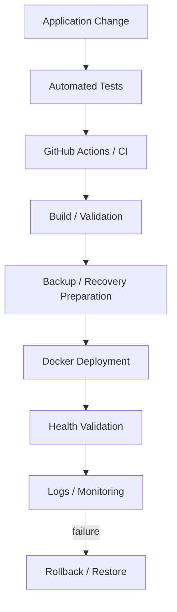

---

# 876. Testing Challenge Map

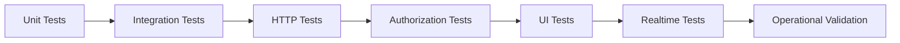

---

# 877. Data Safety Map

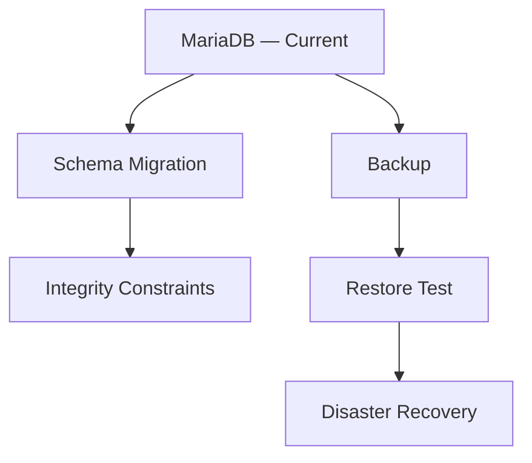

---

# 878. Documentation Governance Map

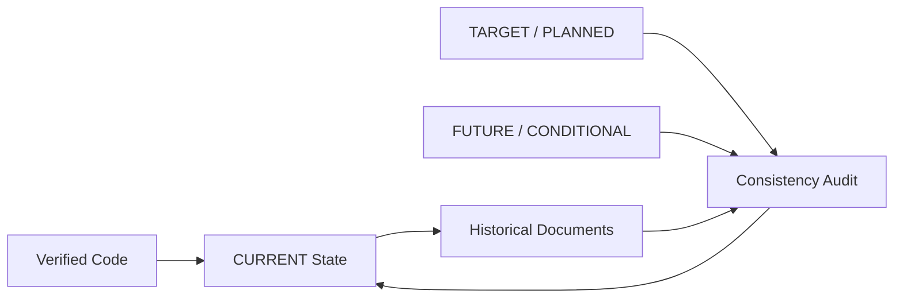

---

# 879. Evidence Hierarchy

Cuando existan contradicciones debe utilizarse una jerarquía de evidencia razonable:

```text
Verified Running Behavior / Code

↓

Tests

↓

Deployment Configuration

↓

Current Technical Documentation

↓

Historical Narrative

↓

Future Design Documentation.
```

---

# 880. Important Qualification

La jerarquía anterior no significa que:

```text
code is always architecturally correct.
```

Significa que para determinar:

```text
what is currently implemented
```

la evidencia verificable prevalece sobre:

```text
stale narrative documentation.
```

---

# 881. Database Invariant

Durante toda la interpretación de los retos:

```text
MariaDB
    CURRENT

PostgreSQL
    FUTURE / CANDIDATE / CONDITIONAL.
```

---

# 882. Authentication Invariant

```text
JWT Access Token
    CURRENT

JWT Refresh Token
    CURRENT

HTTPOnly Cookies
    CURRENT

Explicit Refresh
    CURRENT

Automatic Access Refresh
    CURRENT.
```

---

# 883. Authentication Hardening Invariant

```text
Refresh-token Rotation
    VERIFY / HARDENING

Server-side Revocation
    VERIFY / HARDENING

Reuse Detection
    VERIFY / FUTURE HARDENING

Session / Device Management
    FUTURE.
```

---

# 884. Authorization Invariant

```text
Global RBAC
    CURRENT

Contextual Authorization
    PARTIAL / EVOLVING

ProjectMembership
    TARGET / IN CONSOLIDATION.
```

---

# 885. Realtime Invariant

```text
FastAPI WebSockets
    CURRENT

In-memory Connection Manager
    CURRENT

Selected Realtime Features
    CURRENT

Reconnect
    TARGET / IN PROGRESS

Reconciliation
    TARGET / IN PROGRESS

Distributed Realtime
    FUTURE / CONDITIONAL.
```

---

# 886. Frontend Invariant

```text
Jinja2 SSR
    CURRENT

Bootstrap / AdminLTE
    CURRENT

Modular JavaScript
    CURRENT

Kanban
    PLANNED

Live Kanban
    PLANNED.
```

---

# 887. Infrastructure Invariant

```text
Docker
    CURRENT

Docker Compose
    CURRENT

Nginx
    CURRENT

Ubuntu
    CURRENT

Hetzner VPS
    CURRENT

Redis
    CONDITIONAL

Kubernetes
    CONDITIONAL

Microservices
    CONDITIONAL.
```

---

# 888. Identity Federation Invariant

```text
SAML
    FUTURE / NOT IMPLEMENTED.
```

---

# 889. Storage Invariant

```text
Local / Persistent Attachment Storage
    CURRENT

Object Storage
    FUTURE / CONDITIONAL.
```

---

# 890. Testing Invariant

```text
Automated Testing
    CURRENT

Comprehensive Coverage
    NOT COMPLETE

UI / Realtime / Authorization Expansion
    ONGOING.
```

---

# 891. CI/CD Invariant

```text
GitHub Actions
    CURRENT

CI
    CURRENT

Full CD Maturity
    EVOLVING / VERIFY.
```

---

# 892. Challenge Priority Model

Los retos pueden priorizarse mediante:

```text
Risk

×

Impact

×

Dependency

×

Urgency.
```

---

# 893. P1 — Security and Integrity

Prioridad máxima para:

```text
ProjectMembership

Contextual Authorization

Cross-project Authorization

CSRF

Refresh-token Hardening

Cookie Policy Consistency

WebSocket Authentication

Subscription Authorization.
```

---

# 894. P1 — Reliability Foundations

También:

```text
Realtime Event Contract

Reconnect

Reconciliation

Critical Backup/Restore

Critical Test Coverage.
```

---

# 895. P2 — Maintainability and UX

```text
Shared Fetch Infrastructure

UI Test Expansion

Native Dialog Migration

SSR Query Optimization

Observability Improvements

Documentation Cleanup.
```

---

# 896. P3 — Conditional Architecture

```text
PostgreSQL

Redis

Kubernetes

Microservices

Object Storage

PWA

AI / RAG

Multi-tenancy.
```

---

# 897. P3 Interpretation

`P3` no significa:

```text
planned next.
```

Significa:

```text
do not prioritize
until an explicit trigger exists.
```

---

# 898. Challenge Dependency Principle

Un reto downstream no debe resolverse ignorando:

```text
its upstream dependency.
```

---

# 899. Security Dependency Chain

```text
ProjectMembership

↓

Contextual Authorization

↓

Cross-project Isolation

↓

WebSocket Subscription Authorization

↓

Secure Live Collaboration.
```

---

# 900. Realtime Dependency Chain

```text
Event Contract

↓

Reconnect

↓

Reconciliation

↓

Multi-client Convergence

↓

Live Kanban.
```

---

# 901. Operational Dependency Chain

```text
Backup

↓

Restore Validation

↓

Recovery Procedure

↓

Operational Confidence.
```

---

# 902. Performance Dependency Chain

```text
Measurement

↓

Bottleneck Identification

↓

Optimization

↓

Re-measurement.
```

---

# 903. Architecture Evolution Gate

Antes de introducir una nueva infraestructura debe responderse:

```text
What measured problem
does this solve?
```

---

# 904. Technology Adoption Gate

También:

```text
What complexity does it add?

Who operates it?

How is it tested?

How is it recovered?

What happens when it fails?
```

---

# 905. Technology Rejection Is Not Failure

Decidir no adoptar:

```text
PostgreSQL

Redis

Kubernetes

Microservices
```

mientras no exista necesidad es:

```text
architectural discipline.
```

---

# 906. Simplicity as an Engineering Property

La simplicidad debe entenderse como:

```text
minimum necessary complexity

not

minimum engineering quality.
```

---

# 907. Mature Simplicity

Una solución sencilla puede seguir siendo:

```text
secure

tested

observable

recoverable

well documented.
```

---

# 908. Complexity Budget

Cada nueva tecnología consume:

```text
development capacity

operational capacity

debugging capacity

documentation capacity

security capacity.
```

---

# 909. Therefore

```text
Complexity must earn its place.
```

---

# 910. Security Budget

Cada nuevo endpoint, channel o domain resource aumenta:

```text
security surface.
```

---

# 911. Testing Budget

Cada nueva interaction mode aumenta:

```text
test matrix.
```

---

# 912. Operational Budget

Cada nueva infrastructure component aumenta:

```text
failure modes.
```

---

# 913. Documentation Budget

Cada nueva architecture state aumenta:

```text
consistency maintenance cost.
```

---

# 914. Core Engineering Lesson

La evolución técnica sostenible requiere equilibrar:

```text
feature delivery

security

reliability

maintainability

operability

architectural simplicity.
```

---

# 915. Technical Challenge Register — Architecture

| Challenge | Severity | State |
|---|---:|---|
| Scope evolution | High | ADDRESSED / ONGOING |
| Modular boundaries | High | ONGOING |
| Modular Monolith integrity | High | ONGOING |
| Premature microservices | High | AVOID / CONDITIONAL |
| Architecture-state drift | High | ONGOING |
| Architecture governance | High | ONGOING |

---

# 916. Technical Challenge Register — IAM and Security

| Challenge | Severity | State |
|---|---:|---|
| User / Identity separation | High | ADDRESSED |
| JWT lifecycle | High | CURRENT + HARDENING |
| Cookie policy | High | HARDENING |
| Global RBAC | High | CURRENT |
| ProjectMembership | Critical | TARGET |
| Contextual Authorization | Critical | PARTIAL |
| Cross-project Isolation | Critical | ONGOING |
| CSRF | High | IN PROGRESS / PLANNED |
| SAML | — | FUTURE |

---

# 917. Technical Challenge Register — Persistence

| Challenge | Severity | State |
|---|---:|---|
| MariaDB relational model | High | CURRENT |
| Schema evolution | High | ONGOING |
| Integrity constraints | High | ONGOING |
| Transactions | High | ONGOING |
| Concurrency | High | ONGOING |
| PostgreSQL migration | Conditional | FUTURE / CANDIDATE |
| Backup | Critical | ONGOING |
| Restore | Critical | ONGOING |
| Disaster Recovery | Critical | ONGOING |

---

# 918. Technical Challenge Register — Frontend and Realtime

| Challenge | Severity | State |
|---|---:|---|
| SSR evolution | High | CURRENT / ONGOING |
| Modular JavaScript | Moderate / High | CURRENT |
| Kanban | High | PLANNED |
| Drag and Drop | High | PLANNED |
| WebSockets | High | CURRENT |
| Connection Authentication | Critical | HARDENING |
| Subscription Authorization | Critical | TARGET |
| Event Contract | High | PARTIAL / TARGET |
| Reconnect | Critical | TARGET / IN PROGRESS |
| Reconciliation | Critical | TARGET / IN PROGRESS |
| Multi-client Convergence | Critical | PARTIAL / TARGET |
| Redis | Conditional | NOT CURRENT |
| Live Kanban | Critical | PLANNED |

---

# 919. Technical Challenge Register — Testing and Operations

| Challenge | Severity | State |
|---|---:|---|
| Automated Testing | Critical | CURRENT / EXPANDING |
| Authorization Testing | Critical | EXPANSION REQUIRED |
| UI Testing | High | EXPANDING |
| Realtime Testing | Critical | EXPANDING |
| Query Optimization | High | MEASUREMENT-DRIVEN |
| Observability | High | ONGOING |
| CI | High | CURRENT |
| CD Maturity | High | EVOLVING |
| Deployment Safety | Critical | ONGOING |
| Secret Management | Critical | CONTINUOUS |
| Backup / Restore | Critical | ONGOING |

---

# 920. Technical Challenge Register — Conditional Future

| Capability | State | Trigger |
|---|---|---|
| PostgreSQL | FUTURE / CONDITIONAL | Concrete DB requirement |
| SAML | FUTURE | Federated identity requirement |
| Redis | CONDITIONAL | Cross-instance coordination |
| Kubernetes | CONDITIONAL | Orchestration requirement |
| Microservices | CONDITIONAL | Independent scaling/lifecycle |
| Object Storage | CONDITIONAL | Shared/scalable file storage |
| PWA | FUTURE | Product requirement |
| AI / RAG | FUTURE / EXPERIMENTAL | Validated product use case |
| Multi-tenancy | FUTURE / CONDITIONAL | Product/business requirement |

---

# 921. Challenge Review Checklist

Para cada nuevo reto:

```text
[ ] Is the problem real or hypothetical?

[ ] What evidence demonstrates it?

[ ] Which layer owns it?

[ ] Is it security-sensitive?

[ ] Is data integrity involved?

[ ] Does it affect authorization?

[ ] Does it affect deployment?

[ ] Does it affect recovery?

[ ] Which tests prove the solution?

[ ] Is the proposed solution simpler than the problem requires?
```

---

# 922. Architecture Review Checklist

```text
[ ] Does the change preserve Modular Monolith boundaries?

[ ] Does it introduce unnecessary coupling?

[ ] Does it duplicate shared infrastructure?

[ ] Does it introduce a new source of truth?

[ ] Does it require a new technology?

[ ] Is that technology justified by evidence?
```

---

# 923. Security Review Checklist

```text
[ ] Authentication enforced?

[ ] Global authorization enforced?

[ ] Contextual authorization enforced?

[ ] Nested resource ancestry validated?

[ ] Cross-project leakage prevented?

[ ] Browser mutation protected?

[ ] Sensitive information minimized?

[ ] Realtime subscription protected?
```

---

# 924. Persistence Review Checklist

```text
[ ] MariaDB compatibility verified?

[ ] Migration required?

[ ] Existing data preserved?

[ ] Constraints defined?

[ ] Transaction boundary defined?

[ ] Concurrency considered?

[ ] Backup implications considered?
```

---

# 925. Realtime Review Checklist

```text
[ ] Connection authenticated?

[ ] Subscription authorized?

[ ] Event contract defined?

[ ] Payload minimized?

[ ] Disconnect handled?

[ ] Reconnect handled?

[ ] Reconciliation available?

[ ] Duplicate behavior safe?

[ ] Multi-client isolation tested?
```

---

# 926. Testing Review Checklist

```text
[ ] Happy path covered?

[ ] Validation failure covered?

[ ] Authentication failure covered?

[ ] Authorization failure covered?

[ ] Cross-context failure covered?

[ ] Persistence behavior covered?

[ ] UI behavior covered where necessary?

[ ] Realtime behavior covered where necessary?
```

---

# 927. Operational Review Checklist

```text
[ ] Configuration documented?

[ ] Secrets protected?

[ ] Deployment repeatable?

[ ] Health verifiable?

[ ] Logs useful?

[ ] Backup impact understood?

[ ] Restore possible?

[ ] Rollback/recovery defined?
```

---

# 928. Documentation Review Checklist

```text
[ ] CURRENT vs FUTURE explicit?

[ ] No invented implementation?

[ ] No invented migration?

[ ] No stale filename?

[ ] Cross-reference valid?

[ ] Historical claim supported?

[ ] Candidate architecture labeled?
```

---

# 929. Global Search — Database Consistency

Debe auditarse:

```text
PostgreSQL
```

y comprobar que cada aparición sea:

```text
FUTURE

CANDIDATE

CONDITIONAL

comparison

or migration possibility.
```

Nunca:

```text
current authoritative database.
```

---

# 930. Global Search — MariaDB Consistency

Debe comprobarse que:

```text
MariaDB
```

permanece como:

```text
CURRENT relational database.
```

---

# 931. Global Search — Authentication Consistency

Buscar:

```text
refresh token

refresh-token

refresh_token
```

y evitar que el workflow existente aparezca como:

```text
missing future capability.
```

---

# 932. Global Search — SAML Consistency

Buscar:

```text
SAML
```

y verificar:

```text
FUTURE / NOT IMPLEMENTED.
```

---

# 933. Global Search — Realtime Consistency

Buscar:

```text
Redis

distributed realtime

broker
```

y verificar que no aparezcan como:

```text
CURRENT.
```

---

# 934. Global Search — Kanban Consistency

Buscar:

```text
Kanban

drag and drop

Live Kanban
```

y distinguir:

```text
Task status workflow
    CURRENT

Kanban UI
    PLANNED

Live Kanban
    PLANNED.
```

---

# 935. Global Search — Infrastructure Consistency

Buscar:

```text
Kubernetes

microservices
```

y verificar:

```text
CONDITIONAL / NOT CURRENT.
```

---

# 936. Global Search — Storage Consistency

Buscar:

```text
S3

object storage

distributed storage
```

y verificar:

```text
FUTURE / CONDITIONAL.
```

---

# 937. Global Search — Authorization Consistency

Buscar:

```text
ProjectMembership

contextual authorization
```

y evitar describir ambos como:

```text
fully mature current architecture.
```

---

# 938. Correct Status

```text
ProjectMembership
    TARGET / IN CONSOLIDATION

Contextual Authorization
    PARTIAL / EVOLVING.
```

---

# 939. Global Search — Documentation References

Validar:

```text
37_LOGGING.md

58_TECHNICAL_CHALLENGES.md

61_LESSONS_LEARNED.md.
```

---

# 940. Technical Challenge Maturity Model

```text
Level 1
    Problem discovered

Level 2
    Problem understood

Level 3
    Boundary defined

Level 4
    Solution implemented

Level 5
    Solution tested

Level 6
    Solution observable

Level 7
    Solution operationally recoverable.
```

---

# 941. Security Maturity

Una capability security-sensitive no debería considerarse madura únicamente porque:

```text
the happy path works.
```

---

# 942. Security Maturity Requires

```text
negative tests

cross-context tests

failure handling

configuration safety

operational visibility.
```

---

# 943. Realtime Maturity

Realtime no debería considerarse maduro únicamente porque:

```text
two browser windows update successfully
during a demo.
```

---

# 944. Realtime Maturity Requires

```text
authorization

disconnect tolerance

reconnect

reconciliation

multi-client convergence

test coverage.
```

---

# 945. Database Maturity

Persistencia no debería considerarse madura únicamente porque:

```text
ORM CRUD works.
```

---

# 946. Database Maturity Requires

```text
constraints

migrations

transactions

backup

restore

performance understanding.
```

---

# 947. Operational Maturity

Deployment no debería considerarse maduro únicamente porque:

```text
docker compose up
```

funciona.

---

# 948. Operational Maturity Requires

```text
repeatability

configuration control

health verification

monitoring

backup

restore

recovery.
```

---

# 949. Documentation Maturity

Documentación no debería considerarse madura únicamente porque:

```text
it is extensive.
```

---

# 950. Documentation Maturity Requires

```text
accuracy

consistency

traceability

current/future separation

valid references.
```

---

# 951. Final Architecture Challenge Model

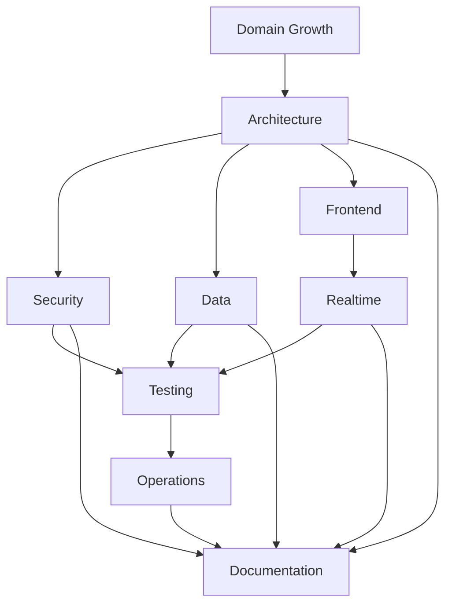

---

# 952. Final Current Architecture Snapshot

```text
Architecture
    Modular Monolith

Backend
    FastAPI

Persistence
    SQLAlchemy
    MariaDB

Frontend
    Jinja2 SSR
    Bootstrap
    AdminLTE
    Modular JavaScript

Authentication
    JWT Access Token
    JWT Refresh Token
    HTTPOnly Cookies
    Explicit Refresh
    Automatic Access Refresh

Authorization
    Global RBAC
    Contextual Authorization PARTIAL

Realtime
    FastAPI WebSockets
    In-memory Connection Manager

Storage
    Local / Persistent Attachments

Infrastructure
    Docker
    Docker Compose
    Nginx
    Ubuntu
    Hetzner VPS

Automation
    GitHub Actions
    Automated Testing.
```

---

# 953. Final Target / Planned Snapshot

```text
ProjectMembership consolidation

Contextual Authorization expansion

Cross-project Authorization coverage

Formal CSRF Protection

Refresh-token Security Hardening

Cookie Policy Centralization

WebSocket Authentication Hardening

WebSocket Subscription Authorization

Realtime Event Contract Normalization

Reconnect

State Reconciliation

Kanban

Drag and Drop

Live Kanban

UI Test Expansion

Realtime Test Expansion

Performance Hardening.
```

---

# 954. Final Future / Conditional Snapshot

```text
PostgreSQL migration

SAML

Redis

Distributed Realtime

Kubernetes

Microservices

Object Storage

PWA

AI / RAG

Multi-tenancy

advanced distributed infrastructure.
```

---

# 955. Final Database Rule

```text
MariaDB is the current database.

PostgreSQL is not
a completed evolution.

Any PostgreSQL adoption
requires a future explicit decision.
```

---

# 956. Final Authentication Rule

```text
Refresh tokens already exist.

The challenge is not
to introduce refresh tokens.

The challenge is
to harden their lifecycle.
```

---

# 957. Final Authorization Rule

```text
Global RBAC is necessary.

Global RBAC alone
is insufficient
for collaborative project resources.
```

---

# 958. Final Context Rule

```text
Authorization must increasingly consider:

actor

role

relationship

resource

context

operation.
```

---

# 959. Final Browser Security Rule

```text
HTTPOnly cookies improve token protection.

They do not remove
the need for CSRF protection
and consistent cookie policy.
```

---

# 960. Final Realtime Rule

```text
WebSockets are current.

Reliable distributed realtime is not.

First solve:

authentication

authorization

contracts

reconnect

reconciliation.
```

---

# 961. Final Kanban Rule

```text
Task status workflow
does not imply
completed Kanban.

Kanban and Live Kanban
remain planned evolution.
```

---

# 962. Final Scaling Rule

```text
Do not distribute
what does not yet need distribution.
```

---

# 963. Final Infrastructure Rule

```text
Docker Compose is not
an immature Kubernetes.

It is the current deployment architecture
appropriate to the present platform context.
```

---

# 964. Final Microservice Rule

```text
A Modular Monolith
is not a temporary failure
to become microservices.

It is the current
architectural choice.
```

---

# 965. Final Storage Rule

```text
Local attachment storage
is current.

Object storage becomes relevant
only when deployment requirements
justify it.
```

---

# 966. Final Testing Rule

```text
Test the boundaries
where failure matters most:

security

data

integration

realtime

recovery.
```

---

# 967. Final Performance Rule

```text
Measure before optimizing.
```

---

# 968. Final Operations Rule

```text
If the platform cannot be restored,
the backup strategy is incomplete.
```

---

# 969. Final Observability Rule

```text
A failure that cannot be understood
will be expensive to fix.
```

---

# 970. Final Documentation Rule

```text
Detailed architecture documentation

must never be interpreted as

implementation evidence.
```

---

# 971. Final Historical Rule

```text
Do not rewrite
planned architecture

as

completed history.
```

---

# 972. Final Evidence Rule

```text
When current documentation conflicts
with verified implementation:

verify the code

verify the tests

verify the deployment

then correct the documentation.
```

---

# 973. Final Complexity Rule

```text
Every new technology
must solve a problem
large enough to justify
the complexity it introduces.
```

---

# 974. Final Security Rule

```text
Security is not one module.

It is a property
of every platform boundary.
```

---

# 975. Final Reliability Rule

```text
Reliable systems assume:

requests fail

connections disappear

clients become stale

deployments fail

data must be recovered.
```

---

# 976. Final Engineering Rule

```text
Prefer explicit boundaries

over implicit assumptions.
```

---

# 977. Final Platform Challenge

El reto técnico global de Aula Robótica Platform no es simplemente:

```text
adding more features.
```

Es:

```text
allowing the platform to grow

without losing

security

data integrity

architectural coherence

operational simplicity

recoverability

and

maintainability.
```

---

# 978. Final Perspective

La evolución técnica saludable puede resumirse como:

```text
Simple

↓

Structured

↓

Secure

↓

Tested

↓

Observable

↓

Recoverable

↓

Scalable when required.
```

---

# 979. Technical Evolution Principle

El orden importa.

No debe convertirse en:

```text
Simple

↓

Distributed

↓

Complex

↓

then attempt to make it reliable.
```

---

# 980. Preferred Evolution

```text
Correctness first.

Security second.

Reliability next.

Optimization after measurement.

Distribution only when justified.
```

---

# 981. Long-term Engineering Objective

Aula Robótica Platform debe poder incorporar nuevos dominios sin obligar a:

```text
rewrite IAM

replace persistence

duplicate authorization

replace SSR

rebuild deployment

or

invent new infrastructure
for every module.
```

---

# 982. Architectural Success Criterion

La arquitectura tendrá éxito si:

```text
new capabilities can be added

while

shared foundations remain stable

and

domain boundaries remain understandable.
```

---

# 983. Security Success Criterion

La seguridad tendrá éxito si:

```text
a user can access

exactly

the resources and operations

that the platform authorizes

and nothing else.
```

---

# 984. Data Success Criterion

La persistencia tendrá éxito si:

```text
valid data survives

invalid states are rejected

schema changes preserve information

and

recovery is possible.
```

---

# 985. Realtime Success Criterion

Realtime tendrá éxito si:

```text
authorized clients receive timely awareness

while

persistent state remains authoritative

and

clients can recover after interruption.
```

---

# 986. Testing Success Criterion

Testing tendrá éxito si:

```text
critical regressions

especially security,
data,
and collaboration regressions

are detected before release.
```

---

# 987. Operations Success Criterion

Operaciones tendrá éxito si:

```text
the platform can be

deployed

observed

diagnosed

backed up

restored

and recovered

predictably.
```

---

# 988. Documentation Success Criterion

La documentación tendrá éxito si permite distinguir inequívocamente:

```text
what exists

what is incomplete

what is planned

what is future

and

what is merely conditional.
```

---

# 989. Current Most Important Technical Challenges

En el estado actual, los retos de mayor impacto son:

```text
1. ProjectMembership consolidation

2. Contextual Authorization

3. Cross-project isolation

4. Formal CSRF Protection

5. Refresh-token Security Hardening

6. Cookie Policy Consistency

7. WebSocket Authentication Hardening

8. Subscription Authorization

9. Realtime Event Contract

10. Reconnect

11. Reconciliation

12. Multi-client Realtime Testing

13. Backup / Restore Confidence

14. Operational Observability

15. Documentation Consistency.
```

---

# 990. Challenges That Must Not Be Artificially Promoted

No deben convertirse en prioridad sin trigger:

```text
PostgreSQL migration

Redis

Kubernetes

Microservices

Object Storage

PWA

AI / RAG

Multi-tenancy.
```

---

# 991. Trigger-based Evolution

Estas capabilities deben seguir el patrón:

```text
Need

↓

Evidence

↓

Evaluation

↓

Decision

↓

Implementation

↓

Validation

↓

Documentation.
```

---

# 992. Not

```text
Interesting Technology

↓

Documentation

↓

Assumed Architecture

↓

Artificial Migration.
```

---

# 993. Final Challenge Governance Loop


---

# 994. Final Challenge Classification

```text
Implemented foundations
    should be preserved.

Partial foundations
    should be hardened.

Target capabilities
    should be implemented deliberately.

Future capabilities
    should remain future.

Conditional capabilities
    should wait for triggers.
```

---

# 995. Final Current-state Guardrail

```text
CURRENT

FastAPI
SQLAlchemy
MariaDB
Modular Monolith
Jinja2 SSR
Bootstrap / AdminLTE
Modular JavaScript
JWT Access Token
JWT Refresh Token
HTTPOnly Cookies
Explicit Refresh
Automatic Access Refresh
Global RBAC
Projects
Tasks
Activities
Attachments
Notifications
Dashboard
Activity Feed
Audit
FastAPI WebSockets
In-memory Connection Manager
Docker
Docker Compose
Nginx
Ubuntu
Hetzner VPS
GitHub Actions
Automated Testing.
```

---

# 996. Final Partial-state Guardrail

```text
PARTIAL / EVOLVING

Contextual Authorization

Project Membership maturity

Realtime reliability

WebSocket security hardening

UI test coverage

Realtime test coverage

Security hardening

Performance maturity

Observability maturity.
```

---

# 997. Final Target-state Guardrail

```text
TARGET / PLANNED

ProjectMembership consolidation

Cross-project Authorization expansion

Formal CSRF Protection

Refresh-token Security Hardening

Cookie Policy Centralization

WebSocket Authentication Hardening

Subscription Authorization

Realtime Event Contract normalization

Reconnect

Reconciliation

Kanban

Drag and Drop

Live Kanban.
```

---

# 998. Final Future-state Guardrail

```text
FUTURE / CONDITIONAL

PostgreSQL

SAML

Redis-backed distributed realtime

Kubernetes

Microservices

Object Storage

PWA

AI / RAG

Multi-tenancy

multi-region architecture.
```

---

# 999. Final Summary

Los principales retos técnicos de Aula Robótica Platform no proceden de una única tecnología.

Proceden de la interacción entre:

```text
growing domain complexity

identity

authentication

authorization

browser security

relational integrity

SSR

JavaScript

realtime collaboration

testing

operations

and

architecture governance.
```

La plataforma dispone actualmente de una base sólida:

```text
FastAPI

SQLAlchemy

MariaDB

Modular Monolith

JWT access + refresh

HTTPOnly cookies

Global RBAC

Jinja2 SSR

Modular JavaScript

WebSockets

Docker-based deployment

Automated testing.
```

La siguiente fase de madurez debe concentrarse especialmente en:

```text
contextual authorization

ProjectMembership

CSRF

refresh-token hardening

cookie-policy consistency

WebSocket security

reconnect

reconciliation

cross-project tests

realtime tests

backup/restore confidence

observability.
```

Y debe evitar convertir prematuramente en arquitectura actual:

```text
PostgreSQL

SAML

Redis

Kubernetes

Microservices

Object Storage

PWA

AI / RAG

Multi-tenancy.
```

---

# 1000. Conclusion

El reto técnico fundamental de Aula Robótica Platform puede expresarse como:

```text
Grow without losing control.
```

Eso implica:

```text
preserve architectural boundaries

protect authorization context

maintain data integrity

harden existing authentication

treat realtime as recoverable communication

test critical boundaries

measure before optimizing

prepare for failure

document implementation truth

and

introduce complexity only when justified.
```

La arquitectura debe evolucionar siguiendo:

```text
Current Need

↓

Verified Problem

↓

Appropriate Design

↓

Implementation

↓

Testing

↓

Operational Validation

↓

Accurate Documentation.
```

Y nunca:

```text
Future Idea

↓

Documentation

↓

Assumed Implementation

↓

False Architectural History.
```

La regla final es:

```text
Solve the problem that exists.

Preserve what already works.

Harden what is incomplete.

Measure before scaling.

Recover from failure.

Document the truth.
```
