# 59_IMPLEMENTATION_TIMELINE.md

# Aula Robótica Platform — Implementation Timeline

## Parte 1/3 — Origen, foundations, arquitectura base, IAM, colaboración, servicios transversales, frontend y consolidación de seguridad

---

# 1. Document Purpose

Este documento define la evolución temporal de **Aula Robótica Platform**, desde sus primeras foundations hasta su consolidación prevista como una plataforma modular, segura, colaborativa y operativamente madura.

El timeline no debe interpretarse únicamente como:

```text
a chronological list of completed features.
```

Representa también:

```text
technical evolution

architectural maturity

product evolution

security hardening

operational maturity

future sequencing.
```

---

# 2. Historical Integrity Principle

Este documento debe preservar una separación estricta entre:

```text
what happened

what exists now

what is being consolidated

what is planned

what remains conditional.
```

---

# 3. Timeline Objective

El objetivo principal es responder de forma trazable a:

```text
Where did the platform start?

What was actually implemented?

Why did the architecture evolve?

Which foundations were introduced first?

Which capabilities depend on previous work?

What is being consolidated now?

What should be implemented next?

Which capabilities intentionally remain future work?
```

---

# 4. Timeline Philosophy

La evolución del proyecto sigue una estrategia:

```text
Foundation

↓

Core Platform

↓

Domain Capabilities

↓

Security Consolidation

↓

Collaborative Experience

↓

Reliability

↓

Operational Maturity

↓

Controlled Expansion.
```

---

# 5. Timeline Is Not a Fixed Calendar

Este documento no pretende imponer:

```text
artificial dates
```

a trabajo que depende de:

```text
technical discovery

risk

validation

product priorities

available development capacity.
```

---

# 6. Timeline Model

Por ello se combinan:

```text
historical phases

current implementation phases

active consolidation

near-term phases

medium-term phases

future evolution phases.
```

---

# 7. Timeline Status Vocabulary

Cada bloque puede clasificarse como:

```text
COMPLETED

CURRENT

PARTIAL

ACTIVE

NEXT

TARGET

PLANNED

FUTURE

CONDITIONAL.
```

---

# 8. COMPLETED

Significa:

```text
the relevant historical milestone
was actually implemented
and became part of platform evolution.
```

---

# 9. CURRENT

Significa:

```text
verified capability
that belongs to the present platform baseline.
```

---

# 10. PARTIAL

Significa:

```text
the capability exists,
but its intended maturity
has not yet been fully reached.
```

---

# 11. ACTIVE

Significa:

```text
currently being implemented,
consolidated,
tested,
or hardened.
```

---

# 12. NEXT

Significa:

```text
highest-priority work
after the active implementation cluster.
```

---

# 13. TARGET

Significa:

```text
accepted architectural or engineering direction
that the platform is moving toward.
```

---

# 14. PLANNED

Significa:

```text
accepted future capability
with meaningful architectural relevance,
but not necessarily scheduled immediately.
```

---

# 15. FUTURE

Significa:

```text
valuable capability
outside the current implementation horizon.
```

---

# 16. CONDITIONAL

Significa:

```text
implementation depends on
an explicit future trigger.
```

---

# 17. Example Conditional Capability

```text
Redis
```

should not be introduced merely because:

```text
realtime exists.
```

---

# 18. Redis Trigger

Redis becomes relevant when a concrete requirement appears, such as:

```text
multiple application instances

requiring

cross-instance realtime coordination.
```

---

# 19. Another Conditional Capability

```text
Kubernetes
```

does not become necessary merely because:

```text
the platform uses containers.
```

---

# 20. Kubernetes Trigger

Its evaluation requires actual operational pressure such as:

```text
orchestration complexity

multiple replicas

high availability requirements

or

significantly more complex deployment topology.
```

---

# 21. Timeline Accuracy Principle

Este documento debe distinguir claramente:

```text
implemented

from

planned.
```

---

# 22. Historical Honesty

No debe presentarse una capability futura como:

```text
already delivered.
```

---

# 23. Documentation Is Not Implementation

La existencia de:

```text
detailed architecture

roadmaps

design documents

future diagrams
```

no demuestra:

```text
runtime implementation.
```

---

# 24. Evidence Principle

Para determinar el estado actual debe priorizarse:

```text
verified implementation

tests

runtime configuration

deployment evidence

current technical documentation.
```

---

# 25. Historical Narrative Rule

Los documentos históricos deben describir:

```text
verified evolution
```

y no transformar:

```text
target architecture
```

en:

```text
completed history.
```

---

# 26. Timeline Sources of Truth

El timeline debe mantenerse coherente con:

```text
47_PRODUCT_ROADMAP.md

49_FEATURE_BACKLOG.md

50_WEEKLY_UPDATE.md

52_ARCHITECTURAL_DECISIONS.md

53_CURRENT_TASKS.md

54_KNOWN_ISSUES.md

55_CHANGELOG.md

56_TECHNICAL_DEBT.md

57_PROJECT_EVOLUTION.md

58_TECHNICAL_CHALLENGES.md

60_MAJOR_DECISIONS.md

61_LESSONS_LEARNED.md

62_FUTURE_EVOLUTION.md.
```

---

# 27. Current Database Truth

La base de datos relacional actualmente utilizada es:

```text
MariaDB.
```

Estado:

```text
CURRENT
```

---

# 28. PostgreSQL Timeline Boundary

PostgreSQL puede aparecer en este timeline únicamente como:

```text
FUTURE

CANDIDATE

or

CONDITIONAL.
```

---

# 29. No Historical PostgreSQL Migration

No debe describirse una evolución:

```text
MariaDB

↓

PostgreSQL
```

como:

```text
completed historical migration.
```

---

# 30. Correct Persistence Timeline

La evolución real debe mantenerse como:

```text
Relational Persistence

↓

SQLAlchemy

↓

MariaDB

↓

Schema / Query / Operational Maturity

↓

Possible future database evaluation
only if justified.
```

---

# 31. Current Authentication Truth

La plataforma dispone actualmente de:

```text
JWT access token

JWT refresh token

HTTPOnly cookies

explicit refresh endpoint

automatic access refresh

refresh-token validation

logout token cleanup.
```

Estado:

```text
CURRENT
```

---

# 32. Refresh-token Timeline Boundary

No debe aparecer como trabajo futuro:

```text
implement refresh tokens.
```

---

# 33. Correct Refresh-token Evolution

La evolución pendiente corresponde a:

```text
rotation verification / hardening

server-side revocation verification

reuse detection

session/device management

cookie-policy consistency.
```

---

# 34. Current Authorization Truth

```text
Global RBAC
    CURRENT

Contextual Authorization
    PARTIAL / EVOLVING

ProjectMembership
    TARGET / IN CONSOLIDATION.
```

---

# 35. SAML Timeline Boundary

```text
SAML
    FUTURE / NOT IMPLEMENTED
```

---

# 36. Current Realtime Truth

```text
FastAPI WebSockets
    CURRENT

In-memory Connection Manager
    CURRENT

Selected realtime features
    CURRENT.
```

---

# 37. Realtime Reliability Boundary

```text
Reconnect
    TARGET / IN PROGRESS

Reconciliation
    TARGET / IN PROGRESS

Distributed Realtime
    FUTURE / CONDITIONAL.
```

---

# 38. Current Frontend Truth

```text
Jinja2 SSR
    CURRENT

Bootstrap
    CURRENT

AdminLTE
    CURRENT

Modular JavaScript
    CURRENT.
```

---

# 39. Kanban Timeline Boundary

```text
Task status workflow
    CURRENT

Kanban UI
    PLANNED

Drag and Drop
    PLANNED

Live Kanban
    PLANNED.
```

---

# 40. Current Infrastructure Truth

```text
Docker
    CURRENT

Docker Compose
    CURRENT

Nginx
    CURRENT

Ubuntu
    CURRENT

Hetzner VPS
    CURRENT

GitHub Actions
    CURRENT.
```

---

# 41. Conditional Infrastructure Truth

```text
Redis
    CONDITIONAL

Kubernetes
    CONDITIONAL

Microservices
    CONDITIONAL

Object Storage
    FUTURE / CONDITIONAL.
```

---

# 42. Timeline Overview

La evolución global puede resumirse como:

```text
Initial Application

↓

Authentication and Administration

↓

Core Platform Foundations

↓

Project Collaboration

↓

Cross-cutting Capabilities

↓

Security Consolidation

↓

Realtime Collaboration

↓

Testing Consolidation

↓

Production Hardening

↓

Domain Expansion

↓

Advanced Platform Capabilities.
```

---

# 43. High-level Timeline

```mermaid
flowchart LR
    A[Initial Application]
    B[Core Foundations]
    C[Project Collaboration]
    D[Platform Services]
    E[Security Hardening]
    F[Realtime Reliability]
    G[Production Readiness]
    H[Domain Expansion]
    I[Advanced Evolution]

    A --> B
    B --> C
    C --> D
    D --> E
    E --> F
    F --> G
    G --> H
    H --> I
```

---

# 44. Implementation Strategy

The implementation timeline follows:

```text
dependency before convenience.
```

---

# 45. Meaning

Una feature visualmente atractiva no debe adelantarse a una foundation crítica de la que depende.

---

# 46. Example

```text
Live Kanban
```

depende de:

```text
ProjectMembership

Contextual Authorization

secure Task mutations

WebSocket Security

Subscription Authorization

Event Contracts

Reconnect

Reconciliation

Multi-client Testing.
```

---

# 47. Therefore

The implementation sequence should be:

```text
secure foundation

↓

reliable state mutation

↓

reliable transport

↓

recovery

↓

collaborative UX.
```

---

# 48. Timeline Principle — Security Before Exposure

Antes de ampliar el acceso a una resource:

```text
authorization model
```

debe estar suficientemente definido.

---

# 49. Timeline Principle — Integrity Before Automation

Antes de automatizar workflows:

```text
domain invariants
```

deben estar suficientemente protegidas.

---

# 50. Timeline Principle — Reliability Before Scale

Antes de horizontal scaling:

```text
single-instance behavior
```

debe ser fiable.

---

# 51. Timeline Principle — Recovery Before Criticality

Antes de considerar production maturity:

```text
backup

and

restore
```

deben estar probados.

---

# 52. Timeline Principle — Evidence Before Infrastructure

Nueva infraestructura debe responder a:

```text
measured

or

demonstrated need.
```

---

# 53. Timeline Principle — Platform Before Specialized Domains

Shared capabilities should precede:

```text
Academic

Inventory

Reservations

Competitions

AI.
```

---

# 54. Timeline Principle — Evolution Without Rewrite

Whenever possible:

```text
extend

harden

refactor incrementally
```

instead of:

```text
rewrite.
```

---

# 55. Timeline Principle — Preserve Working Foundations

La evolución debe distinguir entre:

```text
missing capability
```

y:

```text
existing capability requiring hardening.
```

---

# 56. Example

Refresh tokens pertenecen a:

```text
existing capability requiring hardening.
```

No a:

```text
missing authentication capability.
```

---

# 57. Timeline Principle — State Before Presentation

Una UI colaborativa debe representar:

```text
authoritative domain state.
```

---

# 58. Example

```text
Kanban
```

debe construirse sobre:

```text
Task state

authorized mutation

persistent state

reliable recovery.
```

---

# 59. Timeline Phase Model

The implementation history and future evolution are organized into:

```text
Phase 0 — Project Genesis

Phase 1 — Initial Application Foundation

Phase 2 — Authentication and IAM Foundation

Phase 3 — Core Platform Architecture

Phase 4 — Project Collaboration Foundation

Phase 5 — Cross-cutting Platform Services

Phase 6 — Frontend Interaction Layer

Phase 7 — Security Consolidation

Phase 8 — Realtime Foundation

Phase 9 — Realtime Reliability

Phase 10 — Testing Consolidation

Phase 11 — Operational Maturity

Phase 12 — Production Readiness

Phase 13 — Platform Domain Expansion

Phase 14 — Advanced Platform Evolution.
```

---

# 60. Phase Dependencies

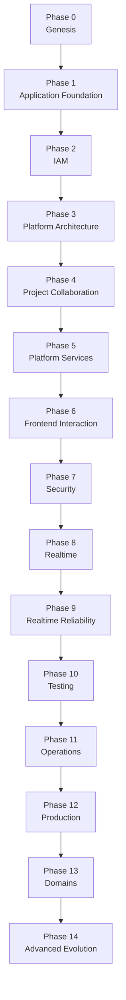

---

# 61. Important Interpretation

These phases are:

```text
architectural sequences
```

rather than necessarily:

```text
strict non-overlapping calendar periods.
```

---

# 62. Parallel Work

Some concerns naturally evolve in parallel.

---

# 63. Testing Example

Testing evolves throughout:

```text
IAM

Projects

Tasks

Attachments

Realtime

Operations.
```

---

# 64. Documentation Example

Documentation evolves throughout:

```text
the entire project lifecycle.
```

---

# 65. Security Example

Security hardening evolves across:

```text
authentication

authorization

browser security

files

realtime

operations.
```

---

# 66. Phase 0 — Project Genesis

```text
Status:
    COMPLETED
```

---

# 67. Initial Context

The project originated from a more specific robotics-oriented application context.

---

# 68. Early Product Scope

The initial focus was closer to:

```text
robotics / Eurobot-related management
```

than to a generic institutional platform.

---

# 69. Initial Engineering Goal

Build a usable application capable of managing:

```text
users

basic authenticated workflows

administrative information

domain-oriented functionality.
```

---

# 70. Initial Architectural Character

The earliest architecture was intentionally simpler.

---

# 71. Main Characteristics

```text
server-rendered application

relational persistence

authentication

administrative UI

domain-oriented CRUD.
```

---

# 72. Why This Was Appropriate

At project genesis, the dominant risk was:

```text
building useful functionality.
```

---

# 73. It Was Not Yet

```text
multi-domain platform architecture

complex realtime collaboration

horizontal scalability

AI infrastructure.
```

---

# 74. Phase 0 Achievement

The project demonstrated:

```text
technical viability

domain usefulness

ability to evolve beyond prototype.
```

---

# 75. Phase 0 Architectural Lesson

```text
Start with enough architecture
to support the current product,
not the imagined final platform.
```

---

# 76. Phase 0 Exit Condition

The phase evolved when the application required:

```text
stronger identity

clearer architecture

richer collaboration

and

reusable platform capabilities.
```

---

# 77. Phase 1 — Initial Application Foundation

```text
Status:
    COMPLETED / CURRENT FOUNDATION
```

---

# 78. Primary Goal

Create a stable web application foundation.

---

# 79. Backend Foundation

The backend evolved around:

```text
FastAPI.
```

Estado actual:

```text
CURRENT
```

---

# 80. Why FastAPI Fit

It provides:

```text
clear routing

dependency injection

validation

async capability

WebSocket support

Python ecosystem integration.
```

---

# 81. Persistence Foundation

The application uses:

```text
SQLAlchemy

+

MariaDB.
```

---

# 82. Current Persistence Baseline

```text
SQLAlchemy
    CURRENT

MariaDB
    CURRENT.
```

---

# 83. Persistence Goal

Provide:

```text
relational integrity

transactional persistence

clear domain relationships

controlled schema evolution.
```

---

# 84. Server-rendered UI

The initial and current frontend foundation uses:

```text
Jinja2 SSR.
```

---

# 85. UI Foundation

The presentation layer incorporates:

```text
Bootstrap

AdminLTE.
```

---

# 86. Current Frontend Baseline

```text
Jinja2 SSR
    CURRENT

Bootstrap
    CURRENT

AdminLTE
    CURRENT.
```

---

# 87. SSR Advantage

SSR provided:

```text
simple initial delivery

server-authoritative rendering

direct integration with authorization

lower frontend complexity.
```

---

# 88. Initial Deployment Direction

The application evolved toward containerized deployment.

---

# 89. Current Deployment Foundation

```text
Docker

Docker Compose

Nginx

Ubuntu

Hetzner VPS.
```

---

# 90. Phase 1 Architectural Achievement

The application acquired a stable baseline:

```text
FastAPI

SQLAlchemy

MariaDB

Jinja2 SSR

Bootstrap / AdminLTE

containerized deployment.
```

---

# 91. Phase 1 Non-goals

This phase did not require:

```text
PostgreSQL migration

Redis

Kubernetes

Microservices

SPA rewrite.
```

---

# 92. Phase 1 Exit Condition

The application foundation became sufficiently stable to support:

```text
identity

authentication

authorization

administration.
```

---

# 93. Phase 2 — Authentication and IAM Foundation

```text
Status:
    COMPLETED FOUNDATION
    + ACTIVE HARDENING
```

---

# 94. Primary Goal

Establish:

```text
identity

authentication

roles

session/token lifecycle

administrative access control.
```

---

# 95. User Model

The platform introduced:

```text
User
```

as a core application identity concept.

---

# 96. Identity Separation

Authentication concerns evolved toward clearer separation between:

```text
user identity

credentials / authentication

authorization roles.
```

---

# 97. Why Separation Matters

A user is not equivalent to:

```text
a password record.
```

---

# 98. Authentication Foundation

JWT became part of the authentication architecture.

---

# 99. Current Token Model

```text
JWT Access Token
    CURRENT

JWT Refresh Token
    CURRENT.
```

---

# 100. Browser Token Storage

The web authentication flow uses:

```text
HTTPOnly cookies.
```

Estado:

```text
CURRENT
```

---

# 101. Login Flow

The current implementation follows conceptually:

```text
Credentials

↓

Authenticate User

↓

Create Access Token

+

Create Refresh Token

↓

Store both in HTTPOnly cookies.
```

---

# 102. Explicit Refresh

The platform provides an explicit:

```text
/refresh
```

workflow.

Estado:

```text
CURRENT
```

---

# 103. Refresh Validation

The refresh workflow validates:

```text
refresh token
```

before issuing:

```text
new access token.
```

---

# 104. Automatic Access Refresh

Authentication middleware can:

```text
detect invalid/expired access authentication

↓

read refresh token

↓

validate refresh token

↓

generate new access token

↓

reconstruct authenticated request state.
```

Estado:

```text
CURRENT
```

---

# 105. Logout

Logout removes:

```text
access token cookie

and

refresh token cookie.
```

Estado:

```text
CURRENT
```

---

# 106. Authentication Milestone

Therefore the historical timeline includes:

```text
Access Token

↓

Refresh Token

↓

HTTPOnly Cookie Storage

↓

Explicit Refresh

↓

Automatic Access Renewal

↓

Logout Cleanup.
```

---

# 107. Refresh-token Hardening Boundary

The following must not be falsely marked as already complete:

```text
rotation guarantees

server-side revocation

reuse detection

session/device management.
```

---

# 108. Correct Status

```text
Refresh workflow
    CURRENT

Refresh security hardening
    ACTIVE / VERIFY

Advanced session management
    FUTURE.
```

---

# 109. Cookie Security Evolution

Cookie configuration became a security-sensitive concern.

---

# 110. Current Known Hardening Gap

Cookie policy is not completely centralized between:

```text
normal login/refresh handling

and

automatic middleware refresh.
```

---

# 111. Why This Matters

Automatic access renewal must not accidentally weaken:

```text
Secure

SameSite

or other cookie attributes
```

relative to the primary authentication flow.

---

# 112. Cookie Policy Direction

```text
Centralize cookie configuration

↓

Use one environment-aware policy

↓

Apply it to every token-writing path.
```

---

# 113. Global RBAC

Role-based authorization became a core access-control mechanism.

Estado:

```text
CURRENT
```

---

# 114. RBAC Purpose

RBAC answers questions such as:

```text
Is this user allowed
to perform this category of operation?
```

---

# 115. RBAC Strength

Global RBAC is:

```text
functional

mature enough to remain
part of the current baseline.
```

---

# 116. RBAC Limitation

Global role alone cannot answer:

```text
Is this user allowed
to access this specific Project?
```

---

# 117. Contextual Authorization Emergence

As collaboration grew, authorization needed to evolve from:

```text
global role
```

toward:

```text
global role

+

resource context

+

relationship.
```

---

# 118. Current Contextual Authorization Status

```text
PARTIAL / EVOLVING
```

---

# 119. ProjectMembership Direction

A canonical membership model is:

```text
TARGET / IN CONSOLIDATION.
```

---

# 120. SAML Boundary

Federated identity through:

```text
SAML
```

has not been implemented.

---

# 121. SAML Status

```text
FUTURE
```

---

# 122. SAML Historical Rule

The IAM timeline must not contain a false progression:

```text
JWT

↓

SAML
```

as if this had already happened.

---

# 123. Correct IAM Evolution

```text
User / Identity

↓

JWT Access

↓

JWT Refresh

↓

HTTPOnly Cookies

↓

Global RBAC

↓

Automatic Access Refresh

↓

Contextual Authorization Consolidation

↓

Possible future Federation.
```

---

# 124. Phase 2 Achievement

The platform established:

```text
authenticated sessions

access + refresh token workflow

HTTPOnly cookie delivery

global role-based authorization

administrative identity foundations.
```

---

# 125. Phase 2 Remaining Hardening

```text
formal CSRF protection

refresh-token security hardening

cookie-policy consistency

contextual authorization maturity.
```

---

# 126. Phase 2 Exit Condition

IAM became sufficiently functional to support:

```text
domain-oriented collaboration
```

while remaining subject to:

```text
security hardening.
```

---

# 127. Phase 3 — Core Platform Architecture

```text
Status:
    CURRENT / CONTINUOUSLY MAINTAINED
```

---

# 128. Primary Goal

Transform the application from:

```text
growing collection of features
```

into:

```text
structured platform architecture.
```

---

# 129. Architectural Direction

The project evolved toward:

```text
Modular Monolith.
```

Estado:

```text
CURRENT
```

---

# 130. Why Modular Monolith

The platform needed:

```text
clear boundaries

maintainability

shared transactions

simple deployment

controlled complexity.
```

---

# 131. Why Not Microservices

The platform did not demonstrate a current need for:

```text
independent scaling

independent deployment

large autonomous teams

strong process isolation.
```

---

# 132. Premature Microservice Cost

Microservices would introduce:

```text
network boundaries

distributed transactions

service discovery

distributed observability

deployment coordination

failure propagation.
```

---

# 133. Microservices Status

```text
CONDITIONAL / NOT CURRENT
```

---

# 134. Modular Monolith Objective

Maintain:

```text
one primary deployable application
```

while preserving:

```text
domain boundaries.
```

---

# 135. Architectural Model

```text
Aula Robótica Platform
│
├── IAM
├── Projects
├── Tasks
├── Activities
├── Attachments
├── Notifications
├── Audit
├── Dashboard
├── Activity Feed
└── Future Domains
```

---

# 136. Module Principle

Each module should own:

```text
its domain semantics

its persistence responsibilities

its application behavior.
```

---

# 137. Shared Foundations

Cross-cutting platform concerns include:

```text
authentication

authorization

audit

notifications

realtime infrastructure

configuration

testing

observability.
```

---

# 138. Architectural Boundary Principle

```text
Shared capability

does not mean

uncontrolled coupling.
```

---

# 139. Dependency Goal

Modules should communicate through:

```text
clear application boundaries.
```

---

# 140. Anti-goal

Avoid:

```text
everything imports everything.
```

---

# 141. Service Layer

Business/application orchestration increasingly belongs in:

```text
Service Layer.
```

---

# 142. Repository Pattern

Persistence access is organized through:

```text
Repository Pattern
```

where appropriate.

---

# 143. Layering Direction

```text
HTTP / Router

↓

Application / Service

↓

Repository / Persistence

↓

MariaDB.
```

---

# 144. Security Cross-cutting Layer

Authorization must be applied without turning:

```text
routers

services

repositories
```

into inconsistent security implementations.

---

# 145. Shared Database Decision

The Modular Monolith uses:

```text
one relational database.
```

---

# 146. Current Database

That relational database is:

```text
MariaDB.
```

---

# 147. Shared Database Does Not Mean Shared Ownership

```text
one physical database
```

does not mean:

```text
every module owns every table.
```

---

# 148. Schema Ownership Direction

Each domain should conceptually own:

```text
its persistence model.
```

---

# 149. Schema Evolution

Database evolution must occur through:

```text
controlled schema changes

compatible application changes

validation

backup awareness.
```

---

# 150. No PostgreSQL Standardization Milestone

This phase must not contain:

```text
PostgreSQL standardization
```

as a completed milestone.

---

# 151. Correct Database Evolution

```text
SQLAlchemy

↓

MariaDB

↓

Relational Model Consolidation

↓

Constraints

↓

Query Optimization

↓

Operational Maturity.
```

---

# 152. Possible Future Database Evaluation

Only a future requirement may trigger evaluation of:

```text
PostgreSQL.
```

---

# 153. PostgreSQL Candidate Criteria

Possible triggers could include:

```text
specific database capabilities

operational requirements

measured limitations

strategic infrastructure decisions.
```

---

# 154. But

Without such a trigger:

```text
MariaDB remains authoritative.
```

---

# 155. Phase 3 Architectural Achievement

The platform acquired a foundation capable of supporting multiple domains without requiring:

```text
distributed-system complexity.
```

---

# 156. Phase 3 Continuous Work

Modular boundaries remain:

```text
a permanent engineering concern.
```

---

# 157. Warning Signs

```text
cross-module internal imports

shared utility dumping grounds

direct modification of foreign domain state

duplicated cross-cutting logic

persistence leakage into presentation.
```

---

# 158. Phase 3 Exit Condition

The architecture became sufficiently structured to support richer collaborative capabilities centered around:

```text
Projects.
```

---

# 159. Phase 4 — Project Collaboration Foundation

```text
Status:
    CORE CURRENT
    + AUTHORIZATION CONSOLIDATION ACTIVE
```

---

# 160. Primary Goal

Establish Project as a major collaboration boundary.

---

# 161. Core Project Model

Projects provide context for:

```text
work

tasks

activities

attachments

collaboration

events.
```

---

# 162. Project Importance

Project is not merely:

```text
another CRUD entity.
```

---

# 163. It Becomes

```text
collaboration context

authorization context

data-scoping context

realtime context.
```

---

# 164. Projects Core

Core Projects functionality is:

```text
CURRENT
```

---

# 165. Task Foundation

Tasks provide structured collaborative work.

Estado:

```text
CURRENT
```

---

# 166. Task Capabilities

The domain represents concepts such as:

```text
title

description

status

priority

assignment

project relationship

timestamps.
```

---

# 167. Task Status Workflow

Task status provides a current workflow foundation.

---

# 168. Important Boundary

Task status does not mean:

```text
Kanban is already implemented.
```

---

# 169. Current vs Planned

```text
Task workflow
    CURRENT

Kanban Board
    PLANNED

Drag and Drop
    PLANNED

Live Kanban
    PLANNED.
```

---

# 170. Activities Foundation

Activities provide project-oriented collaborative information.

Estado:

```text
CURRENT
```

---

# 171. Activity Distinction

Activity is not identical to:

```text
Audit.
```

---

# 172. Activity Purpose

```text
user-facing collaboration information.
```

---

# 173. Audit Purpose

```text
security / operational traceability.
```

---

# 174. Project Membership Requirement

As Project becomes a security context, explicit:

```text
ProjectMembership
```

becomes increasingly important.

---

# 175. Why

Global role cannot answer:

```text
Does this user belong
to this Project?
```

---

# 176. Membership Model

Conceptually:

```text
User

↓

ProjectMembership

↓

Project

↓

Project-scoped Resources.
```

---

# 177. Possible Membership Information

```text
user

project

membership role

status

created_at.
```

---

# 178. Important Historical Boundary

The conceptual model above represents:

```text
TARGET architecture
```

and must not be interpreted as proof that:

```text
the complete canonical ProjectMembership model
is already mature and fully deployed.
```

---

# 179. Current ProjectMembership Status

```text
TARGET / IN CONSOLIDATION
```

---

# 180. Membership Becomes Foundation For

```text
project visibility

task access

attachment access

activity access

realtime subscriptions.
```

---

# 181. Contextual Authorization

Project collaboration introduces:

```text
context-aware policies.
```

---

# 182. Authorization Evolution

From:

```text
User has permission X.
```

toward:

```text
User has permission X

AND

is authorized in Project Y.
```

---

# 183. Current Contextual Authorization Status

```text
PARTIAL / EVOLVING
```

---

# 184. Nested Resources

Task authorization should follow:

```text
Task

↓

Project

↓

Membership / Contextual Policy.
```

---

# 185. Same Pattern

Applies to:

```text
Activities

Attachments

Project-scoped Notifications

future Project resources.
```

---

# 186. Phase 4 Main Security Challenge

Prevent:

```text
cross-project data leakage.
```

---

# 187. Example Risk

A user authorized in Project A must not access:

```text
Task from Project B
```

simply by knowing its ID.

---

# 188. Resource Ancestry

Every project-scoped resource should preserve:

```text
resource

↓

parent

↓

Project

↓

authorization context.
```

---

# 189. Query Scoping

Authorization must not depend solely on:

```text
loading arbitrary resource by ID

then hoping later code rejects it.
```

---

# 190. Better Direction

Where appropriate:

```text
scope queries
to authorized context.
```

---

# 191. Negative Security Testing

This phase requires tests proving:

```text
authorized access succeeds

cross-project access fails

nested-resource bypass fails.
```

---

# 192. Current Consolidation Cluster

```text
ProjectMembership

Contextual Authorization

nested-resource authorization

query scoping

cross-project tests.
```

---

# 193. Dependency Sequence

```text
ProjectMembership

↓

Contextual Policies

↓

Nested-resource Enforcement

↓

Cross-project Tests

↓

Secure Collaboration.
```

---

# 194. Phase 4 Exit Condition

Project collaboration becomes a mature foundation when:

```text
membership

authorization

resource scoping

and

negative tests
```

are consistently enforced.

---

# 195. Phase 5 — Cross-cutting Platform Services

```text
Status:
    CORE CURRENT
    + MATURITY EVOLVING
```

---

# 196. Primary Goal

Introduce capabilities needed across multiple domains.

---

# 197. Major Cross-cutting Capabilities

```text
Audit

Notifications

Attachments

Dashboard

Activity Feed.
```

---

# 198. Why Cross-cutting Services Matter

Without shared capabilities, each domain may independently implement:

```text
history

alerts

files

metrics

activity presentation.
```

---

# 199. Duplication Risk

This would produce:

```text
inconsistent behavior

security divergence

maintenance cost

duplicated infrastructure.
```

---

# 200. Audit Timeline

Audit evolved as a persistent traceability capability.

Estado:

```text
CURRENT
```

---

# 201. Audit Responsibilities

```text
actor

action

resource

timestamp

relevant context.
```

---

# 202. Audit Design Principle

Audit should answer:

```text
Who did what,
to which relevant resource,
and when?
```

---

# 203. Audit Non-goal

Audit is not:

```text
general debug logging.
```

---

# 204. Audit Security Role

It is especially relevant for:

```text
administrative actions

permission changes

membership changes

sensitive mutations.
```

---

# 205. Audit Growth Concern

Audit is naturally:

```text
append-heavy.
```

---

# 206. Audit Maturity Direction

As data grows, the platform may require:

```text
pagination

indexes

retention policy

storage-growth management.
```

---

# 207. Notification Timeline

Notifications provide:

```text
durable user-facing awareness.
```

Estado:

```text
CURRENT
```

---

# 208. Notification Architecture

Current capability includes:

```text
persistent in-app notifications

read/unread state

realtime awareness.
```

---

# 209. Important Architectural Separation

```text
Notification

!=

WebSocket Event.
```

---

# 210. Notification Meaning

A Notification represents:

```text
persistent user-facing state.
```

---

# 211. WebSocket Event Meaning

A WebSocket event represents:

```text
transported realtime information.
```

---

# 212. Reliability Benefit

A failed realtime delivery should not necessarily mean:

```text
the Notification disappears.
```

---

# 213. Advanced Notification Boundary

The following should remain future/target unless implemented:

```text
email delivery

push notifications

notification preferences

digest delivery

background delivery pipelines.
```

---

# 214. Attachment Timeline

Attachments introduced a dual persistence concern.

Estado:

```text
CURRENT
```

---

# 215. Attachment Model

```text
Database

→ metadata


Persistent Storage

→ binary content.
```

---

# 216. Current Storage Strategy

The current architecture uses:

```text
local / persistent attachment storage.
```

---

# 217. Why Local Storage Is Appropriate

It provides:

```text
simple deployment

simple development

low infrastructure complexity

compatibility with current single-instance topology.
```

---

# 218. Storage Evolution Boundary

The architecture may later evaluate:

```text
object storage
```

when actual deployment requirements justify it.

---

# 219. Object Storage Status

```text
FUTURE / CONDITIONAL
```

---

# 220. Attachment Security

Uploads require:

```text
authorization

safe filenames/storage keys

size limits

content validation

controlled download.
```

---

# 221. Attachment Authorization

Access to an attachment should derive from:

```text
its owning resource

↓

its Project context

↓

authorization policy.
```

---

# 222. Dashboard Timeline

Dashboard is part of the current platform.

Estado:

```text
CURRENT
```

---

# 223. Dashboard Purpose

It aggregates platform information for:

```text
operational

administrative

or user-facing visibility.
```

---

# 224. Dashboard Security Challenge

Aggregation must preserve:

```text
authorization scope.
```

---

# 225. Example

A user must not learn inaccessible Project information through:

```text
aggregate counts.
```

---

# 226. Dashboard Performance Direction

As the platform grows, dashboard queries may require:

```text
measurement

query optimization

selective aggregation

index review.
```

---

# 227. Activity Feed Timeline

Activity Feed provides collaborative history derived from meaningful domain actions.

Estado:

```text
CURRENT
```

---

# 228. Activity Feed Must Avoid

```text
becoming raw audit output.
```

---

# 229. Activity Feed vs Audit

```text
Activity Feed
    user-facing collaborative context

Audit
    security / operational traceability.
```

---

# 230. Realtime Activity Feed

Realtime can improve Activity Feed awareness.

---

# 231. But

Persistent application state remains:

```text
authoritative.
```

---

# 232. Phase 5 Architectural Achievement

The platform established reusable capabilities that support multiple domains without forcing each domain to recreate:

```text
audit

notifications

attachments

dashboard behavior

activity history.
```

---

# 233. Phase 5 Continuing Work

Maturity continues around:

```text
authorization

performance

pagination

realtime integration

testing

operational behavior.
```

---

# 234. Phase 5 Exit Condition

Cross-cutting capabilities become sufficiently mature when they are:

```text
reusable

secure

tested

observable

and

operationally manageable.
```

---

# 235. Phase 6 — Frontend Interaction Layer

```text
Status:
    CURRENT FOUNDATION
    + ACTIVE EVOLUTION
```

---

# 236. Primary Goal

Increase interactivity without unnecessarily replacing:

```text
SSR architecture.
```

---

# 237. Current Frontend Model

```text
Jinja2 SSR

+

Bootstrap

+

AdminLTE

+

Modular JavaScript.
```

---

# 238. Frontend Strategy

The platform follows:

```text
Progressive Enhancement.
```

---

# 239. Progressive Enhancement Model

```text
Server-rendered baseline

↓

JavaScript enhancement

↓

Optional realtime enhancement.
```

---

# 240. Why This Direction

It preserves:

```text
server authority

simple navigation

authorization consistency

lower frontend complexity.
```

---

# 241. JavaScript Role

JavaScript can enhance:

```text
dialogs

inline actions

filters

partial updates

notifications

future drag and drop

realtime UI behavior.
```

---

# 242. JavaScript Security Boundary

```text
Client-side behavior
must never become
the authorization boundary.
```

---

# 243. Server Authority

The server remains authoritative for:

```text
validation

authorization

domain rules

persistent state.
```

---

# 244. Modular JavaScript

The frontend uses:

```text
modular JavaScript.
```

Estado:

```text
CURRENT
```

---

# 245. Modularity Goal

Avoid:

```text
one global script

shared mutable browser state

duplicated fetch behavior

implicit dependencies.
```

---

# 246. Shared Fetch Infrastructure

A shared browser request layer is:

```text
TARGET / PLANNED
```

---

# 247. Shared Fetch Responsibilities

Potential responsibilities include:

```text
credentials

headers

error normalization

authentication failure handling

CSRF integration.
```

---

# 248. Native Dialog Migration

Migration away from excessive:

```text
alert()

confirm()

prompt()
```

toward application-controlled dialogs is:

```text
PLANNED / ONGOING UI improvement.
```

---

# 249. Kanban Evolution

Kanban belongs to this interaction evolution.

---

# 250. Kanban Status

```text
PLANNED / TARGET
```

---

# 251. Kanban Foundation

The current Task domain already provides:

```text
task state

status transitions / workflow concepts

project relationships.
```

---

# 252. But

This does not mean:

```text
Kanban UI CURRENT.
```

---

# 253. Planned Kanban Sequence

```text
Task Domain

↓

Authorized Status Mutation

↓

SSR Board

↓

Client Enhancement

↓

Drag and Drop

↓

Realtime Awareness

↓

Live Kanban.
```

---

# 254. Kanban Security Dependency

Before a Task can be moved, the platform must reliably answer:

```text
Can this actor mutate
this Task
inside this Project?
```

---

# 255. Kanban Persistence Rule

Moving a visual card must correspond to:

```text
server-side domain mutation

+

database persistence.
```

---

# 256. Kanban Accessibility Rule

Drag and Drop must not become:

```text
the only interaction mechanism.
```

---

# 257. Live Kanban Boundary

```text
Live Kanban
    PLANNED
```

---

# 258. Live Kanban Dependencies

```text
ProjectMembership

Contextual Authorization

secure Task mutation

WebSocket Authentication

Subscription Authorization

Event Contract

Reconnect

Reconciliation

Multi-client Testing.
```

---

# 259. Phase 6 Achievement

The frontend can evolve incrementally without requiring:

```text
SPA rewrite.
```

---

# 260. SPA Status

```text
NOT CURRENT

NOT REQUIRED.
```

---

# 261. Phase 6 Continuing Work

```text
shared fetch infrastructure

dialog modernization

UI testing

Kanban

accessibility

realtime-aware interaction.
```

---

# 262. Phase 7 — Security Consolidation

```text
Status:
    ACTIVE / HIGH PRIORITY
```

---

# 263. Primary Goal

Strengthen existing security foundations before exposing richer collaborative workflows.

---

# 264. Security Consolidation Is Not Security Replacement

The platform already has:

```text
authentication

refresh workflow

HTTPOnly cookies

global RBAC.
```

---

# 265. Therefore

The current objective is:

```text
harden

extend

verify

and

make security consistent.
```

---

# 266. Security Consolidation Cluster

```text
ProjectMembership

Contextual Authorization

Cross-project Authorization Tests

Formal CSRF Protection

Refresh-token Security Hardening

Cookie Policy Consistency

WebSocket Authentication Hardening

Subscription Authorization.
```

---

# 267. ProjectMembership Priority

```text
Priority:
    P1

Status:
    TARGET / IN CONSOLIDATION
```

---

# 268. Why ProjectMembership Comes Early

It becomes a foundation for:

```text
project visibility

resource authorization

realtime subscriptions

future collaborative workflows.
```

---

# 269. Contextual Authorization Priority

```text
Priority:
    P1

Status:
    PARTIAL / ACTIVE CONSOLIDATION
```

---

# 270. Contextual Authorization Dependency

```text
ProjectMembership

↓

Contextual Policies

↓

Resource Enforcement.
```

---

# 271. Cross-project Authorization Tests

```text
Priority:
    P1

Status:
    EXPANSION REQUIRED
```

---

# 272. Security Test Goal

Prove:

```text
authorized access succeeds

unauthorized cross-project access fails.
```

---

# 273. CSRF Consolidation

Formal CSRF protection is:

```text
P1

ACTIVE / PLANNED HARDENING.
```

---

# 274. Why CSRF Matters

Authentication tokens stored in cookies require browser mutation flows to consider:

```text
cross-site request forgery.
```

---

# 275. CSRF Integration Point

Future shared fetch infrastructure should integrate:

```text
CSRF handling
```

rather than duplicate it across browser modules.

---

# 276. Refresh-token Security Hardening

```text
Priority:
    P1

Status:
    ACTIVE / VERIFY
```

---

# 277. Important Distinction

This task does not mean:

```text
implement refresh tokens.
```

---

# 278. It Means

Verify and strengthen:

```text
rotation behavior

revocation strategy

reuse handling

lifecycle guarantees.
```

---

# 279. Cookie Policy Consistency

```text
Priority:
    P1

Status:
    ACTIVE HARDENING
```

---

# 280. Known Issue

Different token-writing paths should not apply inconsistent:

```text
Secure

SameSite

environment behavior.
```

---

# 281. Target Cookie Direction

```text
one centralized cookie policy

↓

all authentication flows.
```

---

# 282. WebSocket Authentication Hardening

```text
Priority:
    P1

Status:
    ACTIVE / TARGET
```

---

# 283. WebSocket Security Question

Every protected connection must answer:

```text
Who owns this connection?
```

---

# 284. Subscription Authorization

Authentication alone is insufficient.

The platform must also answer:

```text
Which Project channels
may this connection receive?
```

---

# 285. Subscription Authorization Status

```text
P1

TARGET / BLOCKED BY
contextual authorization maturity.
```

---

# 286. Security Dependency Chain

```text
ProjectMembership

↓

Contextual Authorization

↓

Cross-project Isolation

↓

WebSocket Subscription Authorization

↓

Secure Realtime Collaboration.
```

---

# 287. Security Consolidation Outcome

The target is not:

```text
more security mechanisms.
```

It is:

```text
consistent enforcement
across every platform boundary.
```

---

# 288. Phase 7 Exit Condition

Security consolidation reaches a major milestone when:

```text
ProjectMembership is canonical

contextual policies are consistently enforced

cross-project tests pass

CSRF is formalized

refresh hardening is validated

cookie policy is centralized

WebSocket access is context-aware.
```

---

# 289. Phase 7 Does Not Include

```text
SAML implementation

distributed identity infrastructure

complex device-management platform.
```

---

# 290. SAML Remains

```text
FUTURE
```

---

# 291. Security Timeline Map

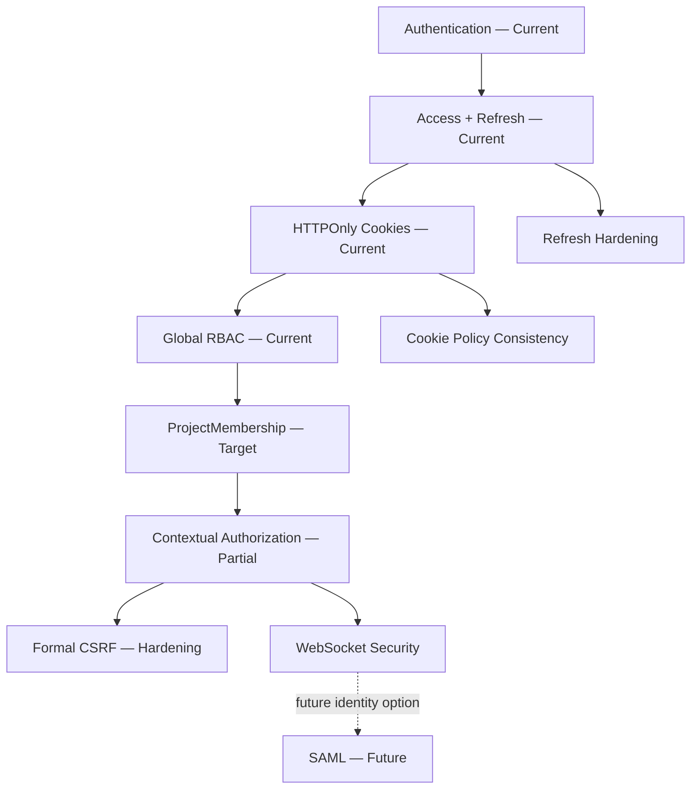

---

# 292. Persistence Timeline Map

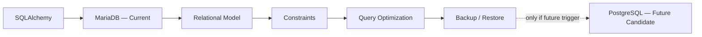

---

# 293. Frontend Timeline Map

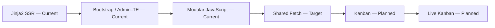

---

# 294. Current Baseline After Phase 7

At this point, the verified baseline is:

```text
FastAPI

SQLAlchemy

MariaDB

Modular Monolith

Jinja2 SSR

Bootstrap / AdminLTE

Modular JavaScript

JWT Access Token

JWT Refresh Token

HTTPOnly Cookies

Explicit Refresh

Automatic Access Refresh

Global RBAC

Projects

Tasks

Activities

Attachments

Notifications

Dashboard

Activity Feed

Audit

FastAPI WebSockets

Docker

Docker Compose

Nginx

Ubuntu

Hetzner VPS

GitHub Actions

Automated Testing.
```

---

# 295. Partial / Active Foundations

```text
Contextual Authorization

ProjectMembership maturity

CSRF hardening

Refresh-token security hardening

Cookie-policy consistency

WebSocket security hardening

Realtime reliability

UI/realtime test expansion

Observability maturity.
```

---

# 296. Planned Product Evolution

```text
Kanban

Drag and Drop

Live Kanban.
```

---

# 297. Future / Conditional Evolution

```text
PostgreSQL

SAML

Redis

Kubernetes

Microservices

Object Storage

PWA

AI / RAG

Multi-tenancy.
```

---

# 298. Phase Transition Principle

The timeline now moves from:

```text
functional collaborative platform
```

toward:

```text
secure and reliable realtime collaboration.
```

---

# 299. Phase 8 Preview — Realtime Foundation

Realtime itself is not a future capability.

The platform already has:

```text
FastAPI WebSockets

+

in-memory connection management.
```

---

# 300. Phase 8 Historical Boundary

Therefore Phase 8 must describe:

```text
the introduction and current existence
of realtime foundations
```

rather than:

```text
a hypothetical future WebSocket implementation.
```

---

# 301. Current Realtime Foundation

```text
FastAPI WebSockets
    CURRENT

In-memory Connection Manager
    CURRENT.
```

---

# 302. Current Realtime Scope

Selected platform capabilities can use realtime awareness.

---

# 303. Realtime Authority Rule

Realtime communicates:

```text
state change awareness.
```

It does not replace:

```text
persistent authoritative state.
```

---

# 304. Correct Realtime Sequence

```text
Authorized Mutation

↓

Persistent Commit

↓

Realtime Event

↓

Authorized Clients

↓

UI Update.
```

---

# 305. Realtime Failure Rule

If an event is lost:

```text
database state
must remain correct.
```

---

# 306. Realtime Reliability Gap

Current WebSockets do not automatically imply:

```text
reconnect reliability

missed-event recovery

multi-client convergence

distributed delivery.
```

---

# 307. Phase 8 vs Phase 9

```text
Phase 8
    Realtime Foundation

Phase 9
    Realtime Reliability.
```

---

# 308. Why This Distinction Matters

It prevents the historical mistake:

```text
WebSockets exist

therefore

realtime architecture is fully mature.
```

---

# 309. Phase 8 Current Achievement

The platform has already crossed the threshold from:

```text
HTTP-only interaction
```

to:

```text
HTTP

+

WebSocket-enabled realtime awareness.
```

---

# 310. Phase 8 Remaining Security Work

```text
connection authentication hardening

subscription authorization

recipient filtering

permission-change behavior.
```

---

# 311. Phase 8 Remaining Contract Work

```text
event naming

payload normalization

scope representation

versioning strategy where required.
```

---

# 312. Phase 8 Remaining Testing Work

```text
connection tests

authorization tests

subscription tests

event isolation tests

multi-client tests.
```

---

# 313. Realtime Scaling Boundary

The current:

```text
in-memory Connection Manager
```

is appropriate for:

```text
single-instance deployment.
```

---

# 314. What It Does Not Provide

It does not provide:

```text
cross-instance coordination.
```

---

# 315. Redis Boundary

Redis remains:

```text
CONDITIONAL / NOT CURRENT.
```

---

# 316. Redis Trigger

A concrete trigger would be:

```text
multiple application instances
requiring shared realtime coordination.
```

---

# 317. Phase 8 Exit Condition

The realtime foundation is considered established because:

```text
WebSocket transport exists

connections can be managed

selected realtime features exist.
```

---

# 318. Phase 9 Entry Condition

The next challenge is not:

```text
introduce realtime.
```

It is:

```text
make existing realtime
more secure,
recoverable,
predictable,
and testable.
```

---

# 319. Timeline Dependency Snapshot

```text
CURRENT FOUNDATION

FastAPI
SQLAlchemy
MariaDB
Modular Monolith
JWT Access + Refresh
HTTPOnly Cookies
Global RBAC
Projects
Tasks
Activities
Attachments
Notifications
Dashboard
Activity Feed
Audit
Jinja2 SSR
Modular JavaScript
WebSockets
Docker stack
GitHub Actions
Automated Testing

↓

ACTIVE CONSOLIDATION

ProjectMembership
Contextual Authorization
CSRF
Refresh Hardening
Cookie Policy
WebSocket Security

↓

NEXT RELIABILITY

Realtime Event Contract
Reconnect
Reconciliation
Multi-client Testing

↓

PLANNED EXPERIENCE

Kanban
Drag and Drop
Live Kanban

↓

OPERATIONAL MATURITY

Testing Expansion
Performance
Observability
Backup / Restore
Production Hardening

↓

FUTURE / CONDITIONAL

PostgreSQL
SAML
Redis
Kubernetes
Microservices
Object Storage
PWA
AI / RAG
Multi-tenancy.
```

---

# 320. Dependency Before Product Polish

The timeline prioritizes:

```text
authorization correctness

before

collaborative visual sophistication.
```

---

# 321. Dependency Before Distribution

It prioritizes:

```text
realtime reliability

before

distributed realtime infrastructure.
```

---

# 322. Dependency Before Database Replacement

It prioritizes:

```text
MariaDB operational maturity

before

considering another relational engine.
```

---

# 323. Dependency Before Federation

It prioritizes:

```text
current IAM hardening

before

future SAML federation.
```

---

# 324. Dependency Before Microservices

It prioritizes:

```text
healthy Modular Monolith boundaries

before

any possible service extraction.
```

---

# 325. Dependency Before Kubernetes

It prioritizes:

```text
repeatable current deployment

before

orchestration complexity.
```

---

# 326. Dependency Before Object Storage

It prioritizes:

```text
secure and recoverable local storage

before

distributed file infrastructure.
```

---

# 327. Historical Truth Checkpoint

At the end of this first timeline segment:

```text
MariaDB remains CURRENT.

PostgreSQL has not replaced MariaDB.

Refresh tokens are CURRENT.

SAML is not implemented.

Global RBAC is CURRENT.

Contextual Authorization is PARTIAL.

ProjectMembership is TARGET / IN CONSOLIDATION.

WebSockets are CURRENT.

Redis is not current.

Kanban is PLANNED.

Docker Compose remains current deployment infrastructure.

Kubernetes and Microservices remain CONDITIONAL.
```

---

# 328. Part 1 Status Matrix

| Capability | Timeline State |
|---|---|
| FastAPI | CURRENT |
| SQLAlchemy | CURRENT |
| MariaDB | CURRENT |
| PostgreSQL | FUTURE / CANDIDATE |
| Modular Monolith | CURRENT |
| Microservices | CONDITIONAL |
| JWT Access Token | CURRENT |
| JWT Refresh Token | CURRENT |
| HTTPOnly Cookies | CURRENT |
| Explicit Refresh | CURRENT |
| Automatic Access Refresh | CURRENT |
| Refresh Security Hardening | ACTIVE / VERIFY |
| Global RBAC | CURRENT |
| Contextual Authorization | PARTIAL / ACTIVE |
| ProjectMembership | TARGET / IN CONSOLIDATION |
| CSRF Hardening | ACTIVE / PLANNED |
| SAML | FUTURE |
| Jinja2 SSR | CURRENT |
| Bootstrap / AdminLTE | CURRENT |
| Modular JavaScript | CURRENT |
| Shared Fetch Infrastructure | TARGET / PLANNED |
| Projects | CURRENT |
| Tasks | CURRENT |
| Activities | CURRENT |
| Attachments | CURRENT |
| Notifications | CURRENT |
| Dashboard | CURRENT |
| Activity Feed | CURRENT |
| Audit | CURRENT |
| Kanban | PLANNED |
| Live Kanban | PLANNED |
| FastAPI WebSockets | CURRENT |
| In-memory Connection Manager | CURRENT |
| Redis | CONDITIONAL |
| Docker | CURRENT |
| Docker Compose | CURRENT |
| Nginx | CURRENT |
| Ubuntu / Hetzner VPS | CURRENT |
| Kubernetes | CONDITIONAL |
| GitHub Actions | CURRENT |
| Automated Testing | CURRENT / EXPANDING |
| Object Storage | FUTURE / CONDITIONAL |
| PWA | FUTURE |
| AI / RAG | FUTURE / EXPERIMENTAL |
| Multi-tenancy | FUTURE / CONDITIONAL |

---

# 329. Part 1 Summary

La primera parte del Implementation Timeline establece la evolución desde:

```text
project genesis
```

hasta:

```text
the current security and realtime consolidation boundary.
```

La evolución confirmada incluye:

```text
FastAPI foundation

SQLAlchemy

MariaDB

Jinja2 SSR

Bootstrap / AdminLTE

JWT access + refresh

HTTPOnly cookies

explicit refresh

automatic access refresh

Global RBAC

Modular Monolith

Projects

Tasks

Activities

Audit

Notifications

Attachments

Dashboard

Activity Feed

Modular JavaScript

FastAPI WebSockets

in-memory realtime

Docker / Docker Compose

Nginx

Ubuntu / Hetzner

GitHub Actions

Automated Testing.
```

La consolidación activa se concentra en:

```text
ProjectMembership

Contextual Authorization

Cross-project Authorization

CSRF

Refresh-token Hardening

Cookie Policy Consistency

WebSocket Security.
```

Y se mantiene explícitamente fuera del baseline actual:

```text
PostgreSQL migration

SAML

Redis-backed distributed realtime

Kubernetes

Microservices

Object Storage

PWA

AI / RAG

Multi-tenancy.
```

---

# 330. Continuation

La **Parte 2/3** continúa desde:

```text
Phase 8 — Realtime Foundation
```

y desarrolla principalmente:

```text
Realtime Event Contracts

WebSocket Security

Subscription Authorization

Reconnect

Reconciliation

Multi-client Convergence

Realtime Testing

Testing Consolidation

UI Testing

Authorization Testing

Performance

Database Query Optimization

Observability

CI/CD

Operational Maturity

Backup

Restore

Disaster Recovery

Production Readiness.
```

---

# 59_IMPLEMENTATION_TIMELINE.md

# Aula Robótica Platform — Implementation Timeline

## Parte 2/3 — Realtime reliability, testing consolidation, performance, observability, CI/CD, operaciones, backup, restore y production readiness

---

# 331. Phase 8 — Realtime Foundation

```text
Status:
    CURRENT FOUNDATION
    + SECURITY HARDENING ACTIVE
```

---

# 332. Primary Goal

Establish a realtime communication foundation without changing the platform principle that:

```text
persistent server state
remains authoritative.
```

---

# 333. Realtime Technology

The platform uses:

```text
FastAPI WebSockets.
```

Estado:

```text
CURRENT
```

---

# 334. Connection Management

The current deployment uses:

```text
in-memory Connection Manager.
```

Estado:

```text
CURRENT
```

---

# 335. Current Topology

The current realtime topology can be represented as:

```text
Browser Clients

↓

FastAPI WebSocket Endpoint

↓

In-memory Connection Manager

↓

Application Events.
```

---

# 336. Current Deployment Assumption

This model is appropriate while the platform operates primarily as:

```text
single application instance.
```

---

# 337. Realtime Architectural Principle

WebSockets provide:

```text
communication.
```

They do not become:

```text
the authoritative persistence layer.
```

---

# 338. Source of Truth

Persistent domain state remains in:

```text
MariaDB.
```

---

# 339. Correct Mutation Flow

```text
Client Action

↓

HTTP / Application Command

↓

Authentication

↓

Authorization

↓

Domain Validation

↓

MariaDB Commit

↓

Realtime Event

↓

Authorized Connected Clients.
```

---

# 340. Why Commit Comes First

Publishing before persistence could produce:

```text
clients observing state
that never became authoritative.
```

---

# 341. Realtime Event Purpose

Realtime events should communicate:

```text
something relevant changed.
```

---

# 342. Realtime Event Non-goal

They should not silently become:

```text
a second domain model.
```

---

# 343. Realtime Scope

Events should be scoped according to relevant context such as:

```text
user

Project

resource

event type.
```

---

# 344. Current Security Challenge

A connected client must not automatically receive:

```text
every platform event.
```

---

# 345. Connection Authentication

Protected WebSocket connections require reliable knowledge of:

```text
who owns the connection.
```

---

# 346. Current Status

```text
WebSocket Authentication
    CURRENT FOUNDATION
    + HARDENING REQUIRED.
```

---

# 347. Authentication Is Not Authorization

Even after identifying a connection:

```text
subscription authorization
```

must determine:

```text
which context
the connection may observe.
```

---

# 348. Project Subscription Example

```text
User A
    member of Project A

User B
    member of Project B

Event:
    Task changed in Project A

Expected:
    User A may receive it
    User B must not receive it.
```

---

# 349. Subscription Authorization Status

```text
TARGET / HIGH PRIORITY
```

---

# 350. Subscription Dependency

```text
ProjectMembership

↓

Contextual Authorization

↓

Subscription Authorization.
```

---

# 351. Permission-change Challenge

Realtime authorization must consider:

```text
permissions may change
while a connection remains open.
```

---

# 352. Example

```text
User connects to Project A.

Later:
    membership is revoked.

Question:
    should the existing subscription remain valid?
```

---

# 353. Target Direction

Security-sensitive changes should eventually support:

```text
subscription invalidation

or

authorization revalidation.
```

---

# 354. Realtime Payload Principle

Payloads should contain:

```text
minimum information
required by the client.
```

---

# 355. Why

Overly rich payloads increase:

```text
data exposure risk

coupling

bandwidth

versioning complexity.
```

---

# 356. Event Contract Need

As realtime capabilities grow, events need:

```text
predictable contracts.
```

---

# 357. Event Contract Status

```text
TARGET / IN PROGRESS
```

---

# 358. Event Envelope Direction

A normalized event may conceptually contain:

```json
{
  "type": "task.updated",
  "scope": {
    "project_id": 42
  },
  "resource": {
    "type": "task",
    "id": 103
  },
  "payload": {}
}
```

---

# 359. Event Contract Goals

```text
consistent naming

clear scope

minimal payload

predictable parsing

future compatibility.
```

---

# 360. Event Naming

Prefer:

```text
resource.action
```

patterns such as:

```text
task.created

task.updated

task.deleted

notification.created

activity.created.
```

---

# 361. Contract Stability

Once multiple clients depend on an event:

```text
casual payload changes
become compatibility risks.
```

---

# 362. Versioning Boundary

Explicit event versioning becomes useful only when:

```text
contract evolution
actually requires compatibility management.
```

---

# 363. Avoid Premature Versioning

Do not add:

```text
complex schema registries

or

multi-version event infrastructure
```

without need.

---

# 364. Realtime Foundation Achievement

The platform already has the foundation required to evolve toward:

```text
reliable collaborative realtime.
```

---

# 365. Phase 8 Exit Condition

The phase is historically established because:

```text
WebSockets exist

connections are managed

selected realtime interactions exist.
```

---

# 366. Phase 8 Remaining Work

```text
authentication hardening

subscription authorization

event contract normalization

negative security testing.
```

---

# 367. Phase 9 — Realtime Reliability

```text
Status:
    TARGET / NEXT
```

---

# 368. Primary Goal

Make realtime behavior resilient to:

```text
disconnects

missed events

duplicate events

stale clients

multiple clients.
```

---

# 369. Fundamental Problem

WebSocket connectivity is not permanent.

---

# 370. Clients Can Disconnect Because Of

```text
network loss

browser suspension

server restart

proxy timeout

deployment

device sleep.
```

---

# 371. Therefore

A reliable realtime architecture must assume:

```text
connections disappear.
```

---

# 372. Reconnect Strategy

```text
Priority:
    P1

Status:
    TARGET / IN PROGRESS
```

---

# 373. Reconnect Goal

When connectivity returns:

```text
the client should reconnect
without requiring manual recovery.
```

---

# 374. Basic Reconnect Flow

```text
Connected

↓

Disconnected

↓

Wait

↓

Reconnect Attempt

↓

Authenticated Connection

↓

Resubscribe.
```

---

# 375. Backoff

Repeated retries should avoid:

```text
tight reconnect loops.
```

---

# 376. Possible Strategy

```text
progressive / exponential backoff
```

with reasonable bounds.

---

# 377. Reconnect Is Not Enough

Suppose:

```text
Client disconnects at 10:00

Task changes at 10:01

Client reconnects at 10:02.
```

---

# 378. Problem

The client may have missed:

```text
task.updated.
```

---

# 379. Therefore

```text
Reconnect

≠

State Recovery.
```

---

# 380. State Reconciliation

```text
Priority:
    P1

Status:
    TARGET / IN PROGRESS
```

---

# 381. Reconciliation Goal

After uncertainty, the client should be able to:

```text
converge back
to authoritative server state.
```

---

# 382. Reconciliation Principle

```text
Server State

>

Client Assumption.
```

---

# 383. Basic Reconciliation Flow

```text
Reconnect

↓

Re-authenticate

↓

Re-subscribe

↓

Fetch authoritative state

↓

Compare / Replace stale local state

↓

Resume realtime.
```

---

# 384. Reconciliation Options

Depending on the capability:

```text
full refetch

partial refetch

resource refetch

version-based synchronization.
```

---

# 385. Initial Preference

For the current architecture, simpler approaches should be preferred where sufficient:

```text
reconnect

+

refetch.
```

---

# 386. Avoid Premature Event Replay Infrastructure

Do not introduce:

```text
distributed event log

complex replay offsets

stream-processing infrastructure
```

unless real requirements justify them.

---

# 387. Duplicate Events

Clients should tolerate situations where:

```text
the same logical update
is observed more than once.
```

---

# 388. Idempotent UI Direction

Where possible:

```text
set state
```

should be safer than:

```text
blindly append state.
```

---

# 389. Example

Prefer:

```text
replace Task 42
with authoritative representation
```

over:

```text
append another Task 42.
```

---

# 390. Out-of-order Events

Networks can produce:

```text
unexpected delivery timing.
```

---

# 391. Mitigation Direction

Where ordering matters, use:

```text
authoritative refetch

or

sufficient version/timestamp semantics.
```

---

# 392. Multi-client Convergence

A user may have:

```text
multiple browser tabs

multiple devices

or

multiple collaborators.
```

---

# 393. Desired Property

Eventually:

```text
all authorized clients
converge to authoritative state.
```

---

# 394. Realtime Testing Requirement

This behavior must not be validated only by:

```text
manual browser demos.
```

---

# 395. Multi-client Test Example

```text
Client A
Client B

Both authorized for Project X.

Client A changes Task.

Expected:

database updated

Client A converges

Client B converges.
```

---

# 396. Cross-project Realtime Test

```text
Client A → Project A

Client B → Project B

Project A changes

Expected:
    A receives relevant update
    B receives nothing.
```

---

# 397. Reconnect Test

```text
Client disconnects.

State changes.

Client reconnects.

Expected:
    client returns to current state.
```

---

# 398. Server Restart Test

A mature realtime suite should eventually validate:

```text
connection loss caused by server restart

↓

reconnect

↓

reconciliation.
```

---

# 399. Realtime Failure Principle

```text
Realtime failure
must degrade collaboration quality,

not

corrupt authoritative state.
```

---

# 400. Redis Boundary

Realtime reliability does not require:

```text
Redis
```

while operating:

```text
one application instance.
```

---

# 401. Redis Adoption Trigger

Redis or another broker becomes relevant if:

```text
Instance A
and
Instance B
```

must share:

```text
realtime events

subscriptions

or coordination.
```

---

# 402. Redis Status

```text
FUTURE / CONDITIONAL
```

---

# 403. Distributed Realtime Status

```text
FUTURE / CONDITIONAL
```

---

# 404. Phase 9 Exit Condition

Realtime reliability reaches a major milestone when:

```text
connection auth is hardened

subscriptions are authorized

event contracts are stable

reconnect works

reconciliation works

multi-client behavior is tested.
```

---

# 405. Phase 9 Enables

```text
Live Kanban

richer collaborative feeds

more reliable realtime notifications

future collaborative modules.
```

---

# 406. Realtime Reliability Map

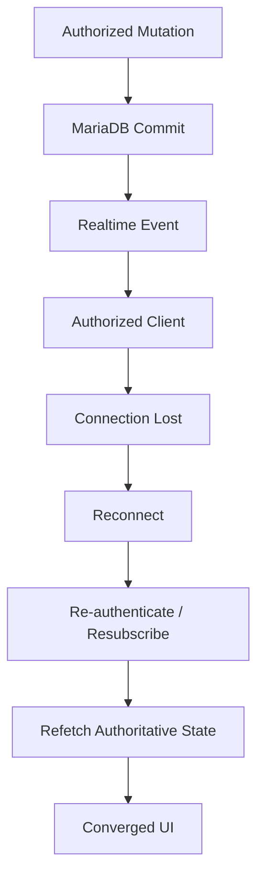

---

# 407. Phase 10 — Testing Consolidation

```text
Status:
    CURRENT FOUNDATION
    + ACTIVE EXPANSION
```

---

# 408. Primary Goal

Increase confidence across:

```text
domain behavior

persistence

HTTP

security

UI

realtime

operations.
```

---

# 409. Current Testing Truth

```text
Automated Testing
    CURRENT

Comprehensive Coverage
    NOT COMPLETE.
```

---

# 410. Testing Strategy

The platform should use complementary test layers.

---

# 411. Test Layers

```text
Unit Tests

Service Tests

Repository / Integration Tests

HTTP/API Tests

Authentication Tests

Authorization Tests

UI Tests

Realtime Tests

Operational Validation.
```

---

# 412. Testing Objective

The objective is not:

```text
maximum test count.
```

---

# 413. Better Objective

```text
maximum useful confidence
at sustainable cost.
```

---

# 414. Unit Testing

Unit tests should validate:

```text
business rules

policy decisions

state transitions

pure transformations.
```

---

# 415. Unit-test Anti-pattern

Avoid excessive dependence on:

```text
private methods

exact internal calls

incidental implementation structure.
```

---

# 416. Service Testing

Services should be tested for:

```text
orchestration

business rules

authorization integration

transaction-relevant behavior.
```

---

# 417. Repository Testing

Repository tests should validate:

```text
real persistence semantics

relationships

constraints

queries

pagination

transaction behavior.
```

---

# 418. Database Fidelity

When behavior depends on the relational engine:

```text
tests should reflect MariaDB semantics
where necessary.
```

---

# 419. PostgreSQL Test Boundary

Do not introduce:

```text
PostgreSQL-specific assumptions
```

into the current baseline.

---

# 420. HTTP Testing

HTTP tests should validate:

```text
request validation

status codes

response contracts

authentication

authorization

error behavior.
```

---

# 421. Negative HTTP Tests

Critical routes should test:

```text
401

403

404

409

422
```

where semantically appropriate.

---

# 422. Authentication Testing

Authentication tests should validate current behavior such as:

```text
login

access token usage

refresh token usage

explicit refresh

automatic access refresh

logout.
```

---

# 423. Refresh Hardening Tests

As security hardening evolves, tests should verify:

```text
rotation semantics

revocation behavior

invalid refresh handling

replay/reuse behavior
```

according to the final adopted design.

---

# 424. Cookie Tests

Cookie behavior should verify:

```text
HttpOnly

Secure

SameSite

expiration

environment-specific policy.
```

---

# 425. Critical Cookie Regression Test

Both:

```text
normal authentication path
```

and:

```text
automatic middleware refresh path
```

should apply:

```text
the same authoritative cookie policy.
```

---

# 426. Authorization Testing

Authorization testing becomes one of the highest-value areas.

---

# 427. Authorization Matrix

Tests should include:

```text
allowed global role

denied global role

valid Project membership

missing Project membership

wrong Project

nested resource from wrong Project.
```

---

# 428. Cross-project Test

```text
User A
belongs to Project A.

Task belongs to Project B.

User A requests Task.

Expected:
    denied.
```

---

# 429. Nested Attachment Test

```text
Attachment

↓

Task

↓

Project B.

User only belongs to Project A.

Expected:
    denied.
```

---

# 430. Authorization Test Dependency

Full contextual coverage depends on:

```text
ProjectMembership

+

Contextual Authorization.
```

---

# 431. UI Testing

UI tests should focus on:

```text
critical workflows

browser integration

forms

dialogs

navigation

interactive mutations.
```

---

# 432. UI Test Status

```text
CURRENT FOUNDATION

+

EXPANSION REQUIRED.
```

---

# 433. Avoid UI Over-testing

Do not move every business rule into:

```text
slow end-to-end tests.
```

---

# 434. Better Distribution

```text
business logic
    lower-level tests

integration
    HTTP tests

critical browser workflow
    UI tests.
```

---

# 435. Kanban Testing

When implemented, Kanban should validate:

```text
authorized movement

persistent state change

failure rollback

keyboard-accessible alternative

realtime synchronization.
```

---

# 436. Realtime Testing

Realtime tests should validate:

```text
connection

authentication

authorization

delivery

isolation

disconnect

reconnect

reconciliation.
```

---

# 437. Multi-client Realtime Testing

The suite should eventually exercise:

```text
multiple simultaneous clients.
```

---

# 438. Realtime Test Priority

```text
P1 / HIGH
```

because collaboration bugs can cause:

```text
stale state

incorrect visibility

security leakage.
```

---

# 439. Test Data Isolation

Tests should avoid:

```text
state leakage
between test cases.
```

---

# 440. Deterministic Tests

Avoid dependence on:

```text
uncontrolled timing

external mutable state

random ordering

shared persistent leftovers.
```

---

# 441. Test Runtime

As coverage grows, the suite should remain:

```text
fast enough
for regular developer execution.
```

---

# 442. Test Segmentation

Potential categories:

```text
fast

integration

UI

realtime

operational.
```

---

# 443. CI Execution

GitHub Actions can execute:

```text
required validation
before integration.
```

---

# 444. Current CI Status

```text
GitHub Actions
    CURRENT

CI
    CURRENT.
```

---

# 445. Phase 10 Exit Condition

Testing maturity improves when critical boundaries have reliable coverage for:

```text
security

data integrity

HTTP contracts

UI workflows

realtime recovery.
```

---

# 446. Testing Timeline Map

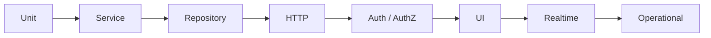

---

# 447. Phase 11 — Performance and Scalability Maturity

```text
Status:
    ONGOING / MEASUREMENT-DRIVEN
```

---

# 448. Primary Goal

Improve performance based on:

```text
evidence
```

rather than:

```text
speculation.
```

---

# 449. Performance Sequence

```text
Measure

↓

Identify

↓

Optimize

↓

Measure Again.
```

---

# 450. Main Performance Areas

```text
database queries

SSR rendering

API latency

dashboard aggregation

Activity Feed

Audit queries

file operations

realtime fan-out.
```

---

# 451. Database Query Optimization

SQLAlchemy can hide expensive query patterns.

---

# 452. N+1 Risk

Example:

```text
Load 100 Tasks

↓

Load Project independently
for each Task.
```

---

# 453. Result

Potentially:

```text
101 queries.
```

---

# 454. Detection

Use:

```text
query logging

profiling

performance measurement

test instrumentation where useful.
```

---

# 455. Optimization Options

```text
joined loading

select-in loading

query redesign

indexes

pagination.
```

---

# 456. Important Rule

Do not globally apply:

```text
eager loading
```

without considering:

```text
actual access patterns.
```

---

# 457. Pagination

Growing lists should avoid:

```text
unbounded retrieval.
```

---

# 458. Pagination Candidates

```text
Tasks

Activities

Notifications

Audit

Activity Feed

Projects

future domain lists.
```

---

# 459. Initial Pagination Strategy

Use the simplest suitable model:

```text
offset pagination
```

when adequate.

---

# 460. Keyset / Cursor Pagination

Evaluate when:

```text
dataset size

ordering requirements

or performance
```

justify it.

---

# 461. Dashboard Performance

Dashboard may aggregate:

```text
multiple modules

multiple queries

counts

recent activity.
```

---

# 462. Dashboard Risk

It can become:

```text
a hidden query hotspot.
```

---

# 463. Dashboard Optimization

Potentially:

```text
query consolidation

indexes

selective eager loading

bounded datasets

limited caching.
```

---

# 464. Caching Boundary

Caching should not be introduced merely because:

```text
performance matters.
```

---

# 465. Cache Risks

```text
stale data

authorization leakage

invalidation complexity

operational complexity.
```

---

# 466. Redis Cache Status

```text
NOT CURRENT

FUTURE / CONDITIONAL.
```

---

# 467. Cache Adoption Rule

```text
measure

↓

identify repeated expensive work

↓

define invalidation

↓

evaluate cache.
```

---

# 468. Horizontal Scaling Boundary

The current platform does not require:

```text
horizontal scaling
```

as a baseline architectural assumption.

---

# 469. Horizontal Scaling Trigger

Possible triggers:

```text
sustained load

availability requirements

resource constraints

multiple-instance deployment.
```

---

# 470. Scaling Consequences

Horizontal scaling would affect:

```text
WebSockets

local file storage

sessions/token assumptions

deployment

observability.
```

---

# 471. Redis Consequence

Multiple realtime instances may require:

```text
broker / shared coordination.
```

---

# 472. Storage Consequence

Multiple application instances may make:

```text
local attachment storage
```

insufficient.

---

# 473. Possible Response

```text
Object Storage
```

could then become relevant.

---

# 474. Kubernetes Consequence

Only sufficiently complex orchestration requirements may justify:

```text
Kubernetes.
```

---

# 475. Performance Phase Exit Condition

There is no fixed exit.

Performance remains:

```text
continuous
and
evidence-driven.
```

---

# 476. Performance Guardrail

```text
Do not optimize
for hypothetical scale
at the cost of current simplicity.
```

---

# 477. Phase 12 — Observability Maturity

```text
Status:
    PARTIAL / ONGOING
```

---

# 478. Primary Goal

Make production behavior sufficiently visible to answer:

```text
What happened?

Where?

Why?

How severe is it?

What should be done?
```

---

# 479. Observability Components

```text
Logging

Metrics

Health

Error Visibility

Correlation

Tracing where justified.
```

---

# 480. Logging

Logs should become:

```text
structured

consistent

searchable

security-conscious.
```

---

# 481. Useful Log Context

```text
timestamp

severity

component

operation

request correlation

resource context

result.
```

---

# 482. Sensitive Logging Rule

Never unnecessarily log:

```text
passwords

JWTs

refresh tokens

secrets

sensitive user data.
```

---

# 483. Authentication Logging

Useful metadata can include:

```text
authentication success/failure

refresh failure

logout

suspicious repeated failures.
```

---

# 484. Authorization Logging

Useful security signals include:

```text
repeated denied access

cross-project attempts

unexpected contextual-policy failures.
```

---

# 485. Metrics

Metrics should answer operational questions.

---

# 486. Potential Metrics

```text
request latency

error rate

database latency

WebSocket connections

WebSocket failures

resource utilization

disk usage.
```

---

# 487. Metrics Anti-goal

Do not collect metrics merely because:

```text
they are easy to collect.
```

---

# 488. Actionable Metric Principle

A useful metric should help:

```text
detect

diagnose

or

capacity-plan.
```

---

# 489. Health Checks

The platform should distinguish:

```text
liveness

from

readiness.
```

---

# 490. Liveness

```text
Is the application process alive?
```

---

# 491. Readiness

```text
Can the application
serve meaningful traffic?
```

---

# 492. Readiness Dependencies

Potentially:

```text
MariaDB connectivity

critical configuration

required persistent storage.
```

---

# 493. Health-check Boundary

Optional integrations should not unnecessarily make:

```text
the whole platform unhealthy.
```

---

# 494. Correlation

Request correlation helps connect:

```text
incoming request

service operation

database behavior

error

audit event.
```

---

# 495. Distributed Tracing Boundary

Full distributed tracing is not automatically necessary because:

```text
the platform is a Modular Monolith.
```

---

# 496. Future Trigger

Tracing becomes more valuable as:

```text
distributed dependencies

or

complex request chains
```

increase.

---

# 497. Alerting

Alerts should represent:

```text
conditions requiring attention.
```

---

# 498. Alert Noise

Avoid:

```text
high-volume low-value alerts.
```

---

# 499. Operational Signal

Good alerts may cover:

```text
service unavailable

database unavailable

sustained error rate

disk exhaustion risk

critical backup failure.
```

---

# 500. Phase 12 Exit Condition

Observability reaches useful maturity when operators can:

```text
detect

understand

and

respond
```

to important failures.

---

# 501. Observability Map

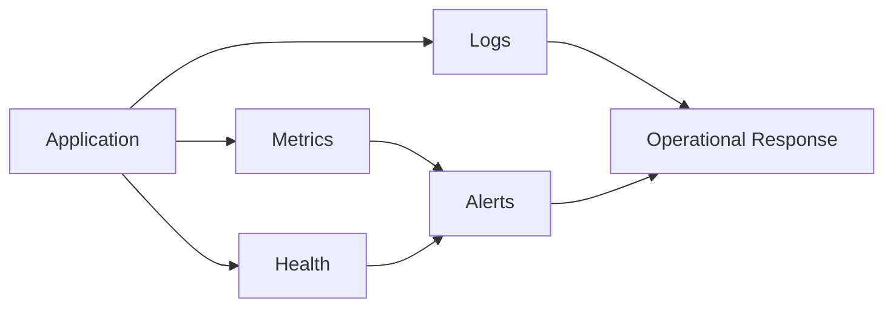

---

# 502. Phase 13 — CI/CD and Deployment Maturity

```text
Status:
    CI CURRENT
    + CD MATURITY EVOLVING
```

---

# 503. Primary Goal

Make software delivery:

```text
repeatable

validated

recoverable

and

low-risk.
```

---

# 504. Current CI Foundation

```text
GitHub Actions
    CURRENT
```

---

# 505. CI Responsibilities

The pipeline can validate:

```text
dependency installation

tests

quality checks

build integrity

configuration assumptions.
```

---

# 506. CI Principle

```text
Broken critical validation

↓

No integration.
```

---

# 507. Deployment Baseline

Current deployment uses:

```text
Docker

Docker Compose

Nginx

Ubuntu

Hetzner VPS.
```

---

# 508. Deployment Architecture

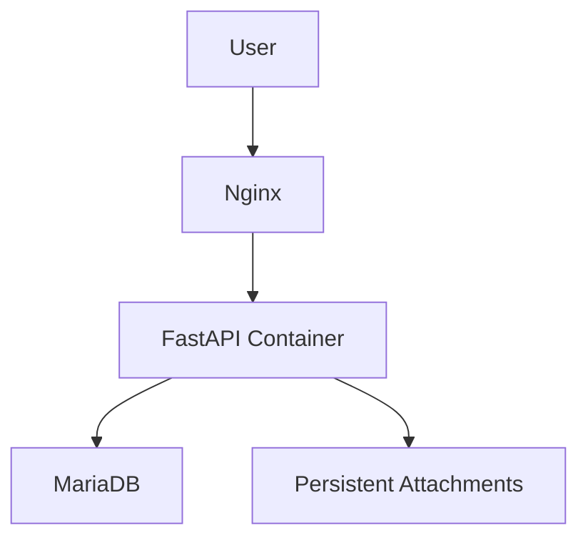

---

# 509. Deployment Principle

A deployment should not depend on:

```text
undocumented manual memory.
```

---

# 510. Deployment Procedure

Conceptually:

```text
Validate

↓

Prepare

↓

Backup where necessary

↓

Deploy

↓

Apply compatible schema changes

↓

Verify health

↓

Smoke test

↓

Observe.
```

---

# 511. Configuration

Deployment configuration should remain external to:

```text
application source code.
```

---

# 512. Configuration Examples

```text
database connection

JWT configuration

cookie policy

storage paths

environment mode

logging configuration.
```

---

# 513. Secrets

Secrets must not be committed into:

```text
source control.
```

---

# 514. Secret Examples

```text
database credentials

JWT signing secrets

private API credentials

private keys.
```

---

# 515. Environment-specific Behavior

Security-sensitive behavior must correctly distinguish:

```text
development

testing

production.
```

---

# 516. Cookie Example

Production must not accidentally inherit:

```text
development-only insecure cookie settings.
```

---

# 517. CD Boundary

The existence of CI does not prove:

```text
fully automated production CD.
```

---

# 518. Current CD Status

```text
EVOLVING / VERIFY
```

---

# 519. Deployment Verification

After deployment, validate:

```text
application availability

database connectivity

authentication

critical route behavior

persistent storage

realtime connectivity where relevant.
```

---

# 520. Smoke Tests

Smoke tests should remain:

```text
small

fast

high-value.
```

---

# 521. Rollback

Every significant deployment should answer:

```text
What happens
if the release must be reverted?
```

---

# 522. Schema Compatibility

Rollback becomes difficult if:

```text
database changes
are not backward-compatible.
```

---

# 523. Safer Migration Direction

Where possible:

```text
expand

↓

deploy compatible application

↓

migrate data

↓

contract later.
```

---

# 524. Deployment Failure Scenarios

```text
container fails

configuration missing

migration fails

database unavailable

Nginx misconfigured

filesystem permission error.
```

---

# 525. Deployment Maturity Goal

Reduce:

```text
unknown failure modes

and

manual recovery improvisation.
```

---

# 526. Kubernetes Boundary

Current deployment maturity does not require:

```text
Kubernetes.
```

---

# 527. Kubernetes Status

```text
FUTURE / CONDITIONAL
```

---

# 528. Kubernetes Trigger

Only evaluate if requirements justify:

```text
orchestration

replicas

high availability

complex deployment topology

autoscaling.
```

---

# 529. Phase 13 Exit Condition

Deployment maturity improves when releases are:

```text
repeatable

tested

observable

recoverable.
```

---

# 530. Phase 14 — Backup and Restore Maturity

```text
Status:
    OPERATIONAL PRIORITY / ONGOING
```

---

# 531. Primary Goal

Protect authoritative platform data against:

```text
human error

software failure

storage failure

deployment failure

infrastructure loss.
```

---

# 532. Backup Scope

Current backup planning should consider:

```text
MariaDB

persistent attachments

critical configuration

deployment information.
```

---

# 533. MariaDB Backup

Database backups must protect:

```text
relational authoritative state.
```

---

# 534. Attachment Backup

Because attachments use persistent local storage:

```text
database-only backup
is insufficient.
```

---

# 535. Metadata / Binary Consistency

Backup strategy must consider consistency between:

```text
attachment metadata

and

physical files.
```

---

# 536. Backup Properties

A useful backup should be:

```text
complete

consistent

protected

retained

recoverable.
```

---

# 537. Backup Frequency

Frequency should eventually derive from:

```text
acceptable data-loss tolerance.
```

---

# 538. Avoid Invented RPO

Do not document arbitrary:

```text
RPO values
```

without actual operational requirements.

---

# 539. Restore Testing

```text
Backup exists

≠

Recovery works.
```

---

# 540. Restore Test

A restore procedure should verify:

```text
backup can be found

database can be restored

attachments can be restored

configuration can be restored

application can start

critical workflows remain usable.
```

---

# 541. Restore Order

A recovery plan should explicitly define:

```text
what is restored

in which order

by whom

and

how success is validated.
```

---

# 542. Disaster Recovery

Disaster Recovery extends beyond:

```text
restoring one database.
```

---

# 543. Disaster Scenarios

```text
VPS loss

filesystem loss

database corruption

failed deployment

configuration loss.
```

---

# 544. Recovery Flow

```text
Provision / Recover Infrastructure

↓

Restore Configuration

↓

Restore MariaDB

↓

Restore Attachments

↓

Deploy Application

↓

Validate Health

↓

Validate Critical Workflows.
```

---

# 545. RTO

Future operational maturity may define:

```text
Recovery Time Objective.
```

---

# 546. RPO

It may also define:

```text
Recovery Point Objective.
```

---

# 547. RTO/RPO Status

```text
TO BE DEFINED
when actual service requirements justify them.
```

---

# 548. Backup Security

Backups may contain:

```text
sensitive platform data.
```

---

# 549. Therefore

They require:

```text
access control

secure storage

retention discipline.
```

---

# 550. Restore Drills

Periodic restore validation should eventually become:

```text
operational routine.
```

---

# 551. Backup Monitoring

Backup failure should not remain:

```text
silently unnoticed.
```

---

# 552. Useful Operational Signal

```text
last successful backup

backup age

backup failure

restore-test status.
```

---

# 553. Phase 14 Exit Condition

Backup maturity is achieved not when:

```text
a backup script exists.
```

But when:

```text
data can actually be recovered
with understood procedures.
```

---

# 554. Backup / Restore Map

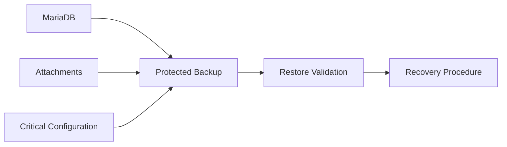

---

# 555. Phase 15 — Production Readiness

```text
Status:
    TARGET / CONTINUOUS MATURITY
```

---

# 556. Primary Goal

Move from:

```text
working application
```

toward:

```text
reliably operable platform.
```

---

# 557. Production Readiness Dimensions

```text
Functionality

Security

Data Integrity

Testing

Observability

Deployment

Recovery

Documentation.
```

---

# 558. Functional Readiness

```text
critical workflows operate correctly

blocking defects resolved

domain invariants protected.
```

---

# 559. Security Readiness

```text
authentication validated

authorization validated

cross-project isolation validated

CSRF posture validated

cookie policy validated

realtime access validated

secrets protected.
```

---

# 560. Data Readiness

```text
schema controlled

constraints validated

migrations understood

backup available

restore tested.
```

---

# 561. Testing Readiness

```text
critical automated tests pass

security boundaries tested

major regressions covered

realtime critical paths tested.
```

---

# 562. Operational Readiness

```text
deployment repeatable

health verifiable

logs available

monitoring useful

recovery understood.
```

---

# 563. Documentation Readiness

```text
current architecture accurate

future architecture separated

runbooks usable

known issues visible

deployment procedures documented.
```

---

# 564. Production-ready Language

Avoid absolute claims such as:

```text
security complete.
```

---

# 565. Better Description

```text
production-oriented

with

continuous hardening.
```

---

# 566. Pre-production Gate

Before a significant release:

```text
[ ] Critical tests pass

[ ] Required migrations validated

[ ] Security-critical flows validated

[ ] Backup available

[ ] Deployment procedure validated

[ ] Health checks validated

[ ] Known blockers resolved.
```

---

# 567. Authentication Gate

```text
[ ] Login works

[ ] Access token works

[ ] Refresh token works

[ ] Explicit refresh works

[ ] Automatic refresh works

[ ] Logout clears token cookies

[ ] Cookie attributes are correct.
```

---

# 568. Authorization Gate

```text
[ ] Global RBAC works

[ ] Project context enforced

[ ] Cross-project access denied

[ ] Nested-resource access denied when unauthorized.
```

---

# 569. Realtime Gate

```text
[ ] Connection authentication validated

[ ] Subscription authorization validated

[ ] Event isolation validated

[ ] Reconnect validated

[ ] Reconciliation validated.
```

---

# 570. Persistence Gate

```text
[ ] MariaDB schema valid

[ ] Migration tested

[ ] Integrity constraints validated

[ ] Backup available

[ ] Restore procedure known.
```

---

# 571. Operations Gate

```text
[ ] Deployment reproducible

[ ] Configuration validated

[ ] Secrets protected

[ ] Health visible

[ ] Logs usable

[ ] Recovery understood.
```

---

# 572. Production Readiness Is a Continuum

Production readiness should not be interpreted as:

```text
one irreversible finish line.
```

---

# 573. Why

Every new feature can introduce:

```text
new security risk

new data risk

new operational risk.
```

---

# 574. Therefore

```text
Production Readiness

=

continuous discipline.
```

---

# 575. Phase 15 Exit Condition

A major maturity threshold is reached when:

```text
critical platform capabilities
are secure,
tested,
observable,
deployable,
and recoverable.
```

---

# 576. Operational Maturity Timeline

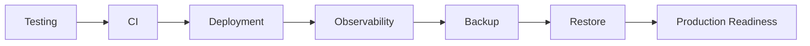

---

# 577. Current-to-Production Dependency Model

```text
CURRENT FUNCTIONAL PLATFORM

↓

SECURITY CONSOLIDATION

↓

REALTIME RELIABILITY

↓

TESTING CONSOLIDATION

↓

OBSERVABILITY

↓

BACKUP / RESTORE

↓

PRODUCTION MATURITY.
```

---

# 578. Important Non-dependency

Production maturity does not require:

```text
PostgreSQL

Redis

Kubernetes

Microservices

Object Storage.
```

---

# 579. Why

Those technologies solve:

```text
specific future requirements.
```

They are not generic synonyms for:

```text
production quality.
```

---

# 580. Production Quality Comes From

```text
correctness

security

testing

recoverability

observability

operational discipline.
```

---

# 581. Current Database Through Production Phase

Throughout the current production-hardening timeline:

```text
MariaDB remains the relational database.
```

---

# 582. PostgreSQL Remains

```text
FUTURE / CANDIDATE / CONDITIONAL.
```

---

# 583. Current Deployment Through Production Phase

```text
Docker

Docker Compose

Nginx

Ubuntu

Hetzner VPS.
```

---

# 584. Kubernetes Remains

```text
CONDITIONAL / NOT CURRENT.
```

---

# 585. Current Architecture Through Production Phase

```text
Modular Monolith.
```

---

# 586. Microservices Remain

```text
CONDITIONAL / NOT CURRENT.
```

---

# 587. Current Realtime Through Production Phase

```text
FastAPI WebSockets

+

In-memory Connection Manager.
```

---

# 588. Redis Remains

```text
CONDITIONAL / NOT CURRENT.
```

---

# 589. Current Storage Through Production Phase

```text
Local / Persistent Attachment Storage.
```

---

# 590. Object Storage Remains

```text
FUTURE / CONDITIONAL.
```

---

# 591. Current IAM Through Production Phase

```text
JWT Access + Refresh

HTTPOnly Cookies

Global RBAC

Partial Contextual Authorization.
```

---

# 592. SAML Remains

```text
FUTURE / NOT IMPLEMENTED.
```

---

# 593. Timeline Risk — Premature Scaling

One of the largest architectural risks is implementing:

```text
future scale solutions
```

before:

```text
current reliability problems.
```

---

# 594. Incorrect Sequence

```text
WebSockets

↓

Redis

↓

Multiple Instances

↓

Then solve reconnect.
```

---

# 595. Preferred Sequence

```text
WebSockets

↓

Authorization

↓

Event Contract

↓

Reconnect

↓

Reconciliation

↓

Testing

↓

Only then evaluate distribution if needed.
```

---

# 596. Timeline Risk — Premature Database Migration

Incorrect:

```text
MariaDB

↓

PostgreSQL
because PostgreSQL is considered more advanced.
```

---

# 597. Correct

```text
MariaDB

↓

Measure requirements

↓

Identify actual limitation

↓

Evaluate alternatives

↓

Migrate only if justified.
```

---

# 598. Timeline Risk — Premature Microservices

Incorrect:

```text
Modular Monolith

↓

Microservices
because the application grew.
```

---

# 599. Correct

```text
Modular Monolith

↓

Strengthen boundaries

↓

Measure independent lifecycle/scaling needs

↓

Extract only if justified.
```

---

# 600. Timeline Risk — Premature Kubernetes

Incorrect:

```text
Docker Compose

↓

Kubernetes
because production exists.
```

---

# 601. Correct

```text
Docker Compose

↓

Operational maturity

↓

Evaluate orchestration needs

↓

Adopt Kubernetes only if justified.
```

---

# 602. Timeline Risk — Premature Object Storage

Incorrect:

```text
Local files

↓

Object storage
because object storage is more scalable.
```

---

# 603. Correct

```text
Local persistent storage

↓

Backup / Restore

↓

Measure topology/storage requirements

↓

Object storage if required.
```

---

# 604. Timeline Risk — Premature SAML

Incorrect:

```text
JWT

↓

SAML
because enterprise systems use SAML.
```

---

# 605. Correct

```text
Current IAM

↓

Security Hardening

↓

Actual Federation Requirement

↓

SAML Evaluation / Implementation.
```

---

# 606. Timeline Risk — Kanban Before Security

Incorrect:

```text
Drag and Drop

↓

later determine
whether user could move the Task.
```

---

# 607. Correct

```text
Contextual Authorization

↓

Authorized Task Mutation

↓

Kanban

↓

Drag and Drop

↓

Live Kanban.
```

---

# 608. Timeline Risk — Realtime Before Persistence

Incorrect:

```text
broadcast visual change

↓

attempt database update.
```

---

# 609. Correct

```text
validate

↓

authorize

↓

persist

↓

broadcast.
```

---

# 610. Timeline Risk — Backup Without Restore

Incorrect:

```text
backup file exists

↓

assume disaster recovery works.
```

---

# 611. Correct

```text
backup

↓

restore test

↓

application validation

↓

recovery confidence.
```

---

# 612. Timeline Risk — Documentation as Evidence

Incorrect:

```text
future architecture documented

↓

therefore implemented.
```

---

# 613. Correct

```text
implementation evidence

↓

status classification

↓

documentation.
```

---

# 614. Timeline Risk — Status Drift

A capability may accidentally evolve in documentation from:

```text
FUTURE

↓

TARGET

↓

CURRENT
```

without:

```text
implementation evidence.
```

---

# 615. Status Promotion Gate

A capability should move to CURRENT only after:

```text
implementation

+

validation

+

integration.
```

---

# 616. Historical Promotion Gate

It should move into completed history only after:

```text
verified historical implementation.
```

---

# 617. Current Operational Priorities

At this stage, operational priorities should include:

```text
critical test coverage

configuration consistency

security hardening

observability

backup

restore

deployment repeatability.
```

---

# 618. Current Realtime Priorities

```text
WebSocket Authentication Hardening

Subscription Authorization

Event Contract

Reconnect

Reconciliation

Multi-client Testing.
```

---

# 619. Current Security Priorities

```text
ProjectMembership

Contextual Authorization

Cross-project Tests

CSRF

Refresh-token Hardening

Cookie Policy Consistency.
```

---

# 620. Current Performance Priorities

```text
measure query behavior

identify N+1 patterns

bound large lists

optimize SSR hotspots

review Dashboard queries.
```

---

# 621. Current Testing Priorities

```text
authorization

realtime

UI critical paths

negative cases

persistence integration.
```

---

# 622. Current Recovery Priorities

```text
MariaDB backup

attachment backup

restore procedure

restore validation

deployment recovery.
```

---

# 623. P1 Timeline Cluster

```text
ProjectMembership

Contextual Authorization

Cross-project Tests

Formal CSRF

Refresh-token Hardening

Cookie Policy Consistency

WebSocket Authentication Hardening

Subscription Authorization

Realtime Event Contract

Reconnect

Reconciliation

Realtime Test Expansion.
```

---

# 624. P2 Timeline Cluster

```text
Shared Fetch Infrastructure

Native Dialog Migration

UI Test Expansion

SSR Query Optimization

Observability Improvement

Documentation Cleanup.
```

---

# 625. Conditional Timeline Cluster

```text
PostgreSQL

SAML

Redis

Kubernetes

Microservices

Object Storage

PWA

AI / RAG

Multi-tenancy.
```

---

# 626. Dependency Chain — Authorization

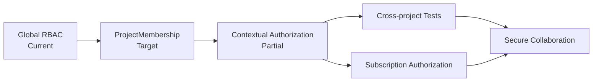

---

# 627. Dependency Chain — Realtime

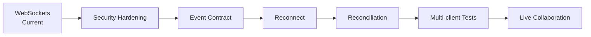

---

# 628. Dependency Chain — Operations

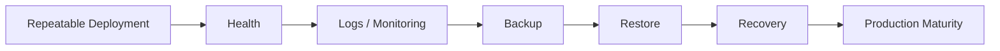

---

# 629. Dependency Chain — Performance

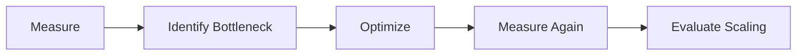

---

# 630. Dependency Chain — Storage

```text
Current Local Storage

↓

Secure Access

↓

Backup

↓

Restore

↓

Capacity Monitoring

↓

Only if topology requires:

Object Storage.
```

---

# 631. Dependency Chain — Database

```text
MariaDB

↓

Schema Discipline

↓

Constraints

↓

Query Optimization

↓

Backup / Restore

↓

Operational Evidence

↓

Only if justified:

Database Migration Evaluation.
```

---

# 632. Dependency Chain — Deployment

```text
Docker

↓

Docker Compose

↓

Nginx

↓

Repeatable VPS Deployment

↓

Health / Monitoring

↓

Recovery

↓

Only if required:

Advanced Orchestration.
```

---

# 633. Pre-1.0 Security Gate

Before a major maturity milestone:

```text
[ ] ProjectMembership model consolidated

[ ] Contextual authorization consistently applied

[ ] Cross-project tests robust

[ ] Formal CSRF implemented

[ ] Refresh-token hardening decisions validated

[ ] Cookie policy centralized

[ ] WebSocket authentication hardened

[ ] Subscription authorization implemented.
```

---

# 634. Pre-1.0 Realtime Gate

```text
[ ] Event contract normalized

[ ] Reconnect implemented

[ ] Reconciliation implemented

[ ] Multi-client tests stable

[ ] Cross-project realtime isolation tested.
```

---

# 635. Pre-1.0 Testing Gate

```text
[ ] Critical service tests stable

[ ] Repository integration tests sufficient

[ ] HTTP negative paths covered

[ ] Authentication lifecycle covered

[ ] Authorization boundaries covered

[ ] Critical UI workflows covered

[ ] Realtime recovery covered.
```

---

# 636. Pre-1.0 Operations Gate

```text
[ ] Deployment reproducible

[ ] Critical configuration centralized

[ ] Secrets protected

[ ] Health checks usable

[ ] Logs operationally useful

[ ] Backup available

[ ] Restore tested

[ ] Recovery documented.
```

---

# 637. Pre-1.0 Documentation Gate

```text
[ ] CURRENT vs FUTURE consistent

[ ] MariaDB consistently CURRENT

[ ] PostgreSQL consistently FUTURE / CANDIDATE

[ ] Refresh workflow correctly CURRENT

[ ] SAML consistently FUTURE

[ ] Redis consistently CONDITIONAL

[ ] Kubernetes consistently CONDITIONAL

[ ] Microservices consistently CONDITIONAL

[ ] Kanban consistently PLANNED

[ ] Cross-references valid.
```

---

# 638. Production Readiness Matrix

| Area | Current Direction | Required Maturity |
|---|---|---|
| Authentication | CURRENT | Hardening |
| Global RBAC | CURRENT | Preserve |
| Context Authorization | PARTIAL | Consolidate |
| CSRF | ACTIVE / PLANNED | Formalize |
| Refresh Workflow | CURRENT | Preserve |
| Refresh Security | ACTIVE / VERIFY | Harden |
| Cookie Policy | ACTIVE | Centralize |
| MariaDB | CURRENT | Operate safely |
| WebSockets | CURRENT | Harden |
| Reconnect | TARGET | Implement |
| Reconciliation | TARGET | Implement |
| Testing | CURRENT | Expand |
| Observability | PARTIAL | Improve |
| CI | CURRENT | Preserve |
| CD | EVOLVING | Improve |
| Backup | ONGOING | Validate |
| Restore | ONGOING | Validate |

---

# 639. Scalability Matrix

| Capability | Current Need | Status |
|---|---|---|
| Single FastAPI deployment | Yes | CURRENT |
| In-memory realtime | Yes | CURRENT |
| Local persistent files | Yes | CURRENT |
| Redis broker | No confirmed trigger | CONDITIONAL |
| Horizontal scaling | No confirmed trigger | CONDITIONAL |
| Object storage | No confirmed trigger | CONDITIONAL |
| Kubernetes | No confirmed trigger | CONDITIONAL |
| Microservices | No confirmed trigger | CONDITIONAL |
| Multi-region | No confirmed trigger | FUTURE |

---

# 640. Timeline Governance Rule

A capability advances through states only when evidence supports the transition.

---

# 641. State Transition

```text
FUTURE

↓

PLANNED / TARGET

↓

ACTIVE

↓

IMPLEMENTED

↓

CURRENT

↓

MATURE.
```

---

# 642. Conditional Branch

A CONDITIONAL capability follows:

```text
CONDITIONAL

↓

Trigger Appears

↓

Evaluate

↓

Decision

↓

TARGET / PLANNED

or

Remain Conditional.
```

---

# 643. No Automatic Promotion

Time alone must not transform:

```text
CONDITIONAL
```

into:

```text
CURRENT.
```

---

# 644. No Documentation Promotion

Detailed design alone must not transform:

```text
TARGET
```

into:

```text
CURRENT.
```

---

# 645. No Prototype Promotion

A local experiment alone must not transform:

```text
EXPERIMENTAL
```

into:

```text
CURRENT platform architecture.
```

---

# 646. No Partial Promotion

A partially implemented capability must not be documented as:

```text
fully mature.
```

---

# 647. Reverse Transition

A capability can also be:

```text
deprecated

replaced

removed.
```

---

# 648. Historical Preservation

When that occurs:

```text
history should preserve
what actually happened.
```

---

# 649. Timeline Review Cadence

The timeline should be reviewed when:

```text
major capability lands

architecture changes

security posture changes

deployment topology changes

future capability becomes active.
```

---

# 650. Timeline Review Inputs

Review should compare:

```text
code

tests

configuration

current tasks

changelog

known issues

technical debt

roadmap

architecture decisions.
```

---

# 651. Current-state Verification Questions

```text
What is actually deployed?

What is actually persisted?

What is actually enforced?

What is actually tested?

What is merely documented?
```

---

# 652. Security Verification Questions

```text
Are access and refresh tokens current?
    Yes.

Are HTTPOnly cookies current?
    Yes.

Is global RBAC current?
    Yes.

Is contextual authorization fully mature?
    No.

Is SAML current?
    No.
```

---

# 653. Database Verification Questions

```text
Is SQLAlchemy current?
    Yes.

Is MariaDB current?
    Yes.

Did PostgreSQL replace MariaDB?
    No.
```

---

# 654. Realtime Verification Questions

```text
Are WebSockets current?
    Yes.

Is the Connection Manager in-memory?
    Yes.

Is distributed Redis realtime current?
    No.

Are reconnect and reconciliation fully mature?
    No.
```

---

# 655. Frontend Verification Questions

```text
Is Jinja2 SSR current?
    Yes.

Is modular JavaScript current?
    Yes.

Is Kanban current?
    No.

Is Live Kanban current?
    No.
```

---

# 656. Infrastructure Verification Questions

```text
Is Docker current?
    Yes.

Is Docker Compose current?
    Yes.

Is Nginx current?
    Yes.

Is the VPS deployment current?
    Yes.

Is Kubernetes current?
    No.

Are microservices current?
    No.
```

---

# 657. Storage Verification Questions

```text
Are attachments current?
    Yes.

Is persistent local storage current?
    Yes.

Is object storage current?
    No.
```

---

# 658. Timeline Current-state Snapshot

```text
CURRENT

FastAPI
SQLAlchemy
MariaDB
Modular Monolith
Jinja2 SSR
Bootstrap
AdminLTE
Modular JavaScript
JWT Access Token
JWT Refresh Token
HTTPOnly Cookies
Explicit Refresh
Automatic Access Refresh
Global RBAC
Projects
Tasks
Activities
Attachments
Notifications
Dashboard
Activity Feed
Audit
FastAPI WebSockets
In-memory Connection Manager
Docker
Docker Compose
Nginx
Ubuntu
Hetzner VPS
GitHub Actions
Automated Testing.
```

---

# 659. Timeline Partial-state Snapshot

```text
PARTIAL / EVOLVING

Contextual Authorization

ProjectMembership maturity

Security Hardening

Realtime Security

Realtime Reliability

UI Testing Coverage

Realtime Testing Coverage

Observability

Performance Maturity

CD Maturity.
```

---

# 660. Timeline Target-state Snapshot

```text
TARGET / PLANNED

ProjectMembership consolidation

Cross-project Authorization expansion

Formal CSRF Protection

Refresh-token Security Hardening

Cookie Policy Centralization

WebSocket Authentication Hardening

Subscription Authorization

Realtime Event Contract

Reconnect

Reconciliation

Kanban

Drag and Drop

Live Kanban

UI Test Expansion

Realtime Test Expansion.
```

---

# 661. Timeline Future-state Snapshot

```text
FUTURE / CONDITIONAL

PostgreSQL

SAML

Redis

Distributed Realtime

Kubernetes

Microservices

Object Storage

PWA

AI / RAG

Multi-tenancy

Multi-region Infrastructure.
```

---

# 662. Part 2 Architectural Checkpoint

The platform should now be interpreted as:

```text
a functioning Modular Monolith

with

mature core foundations

and

active security,
realtime,
testing,
and operational hardening.
```

---

# 663. Part 2 Security Checkpoint

The security story is:

```text
Authentication
    CURRENT / ADVANCED

Refresh Workflow
    CURRENT

Global RBAC
    CURRENT / FUNCTIONAL

Contextual Authorization
    PARTIAL

Session Hardening
    IN PROGRESS

SAML
    FUTURE.
```

---

# 664. Part 2 Persistence Checkpoint

```text
MariaDB
    CURRENT

PostgreSQL
    FUTURE / CANDIDATE

No completed migration exists.
```

---

# 665. Part 2 Realtime Checkpoint

```text
WebSockets
    CURRENT

In-memory Connection Manager
    CURRENT

Security Hardening
    ACTIVE

Reconnect
    TARGET

Reconciliation
    TARGET

Redis-backed Distribution
    CONDITIONAL.
```

---

# 666. Part 2 Product Checkpoint

```text
Task Workflow
    CURRENT

Kanban
    PLANNED

Drag and Drop
    PLANNED

Live Kanban
    PLANNED.
```

---

# 667. Part 2 Operational Checkpoint

```text
Docker / Compose / Nginx / VPS
    CURRENT

GitHub Actions / CI
    CURRENT

CD
    EVOLVING

Observability
    PARTIAL / ONGOING

Backup / Restore
    OPERATIONAL PRIORITY

Kubernetes
    CONDITIONAL.
```

---

# 668. Part 2 Priority Sequence

The recommended implementation sequence remains:

```text
1. ProjectMembership

2. Contextual Authorization

3. Cross-project Authorization Tests

4. Formal CSRF Protection

5. Refresh-token Security Hardening

6. Cookie Policy Consistency

7. WebSocket Authentication Hardening

8. Subscription Authorization

9. Realtime Event Contract

10. Reconnect

11. Reconciliation

12. Realtime Test Expansion

13. UI Test Expansion

14. Performance Measurement / Optimization

15. Observability Improvement

16. Backup / Restore Validation

17. Production Hardening

18. Kanban

19. Drag and Drop

20. Live Kanban.
```

---

# 669. Why Kanban Follows Foundations

Kanban is intentionally sequenced after security/reliability foundations because:

```text
visual collaboration
must not outrun
authorization correctness.
```

---

# 670. Why Distribution Follows Reliability

Distributed realtime is intentionally sequenced after reconnect/reconciliation because:

```text
adding instances
does not solve
client consistency.
```

---

# 671. Why PostgreSQL Is Not in the Current Sequence

There is no verified requirement demonstrating that:

```text
MariaDB must be replaced.
```

---

# 672. Why Kubernetes Is Not in the Current Sequence

There is no verified requirement demonstrating that:

```text
Docker Compose deployment
must be replaced by orchestration.
```

---

# 673. Why Microservices Are Not in the Current Sequence

There is no verified requirement demonstrating that:

```text
independent services
are needed.
```

---

# 674. Why SAML Is Not in the Current Sequence

Federated identity remains dependent on:

```text
actual institutional federation requirements.
```

---

# 675. Why Object Storage Is Not in the Current Sequence

Current deployment can continue using:

```text
persistent local attachment storage
```

while its:

```text
security

backup

restore

capacity
```

are properly managed.

---

# 676. Why AI Is Not in the Current Sequence

AI/RAG should follow:

```text
validated product use case
```

rather than:

```text
technology enthusiasm.
```

---

# 677. Part 2 Summary

La segunda parte del Implementation Timeline desarrolla la transición desde:

```text
existing realtime foundation
```

hacia:

```text
secure realtime

recoverable realtime

stronger automated testing

measured performance

observability

repeatable deployment

backup / restore

production readiness.
```

El orden arquitectónico recomendado es:

```text
Security

↓

Realtime Reliability

↓

Testing

↓

Operations

↓

Collaborative UX

↓

Conditional Scaling.
```

La plataforma debe consolidar primero:

```text
ProjectMembership

Contextual Authorization

CSRF

Refresh-token Hardening

Cookie Policy

WebSocket Security

Event Contracts

Reconnect

Reconciliation

Testing

Backup / Restore.
```

Y mantener como decisiones futuras o condicionales:

```text
PostgreSQL

SAML

Redis

Kubernetes

Microservices

Object Storage

PWA

AI / RAG

Multi-tenancy.
```

---

# 678. Continuation

La **Parte 3/3** continúa con:

```text
Kanban implementation sequence

Live collaboration maturity

future domain expansion

Academic domain

Inventory

Reservations

Competition management

PWA

AI / RAG

conditional PostgreSQL evaluation

conditional Redis adoption

conditional Object Storage

conditional Kubernetes

conditional Microservices

multi-tenancy

long-term scalability

architecture triggers

release sequencing

timeline governance

final CURRENT / TARGET / FUTURE matrices

final implementation roadmap.
```

---

# 59_IMPLEMENTATION_TIMELINE.md

# Aula Robótica Platform — Implementation Timeline

## Parte 3/3 — Kanban, expansión funcional, evolución futura, triggers arquitectónicos, gobernanza y roadmap final

---

# 679. Phase 16 — Kanban Collaboration

```text
Status:
    PLANNED
```

---

# 680. Primary Goal

Transform the existing Task workflow into a richer collaborative visualization without changing the fundamental authority model:

```text
Task state

↓

Server-side validation

↓

Authorized mutation

↓

MariaDB persistence

↓

UI representation.
```

---

# 681. Kanban Is an Evolution of Tasks

Kanban should not introduce:

```text
a second Task model.
```

---

# 682. Existing Foundation

The platform already has:

```text
Tasks

Task statuses

Project relationships

persistent Task state.
```

---

# 683. Therefore

Kanban should build on:

```text
existing Task semantics.
```

---

# 684. Kanban Boundary

```text
Task workflow
    CURRENT

Kanban Board
    PLANNED

Drag and Drop
    PLANNED

Live Kanban
    PLANNED.
```

---

# 685. Kanban Dependency Graph

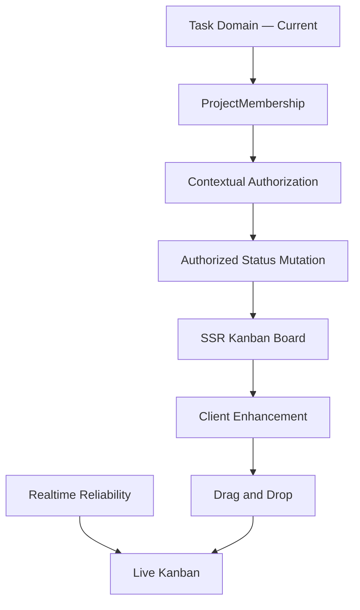

---

# 686. Step 1 — Canonical Task Status

Before building the board:

```text
Task status
```

must remain the authoritative workflow state.

---

# 687. Status Example

Existing workflow concepts such as:

```text
TODO

DOING

DONE
```

can map naturally to:

```text
Kanban columns.
```

---

# 688. Important Rule

Columns must not become:

```text
independent persistence entities
```

unless a future product requirement explicitly requires configurable workflows.

---

# 689. Step 2 — Authorized Status Mutation

The platform requires a secure mutation path for:

```text
changing Task status.
```

---

# 690. Mutation Flow

```text
User

↓

Authenticated Request

↓

Task Lookup

↓

Project Context

↓

Authorization

↓

Transition Validation

↓

Persist Status

↓

Return Authoritative Result.
```

---

# 691. Security Requirement

Knowing a Task ID must never be sufficient to:

```text
move the Task.
```

---

# 692. Cross-project Protection

```text
User belongs to Project A

Task belongs to Project B

↓

Mutation denied.
```

---

# 693. Step 3 — SSR Kanban Board

The first board implementation should preserve the current frontend strategy:

```text
Jinja2 SSR.
```

---

# 694. SSR Board Goal

Render Tasks grouped by:

```text
status.
```

---

# 695. Initial Board Architecture

```text
GET Project Board

↓

Authorize Project Access

↓

Load Authorized Tasks

↓

Group by Status

↓

Render Jinja2 Template.
```

---

# 696. Why SSR First

It provides:

```text
simple baseline

server-authoritative rendering

progressive enhancement

reduced JavaScript coupling.
```

---

# 697. Step 4 — Client Enhancement

Modular JavaScript can progressively add:

```text
interactive movement

optimistic feedback

error handling

realtime updates.
```

---

# 698. Step 5 — Drag and Drop

Drag and Drop is:

```text
PLANNED
```

and should remain:

```text
a presentation mechanism
for authorized Task mutation.
```

---

# 699. Drag and Drop Flow

```text
Drag Card

↓

Drop on Column

↓

Send Authorized Mutation

↓

Server Validates

↓

MariaDB Commit

↓

UI Confirms.
```

---

# 700. Optimistic UI Boundary

If optimistic UI is used:

```text
server rejection
must restore authoritative state.
```

---

# 701. Example Failure

```text
Task visually moved

↓

Server returns 403

↓

Card must return
to previous authoritative column.
```

---

# 702. Accessibility Requirement

Drag and Drop must not become:

```text
the only way
to change Task status.
```

---

# 703. Alternative Interaction

Provide an accessible mechanism such as:

```text
status selector

keyboard controls

or equivalent action.
```

---

# 704. Step 6 — Live Kanban

Live Kanban is:

```text
PLANNED
```

and depends on mature realtime foundations.

---

# 705. Live Kanban Flow

```text
Client A moves Task

↓

Authorized Server Mutation

↓

MariaDB Commit

↓

task.updated Event

↓

Authorized Project Subscribers

↓

Client B Updates Board.
```

---

# 706. Live Kanban Authority

Client B should treat the event as:

```text
notification of authoritative change
```

rather than:

```text
permission to invent local state.
```

---

# 707. Missed-event Recovery

If Client B misses an event:

```text
reconnect

+

reconciliation
```

must restore correct state.

---

# 708. Kanban Testing

Kanban tests should cover:

```text
board rendering

status mutation

authorization

cross-project isolation

invalid transitions

failed mutation rollback

drag/drop integration

realtime update

reconnect

reconciliation.
```

---

# 709. Kanban Exit Condition

Kanban reaches mature collaborative status when:

```text
persistent state

authorization

accessible interaction

realtime delivery

recovery

testing
```

work together consistently.

---

# 710. Phase 17 — Functional Domain Expansion

```text
Status:
    FUTURE / PLANNED BY PRODUCT PRIORITY
```

---

# 711. Primary Goal

Expand the platform beyond current collaboration capabilities while reusing:

```text
IAM

Projects

authorization

attachments

notifications

audit

realtime

testing

operations.
```

---

# 712. Platform-before-domain Principle

New domains should not recreate:

```text
users

permissions

file handling

notifications

audit

realtime infrastructure.
```

---

# 713. Shared Platform Foundation

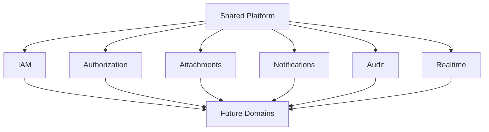

---

# 714. Candidate Future Domains

Potential future domains include:

```text
Academic

Inventory

Reservations

Competition Management.
```

---

# 715. Domain Status Rule

Their architectural documentation must not imply:

```text
full implementation
```

until code and tests demonstrate it.

---

# 716. Domain Introduction Gate

A new domain should have:

```text
clear product value

bounded responsibility

authorization model

persistence model

testing strategy

operational implications.
```

---

# 717. Phase 18 — Academic Domain

```text
Status:
    FUTURE
```

---

# 718. Possible Scope

The Academic domain may eventually represent concepts such as:

```text
courses

groups

students

teachers

academic periods

learning activities.
```

---

# 719. Academic Boundary

The exact model must be driven by:

```text
validated educational requirements.
```

---

# 720. Avoid Premature Modeling

Do not create an enterprise academic information system based solely on:

```text
anticipated future needs.
```

---

# 721. Academic Integration

Potential relationships could include:

```text
User

↓

Academic Role / Membership

↓

Course / Group

↓

Project or Learning Activity.
```

---

# 722. Authorization

Academic authorization may require:

```text
teacher context

student context

group context

course context.
```

---

# 723. Reuse Existing IAM

Academic roles should not automatically replace:

```text
platform IAM.
```

---

# 724. Audit Integration

Sensitive academic operations may require:

```text
Audit.
```

---

# 725. Notification Integration

Academic workflows may generate:

```text
Notifications.
```

---

# 726. Attachment Integration

Learning materials may reuse:

```text
Attachment infrastructure.
```

---

# 727. Realtime Integration

Realtime should be added only where:

```text
collaborative value
justifies it.
```

---

# 728. Academic Exit Condition

The domain becomes CURRENT only after:

```text
validated requirements

implementation

tests

integration

deployment.
```

---

# 729. Phase 19 — Inventory Domain

```text
Status:
    FUTURE
```

---

# 730. Possible Scope

Inventory may represent:

```text
robotics equipment

components

tools

devices

consumables

stock movements.
```

---

# 731. Inventory Integrity

Inventory requires stronger invariants than simple CRUD.

---

# 732. Example

```text
Current Stock

+

Inbound Movement

-

Outbound Movement

=

New Stock.
```

---

# 733. Inventory History

Stock changes should preserve:

```text
movement history.
```

---

# 734. Avoid Direct Quantity Mutation

Prefer:

```text
explicit movement semantics
```

over unexplained:

```text
quantity = new_value.
```

---

# 735. Inventory Audit

Sensitive stock adjustments may require:

```text
Audit.
```

---

# 736. Inventory Authorization

Potential authorization dimensions:

```text
view inventory

create item

register movement

adjust stock

administer inventory.
```

---

# 737. Inventory Attachments

Potentially reuse Attachments for:

```text
manuals

photos

invoices

technical documentation.
```

---

# 738. Inventory Notifications

Potential future events:

```text
low stock

reservation conflict

equipment return overdue.
```

---

# 739. Inventory Exit Condition

As with every future domain:

```text
requirements

↓

domain model

↓

authorization

↓

implementation

↓

tests

↓

CURRENT.
```

---

# 740. Phase 20 — Reservations Domain

```text
Status:
    FUTURE
```

---

# 741. Possible Scope

Reservations may manage:

```text
rooms

equipment

resources

time slots.
```

---

# 742. Reservation Core Challenge

Prevent:

```text
conflicting allocations.
```

---

# 743. Example Invariant

For exclusive resource R:

```text
Reservation A

and

Reservation B
```

must not overlap when both require exclusive access.

---

# 744. Concurrency Challenge

Reservation correctness must account for:

```text
simultaneous requests.
```

---

# 745. Database Role

Correctness should not rely exclusively on:

```text
frontend checks.
```

---

# 746. Reservation Authorization

Potential rules:

```text
who may reserve

which resource

for which context

for how long.
```

---

# 747. Reservation Notifications

Potential events:

```text
reservation created

reservation modified

reservation cancelled

upcoming reservation.
```

---

# 748. Realtime Reservation Boundary

Realtime availability may be useful but:

```text
persistent transactional state
remains authoritative.
```

---

# 749. Reservation Exit Condition

The domain becomes current only after concurrency and authorization semantics are:

```text
implemented

and

tested.
```

---

# 750. Phase 21 — Competition Management

```text
Status:
    FUTURE
```

---

# 751. Product Context

The platform's robotics origins make Competition Management a natural possible future domain.

---

# 752. Possible Concepts

```text
competition

edition

team

participant

registration

round

match

score

ranking.
```

---

# 753. Competition Complexity

Competition rules can vary significantly.

---

# 754. Therefore

Avoid hardcoding one competition model as:

```text
universal platform truth.
```

---

# 755. Competition Rule Model

Potential future architecture may need:

```text
configurable competition rules
```

only if actual product requirements demand them.

---

# 756. Scoring Integrity

Scoring operations may require:

```text
strong authorization

audit

validation

history.
```

---

# 757. Realtime Competition Use

Realtime may later support:

```text
live scoreboards

match status

ranking updates.
```

---

# 758. Competition Realtime Rule

Again:

```text
persist

before

broadcast.
```

---

# 759. Competition Exit Condition

The domain becomes current only after:

```text
validated competition requirements

implementation

testing

operational validation.
```

---

# 760. Phase 22 — PWA Evolution

```text
Status:
    FUTURE
```

---

# 761. Primary Question

Would users materially benefit from:

```text
installability

offline behavior

mobile-oriented experience

push capabilities?
```

---

# 762. PWA Must Solve a Product Problem

PWA should not be adopted merely because:

```text
the browser supports service workers.
```

---

# 763. Offline Complexity

Offline behavior introduces:

```text
stale state

mutation queues

conflict resolution

cache invalidation.
```

---

# 764. Realtime vs Offline

The platform would need to reconcile:

```text
realtime collaboration

with

temporary offline operation.
```

---

# 765. PWA Trigger

A credible trigger would be:

```text
validated mobile/offline usage requirements.
```

---

# 766. PWA Status

Until then:

```text
FUTURE
```

---

# 767. Phase 23 — AI / RAG Evolution

```text
Status:
    FUTURE / EXPERIMENTAL
```

---

# 768. AI Principle

AI should be introduced only for:

```text
specific validated use cases.
```

---

# 769. Possible Future Use Cases

Examples may include:

```text
documentation assistance

semantic search

educational assistance

project knowledge retrieval

activity summarization.
```

---

# 770. These Are Not Current Capabilities

They remain:

```text
candidate future scenarios.
```

---

# 771. RAG Foundation

A future Retrieval-Augmented Generation architecture might require:

```text
document ingestion

chunking

retrieval

authorization-aware filtering

LLM interaction.
```

---

# 772. Security Requirement

AI must not bypass:

```text
existing authorization boundaries.
```

---

# 773. Critical RAG Rule

```text
User cannot retrieve through AI
what the user cannot retrieve
through normal platform authorization.
```

---

# 774. AI Data Governance

Future AI capabilities may require decisions around:

```text
data sensitivity

retention

external providers

prompt content

model output

auditability.
```

---

# 775. AI Reliability

AI output must not automatically become:

```text
authoritative domain state.
```

---

# 776. AI Adoption Trigger

```text
validated use case

+

acceptable privacy model

+

measurable product value.
```

---

# 777. Phase 24 — Multi-tenancy Evaluation

```text
Status:
    FUTURE / CONDITIONAL
```

---

# 778. Multi-tenancy Question

Will one deployment need to host:

```text
multiple independent organizations
```

with strong isolation?

---

# 779. Current Boundary

Project-level collaboration does not automatically mean:

```text
multi-tenancy.
```

---

# 780. Tenant Model

If needed, future architecture may require:

```text
Tenant

↓

Users / Membership

↓

Projects

↓

Resources.
```

---

# 781. Multi-tenant Security

Every relevant query may need:

```text
tenant scoping.
```

---

# 782. Multi-tenant Risk

A missing tenant filter could become:

```text
cross-organization data leakage.
```

---

# 783. Operational Impact

Multi-tenancy may affect:

```text
database design

authorization

storage

audit

billing

configuration

backup.
```

---

# 784. Multi-tenancy Trigger

Adopt only if:

```text
multiple independent organizations
must share the same platform deployment.
```

---

# 785. Phase 25 — PostgreSQL Evaluation

```text
Status:
    FUTURE / CANDIDATE / CONDITIONAL
```

---

# 786. Current Database Reminder

```text
MariaDB
    CURRENT
```

---

# 787. Historical Truth

No completed migration exists from:

```text
MariaDB

to

PostgreSQL.
```

---

# 788. PostgreSQL Is Not a Scheduled Upgrade

It should not appear as:

```text
the inevitable next database.
```

---

# 789. Evaluation Trigger

Possible evaluation requires:

```text
specific technical limitation

operational requirement

feature requirement

or

strategic infrastructure reason.
```

---

# 790. Evaluation Questions

```text
What problem exists in MariaDB?

Can it be solved without migration?

What PostgreSQL capability solves it?

What migration cost exists?

What operational cost changes?

What rollback strategy exists?
```

---

# 791. Migration Cost

A database migration could affect:

```text
schema

SQLAlchemy mappings

queries

migrations

tests

backups

deployment

operations.
```

---

# 792. Migration Decision

Only after evidence:

```text
Stay on MariaDB

or

Plan PostgreSQL Migration.
```

---

# 793. No Predetermined Outcome

The evaluation itself must not assume:

```text
PostgreSQL wins.
```

---

# 794. Phase 26 — Redis Evaluation

```text
Status:
    FUTURE / CONDITIONAL
```

---

# 795. Current Realtime Model

```text
FastAPI WebSockets

+

In-memory Connection Manager.
```

---

# 796. Redis Trigger

The clearest trigger is:

```text
multiple application instances
requiring realtime coordination.
```

---

# 797. Potential Redis Roles

If adopted, Redis could potentially support:

```text
pub/sub

cross-instance event distribution

selected caching

coordination.
```

---

# 798. Avoid Infrastructure Bundling

Adopting Redis for:

```text
realtime coordination
```

does not automatically justify using it for:

```text
every possible cache.
```

---

# 799. Redis Decision

```text
Single Instance

→ In-memory Manager


Multiple Instances + Shared Realtime Need

→ Evaluate Broker


Validated Need

→ Possibly Redis.
```

---

# 800. Phase 27 — Object Storage Evaluation

```text
Status:
    FUTURE / CONDITIONAL
```

---

# 801. Current Attachment Storage

```text
local / persistent storage
```

remains:

```text
CURRENT.
```

---

# 802. Object Storage Trigger

Potential triggers:

```text
multiple application instances

storage capacity

external durability requirements

distributed deployment

independent file serving.
```

---

# 803. Storage Abstraction

Before migration, Attachment logic should avoid unnecessary coupling between:

```text
domain metadata

and

physical storage implementation.
```

---

# 804. Potential Future Providers

The architecture may eventually support:

```text
S3-compatible object storage
```

without making any specific provider mandatory today.

---

# 805. Object Storage Decision

```text
Current Storage Works

↓

Operate / Backup / Measure

↓

Trigger Appears

↓

Evaluate Object Storage.
```

---

# 806. Phase 28 — Kubernetes Evaluation

```text
Status:
    FUTURE / CONDITIONAL
```

---

# 807. Current Deployment

```text
Docker

Docker Compose

Nginx

Ubuntu

Hetzner VPS.
```

---

# 808. Kubernetes Is Not Production Readiness

Production quality does not require:

```text
Kubernetes.
```

---

# 809. Kubernetes Trigger

Potential triggers include:

```text
multiple replicas

complex orchestration

high availability

autoscaling

larger operational topology.
```

---

# 810. Kubernetes Cost

It introduces:

```text
cluster management

networking complexity

deployment objects

secrets management complexity

monitoring complexity

operational expertise.
```

---

# 811. Evaluation Principle

```text
Complexity must pay for itself.
```

---

# 812. Phase 29 — Microservices Evaluation

```text
Status:
    FUTURE / CONDITIONAL
```

---

# 813. Current Architecture

```text
Modular Monolith
    CURRENT
```

---

# 814. Microservices Are Not the Planned Default

The target remains:

```text
healthy modular boundaries
inside the monolith
```

until concrete pressure proves otherwise.

---

# 815. Possible Extraction Triggers

```text
independent scaling

independent deployment

different reliability profile

clear bounded context

organizational ownership.
```

---

# 816. Extraction Rule

```text
Extract because a boundary needs independence,

not

because a module exists.
```

---

# 817. Candidate Extraction Evaluation

Before extraction ask:

```text
Is the boundary already clean?

Does it need independent deployment?

Does it need independent scaling?

Does the operational benefit exceed distributed-system cost?
```

---

# 818. Distributed-system Cost

Microservices introduce:

```text
network failures

distributed observability

service contracts

deployment coordination

eventual consistency

more infrastructure.
```

---

# 819. Microservice Decision

```text
Modular Monolith

↓

Measure Pressure

↓

Evaluate Boundary

↓

Extract Only If Justified.
```

---

# 820. Phase 30 — Horizontal Scaling

```text
Status:
    FUTURE / CONDITIONAL
```

---

# 821. Scaling Principle

Scale because:

```text
measured load

or

availability requirements
```

demand it.

---

# 822. Scaling Dependencies

Horizontal scaling may trigger evaluation of:

```text
Redis

Object Storage

load balancing

distributed observability.
```

---

# 823. Scaling Does Not Necessarily Trigger Microservices

A Modular Monolith can:

```text
run multiple instances.
```

---

# 824. Important Distinction

```text
Horizontal Scaling

!=

Microservices.
```

---

# 825. Phase 31 — Multi-region Architecture

```text
Status:
    DISTANT FUTURE / CONDITIONAL
```

---

# 826. Trigger

Only requirements such as:

```text
geographic resilience

global latency

regulatory distribution

extreme availability
```

could justify it.

---

# 827. Complexity

Multi-region affects:

```text
database consistency

storage

realtime

routing

failover

operations.
```

---

# 828. Current Relevance

```text
None demonstrated.
```

---

# 829. Therefore

It remains outside the active roadmap.

---

# 830. Architecture Trigger Matrix

| Capability | Current Status | Adoption Trigger |
|---|---|---|
| PostgreSQL | FUTURE / CANDIDATE | Verified MariaDB limitation or strategic requirement |
| SAML | FUTURE | Institutional federation requirement |
| Redis | CONDITIONAL | Multi-instance realtime coordination |
| Object Storage | FUTURE / CONDITIONAL | Distributed/storage topology requirement |
| Kubernetes | CONDITIONAL | Orchestration/HA/replica complexity |
| Microservices | CONDITIONAL | Independent lifecycle/scaling requirement |
| Horizontal Scaling | CONDITIONAL | Measured load or availability need |
| Multi-tenancy | FUTURE / CONDITIONAL | Multiple independent organizations |
| PWA | FUTURE | Validated offline/mobile requirement |
| AI / RAG | FUTURE / EXPERIMENTAL | Validated AI use case |
| Multi-region | DISTANT FUTURE | Geographic resilience requirement |

---

# 831. Trigger-based Architecture

The long-term architecture should follow:

```text
Requirement

↓

Evidence

↓

Trigger

↓

Evaluation

↓

Decision

↓

Implementation.
```

---

# 832. Anti-pattern

Avoid:

```text
Technology

↓

Enthusiasm

↓

Implementation

↓

Search for problem.
```

---

# 833. Phase 32 — Release Sequencing

Implementation sequencing should optimize:

```text
dependency

risk reduction

user value.
```

---

# 834. Immediate Consolidation Sequence

```text
ProjectMembership

↓

Contextual Authorization

↓

Cross-project Tests

↓

CSRF

↓

Refresh-token Hardening

↓

Cookie Policy Consistency

↓

WebSocket Authentication

↓

Subscription Authorization.
```

---

# 835. Realtime Reliability Sequence

```text
Event Contract

↓

Reconnect

↓

Reconciliation

↓

Multi-client Testing.
```

---

# 836. Collaborative UX Sequence

```text
Authorized Task Mutation

↓

SSR Kanban

↓

Shared Browser Infrastructure

↓

Drag and Drop

↓

Live Kanban.
```

---

# 837. Operational Sequence

```text
Testing Expansion

↓

Performance Measurement

↓

Observability

↓

Backup Validation

↓

Restore Validation

↓

Production Hardening.
```

---

# 838. Future Product Sequence

After foundational maturity, product priorities may select among:

```text
Academic

Inventory

Reservations

Competition Management.
```

---

# 839. Important Rule

These domains do not necessarily need to be implemented:

```text
in that exact order.
```

---

# 840. Product Priority Decides

The order should depend on:

```text
validated user need

strategic value

dependency

implementation cost.
```

---

# 841. Phase 33 — Near-term Roadmap

```text
Horizon:
    CURRENT / NEXT
```

---

# 842. Near-term Security

```text
ProjectMembership

Contextual Authorization

Cross-project Authorization Tests

Formal CSRF

Refresh-token Security Hardening

Cookie Policy Consistency.
```

---

# 843. Near-term Realtime

```text
WebSocket Authentication Hardening

Subscription Authorization

Event Contract

Reconnect

Reconciliation

Realtime Testing.
```

---

# 844. Near-term Frontend

```text
Shared Fetch Infrastructure

Native Dialog Migration

UI Test Expansion.
```

---

# 845. Near-term Performance

```text
SSR query measurement

N+1 detection

pagination review

Dashboard query review.
```

---

# 846. Near-term Operations

```text
observability improvement

backup validation

restore validation

deployment hardening.
```

---

# 847. Phase 34 — Medium-term Roadmap

```text
Horizon:
    AFTER FOUNDATIONAL CONSOLIDATION
```

---

# 848. Medium-term Product

```text
Kanban

Drag and Drop

Live Kanban.
```

---

# 849. Medium-term Quality

```text
broader UI tests

broader realtime tests

performance regression protection

security regression coverage.
```

---

# 850. Medium-term Operations

```text
stronger monitoring

capacity visibility

recovery drills

release automation maturity.
```

---

# 851. Medium-term Domain Work

One or more future domains may begin according to:

```text
validated product priority.
```

---

# 852. Phase 35 — Long-term Roadmap

```text
Horizon:
    FUTURE / CONDITIONAL
```

---

# 853. Long-term Candidate Capabilities

```text
Academic maturity

Inventory

Reservations

Competition Management

PWA

AI / RAG

Multi-tenancy.
```

---

# 854. Long-term Infrastructure Candidates

Only when triggered:

```text
PostgreSQL

Redis

Object Storage

Horizontal Scaling

Kubernetes

Microservices

Multi-region.
```

---

# 855. Timeline Horizon Model

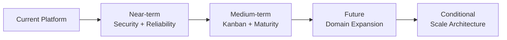

---

# 856. Phase 36 — Timeline Governance

```text
Status:
    CONTINUOUS
```

---

# 857. Primary Goal

Prevent documentation from becoming:

```text
an alternate fictional history.
```

---

# 858. Governance Rule 1

Every major capability should have an explicit status.

---

# 859. Governance Rule 2

Current architecture must reflect:

```text
verified implementation.
```

---

# 860. Governance Rule 3

Future architecture must remain visibly:

```text
future.
```

---

# 861. Governance Rule 4

Conditional architecture must include:

```text
its trigger.
```

---

# 862. Governance Rule 5

Completed history requires:

```text
historical evidence.
```

---

# 863. Governance Rule 6

A roadmap item must not automatically become:

```text
Changelog history.
```

---

# 864. Governance Rule 7

A design document must not automatically become:

```text
Current Architecture.
```

---

# 865. Governance Rule 8

Code and runtime evidence can invalidate:

```text
stale documentation.
```

---

# 866. Example — Refresh Tokens

If stale documentation says:

```text
Refresh Tokens
    FUTURE
```

but verified code implements:

```text
access + refresh

HTTPOnly cookies

/refresh

automatic refresh

logout cleanup
```

then:

```text
implementation evidence wins.
```

---

# 867. Example — PostgreSQL

If strategic documentation says:

```text
PostgreSQL
    CURRENT
```

but verified architecture still uses:

```text
MariaDB
```

then:

```text
MariaDB remains CURRENT.
```

---

# 868. Example — SAML

Detailed SAML architecture does not mean:

```text
SAML is implemented.
```

---

# 869. Example — Kanban

Detailed Kanban planning does not mean:

```text
Kanban is CURRENT.
```

---

# 870. Example — Redis

Detailed distributed realtime architecture does not mean:

```text
Redis is CURRENT.
```

---

# 871. Timeline Synchronization

Changes to implementation status should be reflected across relevant documents.

---

# 872. CURRENT Capability Promotion

When a feature becomes CURRENT, review:

```text
53_CURRENT_TASKS.md

55_CHANGELOG.md

57_PROJECT_EVOLUTION.md

58_TECHNICAL_CHALLENGES.md

59_IMPLEMENTATION_TIMELINE.md

60_MAJOR_DECISIONS.md

61_LESSONS_LEARNED.md

62_FUTURE_EVOLUTION.md.
```

---

# 873. Known Issue Resolution

When a technical issue is resolved, review:

```text
54_KNOWN_ISSUES.md

55_CHANGELOG.md

56_TECHNICAL_DEBT.md.
```

---

# 874. Architectural Decision

When a future option becomes an accepted architectural decision, review:

```text
52_ARCHITECTURAL_DECISIONS.md

59_IMPLEMENTATION_TIMELINE.md

60_MAJOR_DECISIONS.md

62_FUTURE_EVOLUTION.md.
```

---

# 875. Future Capability Promotion

The expected path is:

```text
FUTURE

↓

validated requirement

↓

TARGET / PLANNED

↓

CURRENT TASK

↓

implementation

↓

tests

↓

integration

↓

CURRENT

↓

CHANGELOG / HISTORY.
```

---

# 876. Timeline Audit — Database

Search for statements implying:

```text
PostgreSQL CURRENT

PostgreSQL standardization completed

MariaDB migrated to PostgreSQL.
```

---

# 877. Expected Result

```text
No unsupported statements.
```

---

# 878. Timeline Audit — Authentication

Search for statements implying:

```text
refresh tokens are future

refresh flow is missing.
```

---

# 879. Expected Result

```text
No unsupported statements.
```

---

# 880. Timeline Audit — SAML

Search for:

```text
SAML implemented

SAML current

federated authentication current.
```

---

# 881. Expected Result

```text
No unsupported statements.
```

---

# 882. Timeline Audit — Kanban

Search for:

```text
Kanban CURRENT

Live Kanban CURRENT
```

unless future implementation evidence changes the status.

---

# 883. Timeline Audit — Redis

Search for:

```text
Redis CURRENT

distributed realtime CURRENT.
```

---

# 884. Timeline Audit — Kubernetes

Search for:

```text
Kubernetes CURRENT

Kubernetes deployment completed.
```

---

# 885. Timeline Audit — Microservices

Search for:

```text
microservices CURRENT

microservice migration completed.
```

---

# 886. Timeline Audit — Storage

Search for unsupported claims of:

```text
object storage CURRENT.
```

---

# 887. Timeline Audit — Authorization

Review whether:

```text
Contextual Authorization
```

has been incorrectly promoted from:

```text
PARTIAL / EVOLVING
```

to:

```text
fully mature.
```

---

# 888. Timeline Audit — Realtime

Review whether:

```text
WebSockets CURRENT
```

has been incorrectly interpreted as:

```text
realtime reliability complete.
```

---

# 889. Timeline Audit — Production

Review absolute claims such as:

```text
fully secure

fully production-ready

complete observability.
```

---

# 890. Preferred Language

Use evidence-based maturity language:

```text
CURRENT

PARTIAL

ACTIVE

TARGET

PLANNED

FUTURE

CONDITIONAL.
```

---

# 891. Phase 37 — Final Implementation Roadmap

The implementation roadmap can be represented as five major waves.

---

# 892. Wave 1 — Authorization and Security

```text
ProjectMembership

Contextual Authorization

Cross-project Tests

CSRF

Refresh-token Hardening

Cookie Policy Consistency.
```

---

# 893. Wave 1 Objective

```text
Secure the collaboration boundary.
```

---

# 894. Wave 2 — Realtime Reliability

```text
WebSocket Authentication Hardening

Subscription Authorization

Event Contract

Reconnect

Reconciliation

Realtime Tests.
```

---

# 895. Wave 2 Objective

```text
Make realtime secure
and recoverable.
```

---

# 896. Wave 3 — Collaborative UX

```text
Shared Fetch Infrastructure

SSR Kanban

Authorized Status Mutation

Drag and Drop

Live Kanban

UI Tests.
```

---

# 897. Wave 3 Objective

```text
Improve collaboration
without weakening server authority.
```

---

# 898. Wave 4 — Operational Maturity

```text
Performance Measurement

Query Optimization

Observability

CI/CD Maturity

Backup

Restore

Recovery

Production Hardening.
```

---

# 899. Wave 4 Objective

```text
Make the platform
reliably operable.
```

---

# 900. Wave 5 — Product Expansion

```text
Academic

Inventory

Reservations

Competition Management

PWA

AI / RAG

Multi-tenancy

as justified.
```

---

# 901. Wave 5 Objective

```text
Expand platform value
without destabilizing foundations.
```

---

# 902. Conditional Architecture Lane

In parallel, architecture may evaluate when triggered:

```text
PostgreSQL

Redis

Object Storage

Horizontal Scaling

Kubernetes

Microservices

Multi-region.
```

---

# 903. Conditional Lane Rule

These are not:

```text
mandatory milestones.
```

---

# 904. They Are

```text
possible responses
to future requirements.
```

---

# 905. Full Roadmap Map

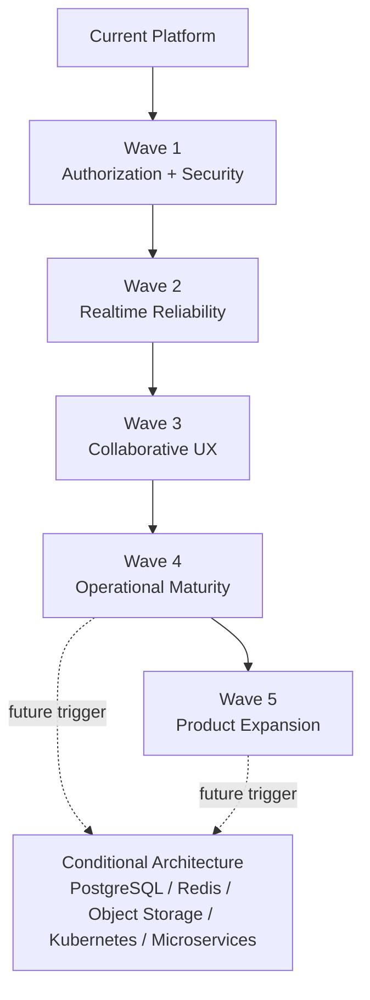

---

# 906. Current Architecture Snapshot

```text
Architecture:
    Modular Monolith

Backend:
    FastAPI

ORM:
    SQLAlchemy

Database:
    MariaDB

Frontend:
    Jinja2 SSR
    Bootstrap
    AdminLTE
    Modular JavaScript

Authentication:
    JWT Access
    JWT Refresh
    HTTPOnly Cookies
    Explicit Refresh
    Automatic Access Refresh

Authorization:
    Global RBAC
    Partial Contextual Authorization

Realtime:
    FastAPI WebSockets
    In-memory Connection Manager

Deployment:
    Docker
    Docker Compose
    Nginx
    Ubuntu
    Hetzner VPS

CI:
    GitHub Actions

Storage:
    Persistent Local Attachment Storage.
```

---

# 907. Current Functional Snapshot

```text
Projects

Tasks

Activities

Attachments

Notifications

Dashboard

Activity Feed

Audit

Realtime foundations.
```

---

# 908. Active Consolidation Snapshot

```text
ProjectMembership

Contextual Authorization

Cross-project Authorization Tests

CSRF

Refresh-token Security Hardening

Cookie Policy Consistency

WebSocket Authentication Hardening

Subscription Authorization.
```

---

# 909. Next Reliability Snapshot

```text
Realtime Event Contract

Reconnect

Reconciliation

Realtime Test Expansion.
```

---

# 910. Planned UX Snapshot

```text
Shared Fetch Infrastructure

Kanban

Drag and Drop

Live Kanban

UI Test Expansion.
```

---

# 911. Operational Maturity Snapshot

```text
Query Optimization

Performance Measurement

Observability

Backup

Restore

Recovery

Deployment Maturity.
```

---

# 912. Future Product Snapshot

```text
Academic

Inventory

Reservations

Competition Management

PWA

AI / RAG

Multi-tenancy.
```

---

# 913. Conditional Architecture Snapshot

```text
PostgreSQL

SAML

Redis

Object Storage

Horizontal Scaling

Kubernetes

Microservices

Multi-region.
```

---

# 914. Final Database Statement

The implementation timeline preserves:

```text
MariaDB
```

as:

```text
CURRENT.
```

---

# 915. PostgreSQL Final Statement

PostgreSQL remains:

```text
FUTURE / CANDIDATE / CONDITIONAL.
```

No completed migration is part of project history.

---

# 916. Final Authentication Statement

The current authentication baseline includes:

```text
JWT Access Token

JWT Refresh Token

HTTPOnly Cookies

Explicit Refresh

Automatic Access Refresh

Refresh-token Validation

Logout Token Cleanup.
```

---

# 917. Final Refresh Hardening Statement

The existence of refresh tokens must remain separate from:

```text
rotation hardening

server-side revocation

reuse detection

device/session management.
```

---

# 918. Final Authorization Statement

```text
Global RBAC
    CURRENT

Contextual Authorization
    PARTIAL / EVOLVING

ProjectMembership
    TARGET / IN CONSOLIDATION.
```

---

# 919. Final SAML Statement

```text
SAML
    FUTURE / NOT IMPLEMENTED.
```

---

# 920. Final Realtime Statement

```text
FastAPI WebSockets
    CURRENT

In-memory Connection Manager
    CURRENT

Reconnect
    TARGET / IN PROGRESS

Reconciliation
    TARGET / IN PROGRESS

Distributed Realtime
    FUTURE / CONDITIONAL.
```

---

# 921. Final Kanban Statement

```text
Task Workflow
    CURRENT

Kanban
    PLANNED

Drag and Drop
    PLANNED

Live Kanban
    PLANNED.
```

---

# 922. Final Infrastructure Statement

```text
Docker
    CURRENT

Docker Compose
    CURRENT

Nginx
    CURRENT

Ubuntu / Hetzner VPS
    CURRENT

Kubernetes
    CONDITIONAL

Microservices
    CONDITIONAL.
```

---

# 923. Final Storage Statement

```text
Persistent Local Attachment Storage
    CURRENT

Object Storage
    FUTURE / CONDITIONAL.
```

---

# 924. Final Architecture Statement

```text
Modular Monolith
    CURRENT

Microservices
    NOT CURRENT / CONDITIONAL.
```

---

# 925. Final Product Evolution Statement

The next meaningful product evolution should occur only after:

```text
security

authorization

realtime reliability

testing

and

operational foundations
```

are sufficiently mature for the capability being introduced.

---

# 926. Implementation Priority Principle

```text
Correctness

before

convenience.
```

---

# 927. Security Priority Principle

```text
Authorization

before

exposure.
```

---

# 928. Realtime Priority Principle

```text
Persistence

before

broadcast.
```

---

# 929. Reliability Priority Principle

```text
Recovery

before

scale.
```

---

# 930. Infrastructure Priority Principle

```text
Evidence

before

complexity.
```

---

# 931. Product Priority Principle

```text
Validated need

before

feature expansion.
```

---

# 932. Architecture Priority Principle

```text
Strong boundaries

before

distribution.
```

---

# 933. Database Priority Principle

```text
Operate MariaDB well

before

considering migration.
```

---

# 934. Realtime Scaling Principle

```text
Reliable single-instance realtime

before

distributed realtime.
```

---

# 935. Deployment Priority Principle

```text
Reliable Docker Compose operations

before

Kubernetes.
```

---

# 936. Domain Priority Principle

```text
Reusable platform foundations

before

domain duplication.
```

---

# 937. AI Priority Principle

```text
Useful product problem

before

AI infrastructure.
```

---

# 938. Timeline Quality Principle

The best implementation timeline is not:

```text
the one containing
the most technologies.
```

---

# 939. It Is

```text
the one that reduces risk
while continuously increasing
real platform value.
```

---

# 940. Historical Integrity Principle

The timeline must remain capable of answering:

```text
What actually happened?
```

without confusing it with:

```text
What might happen next?
```

---

# 941. Current-state Integrity Principle

It must also answer:

```text
What exists today?
```

without promoting:

```text
planned architecture.
```

---

# 942. Future Integrity Principle

And it must answer:

```text
What could evolve later?
```

without implying:

```text
inevitability.
```

---

# 943. Architecture Decision Principle

Future architecture should be:

```text
trigger-driven.
```

---

# 944. Trigger-driven Evolution

```text
Current Need

↓

Measured Limitation

↓

Architecture Trigger

↓

Decision

↓

Implementation

↓

Validation.
```

---

# 945. Continuous Feedback Loop

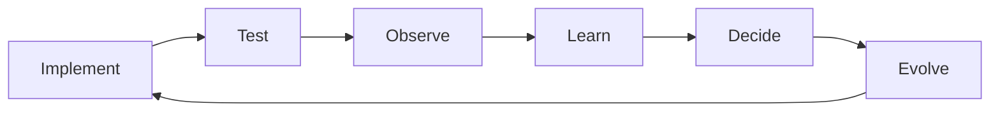

---

# 946. Timeline and Technical Debt

Technical debt should influence sequencing when it:

```text
blocks security

blocks reliability

creates repeated defects

slows future development.
```

---

# 947. Technical Debt Is Not Automatically Priority One

Some debt may remain acceptable if:

```text
risk is low

cost is understood

higher-value work exists.
```

---

# 948. Timeline and Known Issues

Known issues should affect release sequencing according to:

```text
severity

likelihood

blast radius

workaround availability.
```

---

# 949. Timeline and Roadmap

The Product Roadmap answers primarily:

```text
what product capabilities
should evolve.
```

---

# 950. Timeline Role

The Implementation Timeline answers:

```text
in what technical sequence
those capabilities can safely evolve.
```

---

# 951. Timeline and Changelog

The Changelog records:

```text
what changed.
```

---

# 952. Timeline and Project Evolution

Project Evolution explains:

```text
how the architecture
and platform matured.
```

---

# 953. Timeline and Technical Challenges

Technical Challenges explains:

```text
which engineering problems
drove important changes.
```

---

# 954. Timeline and Major Decisions

Major Decisions explains:

```text
which important choices
were made and why.
```

---

# 955. Timeline and Lessons Learned

Lessons Learned captures:

```text
what the project learned
from implementation experience.
```

---

# 956. Timeline and Future Evolution

Future Evolution explores:

```text
possible later directions
without promoting them
to current implementation.
```

---

# 957. Documentation Relationship

```mermaid
flowchart TD
    ROADMAP[47 Product Roadmap]
    TASKS[53 Current Tasks]
    ISSUES[54 Known Issues]
    CHANGE[55 Changelog]
    DEBT[56 Technical Debt]
    EVOLUTION[57 Project Evolution]
    CHALLENGES[58 Technical Challenges]
    TIMELINE[59 Implementation Timeline]
    DECISIONS[60 Major Decisions]
    LESSONS[61 Lessons Learned]
    FUTURE[62 Future Evolution]

    ROADMAP --> TIMELINE
    TASKS --> TIMELINE
    ISSUES --> TIMELINE
    DEBT --> TIMELINE
    CHANGE --> EVOLUTION
    CHALLENGES --> TIMELINE
    DECISIONS --> TIMELINE
    EVOLUTION --> LESSONS
    TIMELINE --> FUTURE
```

---

# 958. Release Decision Questions

Before promoting a significant capability:

```text
Is it implemented?

Is it authorized correctly?

Is it tested?

Is persistence safe?

Is failure behavior understood?

Is deployment safe?

Is rollback/recovery understood?

Is documentation accurate?
```

---

# 959. Future Architecture Decision Questions

Before introducing a major technology:

```text
What problem does it solve?

Is the problem measured?

Can current architecture solve it?

What new complexity appears?

How will it be operated?

How will it be tested?

How will it fail?

How will it be reversed?
```

---

# 960. Timeline Success Criteria

The timeline succeeds if it helps the team:

```text
avoid premature complexity

protect security boundaries

sequence dependencies

preserve historical truth

plan realistic evolution.
```

---

# 961. Current Strengths

The current platform already has significant foundations:

```text
clear backend framework

relational persistence

mature authentication flow

global RBAC

modular architecture

core collaboration domains

cross-cutting platform services

SSR frontend

realtime foundation

containerized deployment

automated testing

CI.
```

---

# 962. Current Improvement Areas

The main improvement areas are:

```text
contextual authorization

ProjectMembership maturity

browser security

refresh security hardening

cookie consistency

WebSocket security

realtime recovery

test depth

observability

backup/restore maturity

performance measurement.
```

---

# 963. Near-term Strategic Goal

```text
Turn existing functionality
into a more secure,
reliable,
and operationally mature platform.
```

---

# 964. Medium-term Strategic Goal

```text
Use those foundations
to deliver richer collaboration,
especially Kanban and Live Kanban.
```

---

# 965. Long-term Strategic Goal

```text
Expand into additional educational,
robotics,
resource-management,
and intelligent capabilities
without sacrificing architectural discipline.
```

---

# 966. Architecture Evolution Guardrail

No future capability should force a rewrite merely because:

```text
the existing architecture
is not fashionable.
```

---

# 967. Rewrite Threshold

A major rewrite requires evidence that:

```text
incremental evolution
cannot reasonably satisfy
validated requirements.
```

---

# 968. Modular Monolith Guardrail

The Modular Monolith should remain:

```text
the default architecture
```

while it continues to satisfy:

```text
deployment

scaling

team

reliability

domain-boundary requirements.
```

---

# 969. MariaDB Guardrail

MariaDB should remain:

```text
the default relational engine
```

while it continues to satisfy:

```text
functional

performance

operational requirements.
```

---

# 970. SSR Guardrail

Jinja2 SSR should remain:

```text
the default frontend delivery model
```

while progressive enhancement remains sufficient.

---

# 971. WebSocket Guardrail

FastAPI WebSockets with in-memory connection management should remain:

```text
the default realtime model
```

while single-instance topology remains sufficient.

---

# 972. Local Storage Guardrail

Persistent local storage should remain:

```text
the default attachment storage
```

while current deployment topology makes it reliable and recoverable.

---

# 973. Docker Compose Guardrail

Docker Compose should remain:

```text
the default orchestration mechanism
```

while current operational complexity remains manageable.

---

# 974. Future Change Rule

A future technology should replace a current foundation only when:

```text
benefit

>

migration cost

+

operational complexity

+

new failure modes.
```

---

# 975. Final CURRENT Matrix

| Area | Capability | Status |
|---|---|---|
| Architecture | Modular Monolith | CURRENT |
| Backend | FastAPI | CURRENT |
| Persistence | SQLAlchemy | CURRENT |
| Database | MariaDB | CURRENT |
| Frontend | Jinja2 SSR | CURRENT |
| UI | Bootstrap / AdminLTE | CURRENT |
| Browser | Modular JavaScript | CURRENT |
| Authentication | JWT Access | CURRENT |
| Authentication | JWT Refresh | CURRENT |
| Authentication | HTTPOnly Cookies | CURRENT |
| Authentication | Explicit Refresh | CURRENT |
| Authentication | Automatic Access Refresh | CURRENT |
| Authorization | Global RBAC | CURRENT |
| Projects | Core Projects | CURRENT |
| Tasks | Core Tasks | CURRENT |
| Activities | Core Activities | CURRENT |
| Files | Attachments | CURRENT |
| Notifications | In-app Notifications | CURRENT |
| Dashboard | Dashboard | CURRENT |
| Feed | Activity Feed | CURRENT |
| Audit | Audit | CURRENT |
| Realtime | FastAPI WebSockets | CURRENT |
| Realtime | In-memory Connection Manager | CURRENT |
| Deployment | Docker | CURRENT |
| Deployment | Docker Compose | CURRENT |
| Proxy | Nginx | CURRENT |
| Host | Ubuntu / Hetzner VPS | CURRENT |
| CI | GitHub Actions | CURRENT |
| Quality | Automated Testing | CURRENT / EXPANDING |
| Storage | Persistent Local Files | CURRENT |

---

# 976. Final PARTIAL / ACTIVE Matrix

| Area | Capability | Status |
|---|---|---|
| Authorization | Contextual Authorization | PARTIAL / ACTIVE |
| Authorization | ProjectMembership | TARGET / IN CONSOLIDATION |
| Security | Formal CSRF | ACTIVE / PLANNED |
| Security | Refresh-token Hardening | ACTIVE / VERIFY |
| Security | Cookie Policy Consistency | ACTIVE |
| Realtime | WebSocket Authentication Hardening | ACTIVE / TARGET |
| Realtime | Subscription Authorization | TARGET |
| Realtime | Event Contract | TARGET |
| Realtime | Reconnect | TARGET / IN PROGRESS |
| Realtime | Reconciliation | TARGET / IN PROGRESS |
| Testing | UI Coverage | EXPANDING |
| Testing | Realtime Coverage | EXPANDING |
| Performance | Query Optimization | ONGOING |
| Operations | Observability | PARTIAL / ONGOING |
| Operations | CD Maturity | EVOLVING |
| Recovery | Backup / Restore Validation | ONGOING |

---

# 977. Final PLANNED Matrix

| Area | Capability | Status |
|---|---|---|
| Frontend | Shared Fetch Infrastructure | PLANNED |
| Frontend | Dialog Modernization | PLANNED / ONGOING |
| Tasks | Kanban | PLANNED |
| Tasks | Drag and Drop | PLANNED |
| Tasks | Live Kanban | PLANNED |
| Testing | Expanded UI Tests | PLANNED |
| Testing | Expanded Realtime Tests | PLANNED |

---

# 978. Final FUTURE Matrix

| Area | Capability | Status |
|---|---|---|
| IAM | SAML | FUTURE |
| Database | PostgreSQL | FUTURE / CANDIDATE |
| Domains | Academic | FUTURE |
| Domains | Inventory | FUTURE |
| Domains | Reservations | FUTURE |
| Domains | Competition Management | FUTURE |
| Client | PWA | FUTURE |
| Intelligence | AI / RAG | FUTURE / EXPERIMENTAL |
| Platform | Multi-tenancy | FUTURE / CONDITIONAL |

---

# 979. Final CONDITIONAL Matrix

| Area | Capability | Trigger |
|---|---|---|
| Realtime | Redis | Multi-instance coordination |
| Storage | Object Storage | Distributed/storage requirement |
| Scaling | Horizontal Scaling | Load / availability requirement |
| Deployment | Kubernetes | Orchestration complexity |
| Architecture | Microservices | Independent lifecycle/scaling |
| Infrastructure | Multi-region | Geographic resilience |
| Database | PostgreSQL Migration | Verified database requirement |

---

# 980. Final Timeline Sequence

```text
CURRENT PLATFORM

↓

SECURITY CONSOLIDATION

↓

CONTEXTUAL AUTHORIZATION

↓

REALTIME SECURITY

↓

REALTIME RELIABILITY

↓

TESTING CONSOLIDATION

↓

KANBAN

↓

LIVE COLLABORATION

↓

OPERATIONAL MATURITY

↓

DOMAIN EXPANSION

↓

CONDITIONAL SCALE EVOLUTION.
```

---

# 981. Final Timeline Rule

```text
The next technology
is not selected
because it is newer.

It is selected
because the next validated problem
requires it.
```

---

# 982. Final Historical Rule

```text
The past must describe
what actually happened.
```

---

# 983. Final Current-state Rule

```text
The present must describe
what actually exists.
```

---

# 984. Final Future Rule

```text
The future must describe
possibilities and targets
without pretending
they already exist.
```

---

# 985. Final Security Rule

```text
Authentication proves identity.

Authorization proves access.

Context proves scope.
```

---

# 986. Final Realtime Rule

```text
Persist first.

Broadcast second.

Reconcile when uncertain.
```

---

# 987. Final Database Rule

```text
MariaDB is CURRENT.

PostgreSQL is not historical fact.

Migration requires a future trigger.
```

---

# 988. Final IAM Rule

```text
JWT Access + Refresh
is CURRENT.

SAML
is FUTURE.
```

---

# 989. Final Authorization Rule

```text
Global RBAC
is CURRENT.

Contextual Authorization
is PARTIAL.

ProjectMembership
is being consolidated.
```

---

# 990. Final Collaboration Rule

```text
Tasks are CURRENT.

Kanban is PLANNED.

Live Kanban is PLANNED.
```

---

# 991. Final Realtime Rule

```text
WebSockets are CURRENT.

In-memory Connection Management is CURRENT.

Distributed Realtime is CONDITIONAL.
```

---

# 992. Final Deployment Rule

```text
Docker Compose is CURRENT.

Kubernetes is CONDITIONAL.
```

---

# 993. Final Architecture Rule

```text
Modular Monolith is CURRENT.

Microservices are CONDITIONAL.
```

---

# 994. Final Storage Rule

```text
Persistent Local Storage is CURRENT.

Object Storage is FUTURE / CONDITIONAL.
```

---

# 995. Final Scaling Rule

```text
Scale only
when evidence requires scale.
```

---

# 996. Final Product Rule

```text
Expand only
when foundations can safely support expansion.
```

---

# 997. Final Engineering Rule

```text
Prefer incremental,
evidence-driven evolution
over speculative architectural replacement.
```

---

# 998. Final Implementation Timeline Summary

Aula Robótica Platform ha evolucionado desde una aplicación web orientada a un contexto concreto de robótica hacia una plataforma modular con foundations consolidadas en:

```text
FastAPI

SQLAlchemy

MariaDB

Modular Monolith

Jinja2 SSR

Bootstrap / AdminLTE

Modular JavaScript

JWT Access + Refresh

HTTPOnly Cookies

Global RBAC

Projects

Tasks

Activities

Attachments

Notifications

Dashboard

Activity Feed

Audit

FastAPI WebSockets

Docker / Docker Compose

Nginx

Ubuntu / Hetzner VPS

GitHub Actions

Automated Testing.
```

La siguiente etapa no consiste en sustituir estas foundations, sino en consolidarlas mediante:

```text
ProjectMembership

Contextual Authorization

Cross-project Security

CSRF

Refresh-token Hardening

Cookie Policy Consistency

WebSocket Security

Subscription Authorization

Event Contracts

Reconnect

Reconciliation

Testing Expansion

Operational Maturity.
```

Sobre esta base podrán evolucionar:

```text
Kanban

Live Kanban

future functional domains

PWA

AI / RAG

Multi-tenancy
```

cuando exista valor de producto suficiente.

Y únicamente cuando aparezcan triggers técnicos verificables deberán evaluarse cambios de infraestructura como:

```text
PostgreSQL

Redis

Object Storage

Horizontal Scaling

Kubernetes

Microservices

Multi-region.
```

---

# 999. Conclusion

The implementation strategy of Aula Robótica Platform is:

```text
Build the foundation.

Secure the boundary.

Persist the truth.

Test the behavior.

Recover from failure.

Observe the system.

Improve collaboration.

Expand the product.

Scale only when required.
```

The timeline therefore remains:

```text
incremental

evidence-driven

security-aware

reliability-oriented

operationally realistic

and

architecturally reversible.
```

---

# 1000. End of Document

```text
59_IMPLEMENTATION_TIMELINE.md

Status:
    AUDITED / TEMPORALLY ALIGNED

Current Database:
    MariaDB

Current Architecture:
    Modular Monolith

Current Authentication:
    JWT Access + Refresh
    HTTPOnly Cookies
    Explicit + Automatic Refresh

Current Authorization:
    Global RBAC
    + Partial Contextual Authorization

Current Realtime:
    FastAPI WebSockets
    + In-memory Connection Manager

Current Deployment:
    Docker
    Docker Compose
    Nginx
    Ubuntu
    Hetzner VPS

Current Storage:
    Persistent Local Attachment Storage

Active Consolidation:
    ProjectMembership
    Contextual Authorization
    CSRF
    Refresh-token Hardening
    Cookie Policy Consistency
    WebSocket Security
    Subscription Authorization
    Realtime Reliability
    Testing
    Operational Maturity

Planned Product Evolution:
    Kanban
    Drag and Drop
    Live Kanban

Future / Conditional Architecture:
    PostgreSQL
    SAML
    Redis
    Object Storage
    Kubernetes
    Microservices
    PWA
    AI / RAG
    Multi-tenancy
    Multi-region

Core Principle:
    Preserve historical truth,
    evolve from verified evidence,
    and introduce complexity
    only when validated requirements justify it.
```
