# 60_MAJOR_DECISIONS.md

# Major Architectural and Technical Decisions

## Aula Robótica Platform

## Parte 1/3 — Principios, arquitectura, persistencia, IAM, autorización, frontend y fundamentos realtime

---

# 1. Propósito del documento

Este documento registra las principales decisiones arquitectónicas, técnicas y de ingeniería que definen **Aula Robótica Platform**.

Su finalidad es preservar no solo:

```text
qué utiliza la plataforma
```

sino también:

```text
por qué se eligió

qué problema resuelve

qué alternativas se descartaron o aplazaron

qué consecuencias introduce

qué estado real tiene la decisión

qué evidencia permite considerarla vigente

y

qué condiciones justificarían revisarla.
```

---

# 2. Naturaleza del documento

`60_MAJOR_DECISIONS.md` es una memoria consolidada de decisiones.

No debe interpretarse como:

```text
roadmap

backlog

catálogo de tecnologías deseadas

lista de experimentos

descripción automática del futuro.
```

---

# 3. Objetivo principal

El documento debe permitir responder:

```text
¿Por qué la plataforma tiene esta arquitectura?

¿Qué decisiones son realmente actuales?

¿Qué decisiones siguen parcialmente implantadas?

¿Qué decisiones son objetivos aceptados?

¿Qué alternativas permanecen condicionadas?

¿Qué tecnologías todavía no forman parte de la arquitectura?
```

---

# 4. Principio de verdad arquitectónica

Una decisión solo puede describirse como parte de la arquitectura actual cuando existe evidencia suficiente de:

```text
implementación

+

integración

+

uso real.
```

---

# 5. Documentation Is Not Implementation

```text
Detailed Documentation

≠

Implemented Architecture.
```

---

# 6. Consecuencia

Una tecnología puede disponer de:

```text
análisis

diagramas

ADR

diseño

estrategia

roadmap
```

sin que ello signifique que sea:

```text
CURRENT.
```

---

# 7. Principio de evidencia

Cuando existe contradicción entre documentación histórica y evidencia técnica verificable:

```text
Verified Implementation Evidence

>

Stale Documentation.
```

---

# 8. Fuentes de evidencia

La evidencia puede proceder de:

```text
código

configuración

dependencias

modelos

migraciones

tests

pipelines

deployment

runtime

infraestructura operativa.
```

---

# 9. Ejemplo — Refresh Tokens

La existencia verificada de:

```text
JWT access token

JWT refresh token

access cookie

refresh cookie

/refresh endpoint

automatic access refresh

refresh validation

logout cookie cleanup
```

demuestra que:

```text
Refresh-token Workflow
    CURRENT.
```

---

# 10. Lo anterior no demuestra automáticamente

```text
refresh-token rotation

server-side revocation

reuse detection

device/session management.
```

---

# 11. Clasificación correcta

```text
Refresh Workflow
    CURRENT

Refresh Security Hardening
    ACTIVE / VERIFY / TARGET

Session / Device Management
    FUTURE.
```

---

# 12. Ejemplo — Database

La arquitectura actual utiliza:

```text
MariaDB.
```

---

# 13. Consecuencia histórica

No debe reconstruirse una evolución ficticia:

```text
MariaDB

↓

PostgreSQL.
```

---

# 14. Estado correcto

```text
MariaDB
    CURRENT

PostgreSQL
    FUTURE / CANDIDATE / CONDITIONAL.
```

---

# 15. Ejemplo — SAML

La existencia de documentación sobre federación no demuestra:

```text
SAML implementation.
```

---

# 16. Estado correcto de SAML

```text
FUTURE / NOT IMPLEMENTED.
```

---

# 17. Ejemplo — Kanban

La existencia de:

```text
Tasks

Task Status

WebSockets
```

no demuestra:

```text
Kanban CURRENT.
```

---

# 18. Estado correcto de Kanban

```text
Task Workflow
    CURRENT

Kanban
    PLANNED

Drag and Drop
    PLANNED

Live Kanban
    PLANNED.
```

---

# 19. Relación con Architectural Decision Records

Este documento complementa los ADR específicos.

---

# 20. ADR

Un ADR puede registrar:

```text
contexto detallado

problema

alternativas

fecha

participantes

decisión

consecuencias

estado.
```

---

# 21. Major Decisions

Este documento proporciona:

```text
visión transversal

coherencia entre decisiones

estado actual

dependencias

triggers de revisión.
```

---

# 22. Relación conceptual

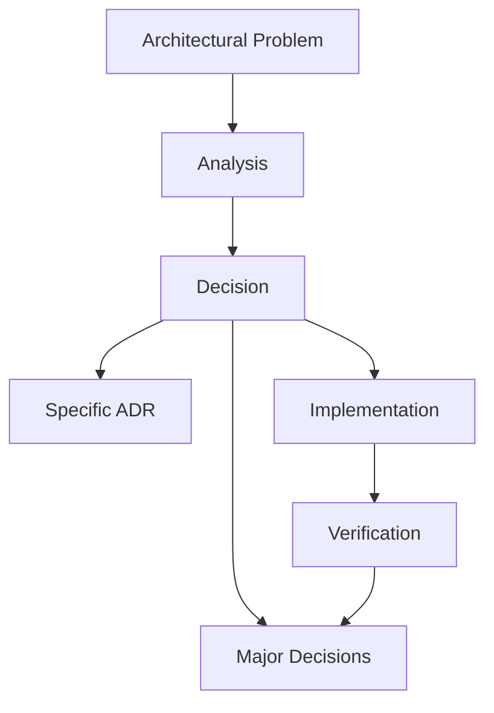

---

# 23. Alcance

Las decisiones cubren:

```text
arquitectura

backend

persistencia

IAM

seguridad

autorización

frontend

realtime

testing

storage

DevOps

deployment

operaciones

observabilidad

escalabilidad

evolución futura.
```

---

# 24. Vocabulario de estado

Para evitar confundir presente y futuro se utilizan:

```text
CURRENT

PARTIAL

TARGET

PLANNED

FUTURE

CONDITIONAL

SUPERSEDED

DEPRECATED.
```

---

# 25. CURRENT

Significa:

```text
implemented

integrated

part of the current platform.
```

---

# 26. PARTIAL

Significa:

```text
implemented to some degree

but not yet complete
or consistently mature.
```

---

# 27. TARGET

Significa:

```text
accepted architectural direction

but not fully implemented.
```

---

# 28. PLANNED

Significa:

```text
expected implementation work
with sufficient product or technical intent.
```

---

# 29. FUTURE

Significa:

```text
possible later capability
not part of the current implementation.
```

---

# 30. CONDITIONAL

Significa:

```text
adopt only
if a concrete trigger appears.
```

---

# 31. SUPERSEDED

Significa:

```text
a later decision
has replaced this one.
```

---

# 32. DEPRECATED

Significa:

```text
still temporarily present
but intentionally being removed.
```

---

# 33. Decision State Is Not Implementation State

Una decisión puede estar:

```text
ACCEPTED
```

mientras su implementación permanece:

```text
TARGET

or

PARTIAL.
```

---

# 34. Ejemplo

```text
Decision:
    Context-aware authorization is required.

Decision Status:
    ACCEPTED.

Implementation Status:
    PARTIAL / EVOLVING.
```

---

# 35. Categorías

Las decisiones pueden clasificarse como:

| Categoría | Propósito |
|---|---|
| Fundacional | Define foundations de la plataforma |
| Estructural | Organiza responsabilidades y límites |
| Persistencia | Define autoridad e integridad de datos |
| Seguridad | Protege identidad, acceso y datos |
| Frontend | Define entrega e interacción cliente |
| Realtime | Define colaboración en tiempo real |
| Operacional | Define ejecución y explotación |
| Evolutiva | Prepara crecimiento controlado |
| Diferida | Evita introducir complejidad prematura |
| Condicional | Se activa únicamente ante un trigger |

---

# 36. Principio rector

La arquitectura sigue:

> **Introducir complejidad únicamente cuando resuelve un problema real, observable o suficientemente validado.**

---

# 37. Evolución preferida

```text
Simple

↓

Structured

↓

Modular

↓

Secure

↓

Reliable

↓

Observable

↓

Scalable when required.
```

---

# 38. Evolución rechazada

```text
Complex from day one

↓

Operationally expensive

↓

Hard to understand

↓

Hard to change.
```

---

# 39. Principio de reversibilidad

Cuando dos soluciones satisfacen adecuadamente el problema actual, se favorece aquella que:

```text
introduce menos complejidad

preserva más opciones futuras

resulta más fácil de operar

resulta más fácil de sustituir.
```

---

# 40. Principio de autoridad

La arquitectura debe definir claramente:

```text
qué componente
es autoridad
sobre cada tipo de estado.
```

---

# 41. Autoridad persistente

Para estado de dominio:

```text
MariaDB

through

SQLAlchemy / Application Logic
```

constituye la autoridad persistente.

---

# 42. Autoridad de seguridad

Las decisiones de acceso pertenecen al:

```text
server.
```

---

# 43. Autoridad realtime

WebSockets comunican cambios.

No sustituyen:

```text
persistent authoritative state.
```

---

# 44. Principio de crecimiento

La plataforma debe evolucionar preferentemente mediante:

```text
incremental architecture.
```

---

# 45. Baseline actual

```text
FastAPI

SQLAlchemy

MariaDB

Modular Monolith

Jinja2 SSR

Bootstrap

AdminLTE

Modular JavaScript

JWT Access + Refresh

HTTPOnly Cookies

Global RBAC

Partial Contextual Authorization

FastAPI WebSockets

In-memory Connection Manager

Docker

Docker Compose

Nginx

Ubuntu

Hetzner VPS

GitHub Actions.
```

---

# 46. MD-001 — FastAPI como framework backend principal

```text
Decision Status:
    ACTIVE

Implementation Status:
    CURRENT

Category:
    FOUNDATIONAL.
```

---

# 47. Contexto

La plataforma necesita soportar:

```text
HTTP

SSR

JSON APIs

authentication

authorization

WebSockets

application services

database access.
```

---

# 48. Decisión

Utilizar:

```text
FastAPI
```

como framework principal del backend.

---

# 49. Motivación

FastAPI proporciona:

```text
HTTP routing

dependency injection

validation

typing

OpenAPI

async capabilities

WebSockets.
```

---

# 50. Beneficio arquitectónico

Permite mantener dentro de una plataforma coherente:

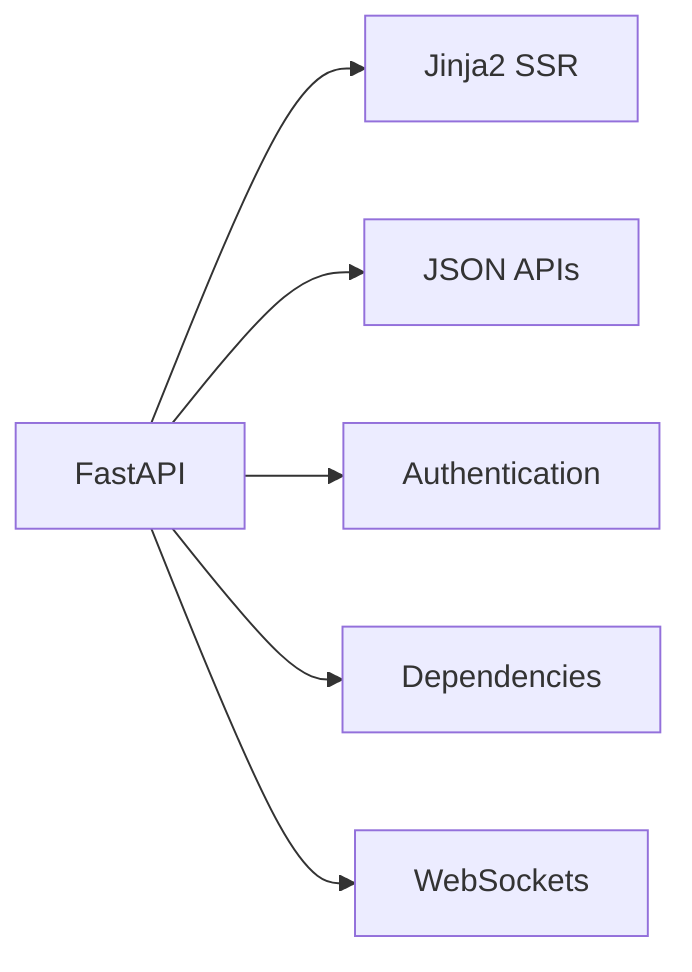

---

# 51. Boundary Rule

FastAPI debe funcionar principalmente como:

```text
transport

+

application boundary.
```

---

# 52. No debe convertirse en

```text
the entire business architecture.
```

---

# 53. Route Responsibility

Las routes deben concentrarse en:

```text
input

HTTP validation boundary

dependency resolution

service invocation

response.
```

---

# 54. Evitar

```text
Route

↓

SQLAlchemy

↓

Business Logic

↓

Audit

↓

Notification

↓

WebSocket
```

concentrado en un único handler.

---

# 55. Alternativas

Alternativas conceptuales:

```text
Django

Flask

other Python frameworks

other backend ecosystems.
```

---

# 56. Trigger de revisión

Revisar únicamente si aparecen requisitos que FastAPI no pueda satisfacer razonablemente o si cambia radicalmente:

```text
the application architecture.
```

---

# 57. MD-002 — Modular Monolith como arquitectura principal

```text
Decision Status:
    ACTIVE

Implementation Status:
    CURRENT

Category:
    FOUNDATIONAL.
```

---

# 58. Decisión

La arquitectura principal es:

```text
Modular Monolith.
```

---

# 59. Decisión complementaria

No adoptar como arquitectura actual:

```text
Microservices.
```

---

# 60. Motivación

El crecimiento funcional no implica automáticamente necesidad de:

```text
independent processes

independent databases

distributed transactions

service discovery

network contracts

independent deployment.
```

---

# 61. Arquitectura conceptual

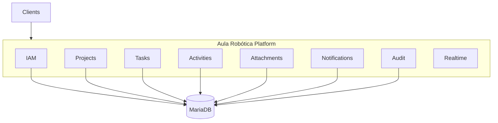

---

# 62. Beneficios

```text
local transactions

simple deployment

low operational overhead

easy debugging

low internal latency

shared infrastructure

incremental evolution.
```

---

# 63. Modular Does Not Mean Unstructured

```text
Monolith

≠

Big Ball of Mud.
```

---

# 64. Requisito esencial

Deben preservarse:

```text
module boundaries

service boundaries

repository boundaries

explicit dependencies.
```

---

# 65. Evolución posible

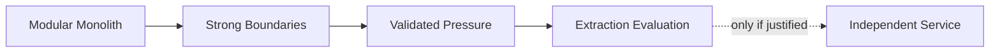

---

# 66. Microservices Status

```text
FUTURE / CONDITIONAL

NOT CURRENT.
```

---

# 67. Triggers potenciales

```text
independent scaling

independent deployment

different reliability requirements

clear organizational ownership

strong bounded-context independence.
```

---

# 68. Anti-trigger

No adoptar microservicios:

```text
because the project is growing

because the architecture looks more modern

because enterprise systems use them.
```

---

# 69. MD-003 — Arquitectura por capas

```text
Decision Status:
    ACTIVE

Implementation Status:
    CURRENT

Category:
    STRUCTURAL.
```

---

# 70. Decisión

Separar conceptualmente:

```text
Presentation

Application

Persistence

Domain / Model

Infrastructure.
```

---

# 71. Flujo principal

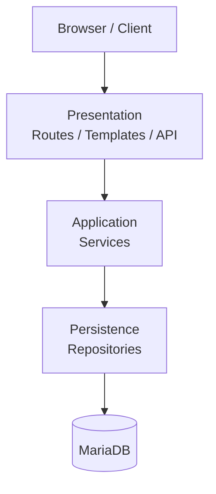

---

# 72. Objetivo

Evitar que las responsabilidades de:

```text
HTTP

business rules

persistence

security

side effects
```

queden mezcladas.

---

# 73. Presentation Layer

Responsabilidades:

```text
request

response

HTTP semantics

templates

serialization

dependency boundaries.
```

---

# 74. Application Layer

Responsabilidades:

```text
use cases

orchestration

authorization coordination

transactions

cross-cutting side effects.
```

---

# 75. Persistence Layer

Responsabilidades:

```text
querying

persistence

data retrieval

database interaction.
```

---

# 76. Infrastructure Layer

Puede contener preocupaciones como:

```text
storage

external integration

realtime transport

deployment-specific adapters.
```

---

# 77. Boundary Principle

```text
Dependencies should point
toward explicit responsibilities,
not convenience.
```

---

# 78. MD-004 — Service Layer explícita

```text
Decision Status:
    ACTIVE

Implementation Status:
    CURRENT

Category:
    STRUCTURAL.
```

---

# 79. Decisión

Los casos de uso significativos deben disponer de:

```text
Service Layer.
```

---

# 80. Razón

Un caso de uso puede necesitar coordinar:

```text
validation

authorization

repositories

transactions

audit

activity

notifications

realtime.
```

---

# 81. Orquestación

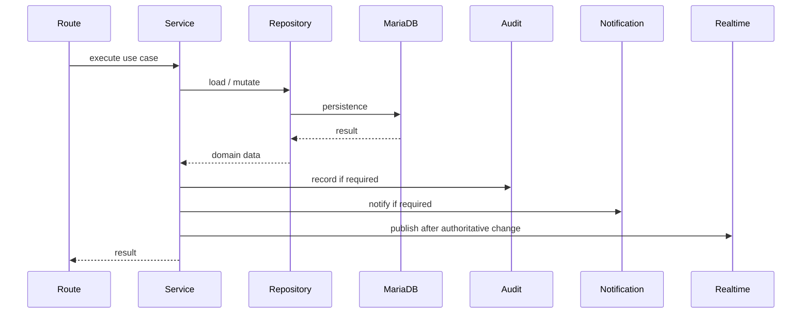

---

# 82. Beneficio

La Service Layer crea:

```text
a reusable application boundary.
```

---

# 83. Regla

Las routes no deben convertirse en:

```text
application services disguised as controllers.
```

---

# 84. MD-005 — Repository Pattern para persistencia

```text
Decision Status:
    ACTIVE

Implementation Status:
    CURRENT

Category:
    STRUCTURAL / PERSISTENCE.
```

---

# 85. Decisión

El acceso significativo a persistencia se organiza mediante:

```text
repositories.
```

---

# 86. Responsabilidad

Los repositorios gestionan:

```text
queries

entity retrieval

persistence operations

database-specific access patterns.
```

---

# 87. No deben decidir

```text
business authorization

HTTP status codes

UI behavior

realtime delivery.
```

---

# 88. Separación

```text
Repository:
    How is data retrieved?

Service:
    What should the use case do?

Policy:
    Is it allowed?

Route:
    How is it exposed through HTTP?
```

---

# 89. Beneficio

Reduce acoplamiento entre:

```text
application logic

and

persistence mechanics.
```

---

# 90. MD-006 — SQLAlchemy como ORM

```text
Decision Status:
    ACTIVE

Implementation Status:
    CURRENT

Category:
    PERSISTENCE.
```

---

# 91. Decisión

Utilizar:

```text
SQLAlchemy
```

como capa ORM/persistencia relacional.

---

# 92. Razones

```text
Python integration

relational modeling

transaction support

query composition

mature ecosystem

database abstraction.
```

---

# 93. Abstraction Does Not Mean Database Irrelevance

SQLAlchemy no elimina la necesidad de comprender:

```text
MariaDB behavior

SQL

indexes

constraints

transactions

query plans.
```

---

# 94. Antiobjetivo

No utilizar el ORM como excusa para:

```text
ignore relational design.
```

---

# 95. Consecuencia

Las optimizaciones deben partir de:

```text
actual query behavior.
```

---

# 96. MD-007 — Base de datos relacional como fuente autoritativa

```text
Decision Status:
    ACTIVE

Implementation Status:
    CURRENT

Category:
    FOUNDATIONAL / PERSISTENCE.
```

---

# 97. Decisión

El estado persistente del dominio se mantiene en:

```text
relational persistence.
```

---

# 98. Motor actual

```text
MariaDB.
```

---

# 99. Justificación

Los principales dominios contienen relaciones como:

```text
User

Project

Task

Activity

Attachment

Notification

Audit.
```

---

# 100. Relational Strength

La base relacional permite expresar:

```text
identity

foreign keys

constraints

transactions

relationships

queryable history.
```

---

# 101. Source of Truth

```text
MariaDB

>

browser state

>

WebSocket event

>

visual representation.
```

---

# 102. Realtime Consequence

Un evento realtime no se convierte en:

```text
authoritative state.
```

---

# 103. Frontend Consequence

El estado visual debe poder:

```text
reconstruct itself
from authoritative server state.
```

---

# 104. MD-008 — MariaDB como motor relacional actual

```text
Decision Status:
    ACTIVE

Implementation Status:
    CURRENT

Category:
    PERSISTENCE.
```

---

# 105. Decisión

El motor relacional actual es:

```text
MariaDB.
```

---

# 106. Historical Integrity

No existe evidencia de una migración completada a:

```text
PostgreSQL.
```

---

# 107. Consecuencia documental

Toda afirmación equivalente a:

```text
PostgreSQL is the current database

PostgreSQL standardization completed

MariaDB was migrated to PostgreSQL
```

debe considerarse:

```text
incorrect
```

salvo futura evidencia de implementación.

---

# 108. Razón de continuidad

Mientras MariaDB satisfaga:

```text
functional requirements

relational integrity

performance

operations

backup/recovery requirements
```

no existe necesidad arquitectónica automática de sustituirla.

---

# 109. PostgreSQL Status

```text
FUTURE / CANDIDATE / CONDITIONAL.
```

---

# 110. Trigger de evaluación

PostgreSQL solo debe evaluarse ante:

```text
verified MariaDB limitation

specific PostgreSQL capability requirement

operational requirement

strategic infrastructure requirement.
```

---

# 111. Database Decision Flow

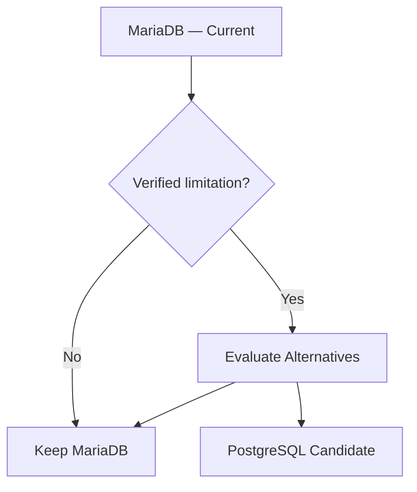

---

# 112. No Predetermined Outcome

Incluso ante una evaluación:

```text
PostgreSQL
```

no debe considerarse automáticamente:

```text
the winner.
```

---

# 113. Portabilidad

La arquitectura puede evitar dependencias innecesarias del motor cuando sea razonable.

---

# 114. Pero

```text
portability
```

no debe degradar:

```text
correctness

clarity

performance.
```

---

# 115. MD-009 — Integridad reforzada en base de datos

```text
Decision Status:
    ACTIVE

Implementation Status:
    CURRENT / CONTINUOUS

Category:
    PERSISTENCE.
```

---

# 116. Decisión

Las invariantes relacionales importantes deben reforzarse mediante mecanismos como:

```text
foreign keys

NOT NULL

UNIQUE

appropriate indexes

database constraints.
```

---

# 117. Razón

La aplicación no es la única capa capaz de:

```text
protect integrity.
```

---

# 118. Defense in Depth

```text
Application Validation

+

Domain Rules

+

Database Constraints.
```

---

# 119. Regla

Una regla crítica que pueda expresarse de forma fiable en la base de datos debería evaluarse como:

```text
database-enforced invariant.
```

---

# 120. MD-010 — Migraciones versionadas para evolución del esquema

```text
Decision Status:
    ACTIVE

Implementation Status:
    CURRENT PRINCIPLE

Category:
    PERSISTENCE / OPERATIONS.
```

---

# 121. Decisión

La evolución del esquema debe realizarse mediante:

```text
controlled versioned migrations.
```

---

# 122. Anti-pattern

No utilizar como estrategia de producción:

```text
drop database

recreate everything

manual undocumented schema changes.
```

---

# 123. Objetivo

Las migraciones deben permitir conocer:

```text
what changed

when

in which order

and

how deployments depend on it.
```

---

# 124. Migration Flow

```text
Schema Change

↓

Migration

↓

Review

↓

Test

↓

Deploy

↓

Verify.
```

---

# 125. Database Migration Is Not Database Engine Migration

Debe distinguirse:

```text
schema migration
```

de:

```text
MariaDB → PostgreSQL migration.
```

---

# 126. Estado

```text
Schema evolution:
    CURRENT PRACTICE

PostgreSQL migration:
    NOT CURRENT.
```

---

# 127. MD-011 — Transacciones controladas por casos de uso

```text
Decision Status:
    ACTIVE

Implementation Status:
    CURRENT PRINCIPLE

Category:
    PERSISTENCE / APPLICATION.
```

---

# 128. Decisión

Los límites transaccionales deben alinearse con:

```text
use-case consistency.
```

---

# 129. Ejemplo

Una operación que conceptualmente requiere:

```text
update resource

+

create related state

+

record critical information
```

debe evitar estados parcialmente persistidos cuando el caso de uso exige atomicidad.

---

# 130. Principio

```text
Commit

only after

the authoritative mutation
is valid.
```

---

# 131. Realtime Consequence

```text
Persist

↓

Commit

↓

Publish Realtime Event.
```

---

# 132. Anti-pattern

```text
Broadcast

↓

Commit

↓

Commit fails.
```

---

# 133. MD-012 — JWT para autenticación web

```text
Decision Status:
    ACTIVE

Implementation Status:
    CURRENT

Category:
    SECURITY / IAM.
```

---

# 134. Decisión

Utilizar:

```text
JWT
```

como mecanismo de token para la autenticación web actual.

---

# 135. Implementación actual

La plataforma utiliza:

```text
Access Token

+

Refresh Token.
```

---

# 136. Authentication Lifecycle

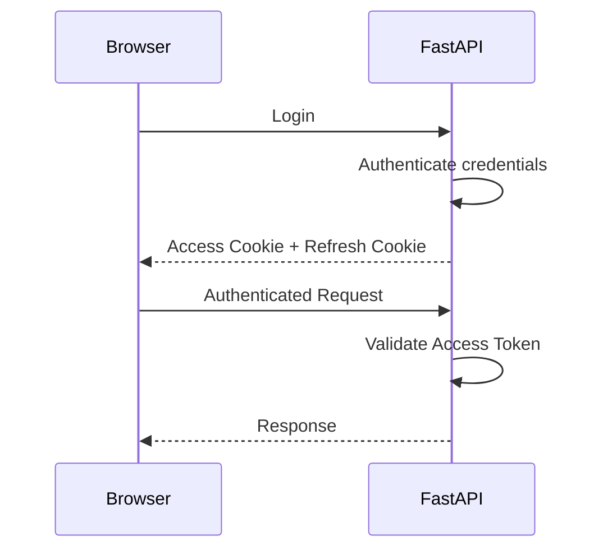

---

# 137. JWT Content Principle

Los tokens deben contener únicamente:

```text
necessary authentication/session claims.
```

---

# 138. JWT Is Not

```text
the database

the authorization model

the user profile store

the domain state.
```

---

# 139. Authorization Consequence

Un token válido demuestra:

```text
authenticated identity/session context.
```

No demuestra automáticamente:

```text
authorization for every resource.
```

---

# 140. MD-013 — Access + Refresh Token Workflow

```text
Decision Status:
    ACTIVE

Implementation Status:
    CURRENT

Category:
    SECURITY / IAM.
```

---

# 141. Decisión

Utilizar un flujo con:

```text
shorter-lived access capability

+

refresh capability
```

para mantener sesiones autenticadas.

---

# 142. Evidencia funcional actual

El flujo incluye:

```text
login returns access + refresh tokens

both stored as cookies

explicit /refresh endpoint

refresh-token validation

new access-token generation

automatic middleware refresh

logout cleanup.
```

---

# 143. Explicit Refresh

La aplicación dispone de:

```text
/refresh
```

para validar el refresh token y emitir:

```text
new access token.
```

---

# 144. Automatic Refresh

El middleware puede:

```text
detect failed/expired access validation

↓

read refresh token

↓

validate refresh token

↓

generate new access token

↓

reconstruct authenticated request state.
```

---

# 145. Refresh Workflow Status

```text
CURRENT.
```

---

# 146. Refresh Hardening Is Different

La existencia del workflow no implica que estén completamente resueltos:

```text
rotation

server-side revocation

reuse detection

device/session management.
```

---

# 147. Refresh Hardening Status

```text
ACTIVE / VERIFY / TARGET.
```

---

# 148. Session Management Status

```text
FUTURE.
```

---

# 149. MD-014 — JWT transportado mediante HTTPOnly Cookies

```text
Decision Status:
    ACTIVE

Implementation Status:
    CURRENT

Category:
    SECURITY.
```

---

# 150. Decisión

Transportar los tokens de autenticación web mediante:

```text
HTTPOnly Cookies.
```

---

# 151. Objetivo

Reducir exposición directa de tokens a:

```text
client-side JavaScript.
```

---

# 152. Current Cookie Model

```text
access token cookie

refresh token cookie.
```

---

# 153. Propiedades de seguridad esperadas

En producción:

```text
HttpOnly

Secure

appropriate SameSite policy

controlled expiration.
```

---

# 154. Cookie Policy Finding

Existe una inconsistencia técnica relevante entre:

```text
normal authentication cookie configuration
```

y:

```text
automatic middleware refresh cookie configuration.
```

---

# 155. Normal Authentication Configuration

La configuración verificada sigue una política equivalente a:

```python
samesite = "lax" if DEBUG else "strict"
secure = not DEBUG
```

---

# 156. Automatic Refresh Configuration

El flujo automático contiene una configuración equivalente a:

```python
samesite = "lax"
secure = False
```

---

# 157. Riesgo

El refresh automático podría:

```text
reissue the access cookie
with weaker attributes
than the normal production login path.
```

---

# 158. Decisión de hardening

La política de cookies debe evolucionar hacia:

```text
one centralized authoritative configuration.
```

---

# 159. Cookie Centralization Status

```text
TARGET / HIGH PRIORITY.
```

---

# 160. MD-015 — Authentication y Authorization son responsabilidades distintas

```text
Decision Status:
    ACTIVE

Implementation Status:
    CURRENT PRINCIPLE

Category:
    SECURITY.
```

---

# 161. Authentication

Responde:

```text
Who are you?
```

---

# 162. Authorization

Responde:

```text
Are you allowed
to perform this operation
on this resource
in this context?
```

---

# 163. Flujo

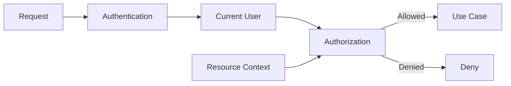

---

# 164. Consecuencia

```text
Authenticated

≠

Authorized.
```

---

# 165. MD-016 — Global RBAC como base de autorización

```text
Decision Status:
    ACTIVE

Implementation Status:
    CURRENT / FUNCTIONAL

Category:
    SECURITY.
```

---

# 166. Decisión

Utilizar:

```text
Role-Based Access Control
```

para representar capacidades globales.

---

# 167. Estado

```text
Global RBAC
    CURRENT

Maturity:
    FUNCTIONAL / MATURE.
```

---

# 168. Limitación

RBAC global no responde completamente:

```text
Can this user modify
this specific resource
inside this specific Project?
```

---

# 169. Ejemplo

```text
Role:
    TEACHER

Question:
    May this teacher modify Task 42
    belonging to Project B?
```

El rol por sí solo no basta.

---

# 170. Consecuencia

La autorización necesita combinar:

```text
Global Role

+

Resource Context

+

Membership / Relationship

+

Operation.
```

---

# 171. MD-017 — Context-aware Authorization

```text
Decision Status:
    ACCEPTED

Implementation Status:
    PARTIAL / EVOLVING

Category:
    SECURITY / STRUCTURAL.
```

---

# 172. Decisión

La autorización debe evaluar:

```text
User

+

Global Role

+

Context

+

Resource

+

Operation.
```

---

# 173. Modelo objetivo

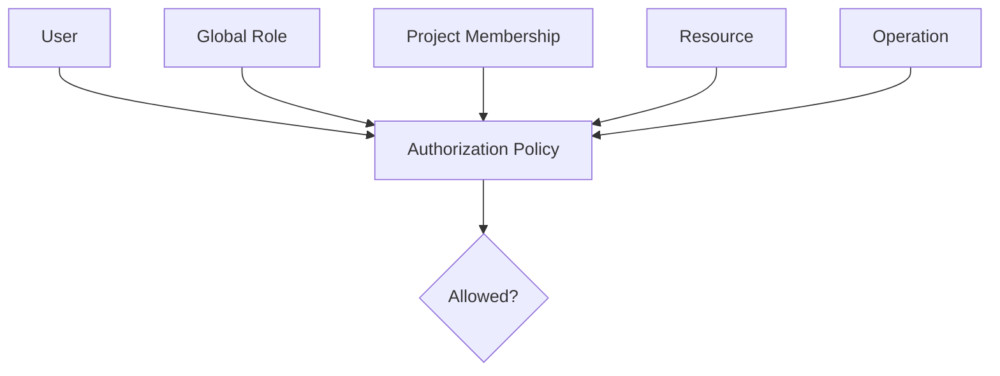

---

# 174. Importante

Esta decisión arquitectónica está:

```text
ACCEPTED
```

pero su implementación no debe describirse como:

```text
fully mature.
```

---

# 175. Estado correcto

```text
Contextual Authorization
    PARTIAL / IN PROGRESS.
```

---

# 176. Razón

La plataforma todavía está consolidando:

```text
ProjectMembership

consistent contextual policies

cross-project negative testing

nested-resource protection.
```

---

# 177. MD-018 — ProjectMembership como modelo contextual

```text
Decision Status:
    ACCEPTED / TARGET

Implementation Status:
    TARGET / IN CONSOLIDATION

Category:
    SECURITY / DOMAIN.
```

---

# 178. Decisión

Formalizar la relación entre:

```text
User

and

Project
```

mediante un modelo contextual explícito.

---

# 179. Propósito

Representar de forma coherente:

```text
membership

project-scoped role/capability

relationship lifecycle

authorization context.
```

---

# 180. ProjectMembership Is Not Global RBAC

```text
Global Role

≠

Project Membership.
```

---

# 181. Ejemplo

```text
User:
    global role = USER

Project A:
    membership = OWNER

Project B:
    no membership.
```

---

# 182. Consecuencia

La autorización puede distinguir:

```text
global capability

from

project-specific access.
```

---

# 183. Dependencias

```text
ProjectMembership

↓

Contextual Authorization

↓

Cross-project Protection

↓

WebSocket Subscription Authorization

↓

Secure Collaboration.
```

---

# 184. MD-019 — Context Injection

```text
Decision Status:
    ACCEPTED

Implementation Status:
    PARTIAL / EVOLVING

Category:
    STRUCTURAL / SECURITY.
```

---

# 185. Decisión

Utilizar dependencias FastAPI para resolver contexto autorizado cuando sea apropiado.

---

# 186. Ejemplo conceptual

```python
def get_project_context(...):
    ...
```

puede resolver:

```text
current user

project

membership

permissions.
```

---

# 187. Objetivo

Evitar duplicar:

```text
load project

verify existence

load relationship

evaluate access

construct context
```

en cada route.

---

# 188. Flujo


---

# 189. Beneficio

Reduce:

```text
authorization omission

policy divergence

duplicate code.
```

---

# 190. Limitación

Context Injection no debe convertirse en:

```text
the only authorization layer.
```

---

# 191. MD-020 — Authorization también en Service Layer

```text
Decision Status:
    ACCEPTED

Implementation Status:
    CURRENT PRINCIPLE / EVOLVING COVERAGE

Category:
    SECURITY.
```

---

# 192. Decisión

Los casos de uso sensibles deben preservar autorización en:

```text
application/service boundaries
```

cuando corresponda.

---

# 193. Razón

Un servicio puede ser reutilizado desde:

```text
HTTP

administration

future API

background process

integration.
```

---

# 194. Defense Model

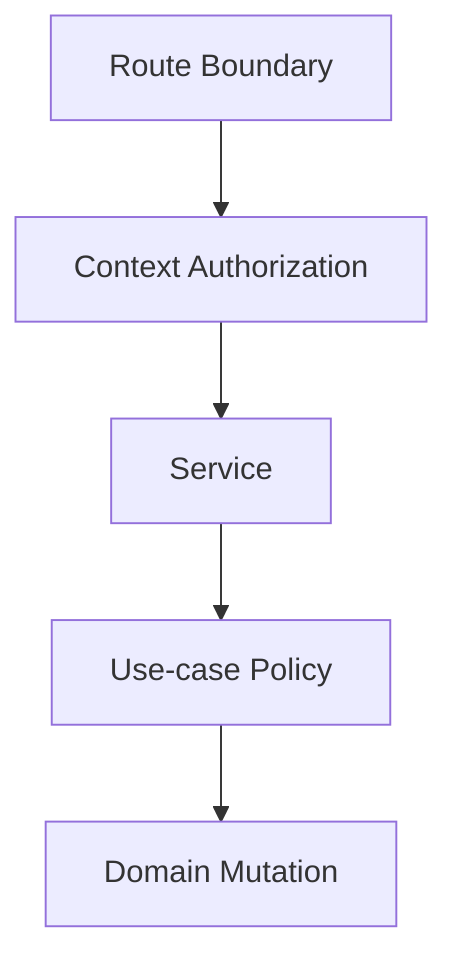

---

# 195. Principio

```text
Authorization belongs
to the use case,
not only to HTTP.
```

---

# 196. MD-021 — Deny by Default

```text
Decision Status:
    ACTIVE

Implementation Status:
    CURRENT PRINCIPLE

Category:
    SECURITY.
```

---

# 197. Decisión

Ante una operación sensible:

```text
Explicitly Allowed
    → ALLOW

Unknown
Incomplete
Ambiguous
    → DENY.
```

---

# 198. Razón

Evita convertir ausencia de política en:

```text
implicit permission.
```

---

# 199. MD-022 — Protección de recursos anidados

```text
Decision Status:
    ACCEPTED

Implementation Status:
    CURRENT PRINCIPLE / EXPANDING COVERAGE

Category:
    SECURITY.
```

---

# 200. Decisión

Un recurso anidado debe validarse también respecto a:

```text
its parent context.
```

---

# 201. Ejemplo

```text
/projects/{project_id}/tasks/{task_id}
```

requiere verificar:

```text
Task exists

AND

Task belongs to Project

AND

User may access that Project/Task.
```

---

# 202. No es suficiente

```text
task_id exists.
```

---

# 203. Riesgo

```text
Cross-project Resource Access.
```

---

# 204. Flujo

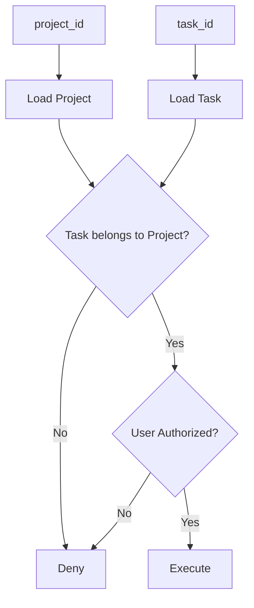

---

# 205. Cross-project Testing

Esta decisión exige pruebas negativas explícitas.

---

# 206. Example Security Test

```text
User belongs to Project A.

Task belongs to Project B.

User requests Task.

Expected:
    DENY.
```

---

# 207. Nested Attachment Example

```text
Attachment

↓

Task

↓

Project B.
```

Si el usuario solo pertenece a Project A:

```text
DENY.
```

---

# 208. MD-023 — CSRF Protection como hardening formal

```text
Decision Status:
    ACCEPTED

Implementation Status:
    TARGET / PLANNED

Category:
    SECURITY.
```

---

# 209. Contexto

La plataforma utiliza:

```text
cookie-based authentication.
```

---

# 210. Consecuencia

Las mutaciones autenticadas deben considerar explícitamente:

```text
Cross-Site Request Forgery.
```

---

# 211. Decisión

Consolidar una estrategia formal de:

```text
CSRF protection.
```

---

# 212. Estado

No describir todavía como:

```text
fully implemented platform-wide.
```

---

# 213. Estado correcto

```text
Formal CSRF Protection
    TARGET / HIGH PRIORITY.
```

---

# 214. Integración esperada

La estrategia deberá ser coherente con:

```text
SSR forms

Fetch requests

cookie authentication

SameSite policy.
```

---

# 215. MD-024 — Refresh-token Security Hardening

```text
Decision Status:
    ACCEPTED

Implementation Status:
    TARGET / VERIFY

Category:
    SECURITY.
```

---

# 216. Contexto

El refresh-token workflow ya existe.

---

# 217. Decisión

Separar explícitamente:

```text
Refresh Implementation
```

de:

```text
Refresh Security Hardening.
```

---

# 218. Current

```text
refresh token issuance

refresh cookie

refresh validation

explicit refresh

automatic refresh

logout cleanup.
```

---

# 219. Hardening Areas

```text
rotation

revocation

reuse detection

session/device semantics.
```

---

# 220. Regla

No reimplementar como “nueva feature” aquello que:

```text
already exists.
```

---

# 221. Objetivo

Fortalecer:

```text
lifecycle security
```

sin falsificar el estado actual.

---

# 222. MD-025 — Cookie Policy centralizada

```text
Decision Status:
    ACCEPTED

Implementation Status:
    TARGET / HIGH PRIORITY

Category:
    SECURITY.
```

---

# 223. Decisión

Definir una única política reutilizable para:

```text
access cookies

refresh cookies

login

explicit refresh

automatic refresh.
```

---

# 224. Objetivo

Evitar divergencias en:

```text
HttpOnly

Secure

SameSite

expiration

path

environment behavior.
```

---

# 225. Trigger

Esta decisión responde a una inconsistencia:

```text
already verified in code.
```

---

# 226. Desired Model

```text
Central Cookie Policy

↓

Login

↓

Explicit Refresh

↓

Automatic Refresh

↓

Consistent Security Attributes.
```

---

# 227. MD-026 — SAML diferido

```text
Decision Status:
    CONDITIONAL

Implementation Status:
    FUTURE / NOT IMPLEMENTED

Category:
    IAM / DEFERRED.
```

---

# 228. Decisión

No introducir SAML en la arquitectura actual sin:

```text
actual federation requirement.
```

---

# 229. Trigger

Evaluar SAML cuando exista necesidad de integración con:

```text
institutional Identity Provider

enterprise federation

education federation

external SSO requirement.
```

---

# 230. Current Authentication Remains

```text
JWT Access + Refresh

HTTPOnly Cookies.
```

---

# 231. Anti-pattern

No considerar:

```text
enterprise architecture
```

sinónimo de:

```text
SAML required.
```

---

# 232. MD-027 — Server-Side Rendering como estrategia frontend principal

```text
Decision Status:
    ACTIVE

Implementation Status:
    CURRENT

Category:
    FRONTEND / FOUNDATIONAL.
```

---

# 233. Decisión

La interfaz principal utiliza:

```text
Jinja2 SSR.
```

---

# 234. No se adopta como baseline

```text
SPA-first architecture.
```

---

# 235. Motivación

Gran parte de la plataforma utiliza:

```text
forms

tables

dashboards

administrative navigation

project views

resource management.
```

---

# 236. SSR Flow

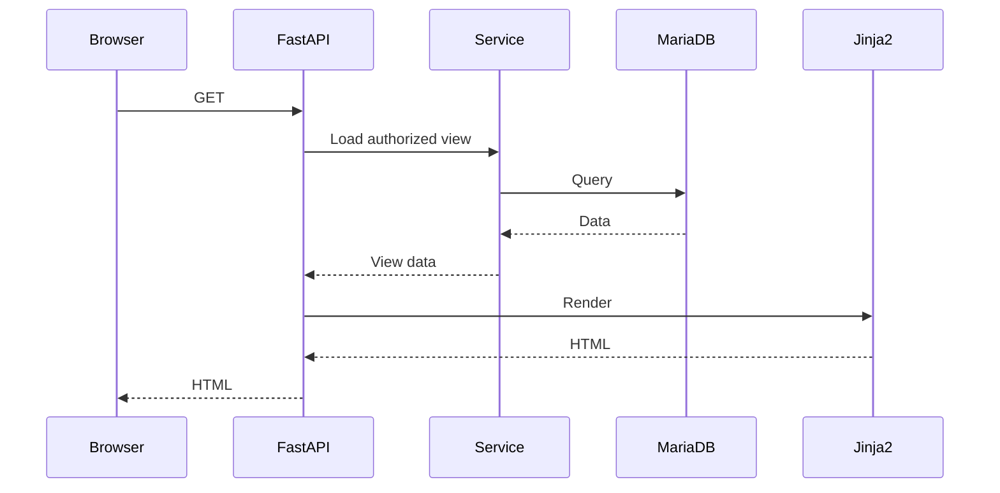

---

# 237. Beneficios

```text
low client state

simple navigation

server-side authorization

less duplicated domain logic

progressive enhancement.
```

---

# 238. Trigger de revisión

Una SPA solo debería evaluarse si aparecen necesidades persistentes que SSR + modular JavaScript no puedan resolver razonablemente.

---

# 239. MD-028 — Progressive Enhancement

```text
Decision Status:
    ACTIVE

Implementation Status:
    CURRENT

Category:
    FRONTEND.
```

---

# 240. Decisión

JavaScript mejora progresivamente:

```text
an SSR baseline.
```

---

# 241. Evolución

```text
SSR

↓

Interactive Components

↓

Fetch Mutations

↓

Realtime Updates.
```

---

# 242. Antiobjetivo

No convertir gradualmente el sistema en:

```text
an accidental SPA
```

sin una decisión arquitectónica explícita.

---

# 243. Progressive Enhancement Principle

Añadir JavaScript cuando mejora:

```text
usability

feedback

interaction

collaboration.
```

---

# 244. MD-029 — Bootstrap + AdminLTE como base visual

```text
Decision Status:
    ACTIVE

Implementation Status:
    CURRENT

Category:
    FRONTEND.
```

---

# 245. Decisión

Utilizar:

```text
Bootstrap

+

AdminLTE
```

como foundations visuales.

---

# 246. Objetivo

Aprovechar:

```text
responsive layout

forms

navigation

cards

tables

modals

dashboard structure.
```

---

# 247. Decisión diferida

No construir prematuramente:

```text
a complete custom design system.
```

---

# 248. Evolución

La plataforma puede consolidar componentes propios sobre esa base:

```text
dialogs

toasts

badges

empty states

tables

permission-aware actions

realtime indicators.
```

---

# 249. MD-030 — JavaScript modular sin framework SPA obligatorio

```text
Decision Status:
    ACTIVE

Implementation Status:
    CURRENT

Category:
    FRONTEND.
```

---

# 250. Decisión

Organizar comportamiento cliente mediante:

```text
modular JavaScript.
```

---

# 251. Objetivo

Evitar:

```text
large global scripts

duplicate handlers

implicit global state

uncontrolled page coupling.
```

---

# 252. Modelo

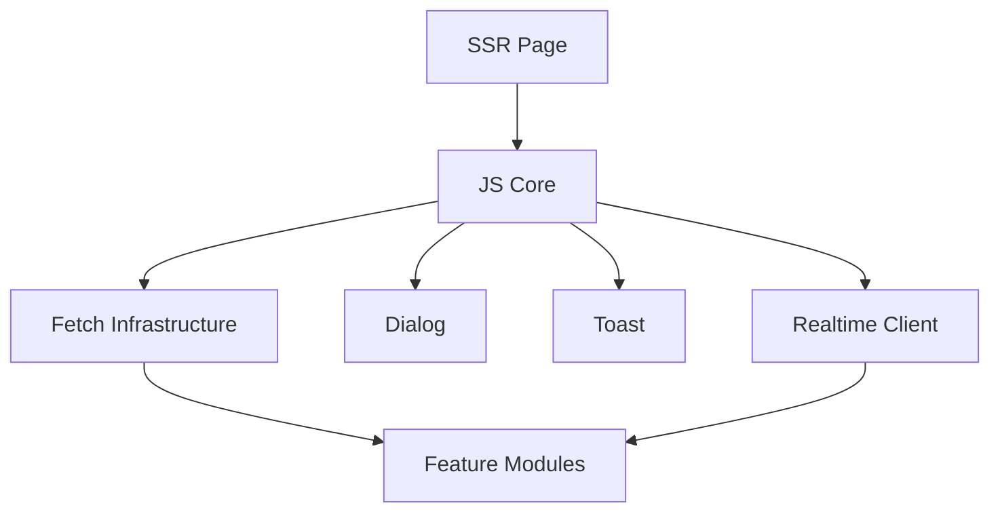

---

# 253. Module Rule

Cada módulo debe buscar:

```text
clear responsibility

limited state

explicit lifecycle

small public API.
```

---

# 254. MD-031 — Fetch/API para mutaciones interactivas

```text
Decision Status:
    ACTIVE

Implementation Status:
    CURRENT

Category:
    FRONTEND.
```

---

# 255. Decisión

Utilizar:

```text
Fetch

+

HTTP/JSON endpoints
```

cuando una interacción no requiere recargar toda la página.

---

# 256. Ejemplos

```text
mark notification as read

modal actions

quick operations

interactive mutations.
```

---

# 257. Future Example

Cuando Kanban sea implementado:

```text
Task status mutation
```

podrá utilizar esta misma infraestructura.

---

# 258. Importante

El ejemplo anterior no significa:

```text
Kanban is CURRENT.
```

---

# 259. Shared Fetch Direction

La infraestructura compartida debe tender a centralizar:

```text
request defaults

error handling

CSRF integration

JSON parsing

authentication behavior.
```

---

# 260. Shared Fetch Status

```text
TARGET / PLANNED CONSOLIDATION.
```

---

# 261. MD-032 — Sistema reutilizable de diálogos

```text
Decision Status:
    ACTIVE

Implementation Status:
    CURRENT FOUNDATION / EVOLVING

Category:
    FRONTEND.
```

---

# 262. Decisión

Evitar implementar cada confirmación mediante:

```text
ad-hoc browser dialogs.
```

---

# 263. Objetivo

Disponer de un patrón consistente para:

```text
confirmations

destructive actions

contextual forms

interactive workflows.
```

---

# 264. Evolución

La migración de diálogos nativos restantes puede realizarse:

```text
incrementally.
```

---

# 265. MD-033 — Sistema reutilizable de Toasts

```text
Decision Status:
    ACTIVE

Implementation Status:
    CURRENT FOUNDATION

Category:
    FRONTEND.
```

---

# 266. Decisión

Utilizar un mecanismo coherente de feedback no bloqueante para:

```text
success

warning

error

informational events.
```

---

# 267. Regla

Un toast no debe sustituir mensajes que requieran:

```text
persistent user attention

or

explicit decision.
```

---

# 268. MD-034 — WebSockets para capacidades realtime

```text
Decision Status:
    ACTIVE

Implementation Status:
    CURRENT

Category:
    REALTIME.
```

---

# 269. Decisión

Utilizar:

```text
FastAPI WebSockets
```

para capacidades que realmente se benefician de comunicación server-to-client en tiempo real.

---

# 270. Current Foundation

```text
WebSocket transport
    CURRENT

In-memory Connection Manager
    CURRENT.
```

---

# 271. Casos apropiados

```text
notifications

activity awareness

collaborative updates

selected realtime synchronization.
```

---

# 272. No utilizar WebSockets para todo

Operaciones convencionales continúan usando:

```text
HTTP.
```

---

# 273. Channel Separation

```text
HTTP
    authoritative command/query boundary

WebSocket
    realtime communication channel.
```

---

# 274. MD-035 — HTTP como canal autoritativo de mutación

```text
Decision Status:
    ACTIVE

Implementation Status:
    CURRENT PRINCIPLE

Category:
    REALTIME / APPLICATION.
```

---

# 275. Decisión

Las mutaciones de dominio deben conservar un camino autoritativo controlado por:

```text
server-side application logic.
```

---

# 276. Flujo preferido


---

# 277. Razón

Separa:

```text
state mutation
```

de:

```text
state notification.
```

---

# 278. MD-036 — Persistencia como autoridad del realtime

```text
Decision Status:
    ACTIVE

Implementation Status:
    CURRENT PRINCIPLE

Category:
    REALTIME / PERSISTENCE.
```

---

# 279. Decisión

El estado realtime deriva de:

```text
persisted authoritative state.
```

---

# 280. Principio

```text
Persist First.

Broadcast Second.
```

---

# 281. Consecuencia

Un evento no debería comunicar como confirmado un cambio que:

```text
failed to persist.
```

---

# 282. Failure Model

```text
Mutation Fails

↓

No Authoritative Change

↓

No Successful Change Event.
```

---

# 283. MD-037 — Contrato canónico de eventos realtime

```text
Decision Status:
    ACCEPTED

Implementation Status:
    TARGET / IN PROGRESS

Category:
    REALTIME.
```

---

# 284. Decisión

Normalizar progresivamente los eventos realtime mediante:

```text
predictable event contracts.
```

---

# 285. Event Envelope Direction

```json
{
  "type": "task.updated",
  "scope": {
    "project_id": 42
  },
  "resource": {
    "type": "task",
    "id": 103
  },
  "payload": {}
}
```

---

# 286. Objetivos

```text
consistent naming

explicit scope

minimal payload

predictable client handling

future compatibility.
```

---

# 287. Naming Direction

Preferir:

```text
resource.action
```

como:

```text
task.updated

notification.created

activity.created.
```

---

# 288. Minimal Payload Principle

No transmitir más información de la necesaria.

---

# 289. Razón

Reduce:

```text
security exposure

client coupling

bandwidth

contract complexity.
```

---

# 290. MD-038 — Autenticación de conexiones WebSocket

```text
Decision Status:
    ACCEPTED

Implementation Status:
    CURRENT FOUNDATION / HARDENING ACTIVE

Category:
    REALTIME / SECURITY.
```

---

# 291. Decisión

Las conexiones protegidas deben estar asociadas a:

```text
authenticated identity.
```

---

# 292. Current Status

```text
WebSocket Authentication
    FOUNDATION CURRENT

Hardening
    ACTIVE / TARGET.
```

---

# 293. Principio

Una conexión anónima no debe adquirir acceso implícito a:

```text
protected realtime information.
```

---

# 294. MD-039 — Autorización de suscripciones WebSocket

```text
Decision Status:
    ACCEPTED

Implementation Status:
    TARGET / HIGH PRIORITY

Category:
    REALTIME / SECURITY.
```

---

# 295. Decisión

Separar:

```text
Connection Authentication
```

de:

```text
Subscription Authorization.
```

---

# 296. Razón

Saber quién es el usuario no demuestra:

```text
which Project events
the user may observe.
```

---

# 297. Subscription Model

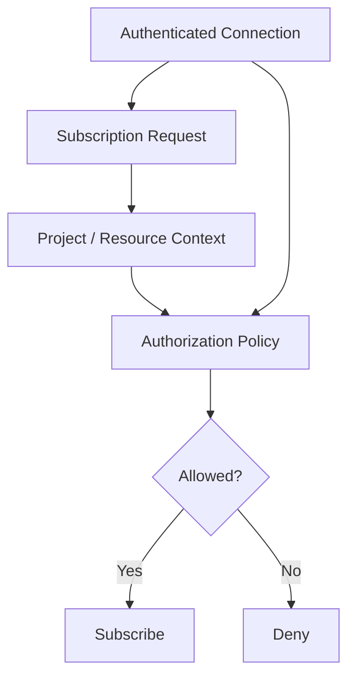

---

# 298. Dependency

Subscription Authorization depende de la madurez de:

```text
ProjectMembership

+

Contextual Authorization.
```

---

# 299. Cross-project Requirement

```text
Project A Event

must not leak to

unauthorized Project B users.
```

---

# 300. MD-040 — Connection Manager inicialmente en memoria

```text
Decision Status:
    ACTIVE

Implementation Status:
    CURRENT

Category:
    REALTIME / OPERATIONS.
```

---

# 301. Decisión

Gestionar conexiones mediante:

```text
in-memory Connection Manager
```

mientras la topología actual lo permita.

---

# 302. Motivación

Para una instancia principal:

```text
simple

fast

low operational overhead

easy to reason about.
```

---

# 303. Limitación reconocida

El estado de conexión en memoria:

```text
is process-local.
```

---

# 304. Consecuencia

No proporciona por sí mismo coordinación entre:

```text
multiple application instances.
```

---

# 305. MD-041 — Redis no se introduce prematuramente

```text
Decision Status:
    CONDITIONAL

Implementation Status:
    NOT CURRENT

Category:
    REALTIME / DEFERRED.
```

---

# 306. Decisión

No introducir:

```text
Redis
```

solo porque la plataforma utiliza WebSockets.

---

# 307. Trigger principal

Evaluar Redis cuando exista:

```text
multiple FastAPI instances

+

need for cross-instance realtime coordination.
```

---

# 308. Posibles usos futuros

```text
pub/sub

shared coordination

selected caching.
```

---

# 309. Important Boundary

Adoptar Redis para:

```text
realtime distribution
```

no obliga a convertirlo en:

```text
universal cache.
```

---

# 310. Estado correcto

```text
Redis
    FUTURE / CONDITIONAL.
```

---

# 311. MD-042 — Reconnect Strategy

```text
Decision Status:
    ACCEPTED

Implementation Status:
    TARGET / IN PROGRESS

Category:
    REALTIME / RELIABILITY.
```

---

# 312. Decisión

Los clientes realtime deben poder recuperarse de:

```text
temporary disconnection.
```

---

# 313. Reconnect Flow

```text
Connected

↓

Disconnected

↓

Backoff

↓

Reconnect

↓

Re-authenticate

↓

Re-subscribe.
```

---

# 314. Importante

```text
Reconnect

≠

State Reconciliation.
```

---

# 315. MD-043 — Reconciliación tras reconexión

```text
Decision Status:
    ACCEPTED

Implementation Status:
    TARGET / IN PROGRESS

Category:
    REALTIME / RELIABILITY.
```

---

# 316. Decisión

Después de una interrupción, el cliente debe poder recuperar:

```text
authoritative server state.
```

---

# 317. Razón

Durante la desconexión pueden haberse perdido:

```text
events.
```

---

# 318. Reconciliation Flow

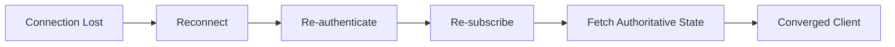

---

# 319. Initial Strategy

Preferir inicialmente:

```text
Reconnect

+

Refetch
```

cuando sea suficiente.

---

# 320. Anti-pattern

No introducir prematuramente:

```text
distributed event replay

complex offsets

stream-processing infrastructure.
```

---

# 321. MD-044 — Tolerancia a eventos duplicados

```text
Decision Status:
    ACCEPTED

Implementation Status:
    TARGET / CLIENT RELIABILITY PRINCIPLE

Category:
    REALTIME.
```

---

# 322. Decisión

Los clientes deberían tolerar razonablemente:

```text
duplicate logical updates.
```

---

# 323. Preferred Client Behavior

Preferir:

```text
replace/update resource state
```

frente a:

```text
blind append.
```

---

# 324. Ejemplo

Mejor:

```text
Task 42 = authoritative representation
```

que:

```text
append another Task 42.
```

---

# 325. MD-045 — Realtime no sustituye persistencia

```text
Decision Status:
    ACTIVE

Implementation Status:
    CURRENT PRINCIPLE

Category:
    REALTIME.
```

---

# 326. Decisión

```text
WebSocket State

≠

Domain Persistence.
```

---

# 327. Distinción

```text
MariaDB:
    authoritative state

WebSocket:
    delivery channel

Browser:
    local representation.
```

---

# 328. Recovery Consequence

Si el cliente duda sobre su estado:

```text
refetch authoritative state.
```

---

# 329. Parte 1 — Resumen de decisiones consolidadas

La primera parte establece como decisiones actuales:

```text
FastAPI

Modular Monolith

Layered Architecture

Service Layer

Repository Pattern

SQLAlchemy

Relational Persistence

MariaDB

Database Integrity

Versioned Schema Evolution

Use-case Transactions

JWT Access + Refresh

HTTPOnly Cookies

Global RBAC

Jinja2 SSR

Bootstrap / AdminLTE

Modular JavaScript

Fetch-based Interactive Mutations

Reusable UI Components

FastAPI WebSockets

In-memory Connection Manager

Persistence-first Realtime.
```

También establece como decisiones aceptadas pero todavía parciales o en consolidación:

```text
Contextual Authorization

ProjectMembership

Context Injection

Cross-project Protection

Formal CSRF

Refresh-token Security Hardening

Central Cookie Policy

Realtime Event Contract

WebSocket Authentication Hardening

Subscription Authorization

Reconnect

Reconciliation

Duplicate-event Tolerance.
```

Y mantiene fuera de la arquitectura actual:

```text
PostgreSQL migration

SAML

Redis-backed distributed realtime

Microservices.
```

---

# 330. Continuation

La **Parte 2/3** continúa con:

```text
persistent notifications

Audit

Activity vs Audit

Attachments

storage abstraction

authorized downloads

Docker

Docker Compose

Nginx

Ubuntu

Hetzner VPS

GitHub Actions

CI/CD

testing strategy

UI testing

realtime testing

observability

logging

monitoring

backup

restore

operational maturity

performance

scalability

Kanban decisions.
```

---

# 60_MAJOR_DECISIONS.md

# Major Architectural and Technical Decisions

## Aula Robótica Platform

## Parte 2/3 — Servicios transversales, almacenamiento, DevOps, testing, observabilidad, operaciones, rendimiento y Kanban

---

# 331. MD-046 — Notificaciones persistentes

```text
Decision Status:
    ACTIVE

Implementation Status:
    CURRENT

Category:
    PLATFORM / COLLABORATION.
```

---

# 332. Decisión

Las notificaciones relevantes para el usuario deben disponer de:

```text
persistent representation.
```

---

# 333. Razón

Una notificación no debe depender exclusivamente de:

```text
the user being connected
at the exact moment
the event occurs.
```

---

# 334. Persistencia

La plataforma puede conservar información como:

```text
recipient

notification type

content / reference

created timestamp

read / unread state.
```

---

# 335. Modelo conceptual

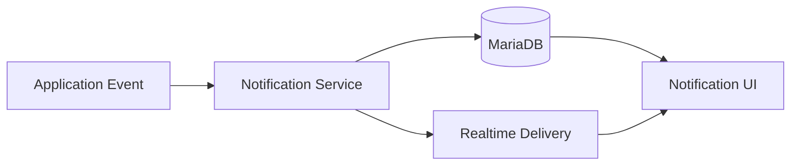

---

# 336. Principio

```text
Notification Persistence

and

Realtime Notification Delivery

are complementary.
```

---

# 337. Persistencia primero

La información durable debe poder recuperarse aunque:

```text
realtime delivery fails.
```

---

# 338. Estado actual

```text
Persistent In-app Notifications
    CURRENT

Read / Unread State
    CURRENT

Realtime Notification Awareness
    CURRENT.
```

---

# 339. No implica

La existencia del módulo actual no demuestra automáticamente:

```text
email notifications

push notifications

digest scheduling

advanced preferences

background delivery infrastructure.
```

---

# 340. Estado de extensiones

```text
Email
    FUTURE / CONDITIONAL

Push
    FUTURE

Digests
    FUTURE

Advanced Preferences
    FUTURE / TARGET.
```

---

# 341. MD-047 — Estado read/unread persistente

```text
Decision Status:
    ACTIVE

Implementation Status:
    CURRENT

Category:
    PLATFORM / UX.
```

---

# 342. Decisión

El estado:

```text
read / unread
```

debe persistirse.

---

# 343. Razón

No debe depender exclusivamente de:

```text
browser memory

DOM state

WebSocket session.
```

---

# 344. Consecuencia

Una nueva sesión puede reconstruir:

```text
notification state
```

desde el servidor.

---

# 345. MD-048 — Audit como subsistema transversal

```text
Decision Status:
    ACTIVE

Implementation Status:
    CURRENT

Category:
    SECURITY / GOVERNANCE.
```

---

# 346. Decisión

Mantener:

```text
Audit
```

como preocupación transversal para operaciones relevantes.

---

# 347. Audit Purpose

Audit responde principalmente:

```text
Who did what?

When?

To which resource?

Under which relevant context?
```

---

# 348. Audit Is Not Logging

```text
Audit

≠

Application Logging.
```

---

# 349. Logging

Logging responde principalmente a:

```text
What happened inside the software?
```

---

# 350. Audit

Audit responde principalmente a:

```text
What relevant action
was performed
by or on behalf of whom?
```

---

# 351. Audit Is Not Activity Feed

```text
Audit

≠

Activity Feed.
```

---

# 352. Activity Feed

El Activity Feed tiene una finalidad:

```text
collaborative / product-facing.
```

---

# 353. Audit

Audit tiene una finalidad:

```text
traceability / security / governance.
```

---

# 354. Separación conceptual

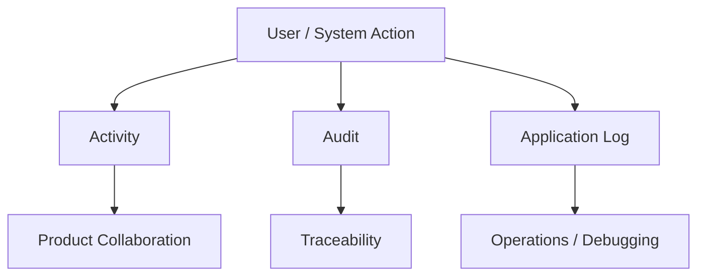

---

# 355. MD-049 — Activity y Audit permanecen separados

```text
Decision Status:
    ACTIVE

Implementation Status:
    CURRENT PRINCIPLE

Category:
    DOMAIN / GOVERNANCE.
```

---

# 356. Decisión

No reutilizar automáticamente:

```text
Activity
```

como:

```text
Audit Record.
```

---

# 357. Razón

Una actividad puede:

```text
be edited

be product-visible

represent collaboration

have domain semantics.
```

---

# 358. Mientras que Audit

debe priorizar:

```text
traceability

security relevance

controlled historical semantics.
```

---

# 359. Consecuencia

Un mismo caso de uso puede generar:

```text
Activity

+

Audit
```

sin que sean el mismo concepto.

---

# 360. MD-050 — Activity Feed como proyección de colaboración

```text
Decision Status:
    ACTIVE

Implementation Status:
    CURRENT

Category:
    PRODUCT / COLLABORATION.
```

---

# 361. Decisión

Mantener un:

```text
Activity Feed
```

orientado a visibilidad colaborativa.

---

# 362. Objetivo

Permitir al usuario comprender:

```text
recent relevant platform activity.
```

---

# 363. Estado

```text
Activity Feed
    CURRENT.
```

---

# 364. Evolución posible

Podrá mejorar con:

```text
filters

pagination

context-aware visibility

realtime awareness

reconciliation.
```

---

# 365. Advanced Feed Status

```text
TARGET / FUTURE
depending on capability.
```

---

# 366. MD-051 — Dashboard como agregación orientada al usuario

```text
Decision Status:
    ACTIVE

Implementation Status:
    CURRENT

Category:
    PRODUCT / FRONTEND.
```

---

# 367. Decisión

El Dashboard agrega información relevante para ofrecer:

```text
operational and product overview.
```

---

# 368. Dashboard Is Not a New Domain

Debe reutilizar información procedente de:

```text
Projects

Tasks

Activities

Notifications

other authorized sources.
```

---

# 369. Regla

No duplicar estado de dominio únicamente para:

```text
dashboard convenience.
```

---

# 370. Performance Consequence

Los dashboards deben vigilar especialmente:

```text
query count

N+1 patterns

unbounded aggregation

expensive joins.
```

---

# 371. MD-052 — Attachments como capacidad transversal

```text
Decision Status:
    ACTIVE

Implementation Status:
    CURRENT

Category:
    PLATFORM / STORAGE.
```

---

# 372. Decisión

Gestionar Attachments como una capacidad reutilizable para asociar archivos a recursos autorizados.

---

# 373. Attachment Model

Conceptualmente:

```text
Attachment Metadata

+

Physical File.
```

---

# 374. Metadata

Puede incluir:

```text
identifier

original filename

storage reference

content type

size

owner / uploader

parent resource

timestamps.
```

---

# 375. Physical File

Representa:

```text
stored binary content.
```

---

# 376. Separation Principle

```text
Metadata

≠

Binary Storage.
```

---

# 377. Razón

Esta separación permite evolucionar el almacenamiento físico sin redefinir todo el modelo funcional.

---

# 378. MD-053 — Almacenamiento local persistente como baseline actual

```text
Decision Status:
    ACTIVE

Implementation Status:
    CURRENT

Category:
    STORAGE / OPERATIONS.
```

---

# 379. Decisión

Mantener actualmente:

```text
persistent local attachment storage.
```

---

# 380. Razón

La topología actual:

```text
single primary deployment

Docker Compose

Hetzner VPS
```

no requiere por sí sola:

```text
distributed object storage.
```

---

# 381. Ventajas

```text
simple

low operational overhead

easy integration

sufficient for current topology.
```

---

# 382. Obligación operacional

Local storage requiere:

```text
persistence outside ephemeral container layers

backup

restore validation

capacity monitoring.
```

---

# 383. Container Rule

Los archivos persistentes no deben depender únicamente del:

```text
container writable layer.
```

---

# 384. MD-054 — Descargas autorizadas

```text
Decision Status:
    ACTIVE

Implementation Status:
    CURRENT PRINCIPLE

Category:
    STORAGE / SECURITY.
```

---

# 385. Decisión

El acceso a un archivo protegido debe pasar por:

```text
authorization.
```

---

# 386. Anti-pattern

No asumir:

```text
knowing the file URL
means being allowed to download it.
```

---

# 387. Flujo

```mermaid
flowchart TD
    REQUEST[Download Request]
    AUTHN[Authenticate]
    ATT[Load Attachment]
    PARENT[Resolve Parent Context]
    AUTHZ[Authorize]
    FILE[Serve File]
    DENY[Deny]

    REQUEST --> AUTHN
    AUTHN --> ATT
    ATT --> PARENT
    PARENT --> AUTHZ
    AUTHZ -->|Allowed| FILE
    AUTHZ -->|Denied| DENY
```

---

# 388. Nested Authorization

Si un attachment pertenece a:

```text
Task

↓

Project
```

la autorización debe respetar:

```text
the Project boundary.
```

---

# 389. MD-055 — Object Storage diferido

```text
Decision Status:
    CONDITIONAL

Implementation Status:
    FUTURE / NOT CURRENT

Category:
    STORAGE / DEFERRED.
```

---

# 390. Decisión

No introducir object storage hasta que exista una necesidad concreta.

---

# 391. Posibles triggers

```text
multiple application instances

distributed deployment

large storage growth

independent file serving

durability requirements

operational storage separation.
```

---

# 392. Posible evolución

```text
Local Persistent Storage

↓

Storage Abstraction

↓

Validated Trigger

↓

S3-compatible Object Storage.
```

---

# 393. Importante

```text
Object Storage
```

es una opción futura.

No es:

```text
CURRENT.
```

---

# 394. MD-056 — Docker como unidad de empaquetado

```text
Decision Status:
    ACTIVE

Implementation Status:
    CURRENT

Category:
    DEVOPS.
```

---

# 395. Decisión

Empaquetar componentes de aplicación mediante:

```text
Docker.
```

---

# 396. Objetivos

```text
reproducibility

dependency isolation

deployment consistency

environment portability.
```

---

# 397. Docker Is Not Architecture

```text
Containerization

≠

Microservices.
```

---

# 398. Consecuencia

Un Modular Monolith puede ejecutarse perfectamente mediante:

```text
Docker.
```

---

# 399. MD-057 — Docker Compose para orquestación actual

```text
Decision Status:
    ACTIVE

Implementation Status:
    CURRENT

Category:
    DEVOPS / OPERATIONS.
```

---

# 400. Decisión

Utilizar:

```text
Docker Compose
```

para coordinar la topología actual.

---

# 401. Razón

La infraestructura actual no requiere todavía un orquestador distribuido de mayor complejidad.

---

# 402. Compose puede coordinar

```text
application

database

proxy

volumes

networks

environment configuration.
```

---

# 403. Operational Benefit

```text
simple deployment

understandable topology

low management overhead

reproducible operations.
```

---

# 404. MD-058 — Nginx como reverse proxy

```text
Decision Status:
    ACTIVE

Implementation Status:
    CURRENT

Category:
    OPERATIONS / NETWORK.
```

---

# 405. Decisión

Utilizar:

```text
Nginx
```

delante de la aplicación.

---

# 406. Responsabilidades

Puede asumir:

```text
reverse proxy

TLS termination

HTTP routing

WebSocket upgrade forwarding

selected static delivery.
```

---

# 407. WebSocket Requirement

La configuración debe preservar correctamente:

```text
Upgrade

Connection
```

y demás comportamiento necesario para WebSockets.

---

# 408. MD-059 — Ubuntu + Hetzner VPS como infraestructura actual

```text
Decision Status:
    ACTIVE

Implementation Status:
    CURRENT

Category:
    OPERATIONS.
```

---

# 409. Decisión

La plataforma se opera actualmente sobre:

```text
Ubuntu

+

Hetzner VPS.
```

---

# 410. Consecuencia

Las decisiones operativas deben optimizar primero:

```text
the infrastructure that actually exists.
```

---

# 411. Anti-pattern

No diseñar todas las operaciones como si la plataforma ya estuviera desplegada en:

```text
Kubernetes

multi-region cloud

large distributed clusters.
```

---

# 412. MD-060 — Kubernetes diferido

```text
Decision Status:
    CONDITIONAL

Implementation Status:
    NOT CURRENT

Category:
    DEVOPS / DEFERRED.
```

---

# 413. Decisión

No introducir Kubernetes sin necesidad operacional suficiente.

---

# 414. Triggers potenciales

```text
multiple replicas

autoscaling

high availability requirements

complex orchestration

larger deployment topology.
```

---

# 415. Coste reconocido

Kubernetes añade:

```text
cluster operations

networking complexity

deployment abstractions

secrets complexity

monitoring complexity

operational expertise.
```

---

# 416. Principio

```text
Production Ready

≠

Kubernetes.
```

---

# 417. Estado

```text
Kubernetes
    FUTURE / CONDITIONAL.
```

---

# 418. MD-061 — GitHub Actions como CI actual

```text
Decision Status:
    ACTIVE

Implementation Status:
    CURRENT

Category:
    DEVOPS / QUALITY.
```

---

# 419. Decisión

Utilizar:

```text
GitHub Actions
```

para automatización de integración continua.

---

# 420. Objetivos

```text
repeatable checks

automated testing

quality feedback

integration confidence.
```

---

# 421. CI Flow

```mermaid
flowchart LR
    PUSH[Push / PR]
    CI[GitHub Actions]
    INSTALL[Install]
    TEST[Test]
    CHECK[Quality Checks]
    RESULT{Pass?}

    PUSH --> CI
    CI --> INSTALL
    INSTALL --> TEST
    TEST --> CHECK
    CHECK --> RESULT
```

---

# 422. CI Is Current

```text
Continuous Integration
    CURRENT.
```

---

# 423. CD Boundary

No asumir automáticamente que existe:

```text
fully automated production deployment.
```

---

# 424. CD Status

```text
Deployment Automation
    EVOLVING

Fully Automated Production CD
    VERIFY / TARGET.
```

---

# 425. MD-062 — CI antes de CD complejo

```text
Decision Status:
    ACTIVE

Implementation Status:
    CURRENT PRINCIPLE

Category:
    DEVOPS.
```

---

# 426. Decisión

Priorizar:

```text
reliable CI
```

antes de:

```text
complex deployment automation.
```

---

# 427. Razón

Automatizar despliegues inseguros:

```text
automates risk.
```

---

# 428. Release Confidence

Antes de aumentar automatización deben ser fiables:

```text
tests

migrations

configuration

backup

rollback / recovery

health validation.
```

---

# 429. MD-063 — Automated Testing como foundation

```text
Decision Status:
    ACTIVE

Implementation Status:
    CURRENT / EXPANDING

Category:
    QUALITY.
```

---

# 430. Decisión

El testing automatizado forma parte de la arquitectura de ingeniería.

---

# 431. No es

```text
optional cleanup after development.
```

---

# 432. Objetivo

Proteger:

```text
business behavior

security boundaries

persistence

HTTP contracts

realtime behavior

UI workflows.
```

---

# 433. Testing Pyramid Direction

```mermaid
flowchart TB
    UI[UI / End-to-End]
    API[API / Integration]
    SERVICE[Service]
    UNIT[Unit]

    UI --> API
    API --> SERVICE
    SERVICE --> UNIT
```

---

# 434. Estado

```text
Automated Testing
    CURRENT

Coverage
    INCOMPLETE / EXPANDING.
```

---

# 435. Regla

No confundir:

```text
tests exist
```

con:

```text
all critical behavior is covered.
```

---

# 436. MD-064 — Service Tests

```text
Decision Status:
    ACTIVE

Implementation Status:
    CURRENT / EXPANDING

Category:
    QUALITY.
```

---

# 437. Decisión

Los casos de uso importantes deben probarse en la capa de servicio cuando ello permita validar:

```text
business behavior

authorization decisions

orchestration

failure handling.
```

---

# 438. Beneficio

Permite verificar comportamiento sin depender siempre de:

```text
full browser execution.
```

---

# 439. MD-065 — Repository and Persistence Tests

```text
Decision Status:
    ACTIVE

Implementation Status:
    CURRENT / EXPANDING

Category:
    QUALITY.
```

---

# 440. Decisión

Las queries y relaciones importantes deben disponer de pruebas cuando exista riesgo de:

```text
incorrect joins

filtering errors

relationship mistakes

persistence regressions.
```

---

# 441. Database Reality

Las pruebas deben respetar suficientemente el comportamiento relacional relevante de:

```text
MariaDB.
```

---

# 442. MD-066 — API / Route Tests

```text
Decision Status:
    ACTIVE

Implementation Status:
    CURRENT / EXPANDING

Category:
    QUALITY.
```

---

# 443. Decisión

Probar contratos HTTP relevantes:

```text
status codes

validation

authentication

authorization

response semantics.
```

---

# 444. Negative Cases

Las pruebas deben incluir:

```text
unauthenticated

unauthorized

missing resource

invalid input

cross-project access.
```

---

# 445. MD-067 — Security Regression Tests

```text
Decision Status:
    ACCEPTED

Implementation Status:
    CURRENT FOUNDATION / EXPANDING

Category:
    SECURITY / QUALITY.
```

---

# 446. Decisión

Las vulnerabilidades y límites de autorización deben convertirse, cuando sea posible, en:

```text
regression tests.
```

---

# 447. Regla

```text
Security Bug

↓

Fix

↓

Regression Test.
```

---

# 448. Cross-project Tests

Especialmente importantes para:

```text
Projects

Tasks

Activities

Attachments

Notifications

WebSocket subscriptions.
```

---

# 449. MD-068 — UI Testing

```text
Decision Status:
    ACTIVE

Implementation Status:
    CURRENT FOUNDATION / EXPANDING

Category:
    QUALITY / FRONTEND.
```

---

# 450. Decisión

Mantener pruebas de UI para workflows donde la integración browser-servidor sea crítica.

---

# 451. UI Test Scope

Ejemplos:

```text
authentication

forms

dialogs

navigation

interactive mutations

permission-aware UI

future Kanban interactions.
```

---

# 452. Estado

```text
UI Testing Foundation
    CURRENT

Coverage Expansion
    PLANNED / ONGOING.
```

---

# 453. MD-069 — Realtime Testing

```text
Decision Status:
    ACTIVE

Implementation Status:
    CURRENT FOUNDATION / EXPANDING

Category:
    QUALITY / REALTIME.
```

---

# 454. Decisión

WebSockets requieren pruebas específicas más allá de HTTP.

---

# 455. Casos relevantes

```text
connect

authenticate

subscribe

receive event

disconnect

reconnect

authorization denial

multiple clients

missed-event recovery.
```

---

# 456. Estado

```text
Realtime Testing Foundation
    CURRENT / PARTIAL

Expanded Reliability Coverage
    PLANNED / ACTIVE.
```

---

# 457. Realtime Test Principle

No considerar realtime maduro únicamente porque:

```text
one connected browser receives an event.
```

---

# 458. MD-070 — Test de autorización antes de optimización

```text
Decision Status:
    ACTIVE

Implementation Status:
    CURRENT PRINCIPLE

Category:
    QUALITY / SECURITY.
```

---

# 459. Decisión

Cuando una optimización modifica acceso a datos, debe preservarse primero:

```text
authorization correctness.
```

---

# 460. Prioridad

```text
Correct

↓

Secure

↓

Fast.
```

---

# 461. MD-071 — Logging estructurado como foundation operacional

```text
Decision Status:
    ACTIVE

Implementation Status:
    CURRENT / EVOLVING

Category:
    OBSERVABILITY.
```

---

# 462. Decisión

La plataforma debe producir logs suficientemente estructurados para:

```text
diagnosis

operations

security investigation

deployment troubleshooting.
```

---

# 463. Logging Concerns

```text
timestamp

severity

component

request context

error information

relevant identifiers.
```

---

# 464. Sensitive Data Rule

No registrar innecesariamente:

```text
passwords

tokens

cookie values

secrets

sensitive personal data.
```

---

# 465. Naming Correction

La documentación debe utilizar:

```text
37_LOGGING.md
```

en lugar del nombre erróneo:

```text
37_LOGGIN.md.
```

---

# 466. MD-072 — Correlation / Request Context

```text
Decision Status:
    ACCEPTED

Implementation Status:
    TARGET / EVOLVING

Category:
    OBSERVABILITY.
```

---

# 467. Decisión

Mejorar la capacidad de correlacionar:

```text
request

service action

database behavior

error

realtime consequence.
```

---

# 468. Objetivo

Responder con mayor facilidad:

```text
What happened
for this specific request?
```

---

# 469. MD-073 — Monitoring basado en señales útiles

```text
Decision Status:
    ACTIVE

Implementation Status:
    PARTIAL / EVOLVING

Category:
    OBSERVABILITY / OPERATIONS.
```

---

# 470. Decisión

Monitorizar primero señales con valor operacional real.

---

# 471. Candidate Signals

```text
availability

error rate

latency

resource consumption

database health

storage capacity

WebSocket connection behavior.
```

---

# 472. Anti-pattern

No generar:

```text
large quantities of metrics
without operational questions.
```

---

# 473. MD-074 — Observabilidad incremental

```text
Decision Status:
    ACTIVE

Implementation Status:
    PARTIAL / ONGOING

Category:
    OBSERVABILITY.
```

---

# 474. Decisión

Construir observabilidad de forma incremental.

---

# 475. Evolución

```text
Logs

↓

Health Checks

↓

Metrics

↓

Correlation

↓

Tracing when justified.
```

---

# 476. No afirmar

La plataforma no debe describirse automáticamente como poseedora de:

```text
full enterprise observability.
```

---

# 477. Estado correcto

```text
Observability
    PARTIAL / EVOLVING.
```

---

# 478. MD-075 — Health Checks

```text
Decision Status:
    ACTIVE

Implementation Status:
    CURRENT FOUNDATION / EVOLVING

Category:
    OPERATIONS.
```

---

# 479. Decisión

Disponer de señales de salud que permitan distinguir:

```text
process running

from

service actually usable.
```

---

# 480. Potential Dimensions

```text
application health

database connectivity

storage availability

critical dependency health.
```

---

# 481. Readiness vs Liveness

Cuando la complejidad lo justifique, distinguir:

```text
Liveness

from

Readiness.
```

---

# 482. MD-076 — Backups como requisito de arquitectura

```text
Decision Status:
    ACTIVE

Implementation Status:
    CURRENT OPERATIONAL REQUIREMENT

Category:
    OPERATIONS / RECOVERY.
```

---

# 483. Decisión

Los backups forman parte de la arquitectura operacional.

---

# 484. Alcance

Debe contemplarse:

```text
MariaDB

+

persistent attachments

+

critical configuration where applicable.
```

---

# 485. Backup Is Not Enough

```text
Backup Exists

≠

Recovery Works.
```

---

# 486. MD-077 — Restore Validation

```text
Decision Status:
    ACTIVE

Implementation Status:
    ONGOING / MATURITY TARGET

Category:
    OPERATIONS / RECOVERY.
```

---

# 487. Decisión

Validar periódicamente que los backups pueden:

```text
actually restore usable state.
```

---

# 488. Recovery Flow

```mermaid
flowchart LR
    DATA[Production Data]
    BACKUP[Backup]
    RESTORE[Restore Test]
    VERIFY[Integrity Verification]
    READY[Recovery Confidence]

    DATA --> BACKUP
    BACKUP --> RESTORE
    RESTORE --> VERIFY
    VERIFY --> READY
```

---

# 489. Recovery Questions

```text
Can MariaDB be restored?

Can attachment files be restored?

Are metadata and files consistent?

How long does recovery take?

Which steps remain manual?
```

---

# 490. MD-078 — Deployment reproducible

```text
Decision Status:
    ACTIVE

Implementation Status:
    CURRENT / EVOLVING

Category:
    OPERATIONS.
```

---

# 491. Decisión

El deployment debe depender de:

```text
versioned configuration

container images

documented environment

repeatable commands.
```

---

# 492. Anti-pattern

Evitar depender de:

```text
undocumented manual server state.
```

---

# 493. MD-079 — Secrets fuera del código

```text
Decision Status:
    ACTIVE

Implementation Status:
    CURRENT PRINCIPLE

Category:
    SECURITY / OPERATIONS.
```

---

# 494. Decisión

Secrets y credenciales no deben mantenerse en:

```text
source-controlled application code.
```

---

# 495. Ejemplos

```text
database credentials

JWT secrets

external API credentials

private keys.
```

---

# 496. Environment Configuration

La configuración sensible debe proporcionarse mediante mecanismos operativos apropiados como:

```text
environment variables

or

secret management appropriate to current topology.
```

---

# 497. MD-080 — Configuración por entorno

```text
Decision Status:
    ACTIVE

Implementation Status:
    CURRENT

Category:
    OPERATIONS.
```

---

# 498. Decisión

Separar configuración dependiente del entorno de:

```text
application behavior.
```

---

# 499. Ejemplos

```text
DEBUG

database connection

cookie security

hostnames

storage paths

logging level.
```

---

# 500. Security Consequence

La configuración de producción debe reforzar:

```text
Secure cookies

strict debug behavior

secret handling

network exposure.
```

---

# 501. MD-081 — Rendimiento guiado por medición

```text
Decision Status:
    ACTIVE

Implementation Status:
    CURRENT PRINCIPLE

Category:
    PERFORMANCE.
```

---

# 502. Decisión

No optimizar basándose únicamente en:

```text
intuition.
```

---

# 503. Flujo

```text
Measure

↓

Identify Bottleneck

↓

Optimize

↓

Measure Again.
```

---

# 504. Priority Areas

En una aplicación SSR relacional, vigilar especialmente:

```text
query count

N+1 queries

large result sets

unbounded feeds

dashboard aggregation

serialization

template rendering.
```

---

# 505. MD-082 — Query Optimization antes de cache distribuida

```text
Decision Status:
    ACTIVE

Implementation Status:
    CURRENT PRINCIPLE

Category:
    PERFORMANCE.
```

---

# 506. Decisión

Antes de introducir cache distribuida:

```text
optimize obvious database access problems.
```

---

# 507. Secuencia preferida

```text
Correct Query

↓

Appropriate Index

↓

Pagination

↓

Reduced Over-fetching

↓

Measure

↓

Cache only if justified.
```

---

# 508. Razón

Caching introduce:

```text
invalidation

staleness

memory usage

operational complexity.
```

---

# 509. Redis Consequence

Redis no debe introducirse simplemente para:

```text
make the architecture look scalable.
```

---

# 510. MD-083 — Pagination para colecciones potencialmente grandes

```text
Decision Status:
    ACTIVE

Implementation Status:
    CURRENT PRINCIPLE / EXPANDING

Category:
    PERFORMANCE.
```

---

# 511. Decisión

Colecciones que puedan crecer deben evaluar:

```text
pagination

bounded queries

explicit ordering.
```

---

# 512. Especialmente

```text
Activity Feed

Notifications

Tasks

Audit records

future large domain collections.
```

---

# 513. MD-084 — Evitar N+1

```text
Decision Status:
    ACTIVE

Implementation Status:
    CONTINUOUS

Category:
    PERFORMANCE / PERSISTENCE.
```

---

# 514. Decisión

Revisar acceso ORM para evitar:

```text
N+1 query patterns.
```

---

# 515. Example

```text
1 query for Projects

+

N queries for related data

=

potential N+1 problem.
```

---

# 516. Solution Depends on Context

Puede implicar:

```text
eager loading

join strategy

dedicated query

projection

batch loading.
```

---

# 517. No Universal Optimization

No utilizar automáticamente:

```text
maximum eager loading everywhere.
```

---

# 518. MD-085 — Horizontal Scaling diferido

```text
Decision Status:
    CONDITIONAL

Implementation Status:
    FUTURE / NOT CURRENT

Category:
    SCALABILITY.
```

---

# 519. Decisión

No introducir arquitectura multi-instancia hasta que exista:

```text
load

availability

or operational requirement.
```

---

# 520. Trigger

```text
Measured Load

or

Availability Requirement

↓

Evaluate Horizontal Scaling.
```

---

# 521. Consecuencias

Horizontal scaling puede exigir revisar:

```text
WebSocket coordination

file storage

session assumptions

load balancing

observability.
```

---

# 522. Importante

```text
Horizontal Scaling

≠

Microservices.
```

---

# 523. Modular Monolith Scaling

El Modular Monolith puede ejecutarse como:

```text
multiple application instances
```

si la infraestructura compartida se adapta.

---

# 524. MD-086 — Escalabilidad trigger-based

```text
Decision Status:
    ACTIVE

Implementation Status:
    CURRENT PRINCIPLE

Category:
    SCALABILITY.
```

---

# 525. Decisión

Cada mecanismo de escalabilidad debe responder a:

```text
a measured or validated trigger.
```

---

# 526. Ejemplos

```text
Multiple instances
    → evaluate realtime broker

Distributed file access
    → evaluate object storage

Complex orchestration
    → evaluate Kubernetes

Independent service lifecycle
    → evaluate service extraction.
```

---

# 527. MD-087 — Kanban como evolución del Task Domain

```text
Decision Status:
    ACCEPTED

Implementation Status:
    PLANNED

Category:
    PRODUCT / FRONTEND.
```

---

# 528. Decisión

Kanban debe construirse sobre:

```text
existing Task semantics.
```

---

# 529. No crear

```text
a parallel Kanban task model.
```

---

# 530. Existing Foundation

```text
Tasks
    CURRENT

Task Status
    CURRENT.
```

---

# 531. Planned Representation

Estados como:

```text
TODO

DOING

DONE
```

pueden representarse visualmente como:

```text
Kanban columns.
```

---

# 532. Important Boundary

```text
Task Status

≠

Kanban Column Entity
```

salvo futura necesidad de workflows configurables.

---

# 533. Kanban Status

```text
Kanban Board
    PLANNED.
```

---

# 534. MD-088 — SSR-first Kanban

```text
Decision Status:
    ACCEPTED

Implementation Status:
    PLANNED

Category:
    FRONTEND.
```

---

# 535. Decisión

La primera versión del board debe respetar la estrategia frontend actual:

```text
Jinja2 SSR

+

Progressive Enhancement.
```

---

# 536. Initial Flow

```mermaid
flowchart TD
    GET[GET Project Board]
    AUTH[Authorize Project]
    LOAD[Load Tasks]
    GROUP[Group by Status]
    SSR[Render Jinja2]
    JS[Enhance with JavaScript]

    GET --> AUTH
    AUTH --> LOAD
    LOAD --> GROUP
    GROUP --> SSR
    SSR --> JS
```

---

# 537. Razón

Evita introducir una arquitectura SPA únicamente para:

```text
one richer interaction.
```

---

# 538. MD-089 — Mutación de estado autorizada antes de Drag and Drop

```text
Decision Status:
    ACCEPTED

Implementation Status:
    PLANNED

Category:
    PRODUCT / SECURITY.
```

---

# 539. Decisión

Antes de implementar Drag and Drop debe existir una operación segura para:

```text
change Task status.
```

---

# 540. Mutation Flow

```text
Task

↓

Resolve Project

↓

Authorize User

↓

Validate Transition

↓

Persist

↓

Return Authoritative State.
```

---

# 541. Regla

Drag and Drop será únicamente:

```text
a UI mechanism
for an authorized use case.
```

---

# 542. MD-090 — Drag and Drop como progressive enhancement

```text
Decision Status:
    ACCEPTED

Implementation Status:
    PLANNED

Category:
    FRONTEND.
```

---

# 543. Decisión

Añadir Drag and Drop después de disponer de:

```text
working board

authorized mutation

stable status semantics.
```

---

# 544. Accessibility

Drag and Drop no debe ser:

```text
the only interaction mechanism.
```

---

# 545. Alternative Control

Debe existir una alternativa accesible como:

```text
status selector

keyboard-capable action

or equivalent.
```

---

# 546. Optimistic UI

Puede evaluarse:

```text
optimistic visual movement
```

siempre que exista:

```text
rollback on server rejection.
```

---

# 547. Server Authority

```text
Browser Position

≠

Authoritative Task Status.
```

---

# 548. MD-091 — Live Kanban después de realtime hardening

```text
Decision Status:
    ACCEPTED

Implementation Status:
    PLANNED

Category:
    PRODUCT / REALTIME.
```

---

# 549. Decisión

No construir Live Kanban sobre una capa realtime todavía insuficientemente consolidada.

---

# 550. Dependencias

```text
ProjectMembership

↓

Contextual Authorization

↓

WebSocket Authentication

↓

Subscription Authorization

↓

Event Contract

↓

Reconnect

↓

Reconciliation

↓

Live Kanban.
```

---

# 551. Live Mutation Flow

```mermaid
sequenceDiagram
    participant A as Client A
    participant API as FastAPI
    participant S as Task Service
    participant DB as MariaDB
    participant WS as WebSocket Manager
    participant B as Client B

    A->>API: Change Task Status
    API->>S: Authorized Mutation
    S->>DB: Persist
    DB-->>S: Commit
    S->>WS: task.updated
    WS-->>B: Authorized Event
    API-->>A: Authoritative Result
```

---

# 552. Missed Event Strategy

```text
Missed Event

↓

Reconnect

↓

Re-subscribe

↓

Refetch

↓

Reconcile.
```

---

# 553. MD-092 — Kanban no redefine la autoridad

```text
Decision Status:
    ACTIVE PRINCIPLE

Implementation Status:
    APPLIES TO PLANNED KANBAN

Category:
    PRODUCT / ARCHITECTURE.
```

---

# 554. Decisión

Incluso con Live Kanban:

```text
MariaDB remains authoritative.
```

---

# 555. Event Meaning

Un evento:

```text
task.updated
```

significa:

```text
authoritative Task state changed.
```

No significa:

```text
the client may invent a new state.
```

---

# 556. MD-093 — Testing como dependency del Kanban

```text
Decision Status:
    ACCEPTED

Implementation Status:
    PLANNED / EXPANDING

Category:
    PRODUCT / QUALITY.
```

---

# 557. Decisión

Kanban debe incluir pruebas para:

```text
rendering

authorized mutation

invalid transition

cross-project denial

client interaction

realtime update

reconnect

reconciliation.
```

---

# 558. Security Priority

Especialmente:

```text
User in Project A

must not mutate

Task in Project B.
```

---

# 559. MD-094 — No introducir arquitectura distribuida para Kanban

```text
Decision Status:
    ACTIVE

Implementation Status:
    CURRENT PRINCIPLE

Category:
    PRODUCT / ARCHITECTURE.
```

---

# 560. Decisión

Kanban por sí mismo no justifica:

```text
Redis

Kubernetes

Microservices

distributed event infrastructure.
```

---

# 561. Current Foundation Is Sufficient Initially

```text
FastAPI

MariaDB

SSR

Modular JavaScript

WebSockets

In-memory Connection Manager.
```

---

# 562. Trigger Remains Independent

Si posteriormente aparece:

```text
multi-instance deployment
```

se evaluará infraestructura distribuida por ese motivo.

---

# 563. Decision Dependency Map

```mermaid
flowchart TD
    MM[Modular Monolith]
    DB[MariaDB]
    IAM[JWT Access + Refresh]
    RBAC[Global RBAC]
    PM[ProjectMembership]
    CA[Contextual Authorization]
    WS[WebSockets]
    WSA[WS Auth Hardening]
    SUB[Subscription Authorization]
    EVT[Event Contract]
    REC[Reconnect + Reconciliation]
    TASK[Tasks]
    KB[Kanban]
    LIVE[Live Kanban]

    MM --> DB
    MM --> IAM
    IAM --> RBAC
    RBAC --> PM
    PM --> CA

    CA --> WSA
    WS --> WSA
    WSA --> SUB
    SUB --> EVT
    EVT --> REC

    TASK --> KB
    CA --> KB
    KB --> LIVE
    REC --> LIVE
```

---

# 564. Operational Dependency Map

```mermaid
flowchart TD
    DOCKER[Docker]
    COMPOSE[Docker Compose]
    NGINX[Nginx]
    VPS[Ubuntu / Hetzner]
    LOG[Logging]
    HEALTH[Health]
    MON[Monitoring]
    BACKUP[Backup]
    RESTORE[Restore]
    OPS[Operational Maturity]

    DOCKER --> COMPOSE
    COMPOSE --> NGINX
    NGINX --> VPS

    VPS --> LOG
    LOG --> HEALTH
    HEALTH --> MON

    VPS --> BACKUP
    BACKUP --> RESTORE

    MON --> OPS
    RESTORE --> OPS
```

---

# 565. Testing Dependency Map

```mermaid
flowchart TD
    UNIT[Unit]
    SERVICE[Service]
    REPO[Repository]
    API[API]
    SEC[Security]
    UI[UI]
    RT[Realtime]
    CONF[Release Confidence]

    UNIT --> CONF
    SERVICE --> CONF
    REPO --> CONF
    API --> CONF
    SEC --> CONF
    UI --> CONF
    RT --> CONF
```

---

# 566. Current vs Conditional Infrastructure

| Capability | Status |
|---|---|
| Docker | CURRENT |
| Docker Compose | CURRENT |
| Nginx | CURRENT |
| Ubuntu | CURRENT |
| Hetzner VPS | CURRENT |
| MariaDB | CURRENT |
| Persistent Local Storage | CURRENT |
| GitHub Actions | CURRENT |
| Redis | FUTURE / CONDITIONAL |
| Object Storage | FUTURE / CONDITIONAL |
| Horizontal Scaling | FUTURE / CONDITIONAL |
| Kubernetes | FUTURE / CONDITIONAL |
| Microservices | FUTURE / CONDITIONAL |

---

# 567. Current vs Planned Collaboration

| Capability | Status |
|---|---|
| Projects | CURRENT |
| Tasks | CURRENT |
| Activities | CURRENT |
| Attachments | CURRENT |
| Notifications | CURRENT |
| Dashboard | CURRENT |
| Activity Feed | CURRENT |
| Audit | CURRENT |
| WebSockets | CURRENT |
| Kanban | PLANNED |
| Drag and Drop | PLANNED |
| Live Kanban | PLANNED |

---

# 568. Security Maturity Snapshot

| Capability | Status |
|---|---|
| JWT Access Token | CURRENT |
| JWT Refresh Token | CURRENT |
| HTTPOnly Cookies | CURRENT |
| Explicit Refresh | CURRENT |
| Automatic Refresh | CURRENT |
| Global RBAC | CURRENT / MATURE |
| Contextual Authorization | PARTIAL / EVOLVING |
| ProjectMembership | TARGET / IN CONSOLIDATION |
| Formal CSRF | TARGET / PLANNED |
| Refresh Rotation | VERIFY / HARDENING |
| Server-side Revocation | VERIFY / HARDENING |
| Reuse Detection | VERIFY / FUTURE HARDENING |
| Cookie Policy Centralization | TARGET |
| SAML | FUTURE |
| WS Authentication Hardening | ACTIVE / TARGET |
| WS Subscription Authorization | TARGET |

---

# 569. Realtime Maturity Snapshot

| Capability | Status |
|---|---|
| FastAPI WebSockets | CURRENT |
| In-memory Connection Manager | CURRENT |
| Selected Realtime Features | CURRENT |
| Canonical Event Contract | TARGET |
| Reconnect | TARGET / IN PROGRESS |
| Reconciliation | TARGET / IN PROGRESS |
| Multi-client Reliability Tests | EXPANDING |
| Distributed Realtime | FUTURE / CONDITIONAL |
| Redis Coordination | FUTURE / CONDITIONAL |

---

# 570. Testing Maturity Snapshot

| Capability | Status |
|---|---|
| Automated Testing | CURRENT |
| Unit Tests | CURRENT |
| Service Tests | CURRENT / EXPANDING |
| Repository Tests | CURRENT / EXPANDING |
| API Tests | CURRENT / EXPANDING |
| Security Tests | CURRENT / EXPANDING |
| UI Testing | CURRENT FOUNDATION / EXPANDING |
| Realtime Testing | CURRENT FOUNDATION / EXPANDING |
| Cross-project Tests | HIGH PRIORITY / EXPANDING |

---

# 571. Operations Maturity Snapshot

| Capability | Status |
|---|---|
| Containerized Deployment | CURRENT |
| Reverse Proxy | CURRENT |
| VPS Deployment | CURRENT |
| CI | CURRENT |
| Production CD | EVOLVING / VERIFY |
| Logging | CURRENT / EVOLVING |
| Monitoring | PARTIAL / EVOLVING |
| Observability | PARTIAL / EVOLVING |
| Backup | CURRENT OPERATIONAL REQUIREMENT |
| Restore Validation | ONGOING / MATURITY TARGET |

---

# 572. Decision Review Principle

Una decisión vigente debe revisarse cuando cambie:

```text
the problem

the constraints

the scale

the security model

the operational topology

or

the product requirement.
```

---

# 573. No Review by Fashion

No revisar una foundation estable únicamente porque:

```text
another technology
has become fashionable.
```

---

# 574. Evidence-driven Review

```text
New Requirement

↓

Current Architecture Evaluation

↓

Measured Gap

↓

Alternative Analysis

↓

Decision.
```

---

# 575. Decision Reversal

Cambiar una decisión no constituye necesariamente:

```text
architectural failure.
```

---

# 576. Puede significar

```text
the constraints changed.
```

---

# 577. Requirement

Cuando una decisión cambie debe registrarse:

```text
previous decision

new trigger

new decision

migration impact

new status.
```

---

# 578. Parte 2 — Resumen

Las decisiones de esta parte consolidan:

```text
persistent notifications

read/unread persistence

Audit

Activity/Audit separation

Activity Feed

Dashboard

Attachments

authorized downloads

persistent local storage

Docker

Docker Compose

Nginx

Ubuntu / Hetzner VPS

GitHub Actions

automated testing

logging

monitoring

observability

backup

restore

performance measurement

query optimization

pagination

N+1 control.
```

---

# 579. Decisiones diferidas o condicionales

Permanecen fuera de la arquitectura actual:

```text
Object Storage

Kubernetes

Horizontal Scaling

Redis-backed distributed realtime.
```

---

# 580. Kanban Boundary

La parte también fija:

```text
Tasks
    CURRENT

Task Status
    CURRENT

Kanban
    PLANNED

Drag and Drop
    PLANNED

Live Kanban
    PLANNED.
```

---

# 581. Kanban Dependencies

Antes de Live Kanban deben consolidarse especialmente:

```text
ProjectMembership

Contextual Authorization

WebSocket Authentication

Subscription Authorization

Event Contract

Reconnect

Reconciliation

Realtime Testing.
```

---

# 582. Continuation

La **Parte 3/3** continúa con:

```text
future domains

PostgreSQL decision boundary

SAML boundary

Redis triggers

Object Storage triggers

Kubernetes triggers

Microservices triggers

PWA

AI / RAG

Multi-tenancy

horizontal scaling

major rejected alternatives

decision governance

decision supersession

architecture invariants

current/future matrices

final decision register

final architectural statement.
```

---

# 60_MAJOR_DECISIONS.md

# Major Architectural and Technical Decisions

## Aula Robótica Platform

## Parte 3/3 — Evolución futura, decisiones condicionales, alternativas descartadas, gobernanza, invariantes y registro final

---

# 583. MD-095 — Expansión funcional sobre foundations compartidas

```text
Decision Status:
    ACTIVE PRINCIPLE

Implementation Status:
    APPLIES TO FUTURE DOMAINS

Category:
    PRODUCT / ARCHITECTURE.
```

---

# 584. Decisión

Los nuevos dominios funcionales deben reutilizar, cuando corresponda:

```text
IAM

Authorization

Projects

Attachments

Notifications

Audit

Realtime

Testing

Operations.
```

---

# 585. Objetivo

Evitar que cada nuevo dominio reconstruya:

```text
identity

permissions

file handling

notification infrastructure

audit infrastructure

realtime infrastructure.
```

---

# 586. Platform Foundation

```mermaid
flowchart TD
    PLATFORM[Shared Platform Foundation]

    IAM[IAM]
    AUTH[Authorization]
    FILES[Attachments]
    NOTIF[Notifications]
    AUDIT[Audit]
    RT[Realtime]
    TEST[Testing]
    OPS[Operations]

    FUTURE[Future Domains]

    PLATFORM --> IAM
    PLATFORM --> AUTH
    PLATFORM --> FILES
    PLATFORM --> NOTIF
    PLATFORM --> AUDIT
    PLATFORM --> RT
    PLATFORM --> TEST
    PLATFORM --> OPS

    IAM --> FUTURE
    AUTH --> FUTURE
    FILES --> FUTURE
    NOTIF --> FUTURE
    AUDIT --> FUTURE
    RT --> FUTURE
    TEST --> FUTURE
    OPS --> FUTURE
```

---

# 587. Domain Introduction Rule

Un nuevo dominio requiere:

```text
validated product need

clear responsibility

domain model

authorization model

persistence model

testing strategy

operational impact.
```

---

# 588. Documentation Rule

Un dominio documentado pero todavía no implementado debe permanecer:

```text
FUTURE

or

PLANNED.
```

---

# 589. MD-096 — Academic Domain diferido

```text
Decision Status:
    FUTURE OPTION

Implementation Status:
    FUTURE / NOT CURRENT

Category:
    PRODUCT.
```

---

# 590. Decisión

Mantener un posible:

```text
Academic Domain
```

como evolución futura, no como parte del baseline actual.

---

# 591. Posibles conceptos

Podría llegar a representar:

```text
courses

groups

students

teachers

academic periods

learning activities.
```

---

# 592. Regla

El modelo definitivo debe surgir de:

```text
validated educational requirements.
```

---

# 593. Anti-pattern

No construir anticipadamente:

```text
a complete academic information system
```

basándose únicamente en posibilidades futuras.

---

# 594. Integración potencial

```text
Academic Domain

↓

IAM

Contextual Authorization

Attachments

Notifications

Audit

possibly Realtime.
```

---

# 595. Estado

```text
Academic Domain
    FUTURE.
```

---

# 596. MD-097 — Inventory Domain diferido

```text
Decision Status:
    FUTURE OPTION

Implementation Status:
    FUTURE / NOT CURRENT

Category:
    PRODUCT.
```

---

# 597. Decisión

Mantener Inventory como posible dominio futuro para recursos como:

```text
robotics equipment

components

tools

devices

consumables.
```

---

# 598. Integrity Requirement

Si se implementa, el inventario debe preservar:

```text
stock integrity

movement history

authorization

auditability.
```

---

# 599. Preferred Model

Preferir:

```text
explicit stock movements
```

frente a:

```text
unexplained quantity replacement.
```

---

# 600. Example

```text
Current Stock

+

Inbound Movement

-

Outbound Movement

=

New Stock.
```

---

# 601. Estado

```text
Inventory
    FUTURE.
```

---

# 602. MD-098 — Reservations Domain diferido

```text
Decision Status:
    FUTURE OPTION

Implementation Status:
    FUTURE / NOT CURRENT

Category:
    PRODUCT.
```

---

# 603. Decisión

Mantener Reservations como posible dominio para:

```text
rooms

equipment

resources

time slots.
```

---

# 604. Primary Integrity Challenge

```text
conflicting reservations.
```

---

# 605. Concurrency Principle

La prevención de conflictos no debe depender exclusivamente de:

```text
frontend validation.
```

---

# 606. Persistent Authority

La decisión final sobre disponibilidad debe mantenerse en:

```text
authoritative server/database logic.
```

---

# 607. Estado

```text
Reservations
    FUTURE.
```

---

# 608. MD-099 — Competition Management diferido

```text
Decision Status:
    FUTURE OPTION

Implementation Status:
    FUTURE / NOT CURRENT

Category:
    PRODUCT.
```

---

# 609. Decisión

Mantener Competition Management como evolución potencial coherente con el origen de robótica de la plataforma.

---

# 610. Posibles conceptos

```text
competition

edition

team

participant

registration

round

match

score

ranking.
```

---

# 611. Rule Variability

No asumir que:

```text
one competition model
fits every competition.
```

---

# 612. Security

Operaciones de scoring podrían requerir:

```text
strong authorization

validation

audit

history.
```

---

# 613. Realtime

Posibles usos futuros:

```text
live scoreboard

match status

ranking updates.
```

---

# 614. Persist-first Rule

Incluso en competición:

```text
Persist

before

Broadcast.
```

---

# 615. Estado

```text
Competition Management
    FUTURE.
```

---

# 616. MD-100 — PostgreSQL como alternativa futura, no como baseline

```text
Decision Status:
    CONDITIONAL

Implementation Status:
    FUTURE / CANDIDATE / NOT CURRENT

Category:
    PERSISTENCE / EVOLUTION.
```

---

# 617. Decisión

Mantener:

```text
MariaDB
```

como motor relacional actual.

---

# 618. PostgreSQL

Debe permanecer como:

```text
candidate future alternative.
```

---

# 619. Explicit Non-decision

No existe una decisión vigente equivalente a:

```text
PostgreSQL is now
the standard database.
```

---

# 620. Tampoco existe

```text
completed MariaDB → PostgreSQL migration.
```

---

# 621. Evaluation Trigger

PostgreSQL debe evaluarse únicamente ante:

```text
verified MariaDB limitation

specific PostgreSQL capability requirement

operational requirement

strategic infrastructure requirement.
```

---

# 622. Evaluation Questions

```text
What concrete problem exists?

Can MariaDB solve it?

Why would PostgreSQL solve it better?

What migration cost exists?

What operational impact exists?

How would rollback work?
```

---

# 623. Migration Impact

Una migración real podría afectar:

```text
schema

SQLAlchemy mappings

SQL behavior

migrations

tests

backup

restore

deployment

operations.
```

---

# 624. Decision Flow

```mermaid
flowchart TD
    CURRENT[MariaDB — CURRENT]
    LIMIT{Validated limitation?}
    KEEP[Keep MariaDB]
    EVAL[Evaluate Alternatives]
    PG[Evaluate PostgreSQL]
    DECIDE{Migration justified?}
    PLAN[Plan Migration]

    CURRENT --> LIMIT
    LIMIT -->|No| KEEP
    LIMIT -->|Yes| EVAL
    EVAL --> PG
    PG --> DECIDE
    DECIDE -->|No| KEEP
    DECIDE -->|Yes| PLAN
```

---

# 625. Final Status

```text
MariaDB
    CURRENT

PostgreSQL
    FUTURE / CANDIDATE / CONDITIONAL.
```

---

# 626. MD-101 — SAML únicamente ante requisito de federación

```text
Decision Status:
    CONDITIONAL

Implementation Status:
    FUTURE / NOT IMPLEMENTED

Category:
    IAM / EVOLUTION.
```

---

# 627. Decisión

No introducir SAML sin:

```text
institutional federation requirement.
```

---

# 628. Trigger

```text
External Identity Provider

Institutional SSO

Federated Identity Requirement.
```

---

# 629. Current IAM

```text
JWT Access

JWT Refresh

HTTPOnly Cookies.
```

---

# 630. Important Distinction

```text
SAML Documentation

≠

SAML Implementation.
```

---

# 631. Final Status

```text
SAML
    FUTURE / NOT IMPLEMENTED.
```

---

# 632. MD-102 — Redis condicionado al escalado realtime

```text
Decision Status:
    CONDITIONAL

Implementation Status:
    FUTURE / NOT CURRENT

Category:
    REALTIME / SCALABILITY.
```

---

# 633. Current Model

```text
FastAPI WebSockets

+

In-memory Connection Manager.
```

---

# 634. Decisión

Mantener el modelo actual mientras:

```text
single-instance realtime
```

sea suficiente.

---

# 635. Redis Trigger

```text
Multiple Application Instances

+

Cross-instance Realtime Coordination.
```

---

# 636. Potential Future Role

```text
Redis Pub/Sub

or equivalent broker capability.
```

---

# 637. Important Boundary

Redis no debe adoptarse automáticamente como:

```text
session store

universal cache

queue

database

pub/sub
```

todo al mismo tiempo.

---

# 638. Decision Principle

Cada uso debe justificar:

```text
its own requirement.
```

---

# 639. Final Status

```text
Redis
    FUTURE / CONDITIONAL.
```

---

# 640. MD-103 — Object Storage condicionado a topología y escala

```text
Decision Status:
    CONDITIONAL

Implementation Status:
    FUTURE / NOT CURRENT

Category:
    STORAGE / SCALABILITY.
```

---

# 641. Current Model

```text
Persistent Local Attachment Storage.
```

---

# 642. Decisión

No sustituir el almacenamiento actual mientras satisfaga:

```text
capacity

durability

deployment

backup

restore requirements.
```

---

# 643. Triggers

```text
multi-instance deployment

distributed file access

large storage growth

independent file serving

stronger durability requirements.
```

---

# 644. Future Direction

```text
Storage Abstraction

↓

S3-compatible Object Storage

only if justified.
```

---

# 645. Final Status

```text
Object Storage
    FUTURE / CONDITIONAL.
```

---

# 646. MD-104 — Kubernetes condicionado a complejidad operacional real

```text
Decision Status:
    CONDITIONAL

Implementation Status:
    FUTURE / NOT CURRENT

Category:
    DEVOPS / SCALABILITY.
```

---

# 647. Current Model

```text
Docker

Docker Compose

Nginx

Ubuntu

Hetzner VPS.
```

---

# 648. Decisión

Mantener esta topología mientras continúe siendo:

```text
sufficient

understandable

reliable

operable.
```

---

# 649. Kubernetes Trigger

```text
multiple replicas

complex orchestration

autoscaling

high availability requirements

larger infrastructure topology.
```

---

# 650. Non-trigger

```text
We want a more enterprise architecture.
```

---

# 651. Final Status

```text
Kubernetes
    FUTURE / CONDITIONAL.
```

---

# 652. MD-105 — Microservices condicionados a independencia real

```text
Decision Status:
    CONDITIONAL

Implementation Status:
    FUTURE / NOT CURRENT

Category:
    ARCHITECTURE / SCALABILITY.
```

---

# 653. Current Architecture

```text
Modular Monolith.
```

---

# 654. Decisión

Mantener el Modular Monolith mientras los módulos puedan evolucionar adecuadamente dentro de:

```text
one deployable application.
```

---

# 655. Extraction Triggers

```text
independent scaling

independent deployment

different reliability profile

clear bounded context

independent ownership.
```

---

# 656. Extraction Rule

```text
Extract because
a boundary requires independence.

Not because
a module exists.
```

---

# 657. Distributed Cost

Microservices introducen:

```text
network failures

service contracts

distributed observability

deployment coordination

eventual consistency

additional infrastructure.
```

---

# 658. Decision Flow

```mermaid
flowchart TD
    MM[Modular Monolith]
    BOUND[Strong Module Boundary]
    PRESSURE{Independent lifecycle required?}
    KEEP[Keep Module]
    EVAL[Evaluate Extraction]
    SERVICE[Independent Service]

    MM --> BOUND
    BOUND --> PRESSURE
    PRESSURE -->|No| KEEP
    PRESSURE -->|Yes| EVAL
    EVAL --> SERVICE
```

---

# 659. Final Status

```text
Microservices
    FUTURE / CONDITIONAL

Modular Monolith
    CURRENT.
```

---

# 660. MD-106 — Horizontal Scaling condicionado a carga o disponibilidad

```text
Decision Status:
    CONDITIONAL

Implementation Status:
    FUTURE / NOT CURRENT

Category:
    SCALABILITY.
```

---

# 661. Decisión

No escalar horizontalmente por anticipación.

---

# 662. Trigger

```text
measured load

or

availability requirement.
```

---

# 663. Consecuencias potenciales

```text
load balancing

realtime coordination

shared file storage

distributed observability.
```

---

# 664. Important Distinction

```text
Horizontal Scaling

≠

Microservices.
```

---

# 665. Modular Monolith

Puede escalar horizontalmente si se adaptan correctamente sus dependencias compartidas.

---

# 666. MD-107 — PWA solo ante necesidad móvil/offline

```text
Decision Status:
    FUTURE OPTION

Implementation Status:
    FUTURE

Category:
    CLIENT / PRODUCT.
```

---

# 667. Decisión

No convertir la plataforma en PWA únicamente porque:

```text
the technology is available.
```

---

# 668. Trigger

```text
validated installability need

offline requirement

mobile workflow

push-notification requirement.
```

---

# 669. Complexity

PWA puede introducir:

```text
service worker lifecycle

cache invalidation

offline state

queued mutations

conflict resolution.
```

---

# 670. Realtime Interaction

Una futura PWA debería reconciliar:

```text
offline operation

with

realtime collaboration.
```

---

# 671. Final Status

```text
PWA
    FUTURE.
```

---

# 672. MD-108 — AI / RAG como capacidad experimental futura

```text
Decision Status:
    FUTURE OPTION

Implementation Status:
    FUTURE / EXPERIMENTAL

Category:
    PRODUCT / INTELLIGENCE.
```

---

# 673. Decisión

Introducir AI únicamente para:

```text
specific validated use cases.
```

---

# 674. Posibles casos

```text
semantic search

documentation assistance

educational assistance

project knowledge retrieval

activity summarization.
```

---

# 675. No son capacidades actuales

```text
AI / RAG
    NOT CURRENT.
```

---

# 676. Authorization Rule

Una futura capa RAG debe preservar:

```text
existing authorization boundaries.
```

---

# 677. Critical Rule

```text
A user must not retrieve through AI
information that the same user
cannot retrieve through normal application access.
```

---

# 678. AI Authority

Los resultados generados por modelos no deben convertirse automáticamente en:

```text
authoritative domain state.
```

---

# 679. Governance

Una futura adopción requiere analizar:

```text
privacy

data sensitivity

provider boundaries

retention

prompt security

output reliability

auditability.
```

---

# 680. Final Status

```text
AI / RAG
    FUTURE / EXPERIMENTAL.
```

---

# 681. MD-109 — Multi-tenancy condicionado a organizaciones independientes

```text
Decision Status:
    CONDITIONAL

Implementation Status:
    FUTURE / NOT CURRENT

Category:
    PLATFORM / SECURITY.
```

---

# 682. Decisión

No introducir un modelo Tenant sin necesidad real de alojar:

```text
multiple independent organizations
within one deployment.
```

---

# 683. Important Distinction

```text
Multiple Projects

≠

Multi-tenancy.
```

---

# 684. Possible Future Model

```text
Tenant

↓

Membership

↓

Projects

↓

Resources.
```

---

# 685. Security Impact

Multi-tenancy exigiría revisar sistemáticamente:

```text
query scoping

authorization

storage

audit

configuration

backup

realtime subscriptions.
```

---

# 686. Risk

Una omisión de tenant scope podría producir:

```text
cross-organization data leakage.
```

---

# 687. Final Status

```text
Multi-tenancy
    FUTURE / CONDITIONAL.
```

---

# 688. MD-110 — Multi-region fuera del roadmap activo

```text
Decision Status:
    DEFERRED / CONDITIONAL

Implementation Status:
    DISTANT FUTURE / NOT CURRENT

Category:
    INFRASTRUCTURE.
```

---

# 689. Decisión

No diseñar actualmente para:

```text
multi-region deployment.
```

---

# 690. Posibles triggers

```text
geographic resilience

global latency

regulatory distribution

extreme availability requirements.
```

---

# 691. Coste

Multi-region afectaría:

```text
database consistency

storage replication

realtime delivery

routing

failover

operations.
```

---

# 692. Current Relevance

```text
No demonstrated requirement.
```

---

# 693. Final Status

```text
Multi-region
    DISTANT FUTURE / CONDITIONAL.
```

---

# 694. MD-111 — No adoptar Event Sourcing sin necesidad

```text
Decision Status:
    DEFERRED

Implementation Status:
    NOT CURRENT

Category:
    ARCHITECTURE.
```

---

# 695. Decisión

No introducir:

```text
Event Sourcing
```

como modelo general de persistencia.

---

# 696. Razón

La plataforma actual puede preservar su estado mediante:

```text
relational persistence

+

Audit

+

Activities

+

domain history where required.
```

---

# 697. Event Sourcing Cost

Introduciría:

```text
event schemas

replay semantics

projection management

event versioning

consistency complexity.
```

---

# 698. Trigger

Solo evaluar ante una necesidad real donde:

```text
event history itself
must be the primary source of truth.
```

---

# 699. MD-112 — No adoptar CQRS generalizado

```text
Decision Status:
    DEFERRED

Implementation Status:
    NOT CURRENT

Category:
    ARCHITECTURE.
```

---

# 700. Decisión

No separar sistemáticamente:

```text
command model

and

query model
```

sin necesidad concreta.

---

# 701. Current Model

```text
Services

+

Repositories

+

purpose-specific queries
```

es suficiente para el baseline actual.

---

# 702. Possible Future Use

Read models especializados pueden evaluarse localmente si:

```text
a specific query workload
requires them.
```

---

# 703. MD-113 — No introducir message broker general sin trigger

```text
Decision Status:
    DEFERRED / CONDITIONAL

Implementation Status:
    NOT CURRENT

Category:
    INFRASTRUCTURE.
```

---

# 704. Decisión

No introducir Kafka, RabbitMQ u otro broker únicamente para:

```text
architectural sophistication.
```

---

# 705. Potential Triggers

```text
durable asynchronous processing

independent consumers

cross-service integration

high-volume event distribution.
```

---

# 706. Current Realtime

```text
WebSockets

+

In-memory Connection Manager
```

no requieren por sí mismos un broker durable.

---

# 707. MD-114 — No adoptar SPA por defecto

```text
Decision Status:
    ACTIVE

Implementation Status:
    CURRENT ARCHITECTURAL BOUNDARY

Category:
    FRONTEND.
```

---

# 708. Decisión

No migrar la interfaz completa a:

```text
React

Angular

Vue

or another SPA framework
```

sin un problema funcional suficiente.

---

# 709. Current Strategy

```text
Jinja2 SSR

+

Modular JavaScript

+

Progressive Enhancement.
```

---

# 710. Trigger

Evaluar SPA si aparecen:

```text
persistent highly interactive workflows

complex client-side state

offline-first requirements

product needs difficult to solve incrementally.
```

---

# 711. Important Rule

Kanban por sí solo:

```text
does not automatically require a SPA.
```

---

# 712. MD-115 — No introducir cache como sustituto de queries correctas

```text
Decision Status:
    ACTIVE

Implementation Status:
    CURRENT PRINCIPLE

Category:
    PERFORMANCE.
```

---

# 713. Decisión

Resolver primero:

```text
bad queries

missing indexes

over-fetching

lack of pagination

N+1 patterns.
```

---

# 714. Después

Evaluar cache únicamente cuando:

```text
measured workload
justifies it.
```

---

# 715. Cache Principle

```text
Cache

is an optimization,

not

the source of truth.
```

---

# 716. MD-116 — No usar WebSockets como command bus general

```text
Decision Status:
    ACTIVE

Implementation Status:
    CURRENT PRINCIPLE

Category:
    REALTIME.
```

---

# 717. Decisión

No trasladar automáticamente todos los comandos del cliente a:

```text
WebSocket messages.
```

---

# 718. Current Preferred Model

```text
HTTP

→ authoritative command

MariaDB

→ persistent state

WebSocket

→ realtime propagation.
```

---

# 719. Razón

Mantiene:

```text
clear request semantics

authorization boundaries

testability

failure handling

recovery.
```

---

# 720. MD-117 — No considerar el cliente autoridad

```text
Decision Status:
    ACTIVE

Implementation Status:
    CURRENT PRINCIPLE

Category:
    SECURITY / FRONTEND / REALTIME.
```

---

# 721. Decisión

El browser nunca debe ser la autoridad final sobre:

```text
permissions

domain state

persistent workflow state.
```

---

# 722. Client Role

El cliente:

```text
renders

requests

interacts

receives updates.
```

---

# 723. Server Role

El servidor:

```text
validates

authorizes

persists

decides authoritative result.
```

---

# 724. MD-118 — No confiar en UI para autorización

```text
Decision Status:
    ACTIVE

Implementation Status:
    CURRENT PRINCIPLE

Category:
    SECURITY.
```

---

# 725. Decisión

Ocultar un botón no constituye:

```text
authorization.
```

---

# 726. Correct Model

```text
UI Permission Awareness
    UX

Server Authorization
    SECURITY.
```

---

# 727. Consecuencia

Un usuario que construya manualmente una petición debe seguir recibiendo:

```text
DENY
```

si carece de autorización.

---

# 728. MD-119 — No confundir realtime delivery con consistencia

```text
Decision Status:
    ACTIVE

Implementation Status:
    CURRENT PRINCIPLE

Category:
    REALTIME.
```

---

# 729. Decisión

Recibir eventos rápidamente no demuestra:

```text
state convergence.
```

---

# 730. Reliability Requires

```text
delivery

+

authorization

+

reconnect

+

reconciliation.
```

---

# 731. Consecuencia

La evolución realtime prioriza:

```text
correct recovery
```

antes que infraestructura distribuida.

---

# 732. MD-120 — No declarar “security complete”

```text
Decision Status:
    ACTIVE

Implementation Status:
    DOCUMENTATION PRINCIPLE

Category:
    SECURITY / GOVERNANCE.
```

---

# 733. Decisión

Evitar afirmaciones absolutas como:

```text
security complete

fully secure

all security concerns solved.
```

---

# 734. Razón

La seguridad es:

```text
continuous engineering work.
```

---

# 735. Current Security Maturity

```text
Authentication
    FUNCTIONAL / ADVANCED

Global RBAC
    FUNCTIONAL / MATURE

Contextual Authorization
    PARTIAL / IN PROGRESS

Session Hardening
    IN PROGRESS

CSRF
    TARGET / PLANNED

SAML
    FUTURE

WebSocket Security
    EVOLVING.
```

---

# 736. MD-121 — No declarar “production-ready” sin alcance

```text
Decision Status:
    ACTIVE

Implementation Status:
    DOCUMENTATION PRINCIPLE

Category:
    OPERATIONS / GOVERNANCE.
```

---

# 737. Decisión

Cuando se utilice:

```text
production-ready
```

debe especificarse:

```text
for which scope

under which assumptions

with which remaining risks.
```

---

# 738. Razón

Un sistema puede estar desplegado y ser usable sin haber completado:

```text
all hardening

all observability

all recovery automation

all scaling.
```

---

# 739. MD-122 — Arquitectura evolutiva y reversible

```text
Decision Status:
    ACTIVE

Implementation Status:
    CURRENT PRINCIPLE

Category:
    ARCHITECTURE.
```

---

# 740. Decisión

Favorecer decisiones que permitan:

```text
incremental improvement

clear migration paths

limited blast radius

reasonable reversibility.
```

---

# 741. Example

```text
Local Storage

→ Storage Abstraction

→ Object Storage if required.
```

---

# 742. Another Example

```text
In-memory WebSocket Manager

→ Broker abstraction

→ Redis if required.
```

---

# 743. Another Example

```text
Modular Monolith

→ Strong Module Boundary

→ Service Extraction if required.
```

---

# 744. MD-123 — Simplicidad como propiedad arquitectónica

```text
Decision Status:
    ACTIVE

Implementation Status:
    CURRENT PRINCIPLE

Category:
    ARCHITECTURE.
```

---

# 745. Decisión

La simplicidad debe tratarse como:

```text
an engineering asset.
```

---

# 746. Simple Does Not Mean Primitive

Significa:

```text
few moving parts

clear responsibilities

understandable failure modes

low operational overhead.
```

---

# 747. Complexity Budget

Cada nueva tecnología consume:

```text
development capacity

operational capacity

testing capacity

documentation capacity

security capacity.
```

---

# 748. Therefore

```text
Complexity must pay rent.
```

---

# 749. MD-124 — Seguridad antes de conveniencia

```text
Decision Status:
    ACTIVE

Implementation Status:
    CURRENT PRINCIPLE

Category:
    SECURITY.
```

---

# 750. Decisión

Ante conflicto entre:

```text
convenient implementation
```

y:

```text
correct authorization
```

debe prevalecer:

```text
correct authorization.
```

---

# 751. MD-125 — Correctness antes de optimization

```text
Decision Status:
    ACTIVE

Implementation Status:
    CURRENT PRINCIPLE

Category:
    ENGINEERING.
```

---

# 752. Decisión

La secuencia preferida es:

```text
Correct

↓

Secure

↓

Tested

↓

Observable

↓

Optimized.
```

---

# 753. MD-126 — Testing como parte de la decisión arquitectónica

```text
Decision Status:
    ACTIVE

Implementation Status:
    CURRENT PRINCIPLE

Category:
    QUALITY.
```

---

# 754. Decisión

Una arquitectura que no puede probarse razonablemente debe considerarse:

```text
architecturally expensive.
```

---

# 755. Consecuencia

Al evaluar alternativas deben incluirse:

```text
testability

failure simulation

integration testing cost

security testing cost.
```

---

# 756. MD-127 — Operabilidad como criterio de arquitectura

```text
Decision Status:
    ACTIVE

Implementation Status:
    CURRENT PRINCIPLE

Category:
    OPERATIONS.
```

---

# 757. Decisión

Una solución técnicamente elegante pero difícil de operar puede ser:

```text
the wrong solution.
```

---

# 758. Evaluar siempre

```text
deployment

monitoring

backup

restore

debugging

incident response

upgrade path.
```

---

# 759. MD-128 — Arquitectura basada en triggers

```text
Decision Status:
    ACTIVE

Implementation Status:
    CURRENT PRINCIPLE

Category:
    GOVERNANCE.
```

---

# 760. Decisión

Las grandes evoluciones deben asociarse a:

```text
explicit adoption triggers.
```

---

# 761. Trigger Model

```mermaid
flowchart LR
    NEED[Validated Need]
    EVIDENCE[Evidence]
    TRIGGER[Architecture Trigger]
    OPTIONS[Evaluate Options]
    DECISION[Decision]
    IMPLEMENT[Implementation]
    VERIFY[Verification]

    NEED --> EVIDENCE
    EVIDENCE --> TRIGGER
    TRIGGER --> OPTIONS
    OPTIONS --> DECISION
    DECISION --> IMPLEMENT
    IMPLEMENT --> VERIFY
```

---

# 762. Examples

```text
Multi-instance realtime
    → evaluate Redis

Distributed files
    → evaluate Object Storage

Complex orchestration
    → evaluate Kubernetes

Independent lifecycle
    → evaluate Microservices

Institutional federation
    → evaluate SAML

Verified MariaDB limitation
    → evaluate PostgreSQL.
```

---

# 763. MD-129 — Decisions require consequences

```text
Decision Status:
    ACTIVE

Implementation Status:
    GOVERNANCE PRINCIPLE

Category:
    GOVERNANCE.
```

---

# 764. Decisión

Toda decisión relevante debe documentar:

```text
benefits

costs

constraints

risks

follow-up work.
```

---

# 765. Reason

Una decisión sin consecuencias documentadas se convierte fácilmente en:

```text
technology preference.
```

---

# 766. MD-130 — Decisions can expire

```text
Decision Status:
    ACTIVE

Implementation Status:
    GOVERNANCE PRINCIPLE

Category:
    GOVERNANCE.
```

---

# 767. Decisión

Una decisión puede dejar de ser correcta cuando cambian:

```text
requirements

scale

team

security

operations

technology constraints.
```

---

# 768. Review Does Not Rewrite History

Cuando una decisión cambia:

```text
preserve old decision

mark status

record new decision.
```

---

# 769. Possible Status Transition

```text
ACTIVE

↓

SUPERSEDED.
```

---

# 770. MD-131 — Supersession explícita

```text
Decision Status:
    ACTIVE

Implementation Status:
    GOVERNANCE PRINCIPLE

Category:
    GOVERNANCE.
```

---

# 771. Decisión

Cuando una nueva decisión reemplaza otra, debe indicar:

```text
what it supersedes.
```

---

# 772. Ejemplo futuro

Si algún día PostgreSQL reemplaza realmente a MariaDB:

```text
Old Decision:
    MariaDB CURRENT

New Decision:
    PostgreSQL CURRENT

Supersession:
    explicit

Migration:
    verified

History:
    preserved.
```

---

# 773. No retroactive rewriting

No se debe modificar la historia para que parezca que:

```text
PostgreSQL had always been current.
```

---

# 774. MD-132 — Changelog registra implementación, no intención

```text
Decision Status:
    ACTIVE

Implementation Status:
    GOVERNANCE PRINCIPLE

Category:
    DOCUMENTATION.
```

---

# 775. Decisión

Una decisión arquitectónica aceptada no entra automáticamente en:

```text
versioned Changelog history.
```

---

# 776. Promotion Flow

```text
Decision

↓

Target / Planned

↓

Implementation

↓

Tests

↓

Integration

↓

Release

↓

Changelog History.
```

---

# 777. MD-133 — Current Tasks no equivale a Current Architecture

```text
Decision Status:
    ACTIVE

Implementation Status:
    GOVERNANCE PRINCIPLE

Category:
    DOCUMENTATION.
```

---

# 778. Decisión

Un elemento en:

```text
53_CURRENT_TASKS.md
```

puede estar:

```text
READY

BLOCKED

IN PROGRESS
```

sin ser:

```text
CURRENT implementation.
```

---

# 779. Example

```text
CT-004 Formal CSRF Protection
    READY
```

significa:

```text
actionable work
```

no:

```text
CSRF fully implemented.
```

---

# 780. MD-134 — Future Evolution no equivale a roadmap comprometido

```text
Decision Status:
    ACTIVE

Implementation Status:
    GOVERNANCE PRINCIPLE

Category:
    DOCUMENTATION.
```

---

# 781. Decisión

`62_FUTURE_EVOLUTION.md` puede explorar:

```text
possible architectures

candidate capabilities

conditional evolution.
```

---

# 782. Esto no significa

```text
approved implementation commitment.
```

---

# 783. MD-135 — Historical documents preserve actual evolution

```text
Decision Status:
    ACTIVE

Implementation Status:
    GOVERNANCE PRINCIPLE

Category:
    DOCUMENTATION.
```

---

# 784. Decisión

Los documentos históricos deben distinguir:

```text
what happened
```

de:

```text
what was considered.
```

---

# 785. Applies Especially To

```text
55_CHANGELOG.md

57_PROJECT_EVOLUTION.md

58_TECHNICAL_CHALLENGES.md

59_IMPLEMENTATION_TIMELINE.md

60_MAJOR_DECISIONS.md

61_LESSONS_LEARNED.md.
```

---

# 786. MD-136 — Nombres y referencias documentales canónicas

```text
Decision Status:
    ACTIVE

Implementation Status:
    DOCUMENTATION GOVERNANCE

Category:
    DOCUMENTATION.
```

---

# 787. Decisión

Utilizar nombres canónicos consistentes.

---

# 788. Logging

```text
Correct:
    37_LOGGING.md

Incorrect:
    37_LOGGIN.md
```

---

# 789. Technical Challenges

```text
Correct:
    58_TECHNICAL_CHALLENGES.md

Incorrect:
    58_TECHNICAL_CHALLENGE.md
```

---

# 790. Document 61

```text
Correct:
    61_LESSONS_LEARNED.md

Incorrect:
    61_ARCHITECTURE_REVIEW.md
```

---

# 791. Reason

Las referencias rotas reducen:

```text
navigability

trust

auditability

automation reliability.
```

---

# 792. MD-137 — No crear documentación adicional sin necesidad

```text
Decision Status:
    ACTIVE

Implementation Status:
    DOCUMENTATION PRINCIPLE

Category:
    DOCUMENTATION.
```

---

# 793. Decisión

La suite documental actual tiene cobertura suficiente.

---

# 794. Consecuencia

No crear automáticamente:

```text
63_*.md
```

solo para resolver inconsistencias que deben corregirse en documentos existentes.

---

# 795. Priority

```text
Coherence

>

Document Count.
```

---

# 796. Decision Review Cycle

```mermaid
flowchart TD
    DECISION[Decision]
    IMPLEMENT[Implementation]
    OPERATE[Operate]
    OBSERVE[Observe]
    CHANGE{Constraints changed?}
    KEEP[Keep Decision]
    REVIEW[Review Alternatives]
    NEW[New Decision]
    SUPER[Mark Previous Superseded]

    DECISION --> IMPLEMENT
    IMPLEMENT --> OPERATE
    OPERATE --> OBSERVE
    OBSERVE --> CHANGE

    CHANGE -->|No| KEEP
    CHANGE -->|Yes| REVIEW

    REVIEW --> NEW
    NEW --> SUPER
```

---

# 797. Review Questions

Para cada decisión mayor:

```text
Does the original problem still exist?

Are the original constraints still valid?

Does the current solution still work?

Has scale materially changed?

Has security materially changed?

Has operational topology changed?

Is there evidence for replacement?
```

---

# 798. Architecture Invariant 1 — MariaDB Current

```text
MariaDB
    CURRENT.
```

---

# 799. Architecture Invariant 2 — PostgreSQL Future

```text
PostgreSQL
    FUTURE / CANDIDATE / CONDITIONAL.
```

---

# 800. Architecture Invariant 3 — No historical PostgreSQL migration

```text
MariaDB → PostgreSQL
    NOT COMPLETED.
```

---

# 801. Architecture Invariant 4 — Modular Monolith Current

```text
Modular Monolith
    CURRENT.
```

---

# 802. Architecture Invariant 5 — Microservices Conditional

```text
Microservices
    NOT CURRENT.
```

---

# 803. Architecture Invariant 6 — JWT Access + Refresh Current

```text
JWT Access
    CURRENT

JWT Refresh
    CURRENT.
```

---

# 804. Architecture Invariant 7 — HTTPOnly Cookies Current

```text
HTTPOnly Cookies
    CURRENT.
```

---

# 805. Architecture Invariant 8 — Refresh Workflow Current

```text
Explicit Refresh
    CURRENT

Automatic Access Refresh
    CURRENT.
```

---

# 806. Architecture Invariant 9 — Refresh Hardening Separate

```text
Refresh Workflow
    CURRENT

Rotation / Revocation / Reuse Detection
    HARDENING / VERIFY / FUTURE.
```

---

# 807. Architecture Invariant 10 — SAML Future

```text
SAML
    FUTURE / NOT IMPLEMENTED.
```

---

# 808. Architecture Invariant 11 — Global RBAC Current

```text
Global RBAC
    CURRENT / MATURE.
```

---

# 809. Architecture Invariant 12 — Context Authorization Partial

```text
Contextual Authorization
    PARTIAL / EVOLVING.
```

---

# 810. Architecture Invariant 13 — ProjectMembership Target

```text
ProjectMembership
    TARGET / IN CONSOLIDATION.
```

---

# 811. Architecture Invariant 14 — WebSockets Current

```text
FastAPI WebSockets
    CURRENT.
```

---

# 812. Architecture Invariant 15 — Connection Manager Current

```text
In-memory Connection Manager
    CURRENT.
```

---

# 813. Architecture Invariant 16 — Distributed Realtime Conditional

```text
Redis-backed / distributed realtime
    FUTURE / CONDITIONAL.
```

---

# 814. Architecture Invariant 17 — Realtime Reliability Evolving

```text
Reconnect

Reconciliation

Subscription Authorization

Event Contract
```

remain:

```text
TARGET / IN PROGRESS.
```

---

# 815. Architecture Invariant 18 — Task Workflow Current

```text
Tasks
    CURRENT

Task Status
    CURRENT.
```

---

# 816. Architecture Invariant 19 — Kanban Planned

```text
Kanban
    PLANNED

Drag and Drop
    PLANNED

Live Kanban
    PLANNED.
```

---

# 817. Architecture Invariant 20 — SSR Current

```text
Jinja2 SSR
    CURRENT.
```

---

# 818. Architecture Invariant 21 — SPA Not Current

```text
SPA Architecture
    NOT CURRENT.
```

---

# 819. Architecture Invariant 22 — Local Storage Current

```text
Persistent Local Attachment Storage
    CURRENT.
```

---

# 820. Architecture Invariant 23 — Object Storage Conditional

```text
Object Storage
    FUTURE / CONDITIONAL.
```

---

# 821. Architecture Invariant 24 — Docker Stack Current

```text
Docker

Docker Compose

Nginx

Ubuntu

Hetzner VPS
```

are:

```text
CURRENT.
```

---

# 822. Architecture Invariant 25 — Kubernetes Conditional

```text
Kubernetes
    FUTURE / CONDITIONAL.
```

---

# 823. Architecture Invariant 26 — GitHub Actions Current

```text
GitHub Actions
    CURRENT.
```

---

# 824. Architecture Invariant 27 — Testing Current but Expanding

```text
Automated Testing
    CURRENT

Coverage
    EXPANDING.
```

---

# 825. Architecture Invariant 28 — Observability Partial

```text
Observability
    PARTIAL / EVOLVING.
```

---

# 826. Architecture Invariant 29 — CSRF Not Yet Complete

```text
Formal CSRF Protection
    TARGET / PLANNED.
```

---

# 827. Architecture Invariant 30 — Cookie Policy Requires Consolidation

```text
Cookie Policy Consistency
    TARGET / HIGH PRIORITY.
```

---

# 828. Current Decision Matrix

| Area | Decision | Status |
|---|---|---|
| Backend | FastAPI | CURRENT |
| Architecture | Modular Monolith | CURRENT |
| Structure | Layered Architecture | CURRENT |
| Application | Service Layer | CURRENT |
| Persistence | Repository Pattern | CURRENT |
| ORM | SQLAlchemy | CURRENT |
| Database | MariaDB | CURRENT |
| Frontend | Jinja2 SSR | CURRENT |
| UI | Bootstrap / AdminLTE | CURRENT |
| Browser | Modular JavaScript | CURRENT |
| Auth | JWT Access | CURRENT |
| Auth | JWT Refresh | CURRENT |
| Auth | HTTPOnly Cookies | CURRENT |
| Auth | Explicit Refresh | CURRENT |
| Auth | Automatic Refresh | CURRENT |
| Authorization | Global RBAC | CURRENT |
| Notifications | Persistent In-app | CURRENT |
| Audit | Audit System | CURRENT |
| Feed | Activity Feed | CURRENT |
| Dashboard | Dashboard | CURRENT |
| Storage | Attachments | CURRENT |
| Storage | Persistent Local Files | CURRENT |
| Realtime | FastAPI WebSockets | CURRENT |
| Realtime | In-memory Manager | CURRENT |
| Deployment | Docker | CURRENT |
| Deployment | Docker Compose | CURRENT |
| Proxy | Nginx | CURRENT |
| Infrastructure | Ubuntu / Hetzner | CURRENT |
| CI | GitHub Actions | CURRENT |
| Quality | Automated Testing | CURRENT / EXPANDING |

---

# 829. Partial / Target Decision Matrix

| Area | Decision | Status |
|---|---|---|
| Authorization | Contextual Authorization | PARTIAL / EVOLVING |
| Authorization | ProjectMembership | TARGET / IN CONSOLIDATION |
| Authorization | Context Injection | PARTIAL / EVOLVING |
| Security | Formal CSRF | TARGET / PLANNED |
| Security | Refresh-token Hardening | TARGET / VERIFY |
| Security | Cookie Policy Centralization | TARGET |
| Realtime | WS Authentication Hardening | ACTIVE / TARGET |
| Realtime | Subscription Authorization | TARGET |
| Realtime | Event Contract | TARGET |
| Realtime | Reconnect | TARGET / IN PROGRESS |
| Realtime | Reconciliation | TARGET / IN PROGRESS |
| Testing | UI Coverage | EXPANDING |
| Testing | Realtime Coverage | EXPANDING |
| Observability | Monitoring | PARTIAL / EVOLVING |
| Observability | Full Observability | EVOLVING |
| Recovery | Restore Validation | ONGOING |
| DevOps | Production CD | EVOLVING / VERIFY |

---

# 830. Planned Decision Matrix

| Area | Decision | Status |
|---|---|---|
| Frontend | Shared Fetch Infrastructure | PLANNED / TARGET |
| Tasks | Authorized Status Mutation | PLANNED |
| Tasks | SSR Kanban | PLANNED |
| Tasks | Drag and Drop | PLANNED |
| Tasks | Live Kanban | PLANNED |
| Quality | Expanded UI Tests | PLANNED / ONGOING |
| Quality | Expanded Realtime Tests | PLANNED / ONGOING |

---

# 831. Future Decision Matrix

| Area | Capability | Status |
|---|---|---|
| IAM | SAML | FUTURE |
| Product | Academic Domain | FUTURE |
| Product | Inventory | FUTURE |
| Product | Reservations | FUTURE |
| Product | Competition Management | FUTURE |
| Client | PWA | FUTURE |
| Intelligence | AI / RAG | FUTURE / EXPERIMENTAL |
| Platform | Multi-tenancy | FUTURE / CONDITIONAL |

---

# 832. Conditional Architecture Matrix

| Area | Capability | Trigger |
|---|---|---|
| Database | PostgreSQL | Verified database requirement |
| Realtime | Redis | Multi-instance realtime |
| Storage | Object Storage | Distributed storage requirement |
| Scaling | Horizontal Scaling | Load / availability |
| Deployment | Kubernetes | Orchestration complexity |
| Architecture | Microservices | Independent lifecycle/scaling |
| Infrastructure | Multi-region | Geographic resilience |
| IAM | SAML | Federated identity requirement |

---

# 833. Rejected / Deferred Complexity Matrix

| Technology / Pattern | Current Decision |
|---|---|
| PostgreSQL migration | DEFERRED / CONDITIONAL |
| SAML | DEFERRED / CONDITIONAL |
| Redis | DEFERRED / CONDITIONAL |
| Kubernetes | DEFERRED / CONDITIONAL |
| Microservices | DEFERRED / CONDITIONAL |
| Object Storage | DEFERRED / CONDITIONAL |
| Event Sourcing | DEFERRED |
| General CQRS | DEFERRED |
| General Message Broker | DEFERRED / CONDITIONAL |
| SPA Rewrite | NOT JUSTIFIED CURRENTLY |
| Multi-region | DISTANT FUTURE |

---

# 834. Decision Promotion Lifecycle

```text
Idea

↓

FUTURE

↓

Validated Requirement

↓

TARGET

↓

PLANNED

↓

Implementation

↓

Testing

↓

Integration

↓

CURRENT.
```

---

# 835. Conditional Capability Lifecycle

```text
CONDITIONAL

↓

Trigger Appears

↓

Evaluate

↓

Reject
or
Accept

↓

If Accepted:
    TARGET

↓

Implementation

↓

CURRENT.
```

---

# 836. Historical Promotion Rule

Una capacidad solo puede incorporarse a la historia como completada después de:

```text
verified implementation.
```

---

# 837. Reverse Correction Rule

Si la documentación afirma que una capacidad es CURRENT pero la evidencia demuestra lo contrario:

```text
correct the documentation.
```

---

# 838. Example — PostgreSQL

```text
Documentation:
    PostgreSQL CURRENT

Evidence:
    MariaDB CURRENT

Result:
    Documentation corrected.
```

---

# 839. Example — Refresh Tokens

```text
Documentation:
    Refresh Tokens FUTURE

Evidence:
    Access + Refresh implementation exists

Result:
    Documentation corrected to CURRENT.
```

---

# 840. Example — Kanban

```text
Documentation:
    Kanban CURRENT

Evidence:
    Task workflow exists
    but Kanban implementation not verified

Result:
    Kanban remains PLANNED.
```

---

# 841. Example — SAML

```text
Documentation:
    SAML part of IAM

Evidence:
    No implementation verified

Result:
    SAML remains FUTURE.
```

---

# 842. Decision Synchronization

Cuando una decisión cambia de estado deben revisarse, según corresponda:

```text
00_MASTER_CONTEXT.md

01_PROJECT_OVERVIEW.md

47_PRODUCT_ROADMAP.md

52_ARCHITECTURAL_DECISIONS.md

53_CURRENT_TASKS.md

54_KNOWN_ISSUES.md

55_CHANGELOG.md

56_TECHNICAL_DEBT.md

57_PROJECT_EVOLUTION.md

58_TECHNICAL_CHALLENGES.md

59_IMPLEMENTATION_TIMELINE.md

60_MAJOR_DECISIONS.md

61_LESSONS_LEARNED.md

62_FUTURE_EVOLUTION.md

README_USO_RAPIDO.md.
```

---

# 843. Decision Synchronization — Database

Si algún día cambia realmente el motor relacional, revisar al menos:

```text
architecture

database

deployment

backup

restore

testing

history

decisions

future evolution.
```

---

# 844. Decision Synchronization — IAM

Si se introduce SAML:

```text
security architecture

IAM

routes

session model

tests

deployment

documentation

history
```

deberán reflejarlo.

---

# 845. Decision Synchronization — Realtime

Si se introduce Redis o equivalente:

```text
realtime architecture

deployment

Docker configuration

monitoring

testing

recovery

operations
```

deberán actualizarse.

---

# 846. Decision Synchronization — Storage

Si se introduce object storage:

```text
attachments

deployment

backup strategy

security

authorized download flow

operations
```

deberán revisarse.

---

# 847. Decision Synchronization — Microservices

Una extracción futura exigiría actualizar:

```text
architecture

service contracts

deployment

observability

CI/CD

security

data ownership

failure handling.
```

---

# 848. Architecture Review Checklist

Antes de aprobar una decisión mayor:

```text
[ ] Problem is explicit
[ ] Requirement is validated
[ ] Current architecture evaluated
[ ] Alternatives considered
[ ] Security impact reviewed
[ ] Persistence impact reviewed
[ ] Operational impact reviewed
[ ] Testing impact reviewed
[ ] Failure modes understood
[ ] Migration path understood
[ ] Reversibility considered
[ ] Documentation status defined
```

---

# 849. Current-state Audit Checklist

```text
[ ] MariaDB is described as CURRENT
[ ] PostgreSQL is not described as CURRENT
[ ] Refresh tokens are described as CURRENT
[ ] Refresh hardening remains separate
[ ] SAML remains FUTURE
[ ] Global RBAC remains CURRENT
[ ] Contextual Authorization remains PARTIAL
[ ] ProjectMembership remains TARGET / consolidating
[ ] WebSockets remain CURRENT
[ ] Redis remains CONDITIONAL
[ ] Kanban remains PLANNED
[ ] Local storage remains CURRENT
[ ] Object Storage remains CONDITIONAL
[ ] Docker Compose remains CURRENT
[ ] Kubernetes remains CONDITIONAL
[ ] Modular Monolith remains CURRENT
[ ] Microservices remain CONDITIONAL
```

---

# 850. Security Decision Checklist

```text
[ ] Authentication separated from authorization
[ ] Resource context validated
[ ] Cross-project access tested
[ ] Nested resources protected
[ ] Cookies use consistent policy
[ ] CSRF strategy explicit
[ ] Refresh lifecycle reviewed
[ ] WebSocket identity verified
[ ] WebSocket subscriptions authorized
[ ] Sensitive logs avoided
```

---

# 851. Realtime Decision Checklist

```text
[ ] Persistent state remains authoritative
[ ] Event published after persistence
[ ] Event scope explicit
[ ] Event payload minimal
[ ] Subscriber authorized
[ ] Disconnect expected
[ ] Reconnect strategy exists
[ ] Reconciliation strategy exists
[ ] Duplicate events tolerated
[ ] Multi-client behavior tested
```

---

# 852. Persistence Decision Checklist

```text
[ ] Relational integrity preserved
[ ] Transaction boundary clear
[ ] Migration path exists
[ ] Index implications reviewed
[ ] Query behavior measured
[ ] Backup impact reviewed
[ ] Restore impact reviewed
[ ] Database engine assumptions explicit
```

---

# 853. Operational Decision Checklist

```text
[ ] Deployment reproducible
[ ] Configuration externalized
[ ] Secrets protected
[ ] Logs useful
[ ] Health visible
[ ] Backup exists
[ ] Restore tested
[ ] Capacity considered
[ ] Rollback/recovery understood
```

---

# 854. Future Technology Checklist

Antes de introducir una tecnología nueva:

```text
[ ] What problem does it solve?
[ ] Is the problem real now?
[ ] Is the problem measured?
[ ] Can current architecture solve it?
[ ] What complexity does it add?
[ ] How is it operated?
[ ] How is it secured?
[ ] How is it tested?
[ ] How does it fail?
[ ] How is it recovered?
[ ] Can it be removed?
```

---

# 855. Architecture Decision Hierarchy

```text
Correctness

↓

Security

↓

Maintainability

↓

Testability

↓

Operability

↓

Performance

↓

Scalability

↓

Architectural Sophistication.
```

---

# 856. Important Qualification

La jerarquía no implica que rendimiento o escalabilidad sean irrelevantes.

Significa que no deben obtenerse destruyendo:

```text
correctness

security

operability.
```

---

# 857. Current Architecture Map

```mermaid
flowchart TB
    CLIENT[Browser]

    subgraph FRONT[Frontend]
        SSR[Jinja2 SSR]
        UI[Bootstrap / AdminLTE]
        JS[Modular JavaScript]
    end

    subgraph APP[FastAPI Modular Monolith]
        ROUTES[Routes]
        SERVICES[Services]
        REPOS[Repositories]
        IAM[IAM]
        AUTHZ[RBAC + Partial Context Auth]
        AUDIT[Audit]
        NOTIF[Notifications]
        RT[WebSockets]
    end

    DB[(MariaDB)]
    FILES[(Persistent Local Files)]

    CLIENT --> SSR
    SSR --> UI
    UI --> JS

    CLIENT --> ROUTES
    JS --> ROUTES
    CLIENT <--> RT

    ROUTES --> SERVICES
    SERVICES --> REPOS
    SERVICES --> IAM
    SERVICES --> AUTHZ
    SERVICES --> AUDIT
    SERVICES --> NOTIF
    SERVICES --> RT

    REPOS --> DB
    SERVICES --> FILES
```

---

# 858. Current Deployment Map

```mermaid
flowchart LR
    USER[User]
    NGINX[Nginx]
    APP[FastAPI Container]
    DB[(MariaDB)]
    FILES[(Persistent Files)]

    USER --> NGINX
    NGINX --> APP
    APP --> DB
    APP --> FILES
```

---

# 859. Target Security Evolution Map

```mermaid
flowchart LR
    CURRENT[Current Security]
    PM[ProjectMembership]
    CA[Contextual Authorization]
    CROSS[Cross-project Tests]
    CSRF[CSRF]
    REFRESH[Refresh Hardening]
    COOKIE[Cookie Policy]
    WSA[WS Auth]
    SUB[Subscription Auth]
    MATURE[More Mature Security]

    CURRENT --> PM
    PM --> CA
    CA --> CROSS
    CROSS --> CSRF
    CSRF --> REFRESH
    REFRESH --> COOKIE
    COOKIE --> WSA
    WSA --> SUB
    SUB --> MATURE
```

---

# 860. Target Realtime Evolution Map

```mermaid
flowchart LR
    WS[WebSockets Current]
    AUTH[WS Security]
    CONTRACT[Event Contract]
    RECONN[Reconnect]
    RECON[Reconciliation]
    TEST[Multi-client Tests]
    LIVE[Live Collaboration]

    WS --> AUTH
    AUTH --> CONTRACT
    CONTRACT --> RECONN
    RECONN --> RECON
    RECON --> TEST
    TEST --> LIVE
```

---

# 861. Conditional Scale Map

```mermaid
flowchart TD
    CURRENT[Current Single-instance Topology]

    MULTI{Need multiple instances?}
    REDIS[Evaluate Redis / Broker]
    STORE[Evaluate Object Storage]
    LB[Load Balancing]

    ORCH{Orchestration complexity?}
    K8S[Evaluate Kubernetes]

    BOUND{Independent module lifecycle?}
    MS[Evaluate Service Extraction]

    DBQ{Database limitation?}
    PG[Evaluate PostgreSQL]

    CURRENT --> MULTI
    MULTI -->|Yes| REDIS
    MULTI -->|Yes| STORE
    MULTI -->|Yes| LB

    LB --> ORCH
    ORCH -->|Yes| K8S

    CURRENT --> BOUND
    BOUND -->|Yes| MS

    CURRENT --> DBQ
    DBQ -->|Yes| PG
```

---

# 862. Major Decision Summary — Foundations

```text
FastAPI
    CURRENT

Modular Monolith
    CURRENT

Layered Architecture
    CURRENT

Service Layer
    CURRENT

Repository Pattern
    CURRENT

SQLAlchemy
    CURRENT

MariaDB
    CURRENT.
```

---

# 863. Major Decision Summary — Security

```text
JWT Access
    CURRENT

JWT Refresh
    CURRENT

HTTPOnly Cookies
    CURRENT

Explicit Refresh
    CURRENT

Automatic Refresh
    CURRENT

Global RBAC
    CURRENT

Contextual Authorization
    PARTIAL

ProjectMembership
    TARGET

CSRF
    TARGET

Refresh Hardening
    TARGET / VERIFY

Cookie Policy Centralization
    TARGET

SAML
    FUTURE.
```

---

# 864. Major Decision Summary — Frontend

```text
Jinja2 SSR
    CURRENT

Bootstrap / AdminLTE
    CURRENT

Modular JavaScript
    CURRENT

Progressive Enhancement
    CURRENT

SPA Rewrite
    NOT CURRENT

Shared Fetch Infrastructure
    TARGET / PLANNED.
```

---

# 865. Major Decision Summary — Realtime

```text
FastAPI WebSockets
    CURRENT

In-memory Connection Manager
    CURRENT

Persistence-first Events
    CURRENT PRINCIPLE

WS Authentication Hardening
    ACTIVE / TARGET

Subscription Authorization
    TARGET

Event Contract
    TARGET

Reconnect
    TARGET

Reconciliation
    TARGET

Redis
    FUTURE / CONDITIONAL.
```

---

# 866. Major Decision Summary — Storage

```text
Attachments
    CURRENT

Persistent Local Storage
    CURRENT

Authorized Downloads
    CURRENT PRINCIPLE

Object Storage
    FUTURE / CONDITIONAL.
```

---

# 867. Major Decision Summary — Operations

```text
Docker
    CURRENT

Docker Compose
    CURRENT

Nginx
    CURRENT

Ubuntu
    CURRENT

Hetzner VPS
    CURRENT

GitHub Actions
    CURRENT

Observability
    PARTIAL / EVOLVING

Backup / Restore Maturity
    ONGOING

Kubernetes
    FUTURE / CONDITIONAL.
```

---

# 868. Major Decision Summary — Collaboration

```text
Projects
    CURRENT

Tasks
    CURRENT

Activities
    CURRENT

Notifications
    CURRENT

Dashboard
    CURRENT

Activity Feed
    CURRENT

Audit
    CURRENT

Kanban
    PLANNED

Drag and Drop
    PLANNED

Live Kanban
    PLANNED.
```

---

# 869. Major Decision Summary — Future Product

```text
Academic
    FUTURE

Inventory
    FUTURE

Reservations
    FUTURE

Competition Management
    FUTURE

PWA
    FUTURE

AI / RAG
    FUTURE / EXPERIMENTAL

Multi-tenancy
    FUTURE / CONDITIONAL.
```

---

# 870. Major Decision Summary — Conditional Architecture

```text
PostgreSQL
    FUTURE / CANDIDATE

Redis
    CONDITIONAL

Object Storage
    CONDITIONAL

Horizontal Scaling
    CONDITIONAL

Kubernetes
    CONDITIONAL

Microservices
    CONDITIONAL

Multi-region
    DISTANT FUTURE / CONDITIONAL.
```

---

# 871. Decision Register — Core

| ID | Decision | Status |
|---|---|---|
| MD-001 | FastAPI backend | CURRENT |
| MD-002 | Modular Monolith | CURRENT |
| MD-003 | Layered Architecture | CURRENT |
| MD-004 | Service Layer | CURRENT |
| MD-005 | Repository Pattern | CURRENT |
| MD-006 | SQLAlchemy | CURRENT |
| MD-007 | Relational Source of Truth | CURRENT |
| MD-008 | MariaDB | CURRENT |
| MD-009 | Database Integrity | CURRENT / CONTINUOUS |
| MD-010 | Versioned Schema Evolution | CURRENT PRINCIPLE |
| MD-011 | Use-case Transactions | CURRENT PRINCIPLE |

---

# 872. Decision Register — IAM and Security

| ID | Decision | Status |
|---|---|---|
| MD-012 | JWT Authentication | CURRENT |
| MD-013 | Access + Refresh Workflow | CURRENT |
| MD-014 | HTTPOnly Cookies | CURRENT |
| MD-015 | Authentication ≠ Authorization | CURRENT PRINCIPLE |
| MD-016 | Global RBAC | CURRENT |
| MD-017 | Contextual Authorization | PARTIAL / EVOLVING |
| MD-018 | ProjectMembership | TARGET |
| MD-019 | Context Injection | PARTIAL / EVOLVING |
| MD-020 | Service-layer Authorization | CURRENT PRINCIPLE |
| MD-021 | Deny by Default | CURRENT PRINCIPLE |
| MD-022 | Nested Resource Protection | EXPANDING |
| MD-023 | Formal CSRF | TARGET |
| MD-024 | Refresh Security Hardening | TARGET / VERIFY |
| MD-025 | Central Cookie Policy | TARGET |
| MD-026 | SAML | FUTURE / CONDITIONAL |

---

# 873. Decision Register — Frontend and Realtime

| ID | Decision | Status |
|---|---|---|
| MD-027 | Jinja2 SSR | CURRENT |
| MD-028 | Progressive Enhancement | CURRENT |
| MD-029 | Bootstrap + AdminLTE | CURRENT |
| MD-030 | Modular JavaScript | CURRENT |
| MD-031 | Fetch Mutations | CURRENT |
| MD-032 | Reusable Dialogs | CURRENT / EVOLVING |
| MD-033 | Toasts | CURRENT |
| MD-034 | FastAPI WebSockets | CURRENT |
| MD-035 | HTTP Authoritative Mutations | CURRENT PRINCIPLE |
| MD-036 | Persistence-first Realtime | CURRENT PRINCIPLE |
| MD-037 | Canonical Event Contract | TARGET |
| MD-038 | WS Authentication | CURRENT FOUNDATION / HARDENING |
| MD-039 | WS Subscription Authorization | TARGET |
| MD-040 | In-memory Connection Manager | CURRENT |
| MD-041 | Redis Deferred | CONDITIONAL |
| MD-042 | Reconnect | TARGET |
| MD-043 | Reconciliation | TARGET |
| MD-044 | Duplicate-event Tolerance | TARGET |
| MD-045 | Realtime ≠ Persistence | CURRENT PRINCIPLE |

---

# 874. Decision Register — Platform and Storage

| ID | Decision | Status |
|---|---|---|
| MD-046 | Persistent Notifications | CURRENT |
| MD-047 | Persistent Read/Unread | CURRENT |
| MD-048 | Audit | CURRENT |
| MD-049 | Activity ≠ Audit | CURRENT PRINCIPLE |
| MD-050 | Activity Feed | CURRENT |
| MD-051 | Dashboard | CURRENT |
| MD-052 | Attachments | CURRENT |
| MD-053 | Persistent Local Storage | CURRENT |
| MD-054 | Authorized Downloads | CURRENT PRINCIPLE |
| MD-055 | Object Storage Deferred | CONDITIONAL |

---

# 875. Decision Register — DevOps and Quality

| ID | Decision | Status |
|---|---|---|
| MD-056 | Docker | CURRENT |
| MD-057 | Docker Compose | CURRENT |
| MD-058 | Nginx | CURRENT |
| MD-059 | Ubuntu + Hetzner VPS | CURRENT |
| MD-060 | Kubernetes Deferred | CONDITIONAL |
| MD-061 | GitHub Actions CI | CURRENT |
| MD-062 | CI before complex CD | CURRENT PRINCIPLE |
| MD-063 | Automated Testing | CURRENT / EXPANDING |
| MD-064 | Service Tests | CURRENT / EXPANDING |
| MD-065 | Persistence Tests | CURRENT / EXPANDING |
| MD-066 | API Tests | CURRENT / EXPANDING |
| MD-067 | Security Regression Tests | EXPANDING |
| MD-068 | UI Testing | CURRENT FOUNDATION / EXPANDING |
| MD-069 | Realtime Testing | CURRENT FOUNDATION / EXPANDING |
| MD-070 | Authorization before Optimization | CURRENT PRINCIPLE |

---

# 876. Decision Register — Operations and Performance

| ID | Decision | Status |
|---|---|---|
| MD-071 | Structured Logging | CURRENT / EVOLVING |
| MD-072 | Correlation Context | TARGET |
| MD-073 | Useful Monitoring | PARTIAL / EVOLVING |
| MD-074 | Incremental Observability | PARTIAL / ONGOING |
| MD-075 | Health Checks | CURRENT FOUNDATION / EVOLVING |
| MD-076 | Backups | CURRENT REQUIREMENT |
| MD-077 | Restore Validation | ONGOING |
| MD-078 | Reproducible Deployment | CURRENT / EVOLVING |
| MD-079 | Secrets Outside Code | CURRENT PRINCIPLE |
| MD-080 | Environment Configuration | CURRENT |
| MD-081 | Measurement-driven Performance | CURRENT PRINCIPLE |
| MD-082 | Query Optimization before Cache | CURRENT PRINCIPLE |
| MD-083 | Pagination | CURRENT PRINCIPLE / EXPANDING |
| MD-084 | N+1 Control | CONTINUOUS |
| MD-085 | Horizontal Scaling Deferred | CONDITIONAL |
| MD-086 | Trigger-based Scaling | CURRENT PRINCIPLE |

---

# 877. Decision Register — Kanban

| ID | Decision | Status |
|---|---|---|
| MD-087 | Kanban extends Tasks | PLANNED |
| MD-088 | SSR-first Kanban | PLANNED |
| MD-089 | Authorized Status Mutation | PLANNED |
| MD-090 | Drag and Drop Enhancement | PLANNED |
| MD-091 | Live Kanban after Realtime Hardening | PLANNED |
| MD-092 | MariaDB remains Kanban Authority | PLANNED PRINCIPLE |
| MD-093 | Kanban Testing | PLANNED / EXPANDING |
| MD-094 | No Distributed Architecture for Kanban Alone | CURRENT PRINCIPLE |

---

# 878. Decision Register — Future Evolution

| ID | Decision | Status |
|---|---|---|
| MD-095 | Shared Foundations for Future Domains | ACTIVE PRINCIPLE |
| MD-096 | Academic Domain | FUTURE |
| MD-097 | Inventory Domain | FUTURE |
| MD-098 | Reservations Domain | FUTURE |
| MD-099 | Competition Management | FUTURE |
| MD-100 | PostgreSQL Candidate | FUTURE / CONDITIONAL |
| MD-101 | SAML on Federation Trigger | FUTURE / CONDITIONAL |
| MD-102 | Redis on Realtime Scale Trigger | FUTURE / CONDITIONAL |
| MD-103 | Object Storage on Storage Trigger | FUTURE / CONDITIONAL |
| MD-104 | Kubernetes on Orchestration Trigger | FUTURE / CONDITIONAL |
| MD-105 | Microservices on Independence Trigger | FUTURE / CONDITIONAL |
| MD-106 | Horizontal Scaling | FUTURE / CONDITIONAL |
| MD-107 | PWA | FUTURE |
| MD-108 | AI / RAG | FUTURE / EXPERIMENTAL |
| MD-109 | Multi-tenancy | FUTURE / CONDITIONAL |
| MD-110 | Multi-region | DISTANT FUTURE / CONDITIONAL |

---

# 879. Decision Register — Deferred Patterns and Governance

| ID | Decision | Status |
|---|---|---|
| MD-111 | Event Sourcing Deferred | NOT CURRENT |
| MD-112 | General CQRS Deferred | NOT CURRENT |
| MD-113 | General Message Broker Deferred | CONDITIONAL |
| MD-114 | No SPA by Default | ACTIVE |
| MD-115 | Query Optimization before Cache | ACTIVE |
| MD-116 | WebSockets not General Command Bus | ACTIVE |
| MD-117 | Client not Authoritative | ACTIVE |
| MD-118 | UI not Authorization | ACTIVE |
| MD-119 | Realtime Delivery ≠ Consistency | ACTIVE |
| MD-120 | No “Security Complete” Claims | ACTIVE |
| MD-121 | Scoped Production-readiness Claims | ACTIVE |
| MD-122 | Evolutionary / Reversible Architecture | ACTIVE |
| MD-123 | Simplicity as Architectural Asset | ACTIVE |
| MD-124 | Security before Convenience | ACTIVE |
| MD-125 | Correctness before Optimization | ACTIVE |
| MD-126 | Testability as Architecture Criterion | ACTIVE |
| MD-127 | Operability as Architecture Criterion | ACTIVE |
| MD-128 | Trigger-based Architecture | ACTIVE |
| MD-129 | Document Consequences | ACTIVE |
| MD-130 | Decisions Can Expire | ACTIVE |
| MD-131 | Explicit Supersession | ACTIVE |
| MD-132 | Changelog Records Implementation | ACTIVE |
| MD-133 | Current Tasks ≠ Current Architecture | ACTIVE |
| MD-134 | Future Evolution ≠ Commitment | ACTIVE |
| MD-135 | Preserve Historical Truth | ACTIVE |
| MD-136 | Canonical Documentation References | ACTIVE |
| MD-137 | No Unnecessary New Documents | ACTIVE |

---

# 880. Final Decision Model

Toda decisión mayor debe poder representarse como:

```text
Context

↓

Problem

↓

Constraints

↓

Alternatives

↓

Decision

↓

Status

↓

Consequences

↓

Evidence

↓

Review Trigger.
```

---

# 881. Final Architecture Principle

```text
Architecture is not
a collection of technologies.

Architecture is
a collection of deliberate boundaries,
responsibilities,
constraints,
and trade-offs.
```

---

# 882. Final Persistence Principle

```text
Persisted relational state
is authoritative.

Realtime state
is derived.

Browser state
is representational.
```

---

# 883. Final Security Principle

```text
Authentication establishes identity.

Authorization establishes permission.

Context establishes scope.
```

---

# 884. Final Realtime Principle

```text
Persist first.

Broadcast second.

Reconnect when disconnected.

Reconcile when uncertain.
```

---

# 885. Final Database Principle

```text
MariaDB is CURRENT.

PostgreSQL is a future candidate.

There has been no completed
MariaDB → PostgreSQL migration.
```

---

# 886. Final Authentication Principle

```text
JWT Access + Refresh
is CURRENT.

HTTPOnly Cookies
are CURRENT.

Explicit and Automatic Refresh
are CURRENT.
```

---

# 887. Final Refresh Principle

```text
Refresh Workflow
is CURRENT.

Refresh Security Hardening
is separate and evolving.
```

---

# 888. Final IAM Principle

```text
Global RBAC
is CURRENT.

Contextual Authorization
is PARTIAL.

ProjectMembership
is TARGET / IN CONSOLIDATION.

SAML
is FUTURE.
```

---

# 889. Final Frontend Principle

```text
Jinja2 SSR

+

Bootstrap / AdminLTE

+

Modular JavaScript

+

Progressive Enhancement
```

remain the current frontend strategy.

---

# 890. Final Kanban Principle

```text
Tasks
are CURRENT.

Kanban
is PLANNED.

Drag and Drop
is PLANNED.

Live Kanban
is PLANNED.
```

---

# 891. Final Realtime Infrastructure Principle

```text
FastAPI WebSockets

+

In-memory Connection Manager
```

are CURRENT.

```text
Redis-backed distributed realtime
```

is CONDITIONAL.

---

# 892. Final Storage Principle

```text
Persistent Local Attachment Storage
is CURRENT.

Object Storage
is FUTURE / CONDITIONAL.
```

---

# 893. Final Deployment Principle

```text
Docker

Docker Compose

Nginx

Ubuntu

Hetzner VPS
```

are CURRENT.

```text
Kubernetes
```

is CONDITIONAL.

---

# 894. Final Architecture Evolution Principle

```text
Modular Monolith
is CURRENT.

Microservices
are CONDITIONAL.
```

---

# 895. Final Scaling Principle

```text
Scale when evidence
requires scale.
```

---

# 896. Final Complexity Principle

```text
Do not pay
distributed-system complexity
before receiving
distributed-system value.
```

---

# 897. Final Documentation Principle

```text
CURRENT
must mean implemented.

TARGET
must mean intended.

PLANNED
must mean expected work.

FUTURE
must mean possible later.

CONDITIONAL
must mean trigger-dependent.
```

---

# 898. Final Historical Principle

```text
Do not rewrite the past
to match the future.
```

---

# 899. Final Decision Governance Principle

```text
Preserve the evidence.

Preserve the context.

Preserve the trade-off.

Preserve the status.

Preserve the trigger.
```

---

# 900. Final Major Decisions Summary

Aula Robótica Platform mantiene como foundations actuales:

```text
FastAPI

SQLAlchemy

MariaDB

Modular Monolith

Layered Architecture

Service Layer

Repository Pattern

Jinja2 SSR

Bootstrap / AdminLTE

Modular JavaScript

JWT Access + Refresh

HTTPOnly Cookies

Global RBAC

Projects

Tasks

Activities

Attachments

Notifications

Dashboard

Activity Feed

Audit

FastAPI WebSockets

In-memory Connection Manager

Docker

Docker Compose

Nginx

Ubuntu

Hetzner VPS

GitHub Actions

Automated Testing.
```

La consolidación inmediata se centra en:

```text
ProjectMembership

Contextual Authorization

Cross-project Security

Formal CSRF

Refresh-token Security Hardening

Cookie Policy Consistency

WebSocket Authentication Hardening

Subscription Authorization

Realtime Event Contract

Reconnect

Reconciliation

UI / Realtime Testing

Observability

Backup / Restore Maturity.
```

La evolución de producto prevista incluye:

```text
Kanban

Drag and Drop

Live Kanban
```

sin promoverlas todavía a arquitectura CURRENT.

Las capacidades futuras incluyen:

```text
Academic

Inventory

Reservations

Competition Management

PWA

AI / RAG

Multi-tenancy.
```

Y las grandes evoluciones de infraestructura permanecen condicionadas a triggers verificables:

```text
PostgreSQL

Redis

Object Storage

Horizontal Scaling

Kubernetes

Microservices

Multi-region.
```

---

# 901. Conclusion

Las decisiones de Aula Robótica Platform siguen una estrategia:

```text
evidence-driven

incremental

security-aware

testable

operable

reversible

trigger-based.
```

La plataforma no busca maximizar:

```text
technology count

architectural fashion

distributed complexity.
```

Busca maximizar:

```text
correctness

security

maintainability

reliability

product value

and

evolution capacity.
```

---

# 902. End of Document

```text
60_MAJOR_DECISIONS.md

Status:
    AUDITED / TEMPORALLY ALIGNED

Current Architecture:
    Modular Monolith

Current Backend:
    FastAPI

Current ORM:
    SQLAlchemy

Current Database:
    MariaDB

Current Frontend:
    Jinja2 SSR
    Bootstrap / AdminLTE
    Modular JavaScript

Current Authentication:
    JWT Access
    JWT Refresh
    HTTPOnly Cookies
    Explicit Refresh
    Automatic Access Refresh

Current Authorization:
    Global RBAC
    + Partial Contextual Authorization

Authorization Target:
    ProjectMembership
    + Consistent Context Policies

Current Realtime:
    FastAPI WebSockets
    + In-memory Connection Manager

Realtime Consolidation:
    Authentication Hardening
    Subscription Authorization
    Event Contract
    Reconnect
    Reconciliation

Current Storage:
    Persistent Local Attachment Storage

Current Deployment:
    Docker
    Docker Compose
    Nginx
    Ubuntu
    Hetzner VPS

Current CI:
    GitHub Actions

Planned Product Evolution:
    Kanban
    Drag and Drop
    Live Kanban

Future / Conditional:
    PostgreSQL
    SAML
    Redis
    Object Storage
    Kubernetes
    Microservices
    PWA
    AI / RAG
    Multi-tenancy
    Multi-region

Core Decision Principle:
    Use the simplest architecture
    that correctly satisfies
    validated requirements,
    and introduce additional complexity
    only when evidence justifies it.
```
