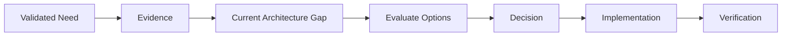
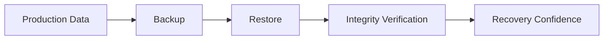
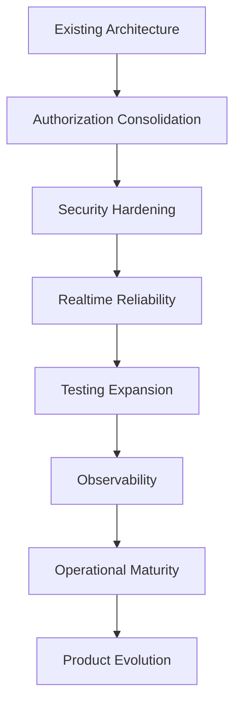
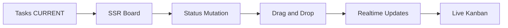
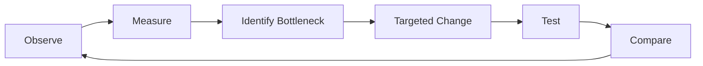
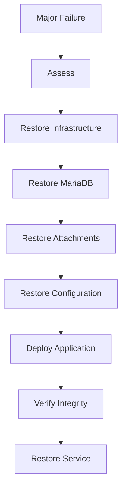
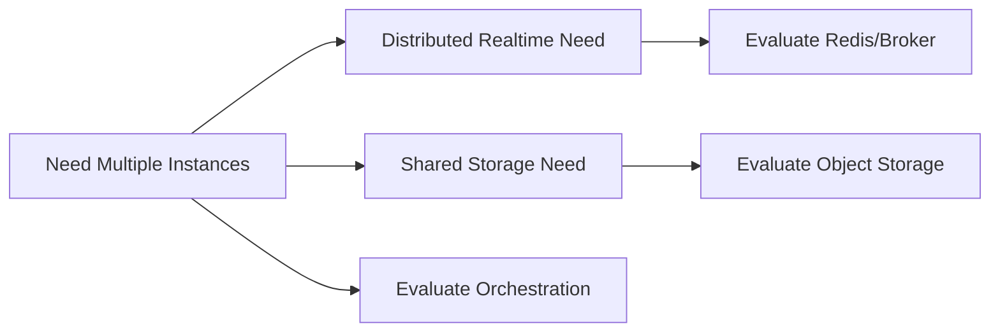
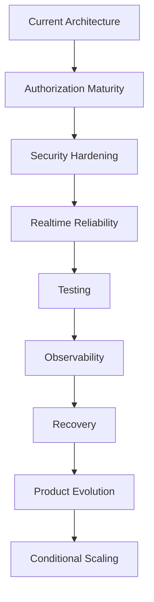

# 61_LESSONS_LEARNED.md

# Lessons Learned — Aula Robótica Platform

## Parte 1/3 — Evolución arquitectónica, persistencia, IAM, autorización y seguridad

---

# 1. Propósito del documento

Este documento consolida las principales:

```text
lessons learned
```

obtenidas durante la evolución técnica y arquitectónica de:

```text
Aula Robótica Platform.
```

No pretende ser únicamente:

```text
an architecture description
```

ni:

```text
a list of technologies.
```

Su objetivo es capturar:

```text
qué decisiones han funcionado;

qué dificultades han revelado
límites arquitectónicos;

qué simplificaciones han sido útiles;

qué supuestos han resultado peligrosos;

qué capacidades necesitan consolidación;

qué prácticas deben preservarse;

qué errores no deben repetirse;

y qué principios deberían orientar
la evolución futura.
```

---

# 2. Naturaleza del documento

Las lecciones recogidas aquí proceden de la evolución real de la plataforma.

Por tanto deben distinguir siempre:

```text
implemented behavior

from

planned behavior

from

future possibilities.
```

---

# 3. Historical Truth Principle

Una lección aprendida solo es útil si parte de:

```text
what actually happened.
```

No debe construirse retrospectivamente una historia basada en:

```text
what the architecture
might become.
```

---

# 4. Documentation Is Not Implementation

Una de las lecciones transversales más importantes es:

```text
Detailed Documentation

≠

Implemented Capability.
```

---

# 5. Consecuencia

La existencia de documentación sobre:

```text
PostgreSQL

SAML

Redis

Kubernetes

Microservices

Object Storage

PWA

AI / RAG

Multi-tenancy
```

no demuestra que esas capacidades formen parte de la arquitectura actual.

---

# 6. Vocabulary

Este documento utiliza la siguiente semántica:

```text
CURRENT
    implementación actual confirmada

PARTIAL
    implementación existente pero incompleta

TARGET
    dirección técnica aceptada

PLANNED
    trabajo previsto

FUTURE
    posibilidad posterior

CONDITIONAL
    solo si aparece un trigger suficiente.
```

---

# 7. Evidence Principle

Cuando exista conflicto entre:

```text
narrative documentation
```

y:

```text
verified implementation evidence,
```

debe prevalecer:

```text
verified implementation evidence.
```

---

# 8. Evidence Hierarchy

Orden preferente:

```text
Verified Runtime / Code Behavior

↓

Tests

↓

Deployment Configuration

↓

Current Technical Documentation

↓

Historical Narrative

↓

Future Design.
```

---

# 9. Lección 1 — La arquitectura debe describir la realidad

La primera lección global es:

```text
architecture documentation
must describe
the architecture that exists.
```

---

# 10. Problema detectado

A medida que creció la documentación, algunas capacidades futuras comenzaron a aparecer como si fueran:

```text
established architecture.
```

---

# 11. Ejemplo principal

La plataforma utiliza actualmente:

```text
MariaDB.
```

Sin embargo, documentación posterior llegó a describir:

```text
PostgreSQL
```

como si hubiera ocurrido una migración.

---

# 12. Lección

```text
Architectural intention
must never be promoted
to historical fact.
```

---

# 13. Regla resultante

```text
MariaDB
    CURRENT

PostgreSQL
    FUTURE / CANDIDATE / CONDITIONAL.
```

---

# 14. No existe

No existe evidencia de una migración completada:

```text
MariaDB

↓

PostgreSQL.
```

---

# 15. Lección 2 — La documentación también necesita gobernanza

Una suite documental extensa puede degradarse aunque cada documento individual parezca:

```text
technically sophisticated.
```

---

# 16. Riesgo

El principal riesgo no es únicamente:

```text
missing documentation.
```

También es:

```text
contradictory documentation.
```

---

# 17. Ejemplos de drift documental

```text
MariaDB CURRENT
in one document

vs

PostgreSQL CURRENT
in another.
```

```text
Kanban PLANNED
in one document

vs

Kanban apparently completed
in historical narrative.
```

```text
SAML FUTURE
in IAM design

vs

SAML apparently established
elsewhere.
```

---

# 18. Lección

```text
Documentation coherence
is an architectural concern.
```

---

# 19. Consecuencia

Los documentos deben compartir:

```text
canonical terminology

canonical status vocabulary

canonical filenames

canonical architecture baseline.
```

---

# 20. Lección 3 — Un Modular Monolith puede ser una arquitectura madura

La evolución del proyecto confirma que:

```text
Modular Monolith
```

no debe considerarse una etapa inferior que necesariamente tenga que convertirse en:

```text
Microservices.
```

---

# 21. Estado actual

```text
Modular Monolith
    CURRENT.
```

---

# 22. Ventajas observadas

Ha permitido mantener:

```text
simple deployment

shared transactions

direct internal calls

lower operational complexity

easier debugging

incremental modularization

fast feature evolution.
```

---

# 23. Lección

```text
Distribution
is not architectural maturity.
```

---

# 24. Lo importante

La calidad del monolito depende de:

```text
boundaries

responsibilities

dependency direction

testability

data ownership

authorization discipline.
```

---

# 25. Riesgo real

El problema no es:

```text
being a monolith.
```

El problema sería evolucionar hacia:

```text
an unstructured monolith.
```

---

# 26. Protección

Preservar:

```text
Route Layer

Service Layer

Repository Layer

Domain / Module Boundaries

Cross-cutting Services

Explicit Authorization.
```

---

# 27. Lección 4 — Los límites internos deben existir antes que los límites de red

Antes de considerar:

```text
Microservices
```

la plataforma debe disponer de:

```text
clear internal boundaries.
```

---

# 28. Razón

Si un módulo no puede delimitarse dentro de una aplicación:

```text
moving it behind HTTP
does not fix the design.
```

---

# 29. Secuencia aprendida

```text
Clear Responsibility

↓

Internal Module Boundary

↓

Stable Contract

↓

Independent Lifecycle Need

↓

Only Then:
Evaluate Service Extraction.
```

---

# 30. Estado de microservicios

```text
Microservices
    FUTURE / CONDITIONAL / NOT CURRENT.
```

---

# 31. Lección 5 — La simplicidad operacional tiene valor

La infraestructura actual:

```text
Docker

Docker Compose

Nginx

Ubuntu

Hetzner VPS
```

ha permitido operar la plataforma sin introducir innecesariamente:

```text
distributed orchestration.
```

---

# 32. Lección

```text
Operational simplicity
is an architectural asset.
```

---

# 33. No significa

Simplicidad no significa:

```text
lack of engineering.
```

Significa:

```text
understandable topology

few moving parts

clear failure modes

lower operational overhead.
```

---

# 34. Consecuencia

No introducir:

```text
Kubernetes
```

solo para obtener una apariencia de:

```text
enterprise architecture.
```

---

# 35. Estado de Kubernetes

```text
Kubernetes
    FUTURE / CONDITIONAL / NOT CURRENT.
```

---

# 36. Lección 6 — La complejidad debe responder a un trigger

Una tecnología adicional debe resolver:

```text
a demonstrated problem.
```

---

# 37. Trigger-based Evolution



---

# 38. Ejemplos

```text
Multi-instance realtime
    → evaluate Redis

Distributed file access
    → evaluate Object Storage

Complex orchestration
    → evaluate Kubernetes

Independent module lifecycle
    → evaluate Microservices

Institutional federation
    → evaluate SAML

Verified MariaDB limitation
    → evaluate PostgreSQL.
```

---

# 39. Lección

```text
Technology adoption
must follow requirements.

Requirements must not be invented
to justify technology adoption.
```

---

# 40. Lección 7 — La separación por capas ha evitado degradación

La evolución de la plataforma confirma el valor de mantener:

```text
Routes

↓

Services

↓

Repositories

↓

Persistence.
```

---

# 41. Route Layer

Las rutas deben concentrarse principalmente en:

```text
HTTP concerns

input parsing

dependency/context injection

response construction.
```

---

# 42. Service Layer

Los servicios deben concentrar:

```text
application use cases

business coordination

transaction boundaries

domain validation

cross-cutting orchestration.
```

---

# 43. Repository Layer

Los repositories deben concentrarse en:

```text
queries

persistence operations

data retrieval

database access patterns.
```

---

# 44. Lección

Cuando una ruta empieza a coordinar directamente:

```text
ORM

authorization

notifications

audit

filesystem

realtime
```

la arquitectura comienza a perder:

```text
separation of concerns.
```

---

# 45. Anti-pattern aprendido

```text
Route

↓

Direct ORM Mutation

↓

Commit

↓

Notification

↓

Broadcast

↓

Filesystem Side Effect.
```

---

# 46. Modelo preferido

```text
Route

↓

Service

↓

Authorization / Validation

↓

Repository / Transaction

↓

Cross-cutting Consequences.
```

---

# 47. Lección 8 — Service Layer es útil, pero también puede degradarse

El Service Layer ha resultado una foundation adecuada.

---

# 48. Riesgo

Un service puede convertirse en:

```text
God Service.
```

---

# 49. Señales

```text
too many unrelated methods

many unrelated dependencies

very large constructor

unrelated transaction flows

frequent changes for unrelated features.
```

---

# 50. Lección

Dividir servicios por:

```text
business capability
```

y no simplemente por:

```text
file size.
```

---

# 51. Lección 9 — Repository Pattern debe aportar semántica

Un repository no debe existir únicamente como:

```text
thin wrapper around SQLAlchemy.
```

---

# 52. Debe aportar

```text
query abstraction

persistence semantics

domain-oriented retrieval

controlled database access.
```

---

# 53. No debe asumir

```text
HTTP behavior

UI concerns

authorization policy

notification delivery.
```

---

# 54. Lección 10 — El ORM no elimina la necesidad de entender SQL

SQLAlchemy facilita:

```text
persistence abstraction.
```

Pero no elimina:

```text
database behavior.
```

---

# 55. Problemas que siguen existiendo

```text
N+1 queries

lazy loading

large object graphs

missing indexes

unbounded result sets

transaction behavior.
```

---

# 56. Lección

```text
Using an ORM
does not remove
the need to understand
relational persistence.
```

---

# 57. Consecuencia

En rutas críticas deben conocerse:

```text
query count

loading strategy

pagination

indexes

transaction boundaries.
```

---

# 58. Lección 11 — MariaDB es la realidad actual

La persistencia relacional actual utiliza:

```text
MariaDB.
```

---

# 59. Estado

```text
MariaDB
    CURRENT.
```

---

# 60. Lección

Las decisiones de:

```text
schema

constraints

queries

migrations

backup

restore

testing
```

deben partir de:

```text
the database actually deployed.
```

---

# 61. Error a evitar

No optimizar ni documentar el sistema como si ya dependiera de características específicas de:

```text
PostgreSQL.
```

---

# 62. PostgreSQL

Puede seguir siendo:

```text
future candidate.
```

---

# 63. Pero

Solo debe evaluarse si existe:

```text
verified requirement.
```

---

# 64. Database Evolution Rule

```text
Current Database Works

↓

Measure / Identify Limitation

↓

Evaluate Alternatives

↓

Migration Decision

↓

Migration Plan

↓

Verified Migration

↓

Only Then:
New Database Becomes CURRENT.
```

---

# 65. Lección 12 — La base de datos debe proteger invariantes

La aplicación puede validar.

Pero determinadas invariantes estructurales deben reforzarse también mediante:

```text
database constraints.
```

---

# 66. Ejemplos

```text
NOT NULL

UNIQUE

FOREIGN KEY

CHECK
```

cuando sean adecuados para MariaDB y el modelo correspondiente.

---

# 67. Defense in Depth


---

# 68. Lección

```text
Application Validation

+

Database Integrity

is stronger than either alone.
```

---

# 69. Lección 13 — Las transacciones deben representar unidades de negocio

Una transacción no debería definirse únicamente por:

```text
repository method boundaries.
```

---

# 70. Debe representar

```text
business unit of work.
```

---

# 71. Ejemplo conceptual

```text
Create Task

+

Persist Required Domain Consequences

+

Persist Critical Audit Data

↓

Commit.
```

---

# 72. Riesgo

Commits demasiado tempranos pueden dejar:

```text
partial business state.
```

---

# 73. Lección

Cuando varias operaciones forman una sola unidad lógica:

```text
transaction ownership
belongs near
the application use case.
```

---

# 74. Evitar

```text
independent repository commits
```

cuando el caso de uso requiere:

```text
shared atomicity.
```

---

# 75. Lección 14 — Realtime no resuelve concurrencia

La incorporación de colaboración realtime hace más visible:

```text
concurrent activity.
```

Pero no evita:

```text
concurrent writes.
```

---

# 76. Casos

```text
simultaneous task updates

membership changes

future reservation conflicts

future inventory updates

future competition scoring.
```

---

# 77. Lección

```text
Realtime Delivery

≠

Concurrency Control.
```

---

# 78. Concurrency Strategy

Debe decidirse:

```text
per invariant.
```

---

# 79. Posibles mecanismos

```text
database constraints

optimistic locking

version fields

transaction isolation

pessimistic locking
```

según necesidad.

---

# 80. Lección 15 — Las migraciones deben asumir datos reales

Una aplicación desplegada no puede evolucionar permanentemente mediante:

```text
drop database

recreate schema

reload sample data.
```

---

# 81. Lección

Toda evolución estructural debe considerar:

```text
existing data.
```

---

# 82. Migration Questions

```text
What changes?

What happens to existing rows?

Are constraints immediately valid?

Are indexes required?

What is deployment ordering?

How is failure recovered?
```

---

# 83. Estado

La disciplina de migraciones debe permanecer:

```text
CURRENT PRINCIPLE / EVOLVING MATURITY.
```

---

# 84. Lección 16 — Backup sin restore probado no es recuperación

Crear un backup no demuestra:

```text
recoverability.
```

---

# 85. Lección

```text
Backup Exists

≠

Restore Works.
```

---

# 86. Deben protegerse

```text
MariaDB

persistent attachments

critical operational configuration
where applicable.
```

---

# 87. Recovery Confidence



---

# 88. Preguntas

```text
Can MariaDB be restored?

Can attachments be restored?

Do attachment metadata
and physical files remain consistent?

How long does recovery take?

Which steps remain manual?
```

---

# 89. Lección 17 — User e Identity son conceptos distintos

La separación conceptual entre:

```text
User

and

Identity
```

es una decisión que conviene preservar.

---

# 90. User

Representa:

```text
the internal platform account/person.
```

---

# 91. Identity

Representa:

```text
a mechanism through which
that user proves identity.
```

---

# 92. Beneficio

Esta separación permite evolucionar posteriormente hacia:

```text
additional identity providers
```

sin redefinir necesariamente:

```text
the internal User domain.
```

---

# 93. Lección

```text
Internal User

≠

Authentication Mechanism.
```

---

# 94. SAML Consequence

Esta arquitectura facilita una posible integración futura con:

```text
SAML.
```

Pero:

```text
SAML
    FUTURE / NOT IMPLEMENTED.
```

---

# 95. Lección 18 — La autenticación actual es más madura de lo que sugería parte de la documentación

La implementación real confirma:

```text
JWT Access Token
    CURRENT

JWT Refresh Token
    CURRENT

HTTPOnly Cookies
    CURRENT.
```

---

# 96. También están implementados

```text
explicit refresh endpoint

automatic access-token refresh

refresh-token validation

logout token cleanup.
```

---

# 97. Lección

No debe describirse:

```text
refresh-token workflow
```

como una capacidad futura.

---

# 98. Estado correcto

```text
Refresh-token Workflow
    CURRENT.
```

---

# 99. Lección 19 — Implementación de refresh y hardening de refresh son problemas distintos

La existencia de refresh tokens no significa que todos los controles avanzados estén resueltos.

---

# 100. Current

```text
Access Token

Refresh Token

HTTPOnly Cookies

Explicit Refresh

Automatic Refresh

Refresh Validation

Logout Cleanup.
```

---

# 101. Hardening / Verify

```text
Refresh-token Rotation

Server-side Revocation

Lifecycle Enforcement.
```

---

# 102. Future Hardening

```text
Reuse Detection

Session / Device Management.
```

---

# 103. Lección

```text
Do not remove
an implemented security capability
because its hardening is incomplete.
```

---

# 104. Tampoco

```text
Do not call
an implemented capability
fully hardened
without evidence.
```

---

# 105. Lección 20 — Las cookies requieren una política única

La revisión del flujo real de autenticación reveló una inconsistencia relevante.

---

# 106. Login / Explicit Authentication

La configuración utiliza una política dependiente del entorno equivalente a:

```text
SameSite:
    lax in DEBUG
    strict outside DEBUG

Secure:
    false in DEBUG
    true outside DEBUG.
```

---

# 107. Automatic Refresh

El middleware de renovación automática utiliza una configuración equivalente a:

```text
SameSite:
    lax

Secure:
    false.
```

---

# 108. Riesgo

Una renovación automática puede emitir un nuevo access cookie con atributos menos estrictos que los utilizados durante:

```text
normal login.
```

---

# 109. Lección

```text
Security policy
must not depend on
which code path
issued the cookie.
```

---

# 110. Acción resultante

Centralizar:

```text
cookie configuration.
```

---

# 111. Cookie Policy

Debe definir en un único lugar:

```text
HttpOnly

Secure

SameSite

Path

Domain if required

expiration / max-age

environment-specific behavior.
```

---

# 112. Estado

```text
HTTPOnly Cookie Authentication
    CURRENT

Cookie Policy Consistency
    TARGET / HIGH PRIORITY.
```

---

# 113. Lección 21 — Cookie Authentication implica pensar explícitamente en CSRF

HTTPOnly reduce exposición del token a:

```text
JavaScript.
```

Pero no elimina:

```text
CSRF.
```

---

# 114. Lección

```text
XSS Token Exposure Mitigation

≠

CSRF Protection.
```

---

# 115. Estado

```text
Formal CSRF Protection
    TARGET / PLANNED.
```

---

# 116. Consecuencia

Las mutaciones autenticadas mediante cookies deben revisar:

```text
CSRF strategy

SameSite policy

Origin / Referer checks where appropriate

token-based protection where appropriate.
```

---

# 117. Lección 22 — Authentication y Authorization deben permanecer separadas

Una identidad autenticada responde:

```text
Who are you?
```

---

# 118. Pero no responde

```text
What may you do
with this resource
in this context?
```

---

# 119. Lección

```text
Authenticated

≠

Authorized.
```

---

# 120. Consecuencia

Todas las interfaces relevantes deben aplicar autorización:

```text
SSR

HTTP APIs

WebSockets

future background operations

future external APIs

future AI retrieval.
```

---

# 121. Lección 23 — Global RBAC funciona para capacidades globales

El modelo global de roles está establecido.

---

# 122. Estado

```text
Global RBAC
    CURRENT / MATURE.
```

---

# 123. Casos adecuados

```text
platform administration

global capabilities

system-level restrictions.
```

---

# 124. Lección

RBAC global funciona bien cuando:

```text
permission scope
is global.
```

---

# 125. Limitación

No representa adecuadamente por sí solo:

```text
project-specific authority.
```

---

# 126. Lección 24 — Los permisos contextuales requieren contexto explícito

Un usuario puede:

```text
manage Project A

view Project B

have no access to Project C.
```

---

# 127. Por tanto

```text
User Global Role

alone

is insufficient.
```

---

# 128. Modelo necesario

```text
User

+

Project

+

Membership

+

Contextual Role

+

Resource

+

Operation.
```

---

# 129. Estado actual

```text
Contextual Authorization
    PARTIAL / EVOLVING.
```

---

# 130. Lección

No promoverla todavía a:

```text
fully mature authorization architecture.
```

---

# 131. Lección 25 — ProjectMembership es una foundation, no una feature cosmética

La evolución de Projects y recursos asociados demuestra la necesidad de consolidar:

```text
ProjectMembership.
```

---

# 132. Estado

```text
ProjectMembership
    TARGET / IN CONSOLIDATION.
```

---

# 133. Modelo conceptual

```text
User

↓

ProjectMembership

↓

Project

+

Contextual Role.
```

---

# 134. Posibles roles

El modelo definitivo puede contemplar roles como:

```text
OWNER

ADMIN

MEMBER

VIEWER
```

según requisitos reales.

---

# 135. Lección

La membership no debe existir solo para:

```text
display project members.
```

Debe soportar:

```text
authorization semantics.
```

---

# 136. Dependencias

```text
ProjectMembership

↓

Contextual Authorization

↓

Cross-project Security

↓

WebSocket Subscription Authorization

↓

Reliable Collaborative Features.
```

---

# 137. Lección 26 — Context Injection reduce duplicación, pero debe mantenerse explícito

La resolución de contexto puede centralizar:

```text
current user

current project

membership

permissions

request context.
```

---

# 138. Beneficio

Reduce:

```text
duplicated setup
```

en múltiples rutas.

---

# 139. Riesgo

Puede degenerar en:

```text
hidden service locator.
```

---

# 140. Lección

Inyectar:

```text
necessary context
```

sin esconder:

```text
arbitrary dependencies.
```

---

# 141. Estado

```text
Context Injection
    PARTIAL / EVOLVING
```

en coherencia con la madurez de la autorización contextual.

---

# 142. Lección 27 — Los recursos anidados deben validar su pertenencia

Una ruta como:

```text
/projects/{project_id}/tasks/{task_id}
```

contiene dos identificadores.

---

# 143. Error

Validar únicamente:

```text
user can access project_id
```

y posteriormente cargar:

```text
task_id
```

sin comprobar relación.

---

# 144. Validación necesaria

```text
task.project_id == project_id.
```

---

# 145. Riesgo

Sin esta comprobación puede aparecer:

```text
cross-project access

IDOR-style vulnerability.
```

---

# 146. Lección

```text
Resource Authorization

must include

Resource Relationship Validation.
```

---

# 147. Aplica a

```text
Tasks

Activities

Attachments

Notifications where scoped

future Kanban mutations

WebSocket subscriptions

future domain resources.
```

---

# 148. Lección 28 — La autorización debe influir en las queries

Modelo débil:

```text
SELECT all resources

↓

filter unauthorized resources
in template.
```

---

# 149. Modelo preferido

```text
Query only resources
the user is authorized to access.
```

---

# 150. Beneficios

```text
reduced accidental exposure

less unnecessary data loading

simpler templates

stronger defense in depth.
```

---

# 151. Lección

```text
Authorization
is not only
a route-level boolean check.
```

---

# 152. También afecta

```text
data retrieval

resource resolution

subscription scope

mutation scope.
```

---

# 153. Lección 29 — Las políticas deben reutilizarse entre interfaces

Una misma regla conceptual puede necesitar aplicarse en:

```text
SSR route

JSON endpoint

WebSocket subscription

future API

future background process.
```

---

# 154. Riesgo

Copiar reglas manualmente provoca:

```text
authorization drift.
```

---

# 155. Lección

Centralizar:

```text
reusable authorization policies.
```

---

# 156. Ejemplo conceptual

```text
can_view_project(...)

can_edit_project(...)

can_create_task(...)

can_edit_task(...)

can_manage_membership(...).
```

---

# 157. Lección 30 — WebSocket autenticado no significa WebSocket autorizado

La plataforma ya dispone de:

```text
FastAPI WebSockets.
```

---

# 158. Estado

```text
WebSocket Foundation
    CURRENT.
```

---

# 159. Pero

Una conexión autenticada demuestra:

```text
socket identity.
```

---

# 160. No demuestra

```text
authorization
for every project,
channel,
resource
or event.
```

---

# 161. Lección

La seguridad realtime requiere al menos:

```text
connection authentication

subscription authorization

operation authorization

authorization revocation strategy.
```

---

# 162. Estado de hardening

```text
WebSocket Authentication Hardening
    ACTIVE / TARGET

Subscription Authorization
    TARGET / HIGH PRIORITY.
```

---

# 163. Lección 31 — HTTP y WebSocket deben compartir trust model

No debe existir:

```text
strict HTTP authorization

+

permissive WebSocket authorization.
```

---

# 164. Principio

```text
Same Resource

↓

Same Authorization Semantics

↓

Different Transport.
```

---

# 165. Consecuencia

Si un usuario no puede acceder a un proyecto mediante HTTP:

```text
the user must not
subscribe to that project
through WebSocket.
```

---

# 166. Lección 32 — Los cambios de autorización pueden invalidar sesiones activas

Casos:

```text
membership removed

project role changed

account disabled

resource access revoked.
```

---

# 167. Problema

Una conexión persistente puede conservar:

```text
stale authorization assumptions.
```

---

# 168. Lección

La arquitectura realtime debe contemplar:

```text
authorization revocation.
```

---

# 169. Estrategias posibles

Según criticidad:

```text
revalidation

connection termination

subscription removal

short-lived authorization context

event-triggered revocation.
```

---

# 170. Estado

```text
Authorization Revocation Strategy
    TARGET / EVOLVING.
```

---

# 171. Lección 33 — UI permissions mejoran UX, pero no proporcionan seguridad

Ocultar un botón puede evitar:

```text
confusing interaction.
```

---

# 172. Pero

No impide que un usuario:

```text
construct a request manually.
```

---

# 173. Lección

```text
UI Permission Awareness
    UX

Server Authorization
    SECURITY.
```

---

# 174. Consecuencia

Toda mutación debe volver a validar:

```text
permission on the server.
```

---

# 175. Lección 34 — Deny by Default reduce errores de autorización

Cuando una política no puede demostrar que una operación está permitida:

```text
deny.
```

---

# 176. Principio

```text
Explicit Allow

rather than

Implicit Allow.
```

---

# 177. Beneficio

Reduce riesgo ante:

```text
new roles

new routes

new resources

incomplete contextual data.
```

---

# 178. Lección 35 — Security Hardening es continuo

La plataforma dispone de foundations de seguridad reales.

---

# 179. Current Security Foundations

```text
JWT Access

JWT Refresh

HTTPOnly Cookies

Global RBAC

Authorization Logic

Audit

Server-side Validation.
```

---

# 180. Pero permanecen áreas de consolidación

```text
Contextual Authorization

ProjectMembership

Cross-project Authorization Tests

Formal CSRF

Refresh-token Hardening

Cookie Policy Consistency

WebSocket Authentication Hardening

Subscription Authorization.
```

---

# 181. Lección

No describir la seguridad como:

```text
complete.
```

---

# 182. Modelo correcto

```text
Security Foundation
    CURRENT

Security Hardening
    CONTINUOUS.
```

---

# 183. Lección 36 — CORS no debe utilizarse como mecanismo de autorización

CORS controla:

```text
browser cross-origin behavior.
```

---

# 184. No controla

```text
whether an authenticated user
may access a resource.
```

---

# 185. Lección

```text
CORS

≠

Authorization.
```

---

# 186. Producción

Debe restringirse a:

```text
origins actually required.
```

---

# 187. Especial cuidado

Cuando se utilizan:

```text
credentials / cookies.
```

---

# 188. Lección 37 — Security Headers forman parte del hardening, no del dominio

Cabeceras como:

```text
Content-Security-Policy

X-Content-Type-Options

Referrer-Policy

Permissions-Policy

Strict-Transport-Security
```

pueden reforzar la seguridad del navegador.

---

# 189. Lección

Deben introducirse:

```text
deliberately
```

y validarse contra:

```text
actual frontend behavior.
```

---

# 190. CSP Example

Una CSP demasiado agresiva puede romper:

```text
inline scripts

AdminLTE assets

Bootstrap behavior

third-party resources.
```

---

# 191. Evolución recomendada

```text
Inventory

↓

Report / Observe

↓

Resolve Violations

↓

Enforce.
```

---

# 192. Lección 38 — Input Validation no sustituye Business Validation

FastAPI y los modelos de entrada pueden validar:

```text
shape

type

format.
```

---

# 193. Pero

Un valor sintácticamente correcto puede seguir siendo:

```text
invalid for the use case.
```

---

# 194. Ejemplo

```text
status = DONE
```

puede ser válido como enum.

Pero una transición concreta podría estar prohibida por:

```text
workflow rules

authorization

resource state.
```

---

# 195. Lección

```text
Schema Validation

≠

Business Validation.
```

---

# 196. Lección 39 — Los modelos de salida deben representar contratos

Devolver directamente una entidad ORM completa puede exponer:

```text
internal fields

sensitive metadata

implementation details

unnecessary relationships.
```

---

# 197. Lección

Los outputs deben reflejar:

```text
the contract needed
by the consumer.
```

---

# 198. No necesariamente

```text
the complete persistence model.
```

---

# 199. Lección 40 — Mass Assignment debe evitarse

Un payload no debe poder modificar automáticamente:

```text
every persistence field.
```

---

# 200. Campos sensibles

Ejemplos:

```text
role

owner_id

project_id

is_admin

created_by

security state.
```

---

# 201. Lección

Determinados campos deben ser:

```text
server-controlled.
```

---

# 202. Lección 41 — Audit, Activity y Logging resuelven problemas diferentes

La plataforma dispone de varios mecanismos relacionados con:

```text
history and visibility.
```

Pero no son equivalentes.

---

# 203. Audit

Responde principalmente:

```text
Who did what?

When?

To which resource?

Under which context?
```

---

# 204. Activity

Representa principalmente:

```text
user-visible collaborative history.
```

---

# 205. Logging

Representa principalmente:

```text
technical operational behavior.
```

---

# 206. Lección

```text
Audit

≠

Activity

≠

Logging.
```

---

# 207. Consecuencia

Una misma operación puede producir:

```text
Activity

+

Audit

+

Technical Log
```

sin que exista duplicación conceptual.

---

# 208. Lección 42 — Audit debe tener semántica de seguridad y gobernanza

Audit no debe convertirse en:

```text
debug log.
```

---

# 209. Eventos especialmente relevantes

```text
membership changes

role changes

administrative operations

security-sensitive changes

important state transitions.
```

---

# 210. Lección

La pregunta:

```text
Can the business operation succeed
if audit persistence fails?
```

debe responderse:

```text
per event category.
```

---

# 211. Lección 43 — Activity Feed no sustituye Audit

El Activity Feed está orientado a:

```text
collaboration and product visibility.
```

---

# 212. Audit está orientado a:

```text
traceability and accountability.
```

---

# 213. Lección

No diseñar Audit en función de:

```text
what looks useful
in the user feed.
```

---

# 214. Tampoco

No diseñar el Activity Feed como:

```text
raw security history.
```

---

# 215. Lección 44 — Las decisiones de seguridad deben generar tests

Cuando se corrige una vulnerabilidad o un límite de autorización:

```text
the fix should become
a regression test
whenever practical.
```

---

# 216. Pattern

```text
Security Problem

↓

Fix

↓

Regression Test

↓

Permanent Protection.
```

---

# 217. Casos prioritarios

```text
cross-project access

nested-resource mismatch

unauthorized mutation

role escalation

attachment access

WebSocket subscription access.
```

---

# 218. Lección 45 — Cross-project tests son especialmente importantes

El modelo contextual introduce un riesgo claro:

```text
a valid user
accessing a valid resource
in the wrong project.
```

---

# 219. Ejemplo

```text
User belongs to Project A

Task belongs to Project B

User knows Task ID

↓

Request must be denied.
```

---

# 220. Lección

Los tests deben comprobar:

```text
relationship

scope

permission
```

y no únicamente:

```text
authentication.
```

---

# 221. Security Test Matrix

| Scenario | Expected |
|---|---|
| Anonymous user | DENY |
| Authenticated unrelated user | DENY |
| Member of wrong project | DENY |
| Valid member without required permission | DENY |
| Valid authorized member | ALLOW |
| Global administrator where policy permits | ALLOW |
| Resource/project mismatch | DENY |

---

# 222. Lección 46 — Seguridad y producto están cada vez más conectados

A medida que la plataforma incorpora:

```text
Projects

Tasks

Attachments

Notifications

Realtime

future Kanban
```

la autorización deja de ser:

```text
an isolated security module.
```

---

# 223. Se convierte en

```text
a product architecture concern.
```

---

# 224. Ejemplo

Live Kanban requiere:

```text
Task semantics

ProjectMembership

Contextual Authorization

WebSocket Security

Subscription Authorization

Realtime Reliability.
```

---

# 225. Lección

Una feature colaborativa no está realmente terminada si solo funciona:

```text
for the happy-path UI.
```

---

# 226. Debe funcionar correctamente bajo

```text
authorization boundaries

concurrent users

reconnects

failures

invalid requests.
```

---

# 227. Lección 47 — La arquitectura debe proteger el camino de evolución

Las foundations actuales permiten evolucionar sin sustituir todo el sistema.

---

# 228. Ejemplo — Authentication

```text
Current:
    JWT Access + Refresh

Future possibility:
    SAML
```

sin necesidad de redefinir:

```text
User
```

si Identity permanece separada.

---

# 229. Ejemplo — Realtime

```text
Current:
    In-memory Connection Manager

Future trigger:
    multiple instances

Possible evolution:
    Redis / broker coordination.
```

---

# 230. Ejemplo — Storage

```text
Current:
    Persistent Local Storage

Future trigger:
    distributed deployment

Possible evolution:
    Object Storage.
```

---

# 231. Ejemplo — Architecture

```text
Current:
    Modular Monolith

Future trigger:
    independent lifecycle

Possible evolution:
    service extraction.
```

---

# 232. Lección

La buena arquitectura futura no consiste en implementar hoy:

```text
all future technologies.
```

---

# 233. Consiste en

```text
avoiding unnecessary decisions
that make justified evolution impossible.
```

---

# 234. Lección 48 — Reversibilidad reduce riesgo

Cuando dos soluciones cumplen los requisitos actuales, suele ser preferible la que permite:

```text
incremental change

limited blast radius

clear rollback

future replacement.
```

---

# 235. Ejemplo

```text
Local Storage

↓

Storage Boundary

↓

Object Storage if required.
```

---

# 236. Otro ejemplo

```text
In-memory Realtime

↓

Stable Event / Connection Abstraction

↓

Distributed Coordination if required.
```

---

# 237. Lección

```text
Reversible decisions
reduce architectural risk.
```

---

# 238. Lección 49 — No todas las decisiones deben optimizarse para escala futura

Diseñar cada componente para:

```text
millions of users

multi-region

hundreds of services
```

cuando esos requisitos no existen produce:

```text
premature complexity.
```

---

# 239. Lección

```text
Scalability must have
a plausible growth path.

It does not require
premature distributed implementation.
```

---

# 240. Current Scale Strategy

```text
Simple Current Topology

↓

Measure

↓

Identify Pressure

↓

Scale Specific Bottleneck

↓

Re-evaluate.
```

---

# 241. Lección 50 — Correctness y security preceden a performance

La secuencia aprendida es:

```text
Correct

↓

Secure

↓

Tested

↓

Observable

↓

Optimized.
```

---

# 242. No significa

Que performance sea secundaria en todos los casos.

---

# 243. Significa

No resolver un problema de rendimiento introduciendo:

```text
incorrect state

weaker authorization

unrecoverable complexity.
```

---

# 244. Lección 51 — Query Optimization precede a distributed cache

Antes de introducir:

```text
Redis cache
```

deben revisarse:

```text
N+1

indexes

pagination

over-fetching

query design.
```

---

# 245. Razón

Cache introduce:

```text
invalidation

staleness

memory management

operational complexity.
```

---

# 246. Lección

```text
Cache
must optimize
a measured problem.

It must not hide
a poorly designed query.
```

---

# 247. Lección 52 — Seguridad debe centralizar políticas, no esconderlas

Centralizar autorización es útil.

Pero debe seguir siendo posible comprender:

```text
why access was allowed
or denied.
```

---

# 248. Anti-pattern

```text
magic permission behavior
```

difícil de seguir desde:

```text
route

service

policy

resource context.
```

---

# 249. Modelo preferido

```text
Explicit Context

+

Reusable Policy

+

Testable Decision.
```

---

# 250. Lección 53 — Los errores de arquitectura suelen aparecer primero como duplicación

Señales tempranas:

```text
same authorization logic
in many routes

same fetch behavior
in many JS files

same cookie configuration
in multiple auth paths

same query patterns
repeated across services.
```

---

# 251. Lección

Duplicación relevante puede indicar:

```text
missing shared abstraction.
```

---

# 252. Pero

No toda duplicación justifica inmediatamente:

```text
generic abstraction.
```

---

# 253. Regla

```text
Observe repetition

↓

Understand common semantics

↓

Extract stable abstraction.
```

---

# 254. Lección 54 — Las abstracciones prematuras también crean deuda

Una abstracción demasiado temprana puede:

```text
hide differences

force unrelated use cases

increase indirection

make debugging harder.
```

---

# 255. Lección

```text
Abstract stable repetition,
not imagined future similarity.
```

---

# 256. Lección 55 — El contexto de seguridad debe ser observable en tests

Una política contextual debe poder probarse mediante entradas como:

```text
user

global role

project

membership

resource

operation.
```

---

# 257. Resultado esperado

```text
ALLOW

or

DENY.
```

---

# 258. Beneficio

Esto permite:

```text
policy-focused tests
```

sin depender siempre de:

```text
full browser workflows.
```

---

# 259. Lección 56 — Una arquitectura segura necesita negative testing

Los tests no deben demostrar únicamente:

```text
authorized user can perform action.
```

---

# 260. También deben demostrar

```text
unauthorized user cannot perform action.
```

---

# 261. Negative Cases

```text
anonymous

wrong role

wrong project

wrong resource relationship

expired authentication

invalid refresh

unauthorized WebSocket subscription.
```

---

# 262. Lección

```text
A security boundary
is not demonstrated
until denial behavior
is tested.
```

---

# 263. Lección 57 — El hardening debe priorizar gaps reales

La prioridad actual no debe ser introducir:

```text
more architecture.
```

---

# 264. Debe ser consolidar

```text
ProjectMembership

Contextual Authorization

Cross-project Authorization Tests

Formal CSRF

Refresh-token Security Hardening

Cookie Policy Consistency

WebSocket Authentication Hardening

Subscription Authorization.
```

---

# 265. Razón

Estas áreas afectan directamente:

```text
security

correctness

future collaboration features.
```

---

# 266. Lección 58 — El roadmap técnico debe respetar dependencias

No todas las tareas pueden realizarse de forma independiente.

---

# 267. Ejemplo

```text
ProjectMembership

↓

Contextual Authorization

↓

Cross-project Tests

↓

WebSocket Subscription Authorization.
```

---

# 268. Otro ejemplo

```text
WebSocket Security

↓

Event Contract

↓

Reconnect

↓

Reconciliation

↓

Live Kanban.
```

---

# 269. Lección

```text
Dependency-aware sequencing
reduces rework.
```

---

# 270. Lección 59 — Una feature visible puede depender de trabajo invisible

Kanban es una feature visual.

Pero su versión colaborativa depende de:

```text
authorization

persistent task state

mutation semantics

realtime security

event contracts

reconnect

reconciliation

testing.
```

---

# 271. Lección

```text
Visible Product Feature

often rests on

Invisible Platform Foundations.
```

---

# 272. Consecuencia

No estimar features colaborativas únicamente por:

```text
HTML

CSS

JavaScript interaction.
```

---

# 273. Lección 60 — El servidor debe seguir siendo la autoridad

La evolución hacia interfaces más dinámicas no debe cambiar:

```text
authority ownership.
```

---

# 274. Browser

Puede:

```text
render

request

optimistically update

receive events.
```

---

# 275. Server

Debe:

```text
validate

authorize

persist

return authoritative result.
```

---

# 276. MariaDB

Mantiene:

```text
authoritative persistent state.
```

---

# 277. Principio

```text
Browser State

≠

Persistent Truth.
```

---

# 278. Lección 61 — Persistencia y realtime deben permanecer separados

Una mutación durable debe seguir:

```text
Validate

↓

Authorize

↓

Persist

↓

Commit

↓

Broadcast.
```

---

# 279. No

```text
Broadcast

↓

Hope Persistence Works.
```

---

# 280. Lección

```text
Persist First.

Broadcast Second.
```

---

# 281. Consecuencia

Si el broadcast falla:

```text
the durable state still exists.
```

---

# 282. Si la persistencia falla

```text
no successful state-change event
should be emitted.
```

---

# 283. Lección 62 — El realtime es una optimización de colaboración

Para capacidades persistentes:

```text
Database
    Source of Truth

WebSocket
    Delivery / Synchronization Mechanism.
```

---

# 284. Lección

Esto permite recuperar estado mediante:

```text
HTTP / SSR refetch
```

cuando el realtime falla.

---

# 285. Esta separación habilita

```text
reconnect

reconciliation

recovery

multi-client convergence.
```

---

# 286. Lección 63 — La arquitectura actual no necesita una reescritura

La revisión de la evolución completa muestra que el problema principal no es:

```text
wrong foundational architecture.
```

---

# 287. La prioridad es

```text
consolidate

harden

test

observe

operate.
```

---

# 288. No

```text
rewrite.
```

---

# 289. Lección

Una reescritura estructural introduciría riesgo sin resolver automáticamente:

```text
authorization gaps

security hardening

realtime reliability

test coverage

operational maturity.
```

---

# 290. Consolidation Strategy



---

# 291. Lección 64 — El siguiente salto de madurez es disciplina, no tecnología

La plataforma ya dispone de suficientes foundations para evolucionar.

---

# 292. El siguiente nivel depende más de

```text
consistent authorization

reliable tests

security hardening

operational recovery

observability

documentation coherence

controlled evolution.
```

---

# 293. Que de añadir

```text
new frameworks

new databases

new brokers

new orchestration platforms.
```

---

# 294. Parte 1 — Resumen

Las principales lecciones de esta primera parte son:

```text
1. Architecture documentation must reflect reality.

2. Documentation itself requires governance.

3. Modular Monolith remains an appropriate current architecture.

4. Internal boundaries should precede distributed boundaries.

5. Operational simplicity has architectural value.

6. Complexity must follow explicit triggers.

7. Layering protects maintainability.

8. Service Layer must avoid God Services.

9. Repository Pattern should provide persistence semantics.

10. ORM usage still requires relational knowledge.

11. MariaDB is the current database.

12. Database constraints should protect structural invariants.

13. Transactions should represent business units of work.

14. Realtime does not solve concurrency.

15. Schema evolution must assume existing data.

16. Backup without restore validation is insufficient.

17. User and Identity are different concepts.

18. JWT Access + Refresh is already implemented.

19. Refresh implementation and refresh hardening are separate.

20. Cookie policy must be centralized.

21. Cookie authentication requires explicit CSRF strategy.

22. Authentication and authorization are different.

23. Global RBAC is appropriate for global capabilities.

24. Contextual permissions require explicit context.

25. ProjectMembership is an authorization foundation.

26. Context Injection must remain explicit.

27. Nested resources must validate relationships.

28. Authorization must influence queries.

29. Policies should remain consistent across interfaces.

30. Authenticated WebSocket does not mean authorized subscription.

31. HTTP and WebSocket must share the same trust model.

32. Active connections must consider authorization revocation.

33. UI permissions are UX, not security.

34. Deny by Default reduces authorization risk.

35. Security hardening is continuous.

36. CORS is not authorization.

37. Security headers require deliberate hardening.

38. Input validation is not business validation.

39. Output models are contracts.

40. Mass assignment must be controlled.

41. Audit, Activity and Logging are different concerns.

42. Audit needs governance semantics.

43. Activity Feed does not replace Audit.

44. Security fixes should become regression tests.

45. Cross-project tests are critical.

46. Security increasingly shapes product architecture.

47. Architecture must preserve evolution paths.

48. Reversible decisions reduce risk.

49. Future scalability does not require premature distribution.

50. Correctness and security precede optimization.

51. Query optimization precedes distributed cache.

52. Security policies should be centralized but explicit.

53. Relevant duplication often reveals missing abstractions.

54. Premature abstractions also create debt.

55. Security context should be directly testable.

56. Security boundaries require negative tests.

57. Hardening must prioritize real gaps.

58. Technical roadmaps must respect dependencies.

59. Visible features depend on invisible foundations.

60. The server remains authoritative.

61. Persist first, broadcast second.

62. Realtime is synchronization, not persistent truth.

63. The platform does not currently require a rewrite.

64. The next maturity step is engineering discipline,
    not additional technology.
```

---

# 295. Current Architecture Baseline

Al finalizar esta primera parte, el baseline confirmado continúa siendo:

```text
Backend:
    FastAPI

Architecture:
    Modular Monolith

Persistence:
    SQLAlchemy
    MariaDB

Frontend:
    Jinja2 SSR
    Bootstrap
    AdminLTE
    Modular JavaScript

Authentication:
    JWT Access
    JWT Refresh
    HTTPOnly Cookies
    Explicit Refresh
    Automatic Access Refresh

Authorization:
    Global RBAC
    Partial Contextual Authorization

Realtime:
    FastAPI WebSockets
    In-memory Connection Manager

Deployment:
    Docker
    Docker Compose
    Nginx
    Ubuntu
    Hetzner VPS

CI:
    GitHub Actions

Testing:
    CURRENT / EXPANDING.
```

---

# 296. Consolidation Baseline

Las áreas principales de consolidación son:

```text
ProjectMembership

Contextual Authorization

Cross-project Authorization Tests

Formal CSRF Protection

Refresh-token Security Hardening

Cookie Policy Consistency

WebSocket Authentication Hardening

WebSocket Subscription Authorization

Realtime Event Contract

Reconnect

Reconciliation

UI Testing

Realtime Testing

Observability

Backup / Restore Validation.
```

---

# 297. Future Boundary

No deben promoverse a CURRENT:

```text
PostgreSQL

SAML

Redis

Object Storage

Kubernetes

Microservices

PWA

AI / RAG

Multi-tenancy

Multi-region.
```

---

# 298. Product Boundary

```text
Tasks
    CURRENT

Task Status
    CURRENT

Kanban
    PLANNED

Drag and Drop
    PLANNED

Live Kanban
    PLANNED.
```

---

# 299. Core Lesson

```text
Preserve what works.

Correct what is inconsistent.

Harden what is incomplete.

Test what must remain safe.

Measure before optimizing.

Recover from failure.

Scale only when required.
```

---

# 300. Continuation

La **Parte 2/3** continúa con las lecciones aprendidas sobre:

```text
frontend architecture

progressive enhancement

shared JavaScript infrastructure

dialogs and interaction patterns

Tasks

Kanban

Activities

Attachments

Notifications

Dashboard

Activity Feed

WebSockets

event contracts

reconnect

reconciliation

multi-client behavior

testing

performance

observability

CI/CD

deployment

operations.
```

---

# 61_LESSONS_LEARNED.md

# Lessons Learned — Aula Robótica Platform

## Parte 2/3 — Frontend, módulos funcionales, colaboración realtime, testing, rendimiento y observabilidad

---

# 301. Lección 65 — SSR sigue siendo una decisión válida

La evolución de la plataforma ha demostrado que:

```text
Server-Side Rendering
```

continúa siendo una solución adecuada para gran parte de la interfaz actual.

---

# 302. Frontend actual

```text
Jinja2 SSR

+

Bootstrap

+

AdminLTE

+

Modular JavaScript.
```

---

# 303. Estado

```text
Jinja2 SSR
    CURRENT

Bootstrap
    CURRENT

AdminLTE
    CURRENT

Modular JavaScript
    CURRENT.
```

---

# 304. Lección

Una interfaz moderna no requiere necesariamente:

```text
SPA architecture.
```

---

# 305. Ventajas observadas

SSR mantiene:

```text
simple navigation

direct authorization integration

predictable server rendering

lower client-state complexity

simpler debugging

incremental enhancement.
```

---

# 306. Lección 66 — Progressive Enhancement permite evolucionar sin reescribir

La estrategia preferida consiste en:

```text
SSR Base

↓

JavaScript Enhancement

↓

Selective Dynamic Interaction

↓

Realtime Enhancement.
```

---

# 307. Principio

```text
Enhance the existing interface.

Do not replace it
without a validated reason.
```

---

# 308. Consecuencia

No existe actualmente una decisión de migrar toda la plataforma a:

```text
React

Angular

Vue

or another SPA framework.
```

---

# 309. SPA Status

```text
SPA Rewrite
    NOT CURRENT
    NOT REQUIRED.
```

---

# 310. Lección 67 — Interactividad localizada no justifica una SPA

Features como:

```text
dialogs

toasts

filters

inline actions

dynamic tables

future drag and drop

realtime updates
```

pueden implementarse mediante:

```text
modular JavaScript.
```

---

# 311. Lección

La decisión frontend debe basarse en:

```text
interaction complexity

state complexity

offline requirements

product needs
```

y no en:

```text
frontend fashion.
```

---

# 312. Lección 68 — JavaScript modular evita una segunda aplicación accidental

Al añadir interactividad progresivamente existe riesgo de crear:

```text
one large global JavaScript file
```

que termine funcionando como:

```text
an undocumented client application.
```

---

# 313. Modelo preferido

```text
Feature-oriented Modules

+

Shared Infrastructure

+

Explicit Initialization.
```

---

# 314. Ejemplo conceptual

```text
tasks.js

activities.js

attachments.js

notifications.js

realtime.js

dialogs.js

fetch.js
```

según la organización real adoptada.

---

# 315. Lección

```text
Modular JavaScript
must remain modular
as interaction grows.
```

---

# 316. Lección 69 — Shared Fetch Infrastructure reduce inconsistencias

Las mutaciones dinámicas comparten necesidades como:

```text
credentials

headers

error parsing

authentication failures

response handling

loading state.
```

---

# 317. Riesgo

Duplicar esta lógica en múltiples módulos provoca:

```text
different error behavior

different credential handling

different security assumptions

duplicated code.
```

---

# 318. Dirección

```text
Shared Fetch Infrastructure
    TARGET / PLANNED.
```

---

# 319. Responsabilidad esperada

Una capa compartida puede centralizar:

```text
request configuration

credentials

common headers

standard error handling

authentication failure handling

response parsing.
```

---

# 320. Lección

La abstracción debe seguir siendo:

```text
small

predictable

transport-oriented.
```

---

# 321. No debe convertirse en

```text
a second application service layer
inside the browser.
```

---

# 322. Lección 70 — Los errores frontend necesitan un contrato coherente

Una UX consistente requiere distinguir:

```text
validation failure

authentication failure

authorization failure

not found

conflict

server error

network failure.
```

---

# 323. Lección

```text
HTTP status

+

structured error payload

+

consistent frontend mapping
```

reduce comportamiento improvisado.

---

# 324. Error UX

No todos los errores deben mostrarse como:

```text
Something went wrong.
```

---

# 325. Pero tampoco

Debe exponerse al usuario:

```text
internal stack traces

database details

security-sensitive information.
```

---

# 326. Lección 71 — Dialogs reutilizables mejoran coherencia

Los flujos de:

```text
confirm

create

edit

delete

archive
```

se benefician de componentes de interacción reutilizables.

---

# 327. Estado

```text
Reusable Dialog Patterns
    CURRENT / EVOLVING.
```

---

# 328. Dirección

Reducir progresivamente:

```text
native alert()

confirm()

prompt()
```

cuando la experiencia requiera:

```text
consistent styling

validation

accessibility

richer interaction.
```

---

# 329. Lección

La migración debe ser:

```text
incremental.
```

---

# 330. No requiere

```text
frontend rewrite.
```

---

# 331. Lección 72 — Toasts son feedback, no estado

Los toasts son adecuados para:

```text
success feedback

recoverable errors

short operational messages.
```

---

# 332. No deben utilizarse como único mecanismo para comunicar:

```text
persistent application state

critical security information

complex validation errors.
```

---

# 333. Lección

```text
Transient UI Feedback

≠

Persistent Domain State.
```

---

# 334. Lección 73 — La accesibilidad debe acompañar a la interactividad

Cuando la interfaz incorpora:

```text
dialogs

dynamic updates

drag and drop

realtime changes
```

debe preservarse:

```text
keyboard interaction

focus management

semantic structure

screen-reader feedback.
```

---

# 335. Future Kanban

Especialmente:

```text
Drag and Drop

must not become
the only interaction mechanism.
```

---

# 336. Alternativa

Las transiciones de estado deben poder realizarse mediante:

```text
accessible controls
```

además de drag and drop.

---

# 337. Lección 74 — Responsive design debe validarse en workflows reales

Una página que:

```text
fits on a small screen
```

no necesariamente es:

```text
usable on a small screen.
```

---

# 338. Deben probarse

```text
tables

forms

dialogs

navigation

task workflows

attachments

future Kanban.
```

---

# 339. Lección

Responsive design debe evaluarse como:

```text
workflow usability
```

y no solo como:

```text
CSS breakpoint compliance.
```

---

# 340. Lección 75 — Projects es un boundary funcional y de seguridad

Projects no debe entenderse únicamente como:

```text
a CRUD entity.
```

---

# 341. También define

```text
collaboration scope

resource scope

membership scope

authorization scope

realtime scope.
```

---

# 342. Lección

A medida que la plataforma crece:

```text
Project
```

se convierte en uno de los principales:

```text
context boundaries.
```

---

# 343. Consecuencia

Recursos como:

```text
Tasks

Activities

Attachments

future Kanban subscriptions
```

deben mantener una relación clara con su proyecto.

---

# 344. Lección 76 — Core funcional y modelo avanzado deben distinguirse

Projects ya dispone de:

```text
current core functionality.
```

Pero eso no implica que todos sus modelos avanzados estén consolidados.

---

# 345. Distinción

```text
Projects Core
    CURRENT

Advanced ProjectMembership Model
    TARGET / IN CONSOLIDATION.
```

---

# 346. Lección

No confundir:

```text
module exists
```

con:

```text
every architectural capability
around the module is mature.
```

---

# 347. Lección 77 — Tasks es una foundation de workflow

Tasks aporta:

```text
persistent work items

status

project relationship

collaborative operations.
```

---

# 348. Estado

```text
Tasks
    CURRENT.
```

---

# 349. Task Status

La existencia de estados como:

```text
TODO

DOING

DONE
```

permite construir:

```text
workflow behavior.
```

---

# 350. Pero

```text
Task Status

≠

Kanban UI.
```

---

# 351. Lección 78 — Un modelo de estados debe tener semántica de transición

No basta con definir:

```text
enum TaskStatus.
```

---

# 352. Debe determinarse

```text
who may change status

which transitions are valid

which side effects occur

what gets audited

what gets broadcast.
```

---

# 353. Future Mutation Flow

```text
Request Status Change

↓

Authenticate

↓

Resolve Project Context

↓

Authorize

↓

Validate Transition

↓

Persist

↓

Audit / Activity as required

↓

Broadcast.
```

---

# 354. Lección

```text
State transition
is a domain operation,
not merely
a field assignment.
```

---

# 355. Lección 79 — Kanban debe extender Tasks, no duplicarlo

El Kanban previsto debe utilizar:

```text
existing Task state.
```

---

# 356. Estado

```text
Kanban
    PLANNED.
```

---

# 357. Anti-pattern

Crear:

```text
KanbanTask

or

Kanban-specific duplicate state
```

sin necesidad real.

---

# 358. Modelo preferido

```text
Task

+

Status

+

Board Projection.
```

---

# 359. Lección

```text
Board
is a view of task state.

It should not become
a parallel source of truth.
```

---

# 360. Lección 80 — SSR-first Kanban reduce riesgo

La primera versión de Kanban puede construirse como:

```text
server-rendered board.
```

---

# 361. Ventajas

Permite validar primero:

```text
task grouping

permissions

status semantics

empty states

responsive layout

accessibility.
```

---

# 362. Después

Puede añadirse:

```text
authorized status mutation.
```

---

# 363. Después

```text
drag and drop.
```

---

# 364. Después

```text
realtime collaboration.
```

---

# 365. Evolución



---

# 366. Lección

```text
Build semantic correctness
before interaction sophistication.
```

---

# 367. Lección 81 — Drag and Drop es interacción, no persistencia

Mover una tarjeta visualmente no significa:

```text
task status changed successfully.
```

---

# 368. Flujo correcto

```text
Drop

↓

Request Mutation

↓

Server Validation

↓

Authorization

↓

Persistence

↓

Success

↓

Confirm UI State.
```

---

# 369. Si falla

La interfaz debe:

```text
rollback

or

reconcile.
```

---

# 370. Lección

```text
DOM Position

≠

Task State.
```

---

# 371. Lección 82 — Optimistic UI requiere estrategia de rollback

Una actualización optimista puede mejorar:

```text
perceived responsiveness.
```

---

# 372. Pero

Debe existir respuesta para:

```text
403

409

422

500

network failure.
```

---

# 373. Lección

No aplicar optimistic UI sin saber:

```text
how to recover
when the server rejects the operation.
```

---

# 374. Lección 83 — Live Kanban depende de realtime maduro

Live Kanban no debe construirse únicamente porque:

```text
WebSockets already exist.
```

---

# 375. Depende de

```text
ProjectMembership

Contextual Authorization

Task Mutation Contract

WebSocket Authentication

Subscription Authorization

Event Contract

Reconnect

Reconciliation

Multi-client Tests.
```

---

# 376. Estado

```text
Live Kanban
    PLANNED.
```

---

# 377. Lección

```text
Realtime capability
is not the same as
realtime feature readiness.
```

---

# 378. Lección 84 — Activities representan colaboración, no necesariamente auditoría

Activities puede registrar:

```text
user-facing project activity.
```

---

# 379. Estado

```text
Activities Core
    CURRENT.
```

---

# 380. Lección

No asumir que:

```text
Activity
```

debe contener toda la información requerida por:

```text
Audit.
```

---

# 381. Distinción

```text
Activity
    product / collaboration

Audit
    governance / traceability.
```

---

# 382. Lección 85 — Los timestamps no crean automáticamente Time Tracking

La existencia de:

```text
created_at

updated_at

activity timestamps

task timestamps
```

no demuestra la existencia de:

```text
a complete Time Tracking subsystem.
```

---

# 383. Lección

No promover a CURRENT un dominio funcional basándose únicamente en:

```text
supporting fields.
```

---

# 384. Future Time Tracking

Si se necesita realmente, deberá definir:

```text
work sessions

ownership

start/stop semantics

duration

corrections

authorization

reporting.
```

---

# 385. Lección 86 — Attachments combinan dos fuentes de estado

Attachments requiere coherencia entre:

```text
database metadata
```

y:

```text
physical file.
```

---

# 386. Estado

```text
Attachments Core
    CURRENT

Persistent Local Storage
    CURRENT.
```

---

# 387. Riesgo

Puede producirse:

```text
metadata without file

file without metadata.
```

---

# 388. Lección

Los flujos deben minimizar:

```text
orphan states.
```

---

# 389. Upload Model

```text
Validate

↓

Authorize

↓

Store / Prepare File

↓

Persist Metadata

↓

Handle Failure / Cleanup.
```

---

# 390. Lección 87 — File access debe pasar por autorización

Conocer:

```text
filename

path

attachment id
```

no debe equivaler a:

```text
permission to download.
```

---

# 391. Correct Model

```text
Request Attachment

↓

Authenticate

↓

Resolve Resource Context

↓

Authorize

↓

Serve File.
```

---

# 392. Lección

```text
Filesystem location
must not become
the authorization model.
```

---

# 393. Lección 88 — El almacenamiento local es válido mientras encaje con la topología

La plataforma actual utiliza:

```text
persistent local attachment storage.
```

---

# 394. Lección

No es necesario introducir:

```text
S3-compatible Object Storage
```

mientras el modelo actual satisfaga:

```text
capacity

durability

backup

restore

deployment topology.
```

---

# 395. Estado

```text
Object Storage
    FUTURE / CONDITIONAL.
```

---

# 396. Trigger

Podría evaluarse ante:

```text
multiple application instances

distributed file access

significant storage growth

independent file serving.
```

---

# 397. Lección 89 — Storage abstraction debe preceder a storage migration

Si aparece un trigger futuro, el primer paso no debería ser:

```text
rewrite every attachment flow
for S3.
```

---

# 398. Mejor evolución

```text
Attachment Service

↓

Storage Interface

↓

Local Storage Implementation

↓

Future Object Storage Implementation.
```

---

# 399. Lección

```text
Abstract the capability
before replacing
the implementation.
```

---

# 400. Lección 90 — Notifications necesitan persistencia cuando representan estado del usuario

Una notificación que el usuario puede:

```text
see later

mark as read

review after reconnect
```

no puede depender únicamente de:

```text
ephemeral WebSocket delivery.
```

---

# 401. Estado

```text
Persistent In-app Notifications
    CURRENT

Read / Unread State
    CURRENT.
```

---

# 402. Lección

```text
WebSocket Delivery

enhances

Persistent Notification State.
```

---

# 403. No sustituye

```text
notification persistence.
```

---

# 404. Lección 91 — Delivery channel y notification domain son conceptos distintos

Una futura notificación podría enviarse mediante:

```text
in-app

WebSocket

email

push.
```

---

# 405. Pero

El dominio debería representar primero:

```text
what happened

who should know

what state the notification has.
```

---

# 406. Lección

```text
Notification

≠

Delivery Transport.
```

---

# 407. Future Capabilities

Pueden evaluarse posteriormente:

```text
preferences

email delivery

push notifications

digests

background delivery.
```

---

# 408. Estado

```text
Advanced Notification Delivery
    FUTURE / TARGET DEPENDING ON REQUIREMENT.
```

---

# 409. Lección 92 — Dashboard es un read model

Dashboard agrega información de múltiples áreas.

---

# 410. Estado

```text
Dashboard
    CURRENT.
```

---

# 411. Lección

No debería convertirse en:

```text
a second domain model.
```

---

# 412. Debe proyectar

```text
existing authoritative state.
```

---

# 413. Riesgo

A medida que crece puede generar:

```text
expensive queries

N+1 behavior

large joins

unnecessary loading.
```

---

# 414. Lección

Dashboard debe optimizarse mediante:

```text
measurement

purpose-specific queries

indexes

pagination where relevant

bounded aggregation.
```

---

# 415. No mediante

```text
automatic distributed cache.
```

---

# 416. Lección 93 — Activity Feed es una proyección colaborativa

Activity Feed:

```text
CURRENT
```

como capacidad funcional.

---

# 417. Su función

```text
surface relevant activity
to users.
```

---

# 418. Lección

Debe evitar:

```text
unbounded queries

loading entire history

exposing unauthorized activities.
```

---

# 419. Por tanto necesita

```text
scope

pagination

authorization

ordering.
```

---

# 420. Lección 94 — Un feed realtime sigue necesitando persistencia

Si el feed recibe nuevos eventos mediante WebSocket:

```text
that does not eliminate
persistent activity history.
```

---

# 421. Modelo

```text
Persistent Activity

+

Realtime Delivery

=

Responsive Activity Feed.
```

---

# 422. Lección 95 — WebSockets son una capability transversal

WebSockets no deben considerarse únicamente:

```text
a notification feature.
```

---

# 423. Pueden soportar

```text
notifications

activity updates

task updates

future Kanban

future competition updates.
```

---

# 424. Estado

```text
FastAPI WebSockets
    CURRENT.
```

---

# 425. Lección

La foundation realtime debe ser:

```text
generic enough
for multiple features
```

pero no tan genérica que pierda:

```text
domain semantics.
```

---

# 426. Lección 96 — In-memory Connection Manager es adecuado para una instancia

El modelo actual utiliza:

```text
In-memory Connection Manager.
```

---

# 427. Estado

```text
CURRENT.
```

---

# 428. Ventajas

```text
simple

fast

easy to understand

low operational overhead.
```

---

# 429. Limitación

Las conexiones de una instancia no son visibles automáticamente para:

```text
another application instance.
```

---

# 430. Lección

Eso no es un defecto actual si:

```text
single-instance deployment
matches current requirements.
```

---

# 431. Trigger

Solo cuando aparezca:

```text
multiple application instances
```

debe evaluarse coordinación distribuida.

---

# 432. Lección 97 — Redis es una respuesta posible, no una obligación

Redis puede resolver en el futuro:

```text
cross-instance event coordination.
```

---

# 433. Pero

```text
Redis
    FUTURE / CONDITIONAL.
```

---

# 434. Lección

No introducir Redis simplemente porque:

```text
the platform has WebSockets.
```

---

# 435. Trigger correcto

```text
Multi-instance Realtime

↓

Need Cross-instance Coordination

↓

Evaluate Redis / Broker Alternatives.
```

---

# 436. Lección 98 — Event Contract reduce acoplamiento realtime

Cuando múltiples features comparten WebSockets, los eventos necesitan estructura consistente.

---

# 437. Dirección

```text
Canonical Realtime Event Contract
    TARGET / IN PROGRESS.
```

---

# 438. Conceptual Envelope

```json
{
  "type": "task.updated",
  "scope": {
    "project_id": 42
  },
  "resource": {
    "type": "task",
    "id": 17
  },
  "payload": {},
  "metadata": {}
}
```

---

# 439. Lección

Un contrato estable facilita:

```text
routing

authorization

testing

versioning

client handling

observability.
```

---

# 440. Lección 99 — Los eventos deben ser mínimos

No emitir automáticamente:

```text
full ORM object graphs.
```

---

# 441. Riesgos

```text
data leakage

large payloads

tight coupling

accidental sensitive fields.
```

---

# 442. Preferir

```text
minimal payload
required by the consumer.
```

---

# 443. Lección 100 — Event type debe representar semántica

Mejor:

```text
task.status_changed
```

que:

```text
update.
```

---

# 444. Razón

Los nombres semánticos mejoran:

```text
routing

debugging

testing

future compatibility.
```

---

# 445. Lección 101 — El scope del evento es parte de la seguridad

Un evento debe definir claramente:

```text
who is allowed
to receive it.
```

---

# 446. Ejemplo

```text
Project-scoped Event

↓

Only Authorized Project Subscribers.
```

---

# 447. Lección

```text
Broadcast Scope

is part of

Authorization.
```

---

# 448. Lección 102 — El orden de eventos no debe asumirse ciegamente

En sistemas colaborativos pueden aparecer:

```text
network delay

reconnect

duplicate delivery

future distributed delivery.
```

---

# 449. Lección

El cliente no debe depender de que:

```text
every event always arrives
exactly once
and perfectly ordered.
```

---

# 450. Estrategia

Usar cuando sea necesario:

```text
resource version

updated_at

sequence information

reconciliation.
```

---

# 451. Lección 103 — Exactly-once no debe ser el supuesto

Un diseño más robusto asume:

```text
duplicates can happen.
```

---

# 452. Consecuencia

Los handlers deberían tender a:

```text
idempotent behavior.
```

---

# 453. Example

Recibir dos veces:

```text
task.status_changed
```

no debería:

```text
duplicate the task card.
```

---

# 454. Lección 104 — Reconnect no equivale a recovery

Abrir otra conexión WebSocket después de una caída resuelve:

```text
transport connectivity.
```

---

# 455. No resuelve

```text
events missed
while disconnected.
```

---

# 456. Estado

```text
Reconnect Strategy
    TARGET / IN PROGRESS.
```

---

# 457. Lección

```text
Reconnect

must be followed by

state recovery
when required.
```

---

# 458. Lección 105 — Reconciliation es la garantía de convergencia

Después de una interrupción, el cliente puede desconocer:

```text
what changed.
```

---

# 459. Estrategia robusta

```text
Reconnect

↓

Refetch Authoritative State

↓

Compare / Replace Local State

↓

Resume Realtime.
```

---

# 460. Estado

```text
State Reconciliation
    TARGET / IN PROGRESS.
```

---

# 461. Lección

```text
Realtime gives immediacy.

Reconciliation gives correctness.
```

---

# 462. Lección 106 — Realtime debe degradar con elegancia

Si WebSocket falla:

```text
persistent product workflows
should remain recoverable.
```

---

# 463. Gracias a

```text
HTTP

SSR

MariaDB persistence.
```

---

# 464. Lección

```text
Realtime enhancement
should not become
a single point of product failure.
```

---

# 465. Lección 107 — Multi-client behavior necesita pruebas propias

Un feature puede funcionar correctamente con:

```text
one browser.
```

---

# 466. Y fallar con

```text
two simultaneous clients.
```

---

# 467. Casos

```text
Client A changes task

Client B receives update

Client B reconnects

Client A loses permission

duplicate event arrives

two users mutate similar state.
```

---

# 468. Lección

Realtime requiere:

```text
multi-client test scenarios.
```

---

# 469. Lección 108 — Testing ya es una capability actual

La plataforma dispone de:

```text
automated testing.
```

---

# 470. Estado

```text
Automated Testing
    CURRENT.
```

---

# 471. Pero

```text
comprehensive coverage
    NOT COMPLETE.
```

---

# 472. Lección

No describir testing como:

```text
future capability.
```

---

# 473. Tampoco

No describirlo como:

```text
finished.
```

---

# 474. Modelo correcto

```text
Testing
    CURRENT / EXPANDING.
```

---

# 475. Lección 109 — La pirámide debe reflejar riesgos

No todos los tests aportan el mismo valor.

---

# 476. Capas

```text
Unit Tests

Service Tests

Repository / Persistence Tests

API Tests

Authorization Tests

UI Tests

Realtime Tests

Operational Verification.
```

---

# 477. Lección

La inversión debe priorizar:

```text
high-risk behavior.
```

---

# 478. Prioridades actuales

```text
authorization

cross-project isolation

authentication lifecycle

task mutations

attachment access

realtime subscriptions

reconnect / reconciliation.
```

---

# 479. Lección 110 — Service Tests son un punto de alto valor

Los servicios contienen:

```text
application orchestration.
```

---

# 480. Por tanto permiten probar

```text
business behavior

authorization coordination

repository interaction

side-effect decisions
```

sin requerir siempre:

```text
full browser execution.
```

---

# 481. Lección

```text
Service Layer

+

Service Tests

is a strong maintainability boundary.
```

---

# 482. Lección 111 — Persistence Tests deben respetar el motor actual

El motor actual es:

```text
MariaDB.
```

---

# 483. Por tanto

Los tests que dependen de comportamiento relacional específico deben evitar asumir automáticamente:

```text
PostgreSQL semantics.
```

---

# 484. Lección

La fidelidad del test importa especialmente para:

```text
constraints

transactions

SQL behavior

indexes

migrations.
```

---

# 485. Lección 112 — API Tests protegen contratos

Las rutas HTTP representan:

```text
externalized application contracts.
```

---

# 486. Deben probar

```text
status codes

request validation

response structure

authentication

authorization

not-found behavior

conflicts.
```

---

# 487. Lección

No limitar API tests a:

```text
200 OK.
```

---

# 488. Lección 113 — UI Tests deben centrarse en workflows críticos

UI testing puede ser costoso y frágil.

---

# 489. Por tanto

Debe priorizar:

```text
critical user workflows
```

frente a:

```text
every visual detail.
```

---

# 490. Estado

```text
UI Testing Foundation
    CURRENT

UI Coverage
    EXPANDING.
```

---

# 491. Casos de alto valor

```text
login

project navigation

task workflow

attachment access

critical dialogs

future Kanban.
```

---

# 492. Lección 114 — Realtime Tests necesitan más que comprobar conexión

Un test que demuestra:

```text
WebSocket connects
```

no demuestra:

```text
realtime correctness.
```

---

# 493. Debe evolucionar hacia

```text
authentication tests

subscription authorization tests

event contract tests

multi-client propagation tests

disconnect tests

reconnect tests

reconciliation tests.
```

---

# 494. Estado

```text
Realtime Testing Foundation
    CURRENT / PARTIAL

Advanced Realtime Coverage
    EXPANDING / PLANNED.
```

---

# 495. Lección 115 — Deterministic tests reducen falsos fallos

Tests dependientes de:

```text
real time

random ordering

shared mutable state

external network behavior
```

tienden a ser:

```text
flaky.
```

---

# 496. Lección

Preferir:

```text
controlled clocks

isolated fixtures

explicit ordering

deterministic data.
```

---

# 497. Lección 116 — El tiempo debe poder inyectarse cuando importa

Código como:

```text
datetime.now()
```

disperso puede dificultar:

```text
deterministic tests

timezone consistency.
```

---

# 498. Dirección

Cuando el tiempo tenga semántica relevante:

```text
explicit timezone

or

injectable clock abstraction.
```

---

# 499. Lección

```text
Time
is an external dependency
when business behavior
depends on it.
```

---

# 500. Lección 117 — Test data debe ser explícito

Fixtures excesivamente mágicas dificultan saber:

```text
why the test passes.
```

---

# 501. Preferir

```text
small

purpose-specific

readable test data.
```

---

# 502. Especialmente para autorización

Debe ser visible:

```text
which user

which project

which membership

which role

which resource.
```

---

# 503. Lección 118 — Los mocks deben respetar contratos reales

Un mock demasiado permisivo puede permitir que el test pase aunque:

```text
production behavior would fail.
```

---

# 504. Riesgos

```text
wrong method signatures

wrong equality semantics

wrong pagination assumptions

wrong transaction behavior.
```

---

# 505. Lección

Mockear:

```text
external dependency behavior
```

sin inventar:

```text
a different system.
```

---

# 506. Lección 119 — Test failure después de refactor no implica necesariamente regression funcional

Cambios de:

```text
framework version

test extension

mocking configuration

object construction
```

pueden revelar:

```text
test assumptions
```

que antes estaban ocultos.

---

# 507. Lección

Ante un fallo:

```text
verify production behavior

verify test setup

verify mock semantics

verify actual regression.
```

---

# 508. No asumir inmediatamente

```text
code is broken
```

ni:

```text
test is wrong.
```

---

# 509. Lección 120 — Coverage es una señal, no el objetivo final

Una cobertura elevada puede coexistir con:

```text
missing authorization scenarios

missing negative tests

missing concurrency behavior

missing recovery tests.
```

---

# 510. Lección

```text
Coverage Percentage

≠

Behavioral Confidence.
```

---

# 511. Debe preguntarse

```text
Which risks are protected?
```

---

# 512. Lección 121 — Performance debe medirse antes de optimizarse

La arquitectura debe evitar:

```text
speculative optimization.
```

---

# 513. Primero

Medir:

```text
latency

query count

slow endpoints

payload size

memory

CPU

database behavior.
```

---

# 514. Después

Identificar:

```text
actual bottleneck.
```

---

# 515. Después

Optimizar:

```text
specific cause.
```

---

# 516. Performance Loop



---

# 517. Lección 122 — N+1 es un riesgo natural en SSR + ORM

Las páginas SSR pueden acceder a relaciones durante:

```text
template rendering.
```

---

# 518. Esto puede provocar

```text
one initial query

+

many hidden relationship queries.
```

---

# 519. Lección

Revisar explícitamente:

```text
relationship loading strategy.
```

---

# 520. Especialmente en

```text
Dashboard

Project lists

Task lists

Activity Feed

Notifications.
```

---

# 521. Lección 123 — Pagination es una protección de rendimiento

Una query correcta hoy puede degradarse cuando:

```text
data volume grows.
```

---

# 522. Lección

Las colecciones potencialmente grandes deben considerar:

```text
pagination

limits

bounded queries.
```

---

# 523. Especialmente

```text
activities

audit

notifications

tasks

future inventory movements

future competition history.
```

---

# 524. Lección 124 — Indexes deben seguir patrones reales de consulta

Crear índices sobre:

```text
every column
```

no es una estrategia.

---

# 525. Deben reflejar

```text
filter patterns

join patterns

ordering patterns

foreign keys

frequent lookups.
```

---

# 526. Lección

```text
Index design
is query-design work.
```

---

# 527. Lección 125 — Cache debe tener ownership e invalidation

Si en el futuro se introduce cache, debe definirse:

```text
what is cached

who owns it

when it expires

how it is invalidated

what happens when stale.
```

---

# 528. Lección

No introducir:

```text
cache
```

sin:

```text
invalidation strategy.
```

---

# 529. Redis

Continúa siendo:

```text
FUTURE / CONDITIONAL.
```

---

# 530. Lección 126 — Observability debe responder preguntas

Observability no consiste únicamente en instalar:

```text
more tools.
```

---

# 531. Debe permitir responder

```text
Is the application healthy?

Which requests are failing?

Which endpoints are slow?

Is MariaDB healthy?

Are WebSockets stable?

Are backups succeeding?

What happened during an incident?
```

---

# 532. Estado

```text
Observability
    PARTIAL / EVOLVING.
```

---

# 533. Lección

No describirla como:

```text
fully mature enterprise observability.
```

sin evidencia.

---

# 534. Lección 127 — Logs deben ser estructurados y útiles

Un log debe aportar contexto como:

```text
timestamp

severity

component

request context

safe identifiers

error context.
```

---

# 535. Debe evitar

```text
passwords

raw tokens

sensitive cookie values

unnecessary personal data.
```

---

# 536. Lección

```text
More logs

≠

Better observability.
```

---

# 537. Lección 128 — Correlation context reduce tiempo de diagnóstico

En un flujo:

```text
Nginx

↓

FastAPI Route

↓

Service

↓

Repository

↓

MariaDB
```

es útil poder relacionar:

```text
the same request.
```

---

# 538. Dirección

```text
Correlation Context
    TARGET / EVOLVING.
```

---

# 539. Puede incluir

```text
request_id

correlation_id

safe user_id

safe project_id
```

cuando proceda.

---

# 540. Lección 129 — Health Check debe medir dependencia útil

Un endpoint que responde:

```text
200 OK
```

sin verificar ninguna dependencia puede demostrar solo:

```text
process is alive.
```

---

# 541. Distinción

```text
Liveness

≠

Readiness.
```

---

# 542. Readiness puede requerir

```text
critical dependency checks
```

según la topología.

---

# 543. Lección

Los health checks deben diseñarse según:

```text
operational purpose.
```

---

# 544. Lección 130 — Metrics deben derivarse de decisiones operativas

No es útil recopilar miles de métricas sin saber:

```text
what action follows.
```

---

# 545. Métricas potencialmente útiles

```text
request latency

error rate

database latency

active WebSockets

WebSocket disconnects

reconnects

failed authentication

failed authorization

backup success.
```

---

# 546. Lección

```text
Metric

↓

Threshold / Interpretation

↓

Operational Action.
```

---

# 547. Lección 131 — Alerting debe evitar tanto silencio como ruido

Demasiadas alertas generan:

```text
alert fatigue.
```

---

# 548. Muy pocas generan:

```text
undetected failure.
```

---

# 549. Lección

Alertar sobre:

```text
actionable conditions.
```

---

# 550. Lección 132 — Security events necesitan visibilidad operacional

Determinados eventos pueden justificar observación específica:

```text
repeated failed logins

repeated refresh failures

authorization denials

suspicious cross-project attempts

WebSocket subscription denials.
```

---

# 551. Pero

Debe evitarse convertir cualquier error de usuario en:

```text
security incident.
```

---

# 552. Lección

```text
Security Observability
requires context,
not only counters.
```

---

# 553. Lección 133 — Performance y observability se refuerzan mutuamente

Sin observabilidad:

```text
performance optimization
becomes guesswork.
```

---

# 554. Sin performance awareness:

```text
observability data
may not lead to action.
```

---

# 555. Ciclo

```text
Observe

↓

Measure

↓

Understand

↓

Optimize

↓

Verify.
```

---

# 556. Lección 134 — El crecimiento funcional aumenta el coste de queries agregadas

Cada nuevo módulo puede incrementar la tentación de construir páginas que consulten:

```text
everything at once.
```

---

# 557. Ejemplo

Dashboard podría combinar:

```text
projects

tasks

activities

notifications

attachments

audit summaries.
```

---

# 558. Lección

Debe mantenerse:

```text
bounded data requirements.
```

---

# 559. No asumir

```text
more information
always means
better dashboard.
```

---

# 560. Lección 135 — El producto debe protegerse de su propia historia

Una plataforma en crecimiento acumula:

```text
old assumptions

old naming

temporary solutions

obsolete documentation

partial migrations.
```

---

# 561. Lección

La evolución necesita periódicamente:

```text
consistency audits.
```

---

# 562. Audit Scope

```text
code

tests

configuration

database assumptions

documentation

deployment

cross references.
```

---

# 563. Lección 136 — Los nombres importan en una suite documental

Errores pequeños como:

```text
37_LOGGIN.md

58_TECHNICAL_CHALLENGE.md

61_ARCHITECTURE_REVIEW.md
```

pueden producir:

```text
broken references

automation failures

reader confusion.
```

---

# 564. Nombres canónicos

```text
37_LOGGING.md

58_TECHNICAL_CHALLENGES.md

61_LESSONS_LEARNED.md.
```

---

# 565. Lección

```text
Documentation filenames
are part of
the documentation contract.
```

---

# 566. Lección 137 — Los ejemplos deben identificarse como ejemplos

Documentos operativos pueden contener:

```text
sample changelog entries

sample incidents

sample migrations

sample deployment flows.
```

---

# 567. Riesgo

Un ejemplo sin etiquetar puede interpretarse posteriormente como:

```text
historical fact.
```

---

# 568. Lección

Marcar claramente:

```text
EXAMPLE

TEMPLATE

CANDIDATE

ILLUSTRATIVE.
```

---

# 569. Especialmente en

```text
CHANGELOG

WEEKLY UPDATE

TIMELINE

PROJECT EVOLUTION

MAJOR DECISIONS.
```

---

# 570. Lección 138 — “Ready” significa ejecutable, no implementado

En gestión de tareas:

```text
READY
```

significa:

```text
the work can start.
```

---

# 571. No significa

```text
the capability is CURRENT.
```

---

# 572. Ejemplo

```text
Formal CSRF Protection
    READY
```

no implica:

```text
Formal CSRF Protection
    IMPLEMENTED.
```

---

# 573. Lección

Los estados de:

```text
work management
```

y:

```text
architecture maturity
```

deben mantenerse separados.

---

# 574. Lección 139 — “Blocked” puede revelar una dependencia arquitectónica real

Una tarea bloqueada no siempre representa:

```text
project management delay.
```

---

# 575. Puede indicar

```text
architectural dependency.
```

---

# 576. Ejemplo

```text
Subscription Authorization

blocked by

Contextual Authorization / ProjectMembership.
```

---

# 577. Lección

Los bloqueos pueden utilizarse para identificar:

```text
foundation sequencing.
```

---

# 578. Lección 140 — El backlog técnico debe priorizar riesgo, no novedad

Features nuevas pueden ser atractivas.

Pero el orden técnico debe considerar:

```text
security risk

data integrity

reliability

recovery

maintainability.
```

---

# 579. Prioridad actual

Antes de arquitecturas futuras:

```text
authorization

CSRF

refresh hardening

cookie policy

WebSocket security

reconciliation

critical tests

backup / restore.
```

---

# 580. Lección

```text
Maturity work
often creates more value
than novelty work.
```

---

# 581. Lección 141 — El estado actual debe poder resumirse claramente

Si la arquitectura no puede explicarse en pocas líneas, la documentación puede estar:

```text
mixing present and future.
```

---

# 582. Current Summary

```text
FastAPI

SQLAlchemy

MariaDB

Modular Monolith

Jinja2 SSR

Bootstrap / AdminLTE

Modular JavaScript

JWT Access + Refresh

HTTPOnly Cookies

Global RBAC

Partial Contextual Authorization

Core Collaboration Modules

FastAPI WebSockets

In-memory Connection Manager

Docker / Docker Compose

Nginx

Ubuntu / Hetzner

GitHub Actions

Automated Testing.
```

---

# 583. Lección

Una descripción actual debe evitar incluir como baseline:

```text
PostgreSQL

SAML

Redis

Kubernetes

Microservices

Object Storage

PWA

AI / RAG

Multi-tenancy.
```

---

# 584. Lección 142 — Future architecture debe escribirse con triggers

En vez de:

```text
We will migrate to PostgreSQL.
```

preferir:

```text
Evaluate PostgreSQL
if a verified database requirement
justifies migration.
```

---

# 585. En vez de

```text
We will use Redis.
```

preferir:

```text
Evaluate distributed realtime coordination
if multiple application instances
require it.
```

---

# 586. En vez de

```text
We will move to Kubernetes.
```

preferir:

```text
Evaluate orchestration platforms
if deployment complexity
justifies them.
```

---

# 587. Lección

```text
Trigger-based future architecture
ages better
than technology-based prediction.
```

---

# 588. Lección 143 — Un roadmap debe permitir no adoptar una tecnología

Una evaluación futura puede concluir:

```text
keep current architecture.
```

---

# 589. Lección

```text
Evaluation

does not imply

Adoption.
```

---

# 590. Esto aplica a

```text
PostgreSQL

Redis

Kubernetes

Microservices

Object Storage

SAML.
```

---

# 591. Lección 144 — Product roadmap y architecture roadmap son distintos

El producto puede necesitar:

```text
Kanban.
```

---

# 592. Pero eso no implica necesitar:

```text
Redis

Kubernetes

Microservices.
```

---

# 593. Lección

```text
Product Feature

must not automatically trigger

Infrastructure Expansion.
```

---

# 594. Ejemplo

Kanban puede evolucionar sobre:

```text
Tasks

MariaDB

SSR

JavaScript

existing WebSockets.
```

---

# 595. Solo si aparecen nuevos requisitos

se evaluarán:

```text
additional infrastructure capabilities.
```

---

# 596. Lección 145 — Arquitectura debe seguir siendo comprensible

Cada capa añadida aumenta:

```text
cognitive load.
```

---

# 597. El sistema debe poder ser comprendido por:

```text
a developer joining the project

an operator investigating failure

a reviewer auditing security.
```

---

# 598. Lección

```text
Understandability
is a quality attribute.
```

---

# 599. Parte 2 — Resumen

Las principales lecciones de esta segunda parte son:

```text
65. SSR remains appropriate for the current product.

66. Progressive Enhancement enables evolution without rewrite.

67. Local interactivity does not require a SPA.

68. Modular JavaScript must remain modular.

69. Shared Fetch Infrastructure reduces duplicated behavior.

70. Frontend errors need consistent contracts.

71. Reusable dialogs improve UX consistency.

72. Toasts are feedback, not persistent state.

73. Accessibility must evolve with interactivity.

74. Responsive design must be tested as workflow usability.

75. Projects are functional and security boundaries.

76. Existing core modules do not imply complete advanced models.

77. Tasks are a workflow foundation.

78. State transitions are domain operations.

79. Kanban should extend Tasks.

80. SSR-first Kanban reduces implementation risk.

81. Drag and Drop is interaction, not persistence.

82. Optimistic UI requires rollback or reconciliation.

83. Live Kanban depends on mature realtime foundations.

84. Activities and Audit remain different concerns.

85. Timestamps do not imply a complete Time Tracking domain.

86. Attachments combine metadata and physical state.

87. File access requires authorization.

88. Local persistent storage remains valid for current topology.

89. Storage abstraction should precede storage replacement.

90. Persistent notifications should not depend on ephemeral delivery.

91. Notification domain and delivery channel are different.

92. Dashboard is a read model.

93. Activity Feed is a collaborative projection.

94. Realtime feed delivery does not replace persistence.

95. WebSockets are a transversal capability.

96. In-memory Connection Manager is valid for one instance.

97. Redis is conditional, not mandatory.

98. Realtime needs a canonical event contract.

99. Events should carry minimal data.

100. Event types should represent domain semantics.

101. Event scope is part of authorization.

102. Event ordering must not be assumed blindly.

103. Exactly-once delivery should not be assumed.

104. Reconnect is not recovery.

105. Reconciliation provides convergence.

106. Realtime should degrade gracefully.

107. Multi-client behavior requires dedicated testing.

108. Automated testing is CURRENT but expanding.

109. Testing investment should follow risk.

110. Service tests protect application orchestration.

111. Persistence tests should respect MariaDB behavior.

112. API tests protect contracts.

113. UI tests should prioritize critical workflows.

114. Realtime tests must go beyond connection success.

115. Deterministic tests reduce flakiness.

116. Time should be controllable when behavior depends on it.

117. Test data should make security context explicit.

118. Mocks must preserve real contracts.

119. Test failures after refactoring require diagnosis.

120. Coverage percentage is not behavioral confidence.

121. Performance should be measured before optimization.

122. SSR + ORM requires explicit N+1 awareness.

123. Pagination protects growing collections.

124. Indexes should follow query patterns.

125. Cache requires ownership and invalidation.

126. Observability must answer operational questions.

127. Logs should be structured and safe.

128. Correlation context improves diagnosis.

129. Liveness and readiness are different.

130. Metrics need operational meaning.

131. Alerting should remain actionable.

132. Security observability requires context.

133. Performance and observability reinforce each other.

134. Functional growth increases aggregation-query risk.

135. Growing systems require consistency audits.

136. Documentation filenames are part of the contract.

137. Examples must be clearly identified as examples.

138. READY does not mean implemented.

139. BLOCKED may expose architectural dependencies.

140. Technical backlog should prioritize risk over novelty.

141. Current architecture should remain easy to summarize.

142. Future architecture should be trigger-based.

143. Evaluation does not imply adoption.

144. Product roadmap and architecture roadmap are different.

145. Understandability is an architectural quality.
```

---

# 600. Current Functional Baseline

```text
Projects Core
    CURRENT

Tasks
    CURRENT

Activities
    CURRENT

Attachments
    CURRENT

Notifications
    CURRENT

Dashboard
    CURRENT

Activity Feed
    CURRENT

Audit
    CURRENT.
```

---

# 601. Current Frontend Baseline

```text
Jinja2 SSR
    CURRENT

Bootstrap
    CURRENT

AdminLTE
    CURRENT

Modular JavaScript
    CURRENT

Progressive Enhancement
    CURRENT DIRECTION.
```

---

# 602. Current Realtime Baseline

```text
FastAPI WebSockets
    CURRENT

In-memory Connection Manager
    CURRENT

Selected Realtime Features
    CURRENT

Distributed Realtime
    FUTURE / CONDITIONAL.
```

---

# 603. Realtime Consolidation Baseline

```text
WebSocket Authentication Hardening
    TARGET / ACTIVE

Subscription Authorization
    TARGET

Canonical Event Contract
    TARGET / IN PROGRESS

Reconnect
    TARGET / IN PROGRESS

Reconciliation
    TARGET / IN PROGRESS

Multi-client Coverage
    EXPANDING.
```

---

# 604. Testing Baseline

```text
Automated Testing
    CURRENT

Service Tests
    CURRENT / EXPANDING

Persistence Tests
    CURRENT / EXPANDING

API Tests
    CURRENT / EXPANDING

Authorization Tests
    EXPANDING

UI Testing Foundation
    CURRENT

UI Coverage
    EXPANDING

Realtime Testing Foundation
    CURRENT / PARTIAL

Realtime Coverage
    EXPANDING.
```

---

# 605. Performance Baseline

```text
Measure First

Optimize Queries

Control N+1

Paginate Growing Collections

Design Useful Indexes

Introduce Cache Only If Justified.
```

---

# 606. Observability Baseline

```text
Logging
    CURRENT / EVOLVING

Monitoring
    PARTIAL / EVOLVING

Health Checks
    CURRENT FOUNDATION / EVOLVING

Correlation Context
    TARGET

Full Observability Maturity
    NOT YET COMPLETE.
```

---

# 607. Architecture Boundary

```text
MariaDB
    CURRENT

PostgreSQL
    FUTURE / CANDIDATE

In-memory Realtime
    CURRENT

Redis
    FUTURE / CONDITIONAL

Persistent Local Storage
    CURRENT

Object Storage
    FUTURE / CONDITIONAL

Docker Compose
    CURRENT

Kubernetes
    FUTURE / CONDITIONAL

Modular Monolith
    CURRENT

Microservices
    FUTURE / CONDITIONAL.
```

---

# 608. Product Evolution Boundary

```text
Task Workflow
    CURRENT

Kanban
    PLANNED

Drag and Drop
    PLANNED

Live Kanban
    PLANNED.
```

---

# 609. Operational Lesson

```text
A feature is not mature
because it works once.

It becomes mature when it is:

correct

authorized

tested

recoverable

observable

and

operable.
```

---

# 610. Continuation

La **Parte 3/3** continúa con las lecciones aprendidas sobre:

```text
CI/CD

deployment

configuration

secrets

production operations

backup and disaster recovery

technical debt

architecture governance

documentation governance

decision-making

future evolution

scalability triggers

product maturity

pre-production readiness

long-term engineering principles

final maturity model

and

final lessons learned.
```

---

# 61_LESSONS_LEARNED.md

# Lessons Learned — Aula Robótica Platform

## Parte 3/3 — CI/CD, operaciones, recuperación, deuda técnica, gobernanza y evolución futura

---

# 611. Lección 146 — CI debe proteger la rama principal

La integración continua debe actuar como:

```text
automated quality gate.
```

---

# 612. Estado

```text
GitHub Actions
    CURRENT

Continuous Integration
    CURRENT.
```

---

# 613. Responsabilidad mínima

El pipeline debe poder detectar:

```text
broken builds

failing tests

invalid dependencies

quality regressions

security issues where tooling exists.
```

---

# 614. Lección

```text
CI is not merely automation.

CI protects integration.
```

---

# 615. Lección 147 — Un pipeline verde debe significar algo

Un pipeline que solo ejecuta:

```text
echo "success"
```

aporta automatización pero no:

```text
confidence.
```

---

# 616. La calidad del pipeline depende de

```text
what it verifies.
```

---

# 617. Evolución deseable

```text
Install

↓

Static Validation

↓

Tests

↓

Build

↓

Security / Dependency Checks

↓

Artifact Validation.
```

---

# 618. Lección

Cada gate debe proteger:

```text
a concrete failure mode.
```

---

# 619. Lección 148 — CI y CD deben distinguirse

La plataforma dispone actualmente de:

```text
CI through GitHub Actions.
```

---

# 620. Pero

La automatización completa del despliegue debe considerarse:

```text
EVOLVING / VERIFY
```

y no asumirse simplemente porque:

```text
CI exists.
```

---

# 621. Distinción

```text
CI
    validates integration

CD
    delivers changes safely.
```

---

# 622. Lección

```text
Continuous Integration

≠

Continuous Deployment.
```

---

# 623. Lección 149 — Automatizar un despliegue inseguro solo acelera el riesgo

Antes de ampliar CD deben existir respuestas claras para:

```text
deployment failure

migration failure

health-check failure

rollback

configuration mismatch.
```

---

# 624. Lección

```text
Safe Deployment

precedes

Fully Automated Deployment.
```

---

# 625. Lección 150 — El artefacto desplegado debe ser identificable

Ante una incidencia debe poder responderse:

```text
Which version is running?
```

---

# 626. Idealmente mediante

```text
Git commit

release identifier

image tag

deployment timestamp.
```

---

# 627. Lección

```text
Deployment traceability
reduces incident ambiguity.
```

---

# 628. Lección 151 — Docker mejora reproducibilidad, no elimina diferencias de entorno

Docker permite controlar:

```text
runtime dependencies

application packaging

service composition.
```

---

# 629. Estado

```text
Docker
    CURRENT

Docker Compose
    CURRENT.
```

---

# 630. Pero siguen existiendo diferencias en

```text
environment variables

secrets

volumes

networking

TLS

host configuration

external dependencies.
```

---

# 631. Lección

```text
Containerized

does not mean

environment-independent.
```

---

# 632. Lección 152 — Docker Compose es adecuado para la topología actual

La topología actual no necesita necesariamente:

```text
cluster orchestration.
```

---

# 633. Docker Compose aporta

```text
service definition

repeatable startup

network composition

volume configuration

operational simplicity.
```

---

# 634. Lección

Mientras satisfaga:

```text
availability

deployment

capacity

operational requirements,
```

no existe obligación arquitectónica de sustituirlo.

---

# 635. Kubernetes

```text
FUTURE / CONDITIONAL / NOT CURRENT.
```

---

# 636. Lección 153 — Nginx es parte de la arquitectura operacional

Nginx no es únicamente:

```text
deployment glue.
```

---

# 637. Puede participar en

```text
reverse proxying

TLS termination

request handling

WebSocket upgrade

security headers

static delivery.
```

---

# 638. Estado

```text
Nginx
    CURRENT.
```

---

# 639. Lección

Su configuración debe versionarse y revisarse como:

```text
production architecture.
```

---

# 640. Lección 154 — WebSockets necesitan configuración de proxy explícita

HTTP funcionando detrás de Nginx no garantiza automáticamente:

```text
WebSocket correctness.
```

---

# 641. Deben considerarse

```text
Upgrade

Connection

timeouts

proxy behavior

TLS.
```

---

# 642. Lección

```text
Realtime deployment
must be tested
through the real proxy path.
```

---

# 643. Lección 155 — Configuración y código tienen ciclos diferentes

Configuración como:

```text
database URL

cookie behavior

debug mode

allowed origins

secrets

deployment parameters
```

no debe quedar dispersa arbitrariamente.

---

# 644. Lección

```text
Configuration
is an explicit system dependency.
```

---

# 645. Debe existir

```text
clear ownership

validation

environment separation

safe defaults.
```

---

# 646. Lección 156 — Defaults seguros importan

Una configuración ausente no debería convertir accidentalmente producción en:

```text
debug mode

insecure cookie mode

permissive CORS mode.
```

---

# 647. Principio

```text
Fail Safe

rather than

Fail Open.
```

---

# 648. Lección 157 — DEBUG no debe definir toda la política de seguridad

Usar:

```text
DEBUG
```

como única señal para decidir múltiples políticas puede resultar demasiado amplio.

---

# 649. A medida que madure la plataforma

puede ser preferible disponer de configuración explícita para:

```text
cookie security

trusted origins

TLS assumptions

logging verbosity.
```

---

# 650. Lección

```text
Environment mode
and
security policy
are related,
but not identical.
```

---

# 651. Lección 158 — Secrets no pertenecen al repositorio

Credenciales como:

```text
database passwords

JWT secrets

future identity-provider secrets

future object-storage credentials
```

deben permanecer fuera de:

```text
source-controlled application code.
```

---

# 652. Lección

La estrategia de secrets debe poder evolucionar sin:

```text
changing application semantics.
```

---

# 653. Lección 159 — Secret rotation debe ser posible

Un secreto que nunca puede cambiarse sin:

```text
manual emergency surgery
```

representa deuda operacional.

---

# 654. Debe existir un camino para:

```text
replace

deploy

verify

retire old secret.
```

---

# 655. Lección

```text
Secret lifecycle
is part of operations.
```

---

# 656. Lección 160 — Production configuration debe validarse

Errores de configuración pueden provocar:

```text
startup failure

security degradation

wrong database connection

broken WebSockets

missing storage.
```

---

# 657. Lección

Validar configuración crítica:

```text
at startup
```

cuando sea posible.

---

# 658. Lección 161 — El despliegue debe ser repetible

Una operación que depende de recordar:

```text
several undocumented shell commands
```

es difícil de reproducir.

---

# 659. Lección

El proceso debe estar:

```text
documented

versioned where appropriate

repeatable

verifiable.
```

---

# 660. Lección 162 — Los runbooks convierten conocimiento personal en capacidad operacional

Operaciones frecuentes deben disponer de instrucciones para:

```text
deploy

restart

rollback

backup

restore

inspect logs

verify health.
```

---

# 661. Lección

```text
Operational knowledge
must not exist only
in developer memory.
```

---

# 662. Lección 163 — Deployment success requiere verificación posterior

Que:

```text
docker compose up
```

termine correctamente no demuestra:

```text
application health.
```

---

# 663. Post-deployment Checks

```text
application reachable

authentication works

MariaDB reachable

critical pages load

WebSocket handshake works

persistent storage mounted

logs clean enough.
```

---

# 664. Lección

```text
Deploy

↓

Verify

↓

Declare Success.
```

---

# 665. Lección 164 — Rollback debe diseñarse antes de necesitarse

Durante una incidencia no es el mejor momento para decidir:

```text
how rollback works.
```

---

# 666. Debe conocerse

```text
previous application version

previous image

database compatibility

migration consequences

configuration compatibility.
```

---

# 667. Lección

```text
Rollback capability
is part of deployment design.
```

---

# 668. Lección 165 — Database migration puede limitar rollback

Un nuevo binario puede revertirse fácilmente.

Una migración destructiva puede no hacerlo.

---

# 669. Por tanto

```text
Application Rollback

and

Database Rollback
```

son problemas diferentes.

---

# 670. Lección

Preferir cuando sea razonable:

```text
backward-compatible schema evolution.
```

---

# 671. Lección 166 — Production readiness es multidimensional

No existe un único indicador:

```text
production_ready = true.
```

---

# 672. Debe evaluarse al menos

```text
functionality

security

data integrity

testing

deployment

observability

backup

restore

documentation

operations.
```

---

# 673. Lección

Una aplicación funcional puede seguir necesitando:

```text
production hardening.
```

---

# 674. Lección 167 — “Production-ready” no debe utilizarse como afirmación absoluta

Especialmente en seguridad.

---

# 675. Mejor lenguaje

```text
production foundation established

with identified hardening areas.
```

---

# 676. Razón

Permanecen áreas como:

```text
CSRF

refresh-token hardening

cookie-policy consistency

contextual authorization

WebSocket security

recovery maturity.
```

---

# 677. Lección 168 — Backups deben cubrir todas las fuentes persistentes

No basta con respaldar:

```text
MariaDB
```

si existen archivos persistentes fuera de ella.

---

# 678. Deben considerarse conjuntamente

```text
MariaDB

+

Attachments.
```

---

# 679. Lección

Una recuperación parcial puede producir:

```text
referentially valid metadata

but missing files.
```

---

# 680. Lección 169 — Backup consistency importa

Si base de datos y archivos se capturan en momentos muy diferentes puede aparecer:

```text
cross-store inconsistency.
```

---

# 681. Debe definirse

```text
acceptable consistency model.
```

---

# 682. Lección

Esto será aún más importante si en el futuro se adopta:

```text
Object Storage.
```

---

# 683. Lección 170 — Restore testing debe ser periódico

Un backup exitoso solo demuestra:

```text
backup command succeeded.
```

---

# 684. Restore testing demuestra:

```text
recoverability.
```

---

# 685. Debe validar

```text
database restoration

attachment restoration

application startup

critical data integrity.
```

---

# 686. Lección

```text
Untested Restore

=

Unknown Recovery.
```

---

# 687. Lección 171 — RPO y RTO deben responder a necesidades reales

No deben inventarse objetivos como:

```text
RPO = 0

RTO = 5 minutes
```

sin requisito ni infraestructura que los soporte.

---

# 688. Deben definirse según

```text
business impact

data criticality

operational capacity

cost.
```

---

# 689. Lección

```text
Recovery objectives
must be requirements,
not decoration.
```

---

# 690. Lección 172 — Disaster Recovery es más que backup

DR debe considerar:

```text
infrastructure loss

database loss

attachment loss

configuration loss

deployment reconstruction.
```

---

# 691. Recovery Flow



---

# 692. Lección 173 — Recovery documentation debe probarse

Un runbook de recuperación puede contener:

```text
obsolete commands

wrong paths

missing credentials

invalid assumptions.
```

---

# 693. Lección

```text
Recovery documentation
must be exercised,
not merely written.
```

---

# 694. Lección 174 — Technical Debt debe ser explícita

Toda plataforma acumula deuda.

El problema no es:

```text
having debt.
```

---

# 695. El problema es

```text
unknown debt

unowned debt

unprioritized debt.
```

---

# 696. Lección

La deuda debe registrar:

```text
impact

risk

scope

priority

dependencies

possible remediation.
```

---

# 697. Lección 175 — No toda solución temporal es mala

Una solución temporal puede ser correcta si:

```text
scope is understood

risk is acceptable

future trigger is documented.
```

---

# 698. Ejemplo

```text
In-memory Connection Manager
```

es una solución apropiada para:

```text
current single-instance topology.
```

---

# 699. No debe etiquetarse automáticamente como:

```text
bad technical debt.
```

---

# 700. Lección

```text
Context determines
whether simplicity
is debt or good design.
```

---

# 701. Lección 176 — La deuda debe distinguirse de la evolución futura

No disponer actualmente de:

```text
Kubernetes
```

no constituye automáticamente:

```text
technical debt.
```

---

# 702. Tampoco

```text
not using PostgreSQL

not using Redis

not using Microservices.
```

---

# 703. Lección

Una tecnología ausente solo representa deuda si existe:

```text
a current unmet requirement
caused by that absence.
```

---

# 704. Lección 177 — Security debt merece prioridad especial

Deuda relacionada con:

```text
authorization

CSRF

cookie security

token lifecycle

WebSocket security
```

puede tener mayor impacto que:

```text
cosmetic refactoring.
```

---

# 705. Lección

Priorizar deuda mediante:

```text
risk

not aesthetics.
```

---

# 706. Lección 178 — Tests faltantes también son deuda técnica

Una capability crítica sin protección adecuada puede generar:

```text
regression risk.
```

---

# 707. Ejemplos

```text
cross-project authorization

refresh lifecycle

cookie policy

realtime subscription authorization

reconciliation.
```

---

# 708. Lección

```text
Missing confidence
is a form of technical debt.
```

---

# 709. Lección 179 — Documentation drift es deuda técnica

Cuando documentos contradicen:

```text
code

runtime

each other,
```

se incrementa el coste de:

```text
maintenance

onboarding

decision-making

future implementation.
```

---

# 710. Lección

```text
Documentation correctness
is maintainability work.
```

---

# 711. Lección 180 — Las decisiones importantes deben registrar contexto

Una decisión arquitectónica sin contexto puede parecer irracional años después.

---

# 712. Debe registrarse

```text
problem

constraints

alternatives

decision

consequences

status.
```

---

# 713. Lección

```text
Decision history
preserves reasoning.
```

---

# 714. Lección 181 — ADR y código deben permanecer sincronizados

Una decisión puede quedar:

```text
superseded

partially implemented

rejected

obsolete.
```

---

# 715. Por tanto

su estado debe reflejar:

```text
current reality.
```

---

# 716. Lección

No mantener eternamente una decisión antigua como:

```text
ACTIVE
```

si la implementación demuestra otra cosa.

---

# 717. Lección 182 — Una decisión futura no es una decisión implementada

Puede decidirse:

```text
evaluate PostgreSQL later.
```

---

# 718. Eso no equivale a:

```text
PostgreSQL adopted.
```

---

# 719. Igual para

```text
SAML

Redis

Object Storage

Kubernetes

Microservices.
```

---

# 720. Lección

```text
Decision to Evaluate

≠

Decision to Adopt

≠

Implemented Architecture.
```

---

# 721. Lección 183 — Las decisiones deben poder revertirse cuando cambia el contexto

Una buena arquitectura no intenta hacer todas las decisiones:

```text
permanent.
```

---

# 722. Debe distinguir

```text
easy-to-change decisions

from

high-cost structural decisions.
```

---

# 723. Lección

Invertir más análisis en:

```text
high-cost irreversible decisions.
```

---

# 724. Lección 184 — Arquitectura debe evolucionar mediante evidencia

El proceso preferido es:

```text
Observe

↓

Measure

↓

Identify Constraint

↓

Evaluate Options

↓

Decide

↓

Implement

↓

Verify.
```

---

# 725. No

```text
Choose Technology

↓

Search for Problem.
```

---

# 726. Lección 185 — PostgreSQL debe permanecer como evaluación condicional

La arquitectura actual utiliza:

```text
MariaDB.
```

---

# 727. No existe evidencia de:

```text
completed PostgreSQL migration.
```

---

# 728. Por tanto

```text
PostgreSQL
    FUTURE / CANDIDATE / CONDITIONAL.
```

---

# 729. Posibles triggers

Solo ejemplos de triggers que podrían justificar evaluación:

```text
verified feature requirements

measured database limitations

specific relational capabilities

operational requirements

scaling characteristics.
```

---

# 730. Lección

Incluso si aparece un trigger:

```text
PostgreSQL must still
win the evaluation.
```

---

# 731. Lección 186 — Una migración de base de datos sería un proyecto, no un cambio de configuración

Si algún día se aprueba:

```text
MariaDB → PostgreSQL
```

debería tratarse como:

```text
explicit migration initiative.
```

---

# 732. Requeriría

```text
compatibility assessment

schema review

SQLAlchemy behavior review

migration tooling

data migration

test adaptation

backup

rollback strategy

performance verification

deployment plan.
```

---

# 733. Solo después de completarse y verificarse

podría actualizarse:

```text
Current Database:
    PostgreSQL.
```

---

# 734. Lección 187 — Redis debe seguir una necesidad distribuida

La arquitectura realtime actual:

```text
FastAPI WebSockets

+

In-memory Connection Manager.
```

---

# 735. Redis podría evaluarse si aparece:

```text
multiple application instances
```

y se necesita:

```text
cross-instance event coordination.
```

---

# 736. Estado

```text
Redis
    CONDITIONAL / NOT CURRENT.
```

---

# 737. Lección

No convertir:

```text
possible scaling mechanism
```

en:

```text
mandatory roadmap milestone.
```

---

# 738. Lección 188 — Object Storage debe seguir a una necesidad de almacenamiento

Actual:

```text
Persistent Local Storage.
```

---

# 739. Future candidate:

```text
Object Storage.
```

---

# 740. Triggers potenciales

```text
multiple application instances

distributed deployment

capacity growth

availability requirements

independent file lifecycle.
```

---

# 741. Lección

```text
Storage migration
must solve
a storage problem.
```

---

# 742. Lección 189 — Kubernetes debe seguir a complejidad operacional real

Kubernetes puede aportar:

```text
orchestration

scheduling

service discovery

self-healing primitives

scaling primitives.
```

---

# 743. Pero también introduce

```text
cluster operations

network complexity

configuration complexity

observability requirements

security surface

learning cost.
```

---

# 744. Estado

```text
Kubernetes
    CONDITIONAL / NOT CURRENT.
```

---

# 745. Lección

```text
Do not adopt
an orchestration platform
before there is
an orchestration problem.
```

---

# 746. Lección 190 — Microservices deben seguir a límites organizativos o de ciclo de vida

Extraer un servicio puede tener sentido cuando existe:

```text
independent scaling

independent deployment

strong domain boundary

different lifecycle

team ownership

fault isolation requirement.
```

---

# 747. Pero

cada servicio añade:

```text
network failure

distributed observability

deployment complexity

contract management

data consistency complexity.
```

---

# 748. Estado

```text
Microservices
    CONDITIONAL / NOT CURRENT.
```

---

# 749. Lección

```text
Modular Monolith First.

Service Extraction
only when justified.
```

---

# 750. Lección 191 — SAML debe responder a una necesidad institucional

La separación User / Identity facilita:

```text
future federation.
```

---

# 751. Pero

```text
SAML
    FUTURE / NOT IMPLEMENTED.
```

---

# 752. Trigger

```text
institutional SSO requirement

or

external identity federation requirement.
```

---

# 753. Lección

No implementar SAML únicamente porque:

```text
enterprise applications often use it.
```

---

# 754. Lección 192 — PWA debe resolver una necesidad de experiencia

PWA puede aportar en el futuro:

```text
installability

offline support

background capabilities

mobile-like experience.
```

---

# 755. Estado

```text
PWA
    FUTURE.
```

---

# 756. Antes de adoptarla debe responderse

```text
Which workflows need offline support?

Which data may be cached safely?

How is stale state reconciled?

How does authentication behave?

How does realtime interact with offline mode?
```

---

# 757. Lección

```text
PWA
is a product architecture decision,
not a manifest-file feature.
```

---

# 758. Lección 193 — AI/RAG necesita un caso de uso antes que una arquitectura

La plataforma podría incorporar capacidades futuras de:

```text
AI

RAG

assistants

semantic retrieval.
```

---

# 759. Estado

```text
AI / RAG
    FUTURE / EXPERIMENTAL.
```

---

# 760. Lección

No diseñar infraestructura compleja de IA sin:

```text
validated user problem.
```

---

# 761. Preguntas previas

```text
What task improves?

Which data is needed?

Who may access that data?

What accuracy is required?

What happens when the model is wrong?

What does it cost?

How is usage audited?
```

---

# 762. Lección 194 — AI debe respetar autorización contextual

Un futuro sistema RAG no puede recuperar:

```text
all project information
```

y confiar después en que el modelo:

```text
does not reveal it.
```

---

# 763. Modelo correcto

```text
User Context

↓

Authorization

↓

Permitted Retrieval Scope

↓

Retrieval

↓

Model.
```

---

# 764. Lección

```text
Authorization must constrain retrieval
before model generation.
```

---

# 765. Lección 195 — Multi-tenancy es un cambio de aislamiento

Multi-tenancy no consiste simplemente en añadir:

```text
tenant_id.
```

---

# 766. Afecta

```text
data isolation

authorization

queries

unique constraints

audit

storage

realtime

operations.
```

---

# 767. Estado

```text
Multi-tenancy
    FUTURE / CONDITIONAL.
```

---

# 768. Lección

No introducir abstracciones multi-tenant sin:

```text
validated product requirement.
```

---

# 769. Lección 196 — Multi-region es una decisión de disponibilidad y consistencia

Multi-region introduce problemas como:

```text
data replication

latency

failover

consistency

routing

operational complexity.
```

---

# 770. Estado

```text
Multi-region
    FUTURE / CONDITIONAL.
```

---

# 771. Lección

No diseñar la aplicación actual como si ya necesitara:

```text
global active-active deployment.
```

---

# 772. Lección 197 — Los nuevos dominios deben integrarse mediante boundaries

Posibles expansiones futuras incluyen:

```text
Academic

Inventory

Reservations

Competition Management.
```

---

# 773. Estado

```text
Future Domain Expansion
    FUTURE / PLANNED DEPENDING ON PRODUCT PRIORITY.
```

---

# 774. Lección

No añadir estos dominios directamente a:

```text
existing services
```

solo porque resulte rápido.

---

# 775. Cada dominio debe identificar

```text
entities

invariants

ownership

authorization

events

dependencies.
```

---

# 776. Lección 198 — Academic debe reutilizar identidad sin deformarla

Un futuro dominio Academic podría necesitar:

```text
students

teachers

courses

groups

enrollments.
```

---

# 777. Lección

No convertir automáticamente:

```text
User
```

en una entidad gigantesca con todos los conceptos académicos.

---

# 778. Preferir

```text
User / Identity

+

Academic Domain Relationships.
```

---

# 779. Lección 199 — Inventory necesita integridad antes que realtime

Inventario podría requerir:

```text
items

stock

locations

movements

assignments.
```

---

# 780. Su prioridad arquitectónica sería:

```text
correct inventory state

before

live inventory animations.
```

---

# 781. Lección

```text
Data Integrity First.

Realtime Second.
```

---

# 782. Lección 200 — Reservations necesita control explícito de concurrencia

Reservas introduce naturalmente:

```text
race conditions.
```

---

# 783. Ejemplo

```text
User A requests slot X

User B requests slot X

at nearly the same time.
```

---

# 784. Lección

El sistema debe garantizar:

```text
reservation invariant
```

en la capa apropiada.

---

# 785. Puede requerir

```text
database constraint

transaction strategy

locking

or

optimistic concurrency.
```

---

# 786. Lección 201 — Competition Management puede exigir orden y trazabilidad

Un dominio de competición podría manejar:

```text
teams

matches

scores

rankings

results.
```

---

# 787. Lección

Los resultados relevantes deben disponer de:

```text
clear authority

validation

auditability

consistent ranking calculation.
```

---

# 788. Realtime

Puede mejorar:

```text
live score visibility.
```

---

# 789. Pero

```text
realtime delivery
must not become
the score authority.
```

---

# 790. Lección 202 — Nuevos dominios no justifican automáticamente nuevos servicios

Academic, Inventory, Reservations o Competition pueden comenzar como:

```text
modules inside the Modular Monolith.
```

---

# 791. Lección

```text
New Domain

≠

New Microservice.
```

---

# 792. Primero

```text
establish boundary internally.
```

---

# 793. Después

solo si aparece un trigger:

```text
evaluate extraction.
```

---

# 794. Lección 203 — Architecture Governance debe preservar invariantes

A medida que crece el proyecto, algunas reglas deben considerarse:

```text
architectural invariants.
```

---

# 795. Invariantes actuales

```text
MariaDB is CURRENT.

PostgreSQL is not CURRENT.

Modular Monolith is CURRENT.

Microservices are not CURRENT.

JWT Access + Refresh is CURRENT.

HTTPOnly Cookies are CURRENT.

SAML is not CURRENT.

Global RBAC is CURRENT.

Contextual Authorization is PARTIAL.

WebSockets are CURRENT.

In-memory Connection Manager is CURRENT.

Redis is not CURRENT.

Local Persistent Storage is CURRENT.

Object Storage is not CURRENT.

Docker Compose is CURRENT.

Kubernetes is not CURRENT.
```

---

# 796. Lección

Una modificación documental o técnica que contradiga estos invariantes debe:

```text
provide evidence
of an actual architecture change.
```

---

# 797. Lección 204 — Cambiar un status arquitectónico requiere evidencia

Transición válida:

```text
FUTURE

↓

PLANNED

↓

TARGET

↓

PARTIAL

↓

CURRENT.
```

---

# 798. Pero no necesariamente

Todas las capacidades recorrerán:

```text
every state.
```

---

# 799. Regla importante

Nunca realizar:

```text
FUTURE

↓

CURRENT
```

solo porque:

```text
documentation became more detailed.
```

---

# 800. Lección 205 — CURRENT debe poder demostrarse

Para marcar una capability como:

```text
CURRENT
```

debe existir evidencia suficiente en:

```text
code

runtime

tests

deployment

or another authoritative source.
```

---

# 801. Lección

```text
CURRENT
is an evidence claim.
```

---

# 802. Lección 206 — PARTIAL es un estado útil

No toda capability debe clasificarse como:

```text
done

or

not done.
```

---

# 803. PARTIAL permite describir honestamente:

```text
implemented foundation

with known missing maturity.
```

---

# 804. Ejemplos

```text
Contextual Authorization

Observability

Advanced Realtime Testing.
```

---

# 805. Lección

```text
PARTIAL
prevents false completion.
```

---

# 806. Lección 207 — CONDITIONAL protege frente al roadmap ficticio

Una capability condicional significa:

```text
there is no commitment
without a trigger.
```

---

# 807. Ejemplos

```text
PostgreSQL

Redis

Object Storage

Kubernetes

Microservices

Multi-tenancy

Multi-region.
```

---

# 808. Lección

```text
CONDITIONAL
is not a weaker PLANNED.

It is a different category.
```

---

# 809. Lección 208 — La documentación debe tener una fuente de verdad temporal

Documentos históricos pueden conservar:

```text
what happened.
```

---

# 810. Documentos de estado deben reflejar:

```text
what is true now.
```

---

# 811. Documentos futuros deben reflejar:

```text
what may happen.
```

---

# 812. Lección

Mezclar esas tres dimensiones produce:

```text
temporal drift.
```

---

# 813. Temporal Model


---

# 814. Lección 209 — Changelog debe registrar hechos

`55_CHANGELOG.md` debe responder:

```text
What changed?
```

---

# 815. No debe convertirse en

```text
future architecture proposal.
```

---

# 816. Lección

```text
Record what happened.

Do not invent when it happened.
```

---

# 817. Lección 210 — Project Evolution debe preservar secuencia histórica

`57_PROJECT_EVOLUTION.md` debe explicar:

```text
how the platform evolved.
```

---

# 818. No debe reescribir retrospectivamente la historia para que parezca que:

```text
future technologies
were already adopted.
```

---

# 819. Lección

```text
Historical narrative
must preserve historical truth.
```

---

# 820. Lección 211 — Technical Challenges debe describir problemas reales

`58_TECHNICAL_CHALLENGES.md` debe separar:

```text
current challenges

known limitations

future scaling challenges.
```

---

# 821. Lección

No presentar:

```text
future hypothetical distributed problems
```

como:

```text
current production incidents.
```

---

# 822. Lección 212 — Timeline debe ser una secuencia, no una ficción

`59_IMPLEMENTATION_TIMELINE.md` debe diferenciar:

```text
completed phases

current consolidation

planned work

conditional evolution.
```

---

# 823. Lección

No insertar como etapa completada:

```text
PostgreSQL standardization
```

si no ocurrió.

---

# 824. Lección 213 — Major Decisions debe evitar decisiones incompatibles

`60_MAJOR_DECISIONS.md` debe impedir que coexistan como activas:

```text
MariaDB is current

and

PostgreSQL is authoritative current database.
```

---

# 825. Lección

Cuando una decisión sustituye realmente a otra:

```text
mark supersession explicitly.
```

---

# 826. Si no ocurrió sustitución

No inventarla.

---

# 827. Lección 214 — Lessons Learned debe aprender de hechos, no de futuros imaginados

Este documento debe extraer conclusiones de:

```text
actual architecture evolution.
```

---

# 828. No debe afirmar como experiencia aprendida:

```text
we migrated to PostgreSQL
```

cuando esa migración:

```text
never happened.
```

---

# 829. Lección

```text
A lesson from an event
requires the event
to have occurred.
```

---

# 830. Lección 215 — Future Evolution debe mantener el futuro como futuro

`62_FUTURE_EVOLUTION.md` debe poder explorar:

```text
PostgreSQL

SAML

Redis

Object Storage

Kubernetes

Microservices

PWA

AI / RAG

Multi-tenancy.
```

---

# 831. Pero siempre con:

```text
future

candidate

conditional

experimental
```

según corresponda.

---

# 832. Lección

Un documento de futuro no debe redefinir:

```text
the current baseline.
```

---

# 833. Lección 216 — Cross-references también necesitan tests

Una suite de más de sesenta documentos puede contener:

```text
renamed files

broken links

obsolete titles

wrong references.
```

---

# 834. Lección

Automatizar comprobaciones para:

```text
referenced filenames

missing files

duplicate document numbers

obsolete aliases.
```

---

# 835. Canonical Corrections

```text
37_LOGGIN.md
    → 37_LOGGING.md

58_TECHNICAL_CHALLENGE.md
    → 58_TECHNICAL_CHALLENGES.md

61_ARCHITECTURE_REVIEW.md
    → 61_LESSONS_LEARNED.md
```

---

# 836. Lección 217 — Consistency checks pueden proteger invariantes documentales

Además de links, pueden buscarse expresiones problemáticas como:

```text
PostgreSQL CURRENT

Redis CURRENT

Kubernetes CURRENT

SAML CURRENT
```

mientras esas afirmaciones sigan siendo falsas.

---

# 837. Lección

```text
Documentation linting
can protect architecture truth.
```

---

# 838. Lección 218 — Los documentos grandes necesitan estructura navegable

Documentación extensa requiere:

```text
clear headings

stable numbering

tables

matrices

cross references

summaries.
```

---

# 839. Lección

Profundidad sin navegabilidad puede reducir:

```text
practical usefulness.
```

---

# 840. Lección 219 — La documentación debe ayudar a tomar decisiones

Un documento técnico no debe existir solo para:

```text
describe.
```

---

# 841. También debe ayudar a responder

```text
What is current?

What is incomplete?

What depends on what?

What should happen next?

What should not happen yet?
```

---

# 842. Lección

```text
Documentation
is an engineering tool.
```

---

# 843. Lección 220 — El roadmap debe tener gates

Una feature compleja debe avanzar cuando sus prerequisites estén suficientemente maduras.

---

# 844. Ejemplo — Live Kanban

```text
ProjectMembership

↓

Contextual Authorization

↓

WebSocket Security

↓

Event Contract

↓

Reconnect

↓

Reconciliation

↓

Live Kanban.
```

---

# 845. Lección

```text
Feature readiness
depends on foundations,
not calendar desire.
```

---

# 846. Lección 221 — Release sequencing debe reducir blast radius

Cambios grandes deben dividirse cuando sea posible en:

```text
independently verifiable increments.
```

---

# 847. Ejemplo Kanban

```text
SSR Board

↓

Status Mutation

↓

Drag and Drop

↓

Realtime.
```

---

# 848. Beneficio

Cada fase permite:

```text
test

observe

rollback

learn.
```

---

# 849. Lección 222 — Security gates deben preceder a collaboration expansion

Antes de ampliar features colaborativas:

```text
contextual authorization
```

debe estar suficientemente consolidada.

---

# 850. Lección

Cuantos más usuarios puedan interactuar sobre:

```text
shared resources,
```

mayor importancia adquiere:

```text
authorization correctness.
```

---

# 851. Lección 223 — Recovery gates deben preceder a criticality growth

Cuanto más valor almacena la plataforma:

```text
more important
tested recovery becomes.
```

---

# 852. Lección

No esperar a que el sistema sea:

```text
business critical
```

para descubrir que:

```text
restore does not work.
```

---

# 853. Lección 224 — Observability gates deben preceder a distributed complexity

Antes de introducir:

```text
multiple instances

Redis

Microservices

Kubernetes,
```

la observabilidad debería ser suficientemente madura para diagnosticar:

```text
current simpler topology.
```

---

# 854. Lección

```text
Do not distribute
what you cannot observe
while centralized.
```

---

# 855. Lección 225 — Scaling should follow bottlenecks

Escalar todo el sistema cuando solo existe un cuello de botella concreto produce:

```text
unnecessary cost.
```

---

# 856. Preferir

```text
identify bottleneck

↓

scale bottleneck

↓

remeasure.
```

---

# 857. Lección

```text
Selective scaling
precedes
architectural distribution.
```

---

# 858. Lección 226 — Vertical scaling sigue siendo una herramienta válida

Antes de introducir distribución, determinados límites pueden resolverse mediante:

```text
CPU

RAM

database tuning

query optimization

storage expansion.
```

---

# 859. Lección

```text
Horizontal scaling
is not automatically
the first scaling step.
```

---

# 860. Lección 227 — Horizontal scaling cambia supuestos

Pasar de:

```text
one application instance
```

a:

```text
multiple instances
```

afecta:

```text
WebSocket connections

local files

in-memory state

session assumptions

deployment

observability.
```

---

# 861. Lección

Horizontal scaling es:

```text
an architecture change,
not only
an infrastructure count change.
```

---

# 862. Lección 228 — Statelessness debe evaluarse de forma concreta

No basta con declarar:

```text
the application is stateless.
```

---

# 863. Deben revisarse

```text
in-memory WebSocket connections

local attachment storage

process-local caches

temporary state.
```

---

# 864. Lección

```text
Statelessness
must be demonstrated
per state category.
```

---

# 865. Lección 229 — Escalar realtime y escalar HTTP son problemas distintos

HTTP puede distribuirse mediante:

```text
load balancing.
```

---

# 866. Realtime además necesita resolver:

```text
connection ownership

cross-instance broadcast

subscription state

disconnect handling.
```

---

# 867. Lección

```text
HTTP Horizontal Scaling

≠

Realtime Horizontal Scaling.
```

---

# 868. Lección 230 — Escalar storage también es independiente

Múltiples instancias no pueden asumir automáticamente:

```text
the same local filesystem.
```

---

# 869. Por tanto

horizontal scaling puede convertirse en trigger para:

```text
shared storage

or

Object Storage evaluation.
```

---

# 870. Lección

Los triggers arquitectónicos pueden estar:

```text
connected.
```

---

# 871. Trigger Chain Example



---

# 872. Lección 231 — Un trigger no obliga a una solución concreta

Aunque exista:

```text
multiple instances,
```

no significa automáticamente:

```text
Redis

S3

Kubernetes.
```

---

# 873. Deben evaluarse:

```text
alternatives

cost

complexity

operational fit.
```

---

# 874. Lección

```text
Trigger

starts evaluation.

It does not end it.
```

---

# 875. Lección 232 — El coste operacional es parte del coste arquitectónico

Una tecnología puede ser técnicamente adecuada y operacionalmente:

```text
too expensive

too complex

too difficult to maintain.
```

---

# 876. Lección

La evaluación debe considerar:

```text
build cost

run cost

learning cost

failure cost

maintenance cost.
```

---

# 877. Lección 233 — La arquitectura debe adaptarse al equipo

Una arquitectura mantenible debe considerar:

```text
team size

skills

operational capacity

delivery needs.
```

---

# 878. Lección

```text
The theoretically most scalable architecture

may not be

the most sustainable architecture.
```

---

# 879. Lección 234 — Developer Experience afecta a la calidad

Procesos difíciles de:

```text
run

test

debug

deploy
```

aumentan probabilidad de:

```text
errors

workarounds

slow feedback.
```

---

# 880. Lección

Mejorar DX mediante:

```text
clear setup

repeatable commands

fast tests

useful logs

accurate documentation.
```

---

# 881. Lección 235 — Onboarding es una prueba de arquitectura

Si un nuevo desarrollador no puede entender:

```text
where business logic lives

where authorization lives

how data flows

how deployment works,
```

puede existir:

```text
architectural opacity.
```

---

# 882. Lección

```text
Onboarding friction
is useful architecture feedback.
```

---

# 883. Lección 236 — Naming consistency reduce cognitive load

Conceptos equivalentes deberían mantener:

```text
consistent names
```

en:

```text
code

database

API

documentation

UI.
```

---

# 884. Lección

Naming inconsistente crea:

```text
false complexity.
```

---

# 885. Lección 237 — Refactoring debe proteger comportamiento

Refactoring significa:

```text
improve structure
without unintentionally changing behavior.
```

---

# 886. Requiere

```text
tests

small increments

review

verification.
```

---

# 887. Lección

No mezclar innecesariamente:

```text
large refactor

+

large feature

+

large migration.
```

---

# 888. Lección 238 — Sonar y herramientas estáticas son señales

Herramientas como análisis estático pueden detectar:

```text
code smells

bugs

security patterns

maintainability issues.
```

---

# 889. Pero

No conocen completamente:

```text
domain context.
```

---

# 890. Lección

```text
Tool Finding

↓

Understand

↓

Assess

↓

Fix / Accept / Document.
```

---

# 891. No

```text
Tool says change

↓

Change blindly.
```

---

# 892. Lección 239 — Comentarios útiles explican por qué

Los comentarios no deben utilizarse para repetir:

```text
what the code obviously does.
```

---

# 893. Son especialmente útiles para explicar:

```text
why a non-obvious decision exists

external constraint

security rationale

compatibility reason.
```

---

# 894. Lección

```text
Readable code
reduces commentary need.

Important rationale
still deserves preservation.
```

---

# 895. Lección 240 — Quality gates no sustituyen code review

CI puede detectar:

```text
automatable failures.
```

---

# 896. Code review puede detectar:

```text
wrong assumptions

domain mistakes

poor abstractions

security concerns

maintainability issues.
```

---

# 897. Lección

```text
Automation

+

Human Review

provide complementary protection.
```

---

# 898. Lección 241 — Definition of Done debe incluir más que código

Una capability relevante puede requerir:

```text
implementation

tests

authorization

error handling

documentation

operational consideration.
```

---

# 899. Lección

```text
Code Complete

≠

Feature Complete.
```

---

# 900. Lección 242 — Arquitectura y producto deben compartir prioridades

Un roadmap puramente técnico puede alejarse del producto.

Un roadmap puramente funcional puede acumular:

```text
unsafe foundations.
```

---

# 901. Lección

Equilibrar:

```text
Product Value

+

Technical Risk

+

Operational Maturity.
```

---

# 902. Lección 243 — La seguridad debe formar parte del diseño inicial de cada feature

No añadir autorización:

```text
after the feature works.
```

---

# 903. Preguntar desde el inicio

```text
Who may see this?

Who may mutate this?

Under which project?

Which relationships matter?

What gets audited?

What gets broadcast?
```

---

# 904. Lección

```text
Authorization
is feature design.
```

---

# 905. Lección 244 — La observabilidad también debe formar parte del diseño

Para una feature crítica:

```text
How do we know it failed?
```

es una pregunta de diseño.

---

# 906. Igual que

```text
How does it work?
```

---

# 907. Lección

```text
Operability
is a feature property.
```

---

# 908. Lección 245 — La recuperación también debe diseñarse

Para operaciones persistentes:

```text
What happens if this fails halfway?
```

debe tener respuesta.

---

# 909. Especialmente en

```text
attachments

future reservations

future inventory movements

future external integrations.
```

---

# 910. Lección

```text
Failure behavior
is part of behavior.
```

---

# 911. Lección 246 — La arquitectura madura mediante ciclos

No existe un momento único donde:

```text
architecture is finished.
```

---

# 912. Ciclo

```text
Build

↓

Use

↓

Observe

↓

Learn

↓

Refine

↓

Harden

↓

Build Again.
```

---

# 913. Lección

La documentación de lessons learned debe conservar:

```text
the learning produced by those cycles.
```

---

# 914. Lección 247 — No todo debe resolverse ahora

Mantener explícitamente:

```text
future

conditional

experimental
```

permite reconocer posibilidades sin:

```text
paying their complexity today.
```

---

# 915. Lección

```text
Deferred complexity
can be good architecture.
```

---

# 916. Lección 248 — Pero la deuda crítica no debe esconderse como “futuro”

Hay diferencia entre:

```text
not needing Kubernetes
```

y:

```text
needing CSRF protection
but postponing it indefinitely.
```

---

# 917. Lección

Clasificar correctamente:

```text
Current Gap

vs

Future Capability.
```

---

# 918. Current Gaps

Incluyen principalmente:

```text
contextual authorization maturity

cross-project test coverage

formal CSRF

refresh hardening

cookie consistency

WebSocket hardening

subscription authorization

realtime recovery

operational recovery maturity.
```

---

# 919. Future Capabilities

Incluyen:

```text
PostgreSQL evaluation

SAML

Redis

Object Storage

Kubernetes

Microservices

PWA

AI / RAG

Multi-tenancy

Multi-region.
```

---

# 920. Lección 249 — Prioridad debe derivarse de riesgo y dependencia

Modelo conceptual:

```text
Priority

≈

Impact

×

Risk

×

Dependency Criticality.
```

---

# 921. No debe derivarse únicamente de

```text
visibility

novelty

technology popularity.
```

---

# 922. Lección 250 — Foundations desbloquean múltiples features

ProjectMembership puede desbloquear:

```text
better project authorization

cross-project isolation

WebSocket subscription security

future collaboration features.
```

---

# 923. Reconciliation puede mejorar:

```text
notifications

activity feed

future Kanban

future realtime modules.
```

---

# 924. Lección

Priorizar foundations con:

```text
high leverage.
```

---

# 925. Lección 251 — Una plataforma profesional no necesita parecer compleja

Profesionalidad proviene de:

```text
correctness

security

clarity

testing

recovery

observability

maintainability.
```

---

# 926. No de acumular:

```text
databases

brokers

clusters

services.
```

---

# 927. Lección

```text
Sophistication

≠

Complexity.
```

---

# 928. Lección 252 — La arquitectura actual tiene un camino coherente de madurez

La evolución recomendada es:

```text
Consolidate Current Foundations

↓

Harden Security

↓

Strengthen Authorization

↓

Strengthen Realtime Reliability

↓

Expand Tests

↓

Improve Observability

↓

Validate Recovery

↓

Deliver Product Evolution

↓

Scale Only When Triggered.
```

---

# 929. Architecture Maturity Flow



---

# 930. Lección 253 — No existe necesidad actual de una replatforming

La arquitectura actual puede evolucionar mediante:

```text
incremental consolidation.
```

---

# 931. No existe evidencia que obligue actualmente a:

```text
replace FastAPI

replace SQLAlchemy

replace MariaDB

replace SSR

replace Docker Compose

replace Modular Monolith.
```

---

# 932. Lección

```text
Improve the system you have
before replacing it
with the system you imagine.
```

---

# 933. Lección 254 — La evolución debe preservar compatibilidad cuando sea útil

Cambios incrementales pueden diseñarse para:

```text
old and new code
to coexist temporarily.
```

---

# 934. Especialmente útil en

```text
schema evolution

API evolution

frontend migration

storage abstraction.
```

---

# 935. Lección

Compatibilidad temporal puede reducir:

```text
deployment risk.
```

---

# 936. Lección 255 — Breaking changes necesitan intención

Un breaking change no debería aparecer como:

```text
accidental side effect.
```

---

# 937. Debe ser

```text
identified

justified

communicated

tested

deployed deliberately.
```

---

# 938. Lección 256 — Versioning debe aparecer cuando exista una necesidad real

No todo contrato interno necesita:

```text
v1 / v2 / v3.
```

---

# 939. Pero contratos externos o persistentes pueden requerir estrategia de:

```text
compatibility

deprecation

migration.
```

---

# 940. Lección

```text
Version when compatibility
becomes a real concern.
```

---

# 941. Lección 257 — Security-sensitive defaults deben tener tests

Ejemplos:

```text
cookie attributes

authorization denial

CSRF behavior

refresh rejection

subscription rejection.
```

---

# 942. Lección

Los defaults importantes no deben depender únicamente de:

```text
developer memory.
```

---

# 943. Lección 258 — El entorno de desarrollo no debe ocultar problemas de producción

Configuraciones locales más permisivas pueden ser necesarias.

---

# 944. Pero deben existir pruebas o validaciones para:

```text
production-specific behavior.
```

---

# 945. Ejemplo actual relevante

La diferencia de atributos de cookies entre:

```text
normal authentication
```

y:

```text
automatic refresh middleware
```

demuestra este riesgo.

---

# 946. Lección

```text
Development convenience
must not silently redefine
production security.
```

---

# 947. Lección 259 — Una inconsistencia pequeña puede revelar un problema sistémico

El caso de las cookies no solo revela:

```text
two different values.
```

---

# 948. Revela:

```text
security policy duplicated
across code paths.
```

---

# 949. Lección

Corregir tanto:

```text
the symptom
```

como:

```text
the missing abstraction.
```

---

# 950. Lección 260 — El conocimiento técnico debe convertirse en invariantes verificables

Ejemplo:

```text
All authentication paths
must use
the same centralized cookie policy.
```

---

# 951. Puede protegerse mediante

```text
shared configuration

tests

code review

documentation.
```

---

# 952. Lección

```text
Important lessons
should become
engineering mechanisms.
```

---

# 953. Final Current-State Matrix

| Capability | Status |
|---|---|
| FastAPI | CURRENT |
| SQLAlchemy | CURRENT |
| MariaDB | CURRENT |
| Modular Monolith | CURRENT |
| Jinja2 SSR | CURRENT |
| Bootstrap | CURRENT |
| AdminLTE | CURRENT |
| Modular JavaScript | CURRENT |
| JWT Access Token | CURRENT |
| JWT Refresh Token | CURRENT |
| HTTPOnly Cookies | CURRENT |
| Explicit Refresh | CURRENT |
| Automatic Access Refresh | CURRENT |
| Global RBAC | CURRENT |
| Contextual Authorization | PARTIAL |
| ProjectMembership maturity | TARGET / IN CONSOLIDATION |
| Projects | CURRENT |
| Tasks | CURRENT |
| Activities | CURRENT |
| Attachments | CURRENT |
| Notifications | CURRENT |
| Dashboard | CURRENT |
| Activity Feed | CURRENT |
| Audit | CURRENT |
| FastAPI WebSockets | CURRENT |
| In-memory Connection Manager | CURRENT |
| Docker | CURRENT |
| Docker Compose | CURRENT |
| Nginx | CURRENT |
| Ubuntu / Hetzner VPS | CURRENT |
| GitHub Actions CI | CURRENT |
| Automated Testing | CURRENT / EXPANDING |

---

# 954. Final Security Matrix

| Capability | Status |
|---|---|
| JWT Access | CURRENT |
| JWT Refresh | CURRENT |
| Refresh Validation | CURRENT |
| Logout Token Cleanup | CURRENT |
| HTTPOnly Cookies | CURRENT |
| Global RBAC | CURRENT |
| Contextual Authorization | PARTIAL |
| Cross-project Authorization Coverage | EXPANDING |
| Formal CSRF Protection | TARGET / PLANNED |
| Refresh Rotation | VERIFY / HARDENING |
| Server-side Refresh Revocation | VERIFY / HARDENING |
| Refresh Reuse Detection | FUTURE HARDENING |
| Session / Device Management | FUTURE |
| Cookie Policy Consistency | TARGET / HIGH PRIORITY |
| WebSocket Authentication Hardening | TARGET / ACTIVE |
| WebSocket Subscription Authorization | TARGET |
| SAML | FUTURE / NOT IMPLEMENTED |

---

# 955. Final Realtime Matrix

| Capability | Status |
|---|---|
| FastAPI WebSockets | CURRENT |
| In-memory Connection Manager | CURRENT |
| Persistent-before-broadcast principle | CURRENT DIRECTION |
| Realtime Features | CURRENT |
| Event Contract | TARGET / IN PROGRESS |
| Reconnect | TARGET / IN PROGRESS |
| Reconciliation | TARGET / IN PROGRESS |
| Subscription Authorization | TARGET |
| Multi-client Test Coverage | EXPANDING |
| Distributed Realtime | FUTURE / CONDITIONAL |
| Redis / Broker | FUTURE / CONDITIONAL |

---

# 956. Final Product Matrix

| Capability | Status |
|---|---|
| Projects Core | CURRENT |
| Tasks Core | CURRENT |
| Task Status Workflow | CURRENT |
| Activities | CURRENT |
| Attachments | CURRENT |
| Notifications | CURRENT |
| Dashboard | CURRENT |
| Activity Feed | CURRENT |
| Kanban Board | PLANNED |
| Kanban Status Mutation | PLANNED |
| Drag and Drop | PLANNED |
| Live Kanban | PLANNED |
| Academic Domain | FUTURE |
| Inventory Domain | FUTURE |
| Reservations Domain | FUTURE |
| Competition Domain | FUTURE |

---

# 957. Final Infrastructure Matrix

| Capability | Status |
|---|---|
| MariaDB | CURRENT |
| Local Persistent Attachment Storage | CURRENT |
| Docker | CURRENT |
| Docker Compose | CURRENT |
| Nginx | CURRENT |
| Ubuntu | CURRENT |
| Hetzner VPS | CURRENT |
| GitHub Actions | CURRENT |
| PostgreSQL | FUTURE / CANDIDATE / CONDITIONAL |
| Redis | FUTURE / CONDITIONAL |
| Object Storage | FUTURE / CONDITIONAL |
| Kubernetes | FUTURE / CONDITIONAL |
| Microservices | FUTURE / CONDITIONAL |
| Multi-region | FUTURE / CONDITIONAL |

---

# 958. Final Future Matrix

```text
PostgreSQL
    FUTURE / CANDIDATE / CONDITIONAL

SAML
    FUTURE

Redis
    FUTURE / CONDITIONAL

Object Storage
    FUTURE / CONDITIONAL

Kubernetes
    FUTURE / CONDITIONAL

Microservices
    FUTURE / CONDITIONAL

PWA
    FUTURE

AI / RAG
    FUTURE / EXPERIMENTAL

Multi-tenancy
    FUTURE / CONDITIONAL

Multi-region
    FUTURE / CONDITIONAL.
```

---

# 959. Final Trigger Matrix

| Trigger | Evaluate |
|---|---|
| Verified MariaDB limitation | PostgreSQL or other DB alternatives |
| Institutional federation requirement | SAML |
| Multiple application instances + realtime coordination | Redis / broker |
| Distributed attachment access | Object Storage |
| Deployment orchestration complexity | Kubernetes or alternatives |
| Independent domain lifecycle / scaling | Service extraction |
| Offline/installable product requirement | PWA |
| Validated intelligent-assistance use case | AI / RAG |
| Tenant-isolation requirement | Multi-tenancy |
| Geographic availability requirement | Multi-region |

---

# 960. Lección 261 — Trigger matrices evitan decisiones automáticas

La tabla anterior debe interpretarse como:

```text
Trigger

↓

Evaluation.
```

---

# 961. No como

```text
Trigger

↓

Mandatory Technology.
```

---

# 962. Lección 262 — El futuro debe permanecer abierto a alternativas

Si aparece necesidad de coordinación distribuida, la solución no tiene por qué ser necesariamente:

```text
Redis.
```

---

# 963. Si aparece necesidad de object storage, la solución no tiene por qué ser necesariamente:

```text
one specific provider.
```

---

# 964. Lección

```text
Document capability needs
before vendor choices.
```

---

# 965. Lección 263 — La arquitectura debe conservar capacidad de aprendizaje

No todas las decisiones futuras pueden conocerse hoy.

---

# 966. Por tanto

la arquitectura debe preservar:

```text
feedback loops

measurement

reversibility

clear boundaries.
```

---

# 967. Lección

```text
Architecture
is partly
the ability to change safely.
```

---

# 968. Lección 264 — El objetivo no es eliminar todo riesgo

Eso sería:

```text
impossible.
```

---

# 969. El objetivo es

```text
identify

reduce

contain

observe

recover.
```

---

# 970. Lección

```text
Resilience
is controlled failure,
not absence of failure.
```

---

# 971. Lección 265 — El objetivo no es eliminar toda deuda

Una plataforma en evolución siempre tendrá:

```text
trade-offs.
```

---

# 972. El objetivo es mantener deuda:

```text
visible

understood

prioritized

bounded.
```

---

# 973. Lección

```text
Managed debt

is different from

accidental architecture.
```

---

# 974. Lección 266 — El objetivo no es implementar todo el roadmap

El roadmap representa:

```text
direction

options

priorities.
```

---

# 975. Puede cambiar cuando cambien:

```text
requirements

usage

constraints

evidence.
```

---

# 976. Lección

```text
Roadmap

is not destiny.
```

---

# 977. Lección 267 — El producto debe poder crecer sin negar su historia

La evolución correcta preserva:

```text
what already works
```

mientras mejora:

```text
what is incomplete.
```

---

# 978. Lección

No es necesario declarar obsoleta toda la arquitectura anterior para justificar:

```text
future improvement.
```

---

# 979. Lección 268 — La verdad arquitectónica debe ser sencilla de expresar

Hoy:

```text
Aula Robótica Platform

is a

FastAPI + SQLAlchemy + MariaDB

Modular Monolith

with

Jinja2 SSR

Bootstrap / AdminLTE

Modular JavaScript

JWT Access + Refresh authentication

HTTPOnly Cookies

Global RBAC

evolving contextual authorization

persistent collaboration modules

FastAPI WebSockets

an in-memory realtime connection model

Docker Compose deployment

Nginx

Ubuntu / Hetzner

GitHub Actions CI

and

automated testing.
```

---

# 980. Lección

Esa descripción no necesita incluir:

```text
PostgreSQL

Redis

Kubernetes

Microservices

SAML
```

para ser:

```text
professional architecture.
```

---

# 981. Lección 269 — La madurez está en las garantías

Las garantías importantes son:

```text
authorized access

consistent data

safe authentication

recoverable state

tested behavior

observable failures

repeatable deployment.
```

---

# 982. Lección

```text
Architecture maturity
is measured by guarantees,
not technology count.
```

---

# 983. Lección 270 — La siguiente evolución debe consolidar antes de expandir

Prioridad recomendada:

```text
1. ProjectMembership

2. Contextual Authorization

3. Cross-project Authorization Tests

4. Formal CSRF Protection

5. Refresh-token Security Hardening

6. Cookie Policy Consistency

7. WebSocket Authentication Hardening

8. Subscription Authorization

9. Realtime Event Contract

10. Reconnect

11. Reconciliation

12. Realtime Test Expansion

13. UI Test Expansion

14. Performance Measurement

15. Observability Maturity

16. Backup / Restore Validation

17. Production Hardening

18. Kanban

19. Drag and Drop

20. Live Kanban.
```

---

# 984. Lección

Este orden prioriza:

```text
foundations

before

feature sophistication.
```

---

# 985. Final Architecture Principles

```text
Reality before aspiration.

Evidence before status.

Correctness before optimization.

Authorization before collaboration.

Persistence before broadcast.

Recovery before criticality.

Measurement before scaling.

Internal boundaries before distribution.

Triggers before technology.

Incremental evolution before rewrite.
```

---

# 986. Final Security Principles

```text
Authenticate explicitly.

Authorize contextually.

Deny by default.

Validate resource relationships.

Protect mutations.

Centralize security policy.

Test negative paths.

Do not log secrets.

Treat refresh hardening separately
from refresh implementation.

Apply equivalent trust rules
across HTTP and WebSocket.
```

---

# 987. Final Data Principles

```text
MariaDB is the current source
of relational persistent truth.

Protect invariants
at the appropriate layers.

Use business-level transactions.

Design migrations for existing data.

Back up persistent state.

Test restoration.

Do not change database technology
without a verified requirement.
```

---

# 988. Final Realtime Principles

```text
Persist first.

Broadcast second.

Authenticate connections.

Authorize subscriptions.

Scope events.

Use semantic contracts.

Expect disconnects.

Expect duplicates.

Reconnect.

Reconcile.

Treat distributed realtime
as conditional.
```

---

# 989. Final Frontend Principles

```text
SSR remains the foundation.

Enhance progressively.

Keep JavaScript modular.

Keep the server authoritative.

Treat optimistic UI as reversible.

Preserve accessibility.

Do not introduce SPA complexity
without a product requirement.
```

---

# 990. Final Operational Principles

```text
Automate useful checks.

Make deployments repeatable.

Verify after deployment.

Know how to rollback.

Protect configuration.

Protect secrets.

Observe failures.

Back up data.

Test recovery.

Document operations.
```

---

# 991. Final Evolution Principles

```text
Keep the Modular Monolith
while it remains appropriate.

Keep MariaDB
while it satisfies requirements.

Keep in-memory realtime
while topology remains single-instance.

Keep local persistent storage
while it satisfies storage requirements.

Keep Docker Compose
while operational complexity remains bounded.
```

---

# 992. Conditional Evolution Principles

```text
Evaluate PostgreSQL
only for a verified persistence need.

Evaluate Redis
only for distributed coordination needs.

Evaluate Object Storage
only for storage/topology needs.

Evaluate Kubernetes
only for orchestration needs.

Evaluate Microservices
only for independent lifecycle needs.

Evaluate SAML
only for identity federation needs.

Evaluate PWA
only for product experience needs.

Evaluate AI / RAG
only for validated intelligent-assistance use cases.
```

---

# 993. Final Documentation Principles

```text
Record what happened.

Describe what exists.

Label what is partial.

Plan what is accepted.

Separate what is future.

Condition what depends on triggers.

Never convert detailed design
into fictional implementation.
```

---

# 994. Final Engineering Principle

```text
Every important capability
should eventually become:

understood

implemented

authorized

tested

observable

recoverable

documented.
```

---

# 995. Final Product Principle

```text
The user experiences features.

The architecture must protect
the guarantees beneath them.
```

---

# 996. Final Governance Principle

```text
Architecture changes
must change documentation.

Documentation changes
must not invent architecture changes.
```

---

# 997. Final Historical Principle

```text
The past must remain factual.

The present must remain verifiable.

The future must remain conditional
until implemented.
```

---

# 998. Final Lesson

The most important lesson from the evolution of Aula Robótica Platform is not:

```text
which technology should come next.
```

It is:

```text
how to evolve
without losing
correctness,
security,
clarity,
recoverability
or historical truth.
```

---

# 999. Final Summary

```text
Aula Robótica Platform
already has a coherent technical foundation.

Its next maturity step
is not architectural replacement.

It is consolidation.

Strengthen authorization.

Harden security.

Improve realtime reliability.

Expand meaningful tests.

Increase observability.

Validate recovery.

Evolve the product incrementally.

Measure before scaling.

Adopt new infrastructure
only when real requirements justify it.

Preserve MariaDB
as the current database
until an actual migration is approved,
implemented and verified.

Preserve the Modular Monolith
until a real service-extraction trigger exists.

Preserve operational simplicity
while it continues to serve the product.

And preserve documentation
as a truthful representation
of the system.
```

---

# 1000. End of Document

```text
61_LESSONS_LEARNED.md

Status:
    AUDITED / TEMPORALLY ALIGNED

Current Database:
    MariaDB

Current Architecture:
    Modular Monolith

Current Backend:
    FastAPI
    SQLAlchemy

Current Frontend:
    Jinja2 SSR
    Bootstrap
    AdminLTE
    Modular JavaScript

Current Authentication:
    JWT Access + Refresh
    HTTPOnly Cookies
    Explicit Refresh
    Automatic Access Refresh

Current Authorization:
    Global RBAC
    + Partial Contextual Authorization

Current Realtime:
    FastAPI WebSockets
    + In-memory Connection Manager

Current Deployment:
    Docker
    Docker Compose
    Nginx
    Ubuntu
    Hetzner VPS

Current CI:
    GitHub Actions

Current Testing:
    Automated
    + Expanding Coverage

Primary Consolidation:
    ProjectMembership
    Contextual Authorization
    Cross-project Authorization Tests
    CSRF Protection
    Refresh-token Security Hardening
    Cookie Policy Consistency
    WebSocket Security
    Subscription Authorization
    Event Contract
    Reconnect
    Reconciliation
    Testing
    Observability
    Backup / Restore Validation

Planned Product Evolution:
    Kanban
    Drag and Drop
    Live Kanban

Future / Conditional:
    PostgreSQL
    SAML
    Redis
    Object Storage
    Kubernetes
    Microservices
    PWA
    AI / RAG
    Multi-tenancy
    Multi-region

Core Lesson:
    Preserve what works.

    Harden what is incomplete.

    Verify what matters.

    Recover from failure.

    Measure before scaling.

    Introduce complexity only
    when a validated requirement
    makes it necessary.

    Keep the documentation truthful.
```
