# 62_FUTURE_EVOLUTION.md

# Future Evolution

## Aula Robótica Platform

---

# 1. Purpose

Este documento define la evolución futura de:

```text
Aula Robótica Platform.
```

Su objetivo es establecer:

```text
possible evolution paths

architectural prerequisites

decision triggers

dependency relationships

maturity gates

explicit non-goals
```

sin convertir posibilidades futuras en:

```text
premature implementation commitments.
```

---

# 2. Scope

Future Evolution cubre la evolución potencial de:

```text
Platform Core

Identity

Authorization

Collaboration

Academic Domain

Inventory

Reservations

Competition

Notifications

Audit

Attachments

Realtime

Search

Analytics

PWA

Integrations

AI / RAG

Infrastructure

Scalability

Operations

Security.
```

---

# 3. Nature of This Document

Este documento no representa:

```text
a fixed delivery plan.
```

Representa:

```text
an architectural possibility map.
```

---

# 4. Difference from Product Roadmap

`47_PRODUCT_ROADMAP.md` responde principalmente:

```text
What product capabilities
should evolve
and in what broad order?
```

`62_FUTURE_EVOLUTION.md` responde:

```text
How could the platform architecture evolve
if those capabilities become necessary?
```

---

# 5. Difference from Implementation Timeline

`59_IMPLEMENTATION_TIMELINE.md` describe:

```text
historical evolution

current consolidation

planned implementation sequencing

conditional future evolution.
```

Este documento analiza:

```text
credible future architectural destinations

and

the conditions required
to move toward them.
```

---

# 6. Difference from Major Decisions

`60_MAJOR_DECISIONS.md` registra:

```text
decisions already taken

explicitly deferred decisions

conditional architectural decisions.
```

Future Evolution explora:

```text
what could happen next
without assuming
that it will happen.
```

---

# 7. Difference from Lessons Learned

`61_LESSONS_LEARNED.md` recoge:

```text
lessons derived from
actual platform evolution.
```

Future Evolution analiza:

```text
credible future architecture paths

without converting them
into historical facts.
```

---

# 8. Core Evolution Principle

La evolución debe seguir:

```text
Need

↓

Evidence

↓

Decision

↓

Incremental Change

↓

Validation

↓

Observation

↓

Further Evolution.
```

---

# 9. Avoid

```text
Future Possibility

↓

Immediate Infrastructure Adoption.
```

---

# 10. Evolution Philosophy

Aula Robótica Platform seguirá:

```text
evolutionary architecture
```

en lugar de:

```text
speculative architecture.
```

---

# 11. Evolution Rule

Una capacidad futura no debe implementarse únicamente porque:

```text
it may eventually be useful.
```

---

# 12. Trigger Rule

Debe existir al menos uno de:

```text
product requirement

measured technical limitation

security requirement

operational requirement

organizational requirement

regulatory requirement.
```

---

# 13. Architectural Status Vocabulary

Para mantener coherencia con el resto de la documentación:

```text
CURRENT
    confirmed current implementation

PARTIAL
    implemented but incomplete

TARGET
    accepted architectural direction

PLANNED
    expected implementation

FUTURE
    possible later capability

CONDITIONAL
    evaluate only if a trigger appears

EXPERIMENTAL
    candidate for isolated validation.
```

---

# 14. Horizon Vocabulary

Además del estado arquitectónico, este documento puede utilizar horizontes:

```text
NEAR-TERM

MEDIUM-TERM

LONG-TERM.
```

---

# 15. Important Distinction

```text
Status

≠

Horizon.
```

---

# 16. Example

Una capacidad puede ser:

```text
Status:
    FUTURE

Horizon:
    MEDIUM-TERM.
```

---

# 17. Another Example

Una capacidad puede ser:

```text
Status:
    CONDITIONAL

Horizon:
    LONG-TERM.
```

sin existir compromiso de implementación.

---

# 18. NEAR-TERM

Significa:

```text
natural continuation
of current architecture consolidation.
```

---

# 19. MEDIUM-TERM

Significa:

```text
credible evolution
after current foundations mature.
```

---

# 20. LONG-TERM

Significa:

```text
possible strategic evolution
without current implementation commitment.
```

---

# 21. CONDITIONAL

Significa:

```text
evaluate or implement
only if an explicit trigger appears.
```

---

# 22. EXPERIMENTAL

Significa:

```text
candidate for isolated evaluation
before architectural adoption.
```

---

# 23. Evolution Invariants

Toda evolución futura debe preservar:

```text
security

authorization

data integrity

auditability

recoverability

maintainability

operability

historical truth.
```

---

# 24. Current Architecture Invariants

La evolución parte de una realidad actual concreta:

```text
FastAPI
    CURRENT

SQLAlchemy
    CURRENT

MariaDB
    CURRENT

Modular Monolith
    CURRENT

Jinja2 SSR
    CURRENT

Bootstrap
    CURRENT

AdminLTE
    CURRENT

Modular JavaScript
    CURRENT.
```

---

# 25. Current Authentication Invariants

```text
JWT Access Token
    CURRENT

JWT Refresh Token
    CURRENT

Access + Refresh Cookies
    CURRENT

HTTPOnly Cookies
    CURRENT

Explicit /refresh
    CURRENT

Automatic Access Refresh
    CURRENT

Refresh-token Validation
    CURRENT

Logout Token Cleanup
    CURRENT.
```

---

# 26. Authentication Hardening Boundary

Lo anterior no implica que estén completamente consolidados:

```text
refresh-token rotation

server-side revocation

reuse detection

session/device management.
```

---

# 27. Authentication Hardening Status

```text
Refresh-token Rotation
    VERIFY / HARDENING

Server-side Revocation
    VERIFY / HARDENING

Reuse Detection
    FUTURE HARDENING

Session / Device Management
    FUTURE.
```

---

# 28. Current Authorization Invariants

```text
Global RBAC
    CURRENT

Contextual Authorization
    PARTIAL

ProjectMembership maturity
    TARGET / IN CONSOLIDATION.
```

---

# 29. Current Realtime Invariants

```text
FastAPI WebSockets
    CURRENT

In-memory Connection Manager
    CURRENT

Selected Realtime Features
    CURRENT.
```

---

# 30. Realtime Evolution Boundary

```text
Subscription Authorization
    TARGET

Canonical Event Contract
    TARGET / IN PROGRESS

Reconnect
    TARGET / IN PROGRESS

Reconciliation
    TARGET / IN PROGRESS

Distributed Realtime
    FUTURE / CONDITIONAL

Redis / Broker
    FUTURE / CONDITIONAL.
```

---

# 31. Current Infrastructure Invariants

```text
Docker
    CURRENT

Docker Compose
    CURRENT

Nginx
    CURRENT

Ubuntu
    CURRENT

Hetzner VPS
    CURRENT

GitHub Actions
    CURRENT.
```

---

# 32. Future Infrastructure Boundary

```text
PostgreSQL
    FUTURE / CANDIDATE / CONDITIONAL

Redis
    FUTURE / CONDITIONAL

Object Storage
    FUTURE / CONDITIONAL

Kubernetes
    FUTURE / CONDITIONAL

Microservices
    FUTURE / CONDITIONAL.
```

---

# 33. Critical Persistence Invariant

```text
Current Relational Database:
    MariaDB.
```

---

# 34. PostgreSQL Invariant

No existe una migración histórica completada:

```text
MariaDB

→

PostgreSQL.
```

---

# 35. PostgreSQL Status

```text
PostgreSQL
    FUTURE
    CANDIDATE
    CONDITIONAL.
```

---

# 36. PostgreSQL Rule

Solo podrá pasar a una fase de adopción si existe:

```text
verified requirement

+

explicit architectural decision

+

migration plan

+

implementation

+

validation.
```

---

# 37. Current Architecture Principle

Una arquitectura más avanzada no es necesariamente:

```text
a better architecture.
```

---

# 38. Better Architecture

Es aquella que resuelve:

```text
actual requirements
```

con:

```text
appropriate complexity.
```

---

# 39. Future Evolution Layers

La evolución puede visualizarse mediante:

```text
Foundation

↓

Collaboration

↓

Operational Maturity

↓

Domain Expansion

↓

Advanced Capabilities

↓

Conditional Scale.
```

---

# 40. Evolution Map

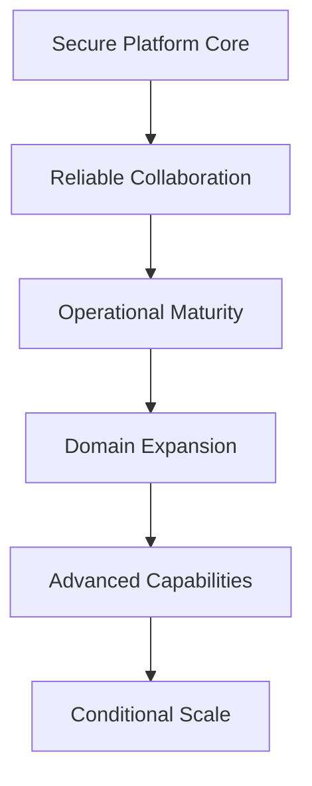

---

# 41. Evolution Dependency Principle

No todas las capacidades futuras pueden evolucionar:

```text
independently.
```

---

# 42. Example

```text
Multi-user Domain Expansion
```

depende de:

```text
Contextual Authorization.
```

---

# 43. Another Example

```text
Horizontal Scaling
```

afecta:

```text
WebSocket distribution

file storage

process-local state

deployment

observability.
```

---

# 44. Evolution Gate Principle

Cada salto relevante debe tener:

```text
maturity gate.
```

---

# 45. Gate

Un gate responde:

```text
What must already be true
before introducing this complexity?
```

---

# 46. Gate Categories

Los gates pueden pertenecer a:

```text
Security

Authorization

Data

Testing

Operations

Recovery

Observability

Product Validation

Scalability.
```

---

# 47. Evolution Decision Flow

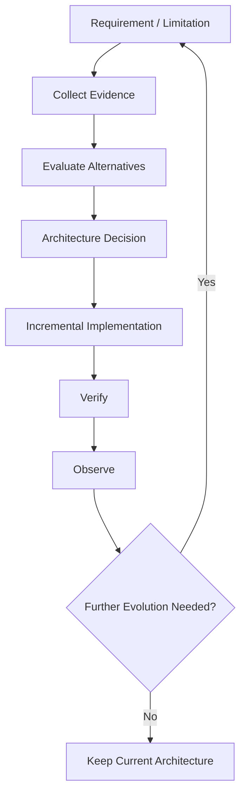

---

# 48. Important Outcome

Una evaluación futura puede concluir:

```text
keep the current architecture.
```

---

# 49. Evaluation Principle

```text
Evaluation

≠

Adoption.
```

---

# 50. Future Evolution — Foundation Track

**Horizonte:** NEAR-TERM

La primera evolución no consiste en añadir:

```text
new infrastructure

or

new architectural complexity.
```

Consiste en consolidar:

```text
platform guarantees.
```

---

# 51. Foundation Capabilities

```text
Project Membership

Contextual Authorization

Nested-resource Authorization

Browser Security

Authentication Hardening

Database Integrity

Transaction Boundaries

Realtime Security

Realtime Recovery

Testing

Operational Recovery.
```

---

# 52. Target Foundation


---

# 53. Evolution Priority

La plataforma debe evolucionar desde:

```text
authenticated application
```

hacia:

```text
contextually authorized collaborative platform.
```

---

# 54. Why

Porque futuras capacidades como:

```text
Academic

Inventory

Reservations

Competition
```

pueden contener:

```text
different users

different contexts

different permissions

different resource relationships.
```

---

# 55. Foundation Gate

Antes de ampliar significativamente los dominios colaborativos debería existir suficiente madurez en:

```text
ProjectMembership

Contextual Authorization

Cross-project Isolation

Nested-resource Authorization

Security Hardening

Critical Tests.
```

---

# 56. Future Evolution — Project Membership

**Estado:** TARGET / IN CONSOLIDATION  
**Horizonte:** NEAR-TERM

Project Membership debe evolucionar hacia una capacidad explícita.

---

# 57. Membership Responsibilities

```text
membership lifecycle

context role

permissions

invitation

removal

administrative rules.
```

---

# 58. Membership Model

Conceptualmente:

```text
User

↓

ProjectMembership

↓

Project.
```

---

# 59. Membership Evolution


---

# 60. Membership Invariant

Nunca asumir:

```text
authenticated
=
project member.
```

---

# 61. Membership Authorization Invariant

Tampoco asumir:

```text
project member
=
authorized for every project action.
```

---

# 62. Membership Context

La autorización podrá depender de:

```text
membership

context role

resource ownership

resource relationship

specific action.
```

---

# 63. Possible Future Membership States

Si el producto necesita lifecycle explícito, podría evolucionar hacia:

```text
INVITED

ACTIVE

SUSPENDED

REMOVED.
```

---

# 64. Avoid Premature States

No introducir estados que:

```text
have no product behavior.
```

---

# 65. Membership Lifecycle Gate

Antes de incorporar lifecycle avanzado deben existir:

```text
actual invitation workflow

suspension semantics

reactivation semantics

administrative ownership.
```

---

# 66. Membership Audit

Cambios sensibles deberían poder registrar:

```text
who

changed what

for which project

when

and why when relevant.
```

---

# 67. Membership Security

Operaciones como:

```text
add member

change contextual role

remove member

suspend member
```

deben ser:

```text
explicitly authorized.
```

---

# 68. Membership Future Direction

```text
ProjectMembership

↓

Context Role

↓

Permission Policies

↓

Nested-resource Authorization

↓

Realtime Subscription Authorization.
```

---

# 69. Membership Dependency Value

ProjectMembership no es únicamente una mejora del módulo Projects.

Puede convertirse en foundation para:

```text
cross-project isolation

task authorization

attachment authorization

activity visibility

realtime subscriptions

future domain collaboration.
```

---

# 70. Future Evolution — Invitations

**Estado:** FUTURE / PLANNED DEPENDING ON PRODUCT NEED  
**Horizonte:** MEDIUM-TERM

Si colaboración requiere incorporación formal de usuarios:

```text
Project Invitation
```

puede convertirse en entidad propia.

---

# 71. Invitation Model

Conceptualmente puede contener:

```text
inviter

invitee / email

project

intended contextual role

token or secure reference

status

expiration

timestamps.
```

---

# 72. Invitation Security

Debe proteger:

```text
token unpredictability

expiration

single-use semantics

authorization of inviter

safe acceptance flow.
```

---

# 73. Invitation Lifecycle

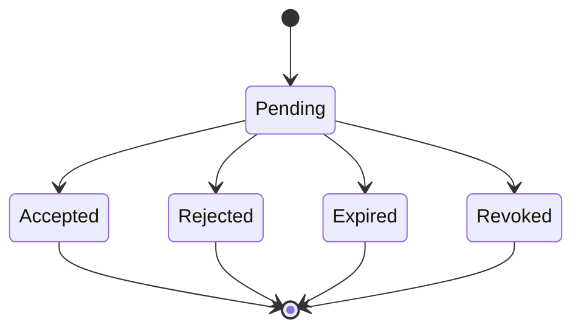

---

# 74. Invitation Invariant

```text
Invitation

≠

Membership.
```

---

# 75. Membership Creation

La membership debería aparecer cuando:

```text
the invitation is validly accepted
```

según las reglas del dominio.

---

# 76. Invitation Replay

Una invitación aceptada, expirada o revocada no debería permitir:

```text
replay-based membership creation.
```

---

# 77. Invitation Gate

No construir un sistema avanzado de invitaciones antes de validar:

```text
who invites

who accepts

which roles may be assigned

how expiration behaves

whether email delivery is required.
```

---

# 78. Future Evolution — Contextual Roles

**Estado:** TARGET  
**Horizonte:** NEAR / MEDIUM-TERM

Roles globales no deben multiplicarse para representar:

```text
project-specific authority.
```

---

# 79. Prefer

```text
Global Role

+

Context Role

+

Permissions.
```

---

# 80. Example

Un usuario podría ser:

```text
global role = USER

project A = ADMIN

project B = MEMBER.
```

---

# 81. Contextual Role Principle

```text
Global authority

and

resource-context authority

must remain distinguishable.
```

---

# 82. Avoid Role Explosion

Evitar modelos como:

```text
GLOBAL_PROJECT_A_ADMIN

GLOBAL_PROJECT_B_MEMBER

GLOBAL_PROJECT_C_EDITOR.
```

---

# 83. Future Role Evolution

Si los dominios futuros lo requieren, podrían aparecer roles contextuales específicos para:

```text
Projects

Academic

Inventory

Reservations

Competition.
```

---

# 84. Constraint

No crear un sistema universal de roles antes de conocer:

```text
actual domain semantics.
```

---

# 85. Future Evolution — Permission Policies

**Estado:** TARGET  
**Horizonte:** NEAR-TERM

Las políticas deberían evolucionar hacia:

```text
explicit reusable authorization functions.
```

---

# 86. Example

```python
can_manage_members(context)

can_edit_project(context)

can_create_task(context)

can_delete_attachment(context, attachment)

can_subscribe_project_realtime(context)
```

---

# 87. Policy Benefit

Reduce:

```text
authorization duplication

semantic drift

route-specific security behavior

inconsistent denial behavior.
```

---

# 88. Policy Boundary

Las policies deben responder:

```text
Is this action allowed?
```

---

# 89. Policy Should Not Become

```text
a second service layer

or

a repository abstraction.
```

---

# 90. Policy Inputs

Pueden incluir:

```text
authenticated user

global role

membership

context role

resource

resource relationship

requested action.
```

---

# 91. Policy Output

Idealmente:

```text
allow

or

deny.
```

---

# 92. Policy Side Effects

Por defecto deberían evitar:

```text
business mutations

database writes

realtime broadcasts.
```

---

# 93. Authorization Consistency

La misma semántica debería reutilizarse entre:

```text
HTTP

SSR actions

API mutations

WebSocket subscriptions.
```

---

# 94. Authorization Dependency

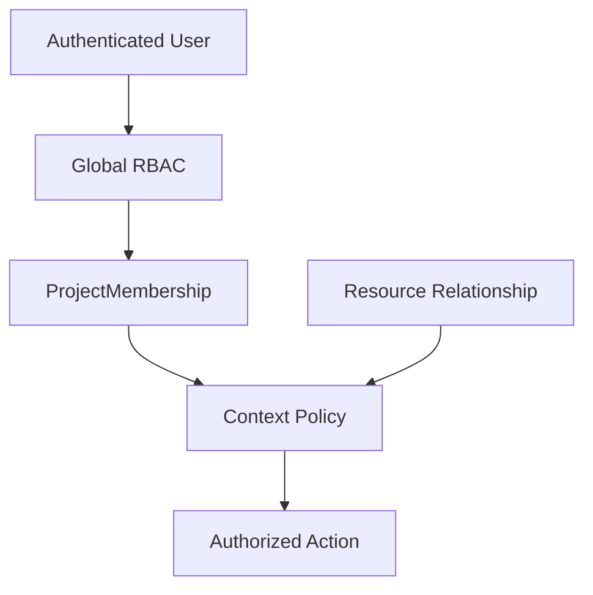

---

# 95. Future Evolution — Nested-resource Authorization

**Estado:** TARGET  
**Horizonte:** NEAR-TERM

Recursos como:

```text
Task

Activity

Attachment
```

no deben autorizarse únicamente mediante:

```text
resource id.
```

---

# 96. Required Context

Debe validarse:

```text
resource

↓

parent context

↓

user relationship

↓

requested action.
```

---

# 97. Example

```text
Attachment

↓

Task / Activity / Project

↓

Project

↓

Membership

↓

Permission.
```

---

# 98. Nested-resource Invariant

```text
Knowing a resource identifier

does not imply

authorization to access it.
```

---

# 99. Cross-project Isolation

Debe impedirse:

```text
User authorized in Project A

↓

accessing Project B resource

through a guessed or known identifier.
```

---

# 100. Cross-project Testing

Esta garantía debe protegerse mediante:

```text
negative authorization tests.
```

---

# 101. Future Evolution — Authorization Engine

**Estado:** CONDITIONAL  
**Horizonte:** LONG-TERM

No existe necesidad actual de:

```text
external policy engine.
```

---

# 102. Current Direction

Mantener:

```text
application-owned contextual policies.
```

---

# 103. Possible Future Trigger

Evaluar una solución más sofisticada únicamente si:

```text
policy complexity becomes difficult
to maintain safely
inside application code.
```

---

# 104. Trigger Indicators

Podrían incluir:

```text
many independent domains

large permission matrix

external policy administration

cross-service authorization

regulatory policy requirements.
```

---

# 105. Candidate Evolution

Podrían evaluarse:

```text
policy objects

declarative permissions

policy-as-code

external authorization systems.
```

---

# 106. Important Rule

```text
External authorization technology

must solve

an authorization-management problem.
```

---

# 107. Avoid

```text
introducing a policy engine

because

enterprise systems often have one.
```

---

# 108. Future Evolution — Browser Security

**Estado:** TARGET / HARDENING  
**Horizonte:** NEAR-TERM

La evolución inmediata debe reforzar:

```text
browser-facing security guarantees.
```

---

# 109. Main Areas

```text
Formal CSRF Protection

Cookie Policy Consistency

Secure Mutation Patterns

Security Headers

Origin / Host Validation where applicable.
```

---

# 110. CSRF Direction

Las mutaciones autenticadas mediante cookies requieren una estrategia formal para:

```text
cross-site request forgery protection.
```

---

# 111. CSRF Status

```text
Formal CSRF Protection
    TARGET / PLANNED.
```

---

# 112. CSRF Evolution

La solución concreta deberá integrarse con:

```text
SSR forms

JavaScript fetch mutations

authentication cookies

API behavior.
```

---

# 113. Cookie Policy Direction

La política de cookies debe centralizar:

```text
HttpOnly

Secure

SameSite

Path

expiration / max-age

environment-specific behavior.
```

---

# 114. Current Cookie Hardening Issue

Actualmente existen caminos de emisión/renovación que deben mantenerse coherentes:

```text
normal authentication flow

and

automatic access-token refresh.
```

---

# 115. Evolution Goal

```text
One centralized cookie policy

↓

All authentication code paths.
```

---

# 116. Cookie Invariant

Una renovación automática no debe degradar:

```text
production cookie security attributes.
```

---

# 117. Future Evolution — Authentication Hardening

**Estado:** TARGET / HARDENING  
**Horizonte:** NEAR-TERM

La plataforma ya dispone de:

```text
access-token workflow

+

refresh-token workflow.
```

---

# 118. Current Authentication Flow

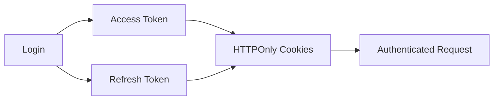

---

# 119. Explicit Refresh

```text
/refresh
```

es:

```text
CURRENT.
```

---

# 120. Automatic Refresh

La renovación automática del access token mediante middleware es:

```text
CURRENT.
```

---

# 121. Logout Cleanup

La eliminación de:

```text
access cookie

and

refresh cookie
```

durante logout es:

```text
CURRENT.
```

---

# 122. Hardening Is Different

La evolución futura no debe describirse como:

```text
implement refresh tokens.
```

---

# 123. Correct Description

Debe describirse como:

```text
harden the existing refresh-token lifecycle.
```

---

# 124. Potential Hardening

```text
rotation

server-side revocation

reuse detection

session identification

device/session management.
```

---

# 125. Rotation Status

```text
Refresh-token Rotation
    VERIFY / HARDENING.
```

---

# 126. Revocation Status

```text
Server-side Revocation
    VERIFY / HARDENING.
```

---

# 127. Reuse Detection Status

```text
Refresh-token Reuse Detection
    FUTURE HARDENING.
```

---

# 128. Session Management Status

```text
Session / Device Management
    FUTURE.
```

---

# 129. Authentication Hardening Principle

No añadir estado servidor al lifecycle de tokens sin definir:

```text
what security guarantee
that state provides.
```

---

# 130. Future Evolution — Identity

**Estado:** FUTURE / CONDITIONAL  
**Horizonte:** MEDIUM / LONG-TERM

Identity puede evolucionar sin cambiar:

```text
internal User identity.
```

---

# 131. Current Concept

```text
User
```

representa:

```text
application identity.
```

---

# 132. Future Concept

```text
ExternalIdentity
```

podría representar:

```text
authentication-provider identity.
```

---

# 133. Identity Architecture

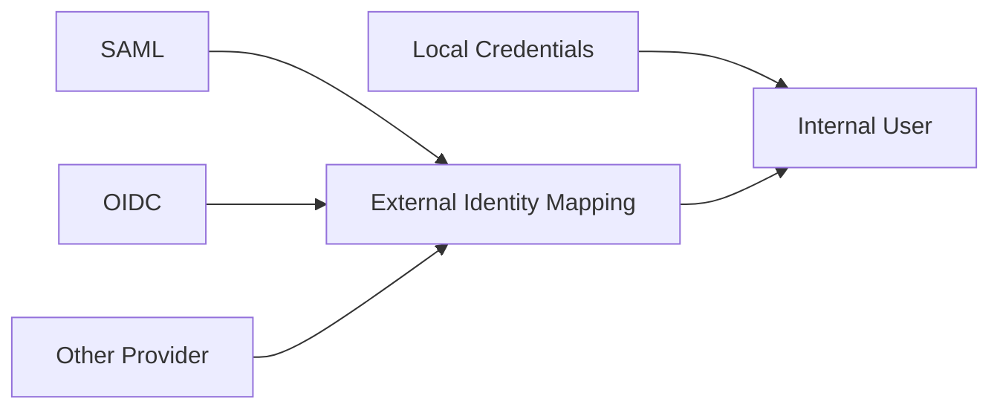

---

# 134. Identity Principle

```text
Authentication provider

must not become

business identity.
```

---

# 135. Identity Boundary

El dominio funcional debería depender de:

```text
Internal User
```

y no directamente de:

```text
SAML subject

OIDC subject

external provider identifiers.
```

---

# 136. Benefit

Permite cambiar o ampliar proveedores sin reestructurar:

```text
Projects

Tasks

Activities

Audit

future domains.
```

---

# 137. Future Evolution — SAML

**Estado:** FUTURE / CONDITIONAL / NOT IMPLEMENTED  
**Horizonte:** MEDIUM-TERM IF REQUIRED

SAML puede habilitar:

```text
institutional authentication.
```

---

# 138. SAML Trigger

Debe existir:

```text
institutional SSO requirement

or

external federation requirement.
```

---

# 139. SAML Does Not Define

```text
project membership

project permissions

domain authorization

resource ownership.
```

---

# 140. SAML Boundary

```text
Identity Provider

↓

Authentication Assertion

↓

Identity Mapping

↓

Internal User

↓

Application Authorization.
```

---

# 141. SAML Security Areas

Una futura implementación deberá considerar:

```text
assertion validation

issuer validation

audience validation

signature validation

time constraints

replay protection

identity mapping

account lifecycle.
```

---

# 142. SAML Non-goal

No debe utilizarse SAML como sustituto de:

```text
ProjectMembership

Contextual Authorization.
```

---

# 143. Future Evolution — OIDC

**Estado:** FUTURE / CONDITIONAL  
**Horizonte:** MEDIUM / LONG-TERM

OIDC podría evaluarse para:

```text
modern identity providers

cloud identity

future integrations.
```

---

# 144. OIDC Trigger

Adoptar únicamente cuando exista:

```text
actual identity-provider requirement.
```

---

# 145. Provider-neutral Direction

Si se desarrolla federación, conviene preservar una capa conceptual:

```text
External Identity

↓

Internal User.
```

---

# 146. Benefit

Evita que el dominio dependa directamente de:

```text
one federation protocol.
```

---

# 147. Future Evolution — Account Linking

**Estado:** FUTURE  
**Horizonte:** LONG-TERM

Un usuario podría disponer de:

```text
local identity

+

institutional identity.
```

---

# 148. Account-linking Risk

Puede introducir:

```text
account takeover paths

identity confusion

duplicate accounts

incorrect merges.
```

---

# 149. Requirement

Debe existir:

```text
strong identity verification.
```

---

# 150. Account-linking Invariant

Nunca enlazar cuentas únicamente porque comparten:

```text
an unverified email address.
```

---

# 151. Future Evolution — Identity Lifecycle

**Estado:** FUTURE / CONDITIONAL  
**Horizonte:** MEDIUM / LONG-TERM

Federación futura puede introducir lifecycle adicional:

```text
provisioning

deprovisioning

disabled external identity

relinked identity

provider migration.
```

---

# 152. Identity Lifecycle Principle

```text
Authentication lifecycle

and

business-data lifecycle

must remain distinguishable.
```

---

# 153. User Deactivation

Desactivar acceso no debería implicar automáticamente:

```text
delete historical business data.
```

---

# 154. Audit Preservation

La plataforma debe poder conservar referencias históricas necesarias para:

```text
auditability

traceability

domain history.
```

---

# 155. Future Evolution — Collaboration Track

**Estado:** TARGET / PLANNED  
**Horizonte:** NEAR / MEDIUM-TERM

Una vez consolidadas las garantías de autorización, la siguiente evolución natural es:

```text
richer collaboration.
```

---

# 156. Collaboration Foundations

```text
Projects

Tasks

Activities

Attachments

Notifications

Activity Feed

Audit

WebSockets.
```

son ya capacidades:

```text
CURRENT.
```

---

# 157. Collaboration Evolution

No requiere reemplazar estas capacidades.

Debe:

```text
compose and mature them.
```

---

# 158. Main Collaboration Evolution

```text
Kanban

Task State Mutation

Drag and Drop

Realtime Updates

Reconnect

Reconciliation

Live Kanban.
```

---

# 159. Future Evolution — Kanban

**Estado:** PLANNED  
**Horizonte:** NEAR / MEDIUM-TERM

Kanban debe evolucionar desde:

```text
existing Task state.
```

---

# 160. Kanban Invariant

```text
Task

remains

the authoritative work item.
```

---

# 161. Avoid

No crear innecesariamente:

```text
KanbanTask

Kanban-only status

parallel task persistence.
```

---

# 162. Preferred Model

```text
Task

+

Task Status

+

Board Projection.
```

---

# 163. Kanban Evolution Sequence


---

# 164. Kanban Phase 1

```text
SSR Board.
```

---

# 165. Purpose

Validar:

```text
columns

status grouping

authorization

empty states

responsive behavior

accessibility.
```

---

# 166. Kanban Phase 2

```text
Authorized Status Mutation.
```

---

# 167. Mutation Flow

```text
User Action

↓

Authentication

↓

Context Resolution

↓

Authorization

↓

Transition Validation

↓

Persistence

↓

Audit / Activity where required

↓

Response.
```

---

# 168. Kanban Phase 3

```text
Drag and Drop.
```

---

# 169. Drag-and-drop Principle

```text
Visual movement

must not become

authoritative state.
```

---

# 170. Kanban Phase 4

```text
Realtime Update.
```

---

# 171. Realtime Principle

```text
Persist first.

Broadcast second.
```

---

# 172. Kanban Phase 5

```text
Live Kanban.
```

---

# 173. Live Kanban Gate

Antes de considerarlo suficientemente maduro deben existir:

```text
Contextual Authorization

WebSocket Authentication Hardening

Subscription Authorization

Stable Event Contract

Reconnect

Reconciliation

Multi-client Tests.
```

---

# 174. Future Evolution — Task Transition Rules

**Estado:** TARGET  
**Horizonte:** NEAR / MEDIUM-TERM

A medida que Task evolucione, sus cambios de estado pueden necesitar:

```text
explicit transition semantics.
```

---

# 175. Possible Rules

```text
allowed source status

allowed destination status

required permission

required fields

side effects.
```

---

# 176. Transition Invariant

```text
Status mutation

is a domain operation,

not merely

a database field update.
```

---

# 177. Future Evolution — Optimistic Interaction

**Estado:** FUTURE / OPTIONAL  
**Horizonte:** MEDIUM-TERM

Drag and drop puede utilizar:

```text
optimistic UI
```

solo si existe:

```text
rollback or reconciliation behavior.
```

---

# 178. Optimistic Flow

```text
Move Card Locally

↓

Send Mutation

↓

Server Accepts?
```

---

# 179. Success

```text
Keep State.
```

---

# 180. Failure

```text
Rollback

or

Refetch Authoritative State.
```

---

# 181. Future Evolution — Realtime Security

**Estado:** TARGET / HARDENING  
**Horizonte:** NEAR-TERM

WebSocket security debe evolucionar junto con:

```text
HTTP authorization maturity.
```

---

# 182. WebSocket Authentication

La plataforma ya dispone de:

```text
realtime foundation.
```

La evolución debe reforzar:

```text
authentication behavior

failure behavior

session lifecycle interaction.
```

---

# 183. Subscription Authorization

Un usuario autenticado no debe poder suscribirse automáticamente a:

```text
every project

every resource

every channel.
```

---

# 184. Subscription Flow

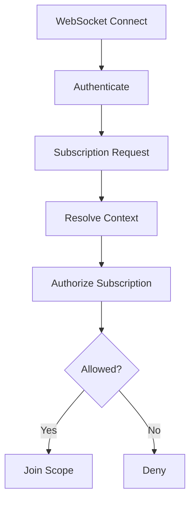

---

# 185. Subscription Invariant

```text
Authenticated

≠

Authorized Subscriber.
```

---

# 186. Future Evolution — Realtime Event Contract

**Estado:** TARGET / IN PROGRESS  
**Horizonte:** NEAR-TERM

La plataforma debe converger hacia:

```text
canonical event semantics.
```

---

# 187. Conceptual Event

```json
{
  "type": "task.status_changed",
  "scope": {
    "project_id": 42
  },
  "resource": {
    "type": "task",
    "id": 17
  },
  "payload": {},
  "metadata": {}
}
```

---

# 188. Event Contract Goals

```text
semantic event names

explicit scope

minimal payload

resource identity

versioning capability if needed

testability.
```

---

# 189. Event Security

No incluir automáticamente:

```text
full ORM entities

sensitive user data

authorization-inappropriate fields.
```

---

# 190. Event Scope

Debe permitir determinar:

```text
who may receive the event.
```

---

# 191. Future Evolution — Reconnect

**Estado:** TARGET / IN PROGRESS  
**Horizonte:** NEAR-TERM

Los clientes deben asumir que:

```text
connections fail.
```

---

# 192. Reconnect Responsibilities

```text
detect disconnect

backoff

reconnect

restore subscriptions

recover state.
```

---

# 193. Reconnect Principle

```text
Reconnect

restores transport.
```

---

# 194. It Does Not Automatically Restore

```text
missed state.
```

---

# 195. Future Evolution — Reconciliation

**Estado:** TARGET / IN PROGRESS  
**Horizonte:** NEAR-TERM

Después de una desconexión debe poder recuperarse:

```text
authoritative state.
```

---

# 196. Preferred Initial Strategy

```text
Reconnect

↓

Refetch

↓

Replace / Reconcile Local State

↓

Resume Realtime.
```

---

# 197. Why

Es preferible comenzar con:

```text
simple authoritative refetch
```

antes de construir:

```text
complex replay infrastructure.
```

---

# 198. Future Replay

Un sistema de:

```text
event replay

offsets

durable event streams
```

sería:

```text
CONDITIONAL.
```

---

# 199. Replay Trigger

Solo debería evaluarse si:

```text
refetch-based reconciliation
becomes insufficient.
```

---

# 200. Future Evolution — Duplicate Events

Los clientes deberían tolerar:

```text
duplicate delivery.
```

---

# 201. Principle

```text
Exactly-once delivery

must not be assumed.
```

---

# 202. Handler Direction

Tender hacia:

```text
idempotent event handling.
```

---

# 203. Future Evolution — Event Ordering

Los clientes tampoco deberían asumir ciegamente:

```text
perfect event ordering.
```

---

# 204. Possible Future Mechanisms

Si fuera necesario:

```text
resource version

updated_at

sequence

reconciliation.
```

---

# 205. Avoid Premature Complexity

No introducir:

```text
global event sequencing
```

sin:

```text
demonstrated ordering problem.
```

---

# 206. Future Evolution — Multi-client Collaboration

**Estado:** TARGET / PLANNED  
**Horizonte:** NEAR / MEDIUM-TERM

Realtime maturity debe probar:

```text
multiple simultaneous clients.
```

---

# 207. Scenarios

```text
Client A mutates task

Client B receives update

Client B reconnects

Client A loses permission

Client B receives duplicate event

both clients change related state.
```

---

# 208. Multi-client Gate

Live collaboration no debe considerarse madura hasta disponer de:

```text
repeatable multi-client verification.
```

---

# 209. Future Evolution — Distributed Realtime

**Estado:** FUTURE / CONDITIONAL  
**Horizonte:** LONG-TERM

La arquitectura actual utiliza:

```text
In-memory Connection Manager.
```

---

# 210. Current Topology Fit

Esto es adecuado mientras:

```text
single-instance realtime
meets current requirements.
```

---

# 211. Distribution Trigger

Si aparecen:

```text
multiple application instances
```

puede surgir necesidad de:

```text
cross-instance event coordination.
```

---

# 212. Candidate Solutions

Solo entonces podrían evaluarse:

```text
Redis Pub/Sub

Redis Streams

message broker

other coordination mechanisms.
```

---

# 213. Redis Status

```text
Redis
    FUTURE / CONDITIONAL.
```

---

# 214. Redis Is Not

```text
current architecture

or

mandatory roadmap milestone.
```

---

# 215. Distributed Realtime Decision Flow

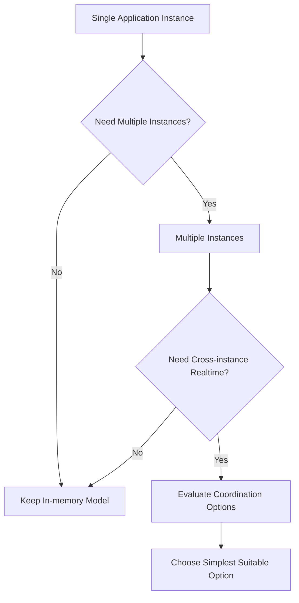

---

# 216. Future Evolution — Notification Maturity

**Estado:** FUTURE / TARGET DEPENDING ON REQUIREMENT  
**Horizonte:** MEDIUM-TERM

La plataforma ya dispone de:

```text
persistent in-app notifications

read / unread state

realtime delivery capability.
```

---

# 217. Notification Evolution

Podría incorporar:

```text
notification preferences

email delivery

push notifications

digests

background delivery.
```

---

# 218. Notification Principle

```text
Notification Domain

≠

Delivery Channel.
```

---

# 219. Delivery Architecture

```text
Notification

↓

Delivery Policy

↓

In-app

WebSocket

Future Email

Future Push.
```

---

# 220. Email Status

```text
Email Notification Delivery
    FUTURE.
```

---

# 221. Push Status

```text
Push Notifications
    FUTURE.
```

---

# 222. Notification Preferences

Podrían definir:

```text
which event

which channel

which frequency

which context.
```

---

# 223. Notification Gate

No construir un sistema complejo de preferencias antes de disponer de:

```text
multiple meaningful delivery options.
```

---

# 224. Future Evolution — Background Processing

**Estado:** CONDITIONAL  
**Horizonte:** MEDIUM / LONG-TERM

Algunas capacidades futuras podrían necesitar:

```text
asynchronous jobs.
```

---

# 225. Candidate Workloads

```text
email delivery

large report generation

future AI processing

large imports

future media processing

scheduled maintenance.
```

---

# 226. Current Rule

No introducir una infraestructura de workers únicamente porque:

```text
background jobs may someday exist.
```

---

# 227. Trigger

Debe existir:

```text
real work that should not execute
inside the request lifecycle.
```

---

# 228. Candidate Architecture

Si aparece el trigger:

```text
Application

↓

Job Queue

↓

Worker

↓

Persistent Result / Side Effect.
```

---

# 229. Broker Decision

La necesidad de background jobs no obliga automáticamente a:

```text
Redis.
```

---

# 230. Evaluation

Debe evaluarse:

```text
job semantics

delivery guarantees

retry requirements

scheduling requirements

operational cost.
```

---

# 231. Future Evolution — Audit Maturity

**Estado:** CURRENT FOUNDATION / EVOLVING  
**Horizonte:** NEAR / MEDIUM-TERM

Audit ya existe como:

```text
cross-cutting capability.
```

---

# 232. Future Audit Evolution

Puede reforzarse con:

```text
coverage consistency

structured event types

safe metadata

queryability

retention rules

administrative visibility.
```

---

# 233. Audit Invariant

```text
Audit

≠

Activity Feed.
```

---

# 234. Audit Goal

Debe preservar:

```text
traceability
```

incluso cuando el evento no deba mostrarse como:

```text
user-facing activity.
```

---

# 235. Future Audit Retention

Las políticas de retención solo deberían definirse cuando existan:

```text
product

operational

legal

or regulatory requirements.
```

---

# 236. Future Evolution — Attachment Maturity

**Estado:** CURRENT FOUNDATION / EVOLVING  
**Horizonte:** NEAR / MEDIUM-TERM

Attachments ya dispone de:

```text
metadata

physical file

authorized access

persistent local storage.
```

---

# 237. Near-term Evolution

Puede reforzar:

```text
metadata consistency

failure cleanup

orphan detection

authorization coverage

backup / restore verification.
```

---

# 238. Storage Abstraction

Si la plataforma necesita futura portabilidad de almacenamiento:

```text
Attachment Service

↓

Storage Interface

↓

Local Storage.
```

---

# 239. Future Storage Implementation

Posteriormente podría añadirse:

```text
Object Storage Implementation.
```

---

# 240. Object Storage Status

```text
FUTURE / CONDITIONAL.
```

---

# 241. Object Storage Triggers

```text
multiple application instances

distributed attachment access

large storage growth

independent file serving

availability requirements.
```

---

# 242. Storage Decision Rule

```text
Storage Trigger

↓

Evaluate Alternatives

↓

Choose Appropriate Storage.
```

---

# 243. Not

```text
Storage Trigger

↓

Automatically choose S3.
```

---

# 244. Future Evolution — Search

**Estado:** FUTURE / EVOLVING DEPENDING ON PRODUCT NEED  
**Horizonte:** MEDIUM-TERM

A medida que crezcan:

```text
Projects

Tasks

Activities

Attachments

future domains,
```

la búsqueda puede necesitar mayor sofisticación.

---

# 245. Initial Direction

Antes de introducir infraestructura específica:

```text
improve relational search
where sufficient.
```

---

# 246. Possible Capabilities

```text
text search

filters

sorting

pagination

domain-specific search.
```

---

# 247. Search Engine Trigger

Solo evaluar un motor especializado si aparecen necesidades como:

```text
large search volume

advanced relevance

fuzzy search

cross-domain indexing

complex text retrieval.
```

---

# 248. Candidate Future Solutions

Podrían evaluarse:

```text
database-native capabilities

dedicated search engine

hybrid indexing.
```

---

# 249. Search Principle

```text
Search architecture
must follow
search requirements.
```

---

# 250. Future Evolution — Analytics

**Estado:** FUTURE  
**Horizonte:** MEDIUM / LONG-TERM

Analytics puede evolucionar desde:

```text
operational reporting
```

hacia:

```text
product and domain insights.
```

---

# 251. Analytics Questions

Antes de diseñar infraestructura deben definirse:

```text
Which questions need answers?

Who needs them?

How fresh must data be?

What data may be aggregated?

What privacy constraints apply?
```

---

# 252. Initial Analytics Direction

Preferir inicialmente:

```text
purpose-specific relational queries

bounded reporting

measured optimization.
```

---

# 253. Avoid

No crear inmediatamente:

```text
data warehouse

data lake

streaming platform
```

sin:

```text
validated analytical requirement.
```

---

# 254. Analytics Evolution Trigger

Podría aparecer cuando:

```text
operational queries interfere with application workload

historical analysis grows

cross-domain reporting becomes complex

data volume justifies separation.
```

---

# 255. Future Evolution — Operational Maturity Track

**Estado:** TARGET  
**Horizonte:** NEAR / MEDIUM-TERM

Antes de aumentar complejidad arquitectónica debe aumentar:

```text
operational maturity.
```

---

# 256. Operational Areas

```text
logging

monitoring

health checks

metrics

correlation

backup

restore

deployment verification

rollback

incident response.
```

---

# 257. Operational Principle

```text
Do not distribute
what cannot yet be operated
reliably while centralized.
```

---

# 258. Future Evolution — Observability

**Estado:** PARTIAL / EVOLVING  
**Horizonte:** NEAR-TERM

Observability debe evolucionar para responder:

```text
Is the application healthy?

Which requests fail?

Which endpoints are slow?

Is MariaDB healthy?

Are WebSockets stable?

Are backups succeeding?

What happened during an incident?
```

---

# 259. Observability Layers

```text
Logs

Metrics

Health

Correlation

Alerts

Future Tracing if justified.
```

---

# 260. Logging Evolution

Debe avanzar hacia:

```text
structured

consistent

safe

contextual logging.
```

---

# 261. Sensitive-data Rule

No registrar:

```text
passwords

raw JWTs

refresh tokens

cookie values

unnecessary personal information.
```

---

# 262. Correlation

Puede evolucionar mediante:

```text
request_id

correlation_id

safe user context

safe project context.
```

---

# 263. Health Evolution

Distinguir:

```text
Liveness

and

Readiness.
```

---

# 264. Metrics Evolution

Priorizar métricas con utilidad operacional:

```text
request latency

error rate

database latency

WebSocket connections

disconnect rate

authentication failures

authorization denials

backup status.
```

---

# 265. Alerting Evolution

Alertar sobre:

```text
actionable conditions.
```

---

# 266. Distributed Tracing

**Estado:** CONDITIONAL

No es obligatorio para la arquitectura actual.

---

# 267. Tracing Trigger

Puede evaluarse si:

```text
request flow becomes distributed

or

diagnosis becomes difficult
across multiple components.
```

---

# 268. Future Evolution — Backup

**Estado:** TARGET / OPERATIONAL MATURITY  
**Horizonte:** NEAR-TERM

La estrategia de backup debe proteger:

```text
MariaDB

+

persistent attachments.
```

---

# 269. Backup Invariant

Respaldar solo MariaDB puede producir:

```text
metadata without physical files.
```

---

# 270. Backup Evolution

Debe definir:

```text
schedule

retention

storage location

verification

failure visibility.
```

---

# 271. Future Evolution — Restore

**Estado:** TARGET / HIGH PRIORITY  
**Horizonte:** NEAR-TERM

La capacidad real no es:

```text
backup.
```

Es:

```text
recoverability.
```

---

# 272. Restore Validation

Debe comprobar:

```text
MariaDB restoration

attachment restoration

application startup

critical integrity

authentication

core workflows.
```

---

# 273. Restore Principle

```text
Untested restore

=

unknown recovery.
```

---

# 274. Future Evolution — Disaster Recovery

**Estado:** TARGET / EVOLVING  
**Horizonte:** MEDIUM-TERM

DR debe contemplar:

```text
host loss

database loss

attachment loss

configuration loss

deployment reconstruction.
```

---

# 275. Recovery Architecture

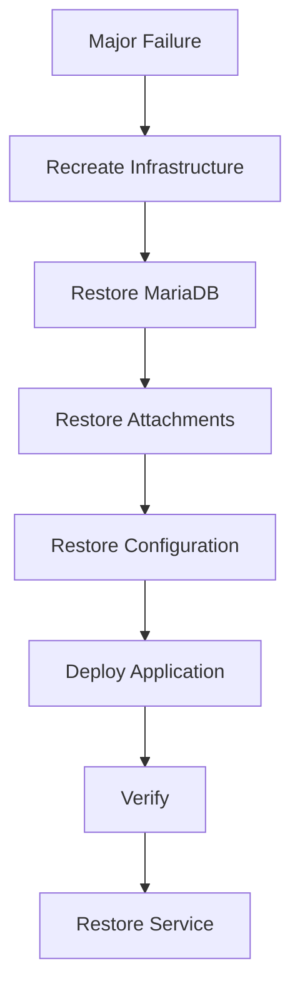

---

# 276. Recovery Objectives

RPO y RTO deben definirse únicamente cuando existan:

```text
business requirements

and

operational capability
to support them.
```

---

# 277. Avoid Fictional Objectives

No declarar arbitrariamente:

```text
RPO = 0

RTO = 5 minutes.
```

---

# 278. Future Evolution — Deployment Maturity

**Estado:** CURRENT FOUNDATION / EVOLVING  
**Horizonte:** NEAR-TERM

La base actual incluye:

```text
Docker

Docker Compose

Nginx

Ubuntu

Hetzner VPS

GitHub Actions.
```

---

# 279. Deployment Evolution

Debe reforzar:

```text
repeatability

version identification

post-deployment verification

rollback

configuration validation.
```

---

# 280. CI Status

```text
GitHub Actions CI
    CURRENT.
```

---

# 281. CD Status

```text
Full Continuous Deployment
    EVOLVING / VERIFY.
```

---

# 282. Deployment Principle

```text
Safe deployment

before

fully automated deployment.
```

---

# 283. Future Evolution — Configuration

**Estado:** TARGET / EVOLVING  
**Horizonte:** NEAR-TERM

Configuración debe evolucionar hacia:

```text
centralized

validated

environment-aware

secure defaults.
```

---

# 284. Important Areas

```text
database connectivity

cookie policy

debug behavior

origins

hosts

storage paths

logging

secrets.
```

---

# 285. Configuration Principle

```text
Missing configuration
must not silently
degrade production security.
```

---

# 286. Future Evolution — Secret Management

**Estado:** CURRENT FOUNDATION / EVOLVING  
**Horizonte:** NEAR / MEDIUM-TERM

Secrets deben mantenerse fuera de:

```text
application source code.
```

---

# 287. Future Maturity

Puede incluir:

```text
rotation procedures

deployment integration

secret inventory

access control.
```

---

# 288. Secret-management Platform

Un sistema especializado de secrets es:

```text
CONDITIONAL.
```

---

# 289. Trigger

Evaluarlo cuando:

```text
secret count

team size

rotation requirements

deployment topology

or compliance needs
```

lo justifiquen.

---

# 290. Future Evolution — Testing Maturity

**Estado:** CURRENT / EXPANDING  
**Horizonte:** NEAR-TERM

Automated testing ya existe.

La evolución consiste en:

```text
increase confidence,
not introduce testing from zero.
```

---

# 291. Priority Test Areas

```text
Contextual Authorization

Cross-project Isolation

Authentication Lifecycle

Cookie Policy

CSRF

WebSocket Authentication

Subscription Authorization

Reconnect

Reconciliation

Multi-client Realtime

Critical UI Workflows.
```

---

# 292. Test Maturity Model

```text
Foundation Tests

↓

Security Tests

↓

Cross-context Tests

↓

Realtime Tests

↓

Recovery Tests

↓

Operational Verification.
```

---

# 293. Future Evolution — Production Readiness

**Estado:** CONTINUOUS MATURITY  
**Horizonte:** NEAR / MEDIUM-TERM

Production readiness debe evaluarse como:

```text
multidimensional maturity.
```

---

# 294. Production Gates

```text
Functional

Security

Authorization

Data Integrity

Testing

Deployment

Observability

Backup

Restore

Documentation.
```

---

# 295. Security Gate

Debe reconocer honestamente:

```text
implemented foundations

and

remaining hardening.
```

---

# 296. Avoid

```text
Security Complete.
```

---

# 297. Prefer

```text
Security foundation established

with identified hardening work.
```

---

# 298. Future Evolution — Performance

**Estado:** EVOLVING  
**Horizonte:** NEAR / MEDIUM-TERM

Performance debe seguir:

```text
measure

↓

identify

↓

optimize

↓

remeasure.
```

---

# 299. Primary Areas

```text
N+1 queries

pagination

indexes

Dashboard aggregation

Activity Feed

Notifications

future large-domain collections.
```

---

# 300. Performance Principle

```text
Measurement before caching.

Measurement before distribution.

Measurement before database migration.
```

---

# 301. Future Evolution — Caching

**Estado:** CONDITIONAL  
**Horizonte:** MEDIUM / LONG-TERM

Cache solo debe introducirse ante:

```text
measured repeated expensive work.
```

---

# 302. Cache Requirements

Antes de implementarlo deben definirse:

```text
cache ownership

key strategy

expiration

invalidation

stale-data tolerance

failure behavior.
```

---

# 303. Cache Technology

No asumir:

```text
cache
=
Redis.
```

---

# 304. Cache Decision

```text
Caching Need

↓

Define Semantics

↓

Evaluate Options

↓

Choose Implementation.
```

---

# 305. Future Evolution — Domain Expansion Track

**Estado:** FUTURE  
**Horizonte:** MEDIUM / LONG-TERM

Una vez suficientemente maduras las foundations, la plataforma puede incorporar nuevos dominios.

---

# 306. Candidate Domains

```text
Academic

Inventory

Reservations

Competition Management.
```

---

# 307. Domain Expansion Principle

```text
New Domain

≠

New Microservice.
```

---

# 308. Default Direction

Nuevos dominios deberían comenzar como:

```text
well-bounded modules
inside the Modular Monolith.
```

---

# 309. Domain Requirements

Cada dominio debe definir:

```text
entities

invariants

ownership

authorization

transactions

events

audit requirements

dependencies.
```

---

# 310. Domain Boundary Rule

No incorporar nuevas entidades arbitrariamente a:

```text
existing modules
```

solo porque resulte más rápido.

---

# 311. Domain Integration

Un nuevo dominio puede reutilizar capabilities como:

```text
User

Identity

Authorization

Audit

Notifications

Attachments

Realtime
```

sin:

```text
duplicating them.
```

---

# 312. Domain Coupling Rule

Reutilizar una capability no significa:

```text
coupling every domain
directly to every other domain.
```

---

# 313. Future Evolution — Academic Domain

**Estado:** FUTURE  
**Horizonte:** MEDIUM-TERM

Academic podría incorporar conceptos como:

```text
students

teachers

courses

groups

enrollments

academic activities.
```

---

# 314. Academic Identity Principle

No convertir automáticamente:

```text
User
```

en:

```text
Student + Teacher + Administrator + every future role.
```

---

# 315. Prefer

```text
User

+

Academic Relationships.
```

---

# 316. Academic Context

Un usuario podría tener:

```text
different academic relationships
```

sin cambiar su:

```text
application identity.
```

---

# 317. Academic Authorization

Podría necesitar contextos como:

```text
course

group

classroom

academic period.
```

---

# 318. Academic Gate

Antes de implementarlo deben definirse:

```text
real academic workflows

ownership

role semantics

privacy requirements

data lifecycle.
```

---

# 319. Academic Realtime

Realtime puede ser útil para:

```text
activity updates

collaboration

future classroom events.
```

---

# 320. But

```text
Academic Domain

must not depend on realtime
for persistent correctness.
```

---

# 321. Future Evolution — Inventory Domain

**Estado:** FUTURE  
**Horizonte:** MEDIUM-TERM

Inventory podría gestionar:

```text
equipment

components

robots

materials

locations

assignments

stock movements.
```

---

# 322. Inventory Core Principle

```text
Inventory State

must be authoritative
in persistent storage.
```

---

# 323. Inventory Movement

Cambios de stock deberían representarse como:

```text
explicit domain operations.
```

---

# 324. Avoid

```text
stock = stock - 1
```

disperso por:

```text
controllers

templates

client code.
```

---

# 325. Possible Inventory Model

```text
Item

Location

Stock

Movement

Assignment.
```

---

# 326. Inventory Integrity

Debe proteger:

```text
negative stock rules

duplicate assignment rules

location consistency

movement traceability.
```

---

# 327. Inventory Audit

Movimientos relevantes pueden necesitar:

```text
who

what

from where

to where

when.
```

---

# 328. Inventory Realtime

Puede mejorar:

```text
live stock visibility.
```

---

# 329. But

```text
Realtime

must not become

inventory authority.
```

---

# 330. Future Evolution — Reservations Domain

**Estado:** FUTURE  
**Horizonte:** MEDIUM-TERM

Reservations podría gestionar:

```text
resources

time slots

users

booking rules

availability.
```

---

# 331. Reservation Core Risk

```text
Concurrency.
```

---

# 332. Example

```text
User A requests resource X at 10:00

User B requests resource X at 10:00

at nearly the same time.
```

---

# 333. Reservation Invariant

Debe existir una garantía para impedir:

```text
invalid double booking
```

cuando el dominio así lo requiera.

---

# 334. Possible Mechanisms

Según el modelo real:

```text
database constraints

transactions

locking

optimistic concurrency.
```

---

# 335. Reservation Principle

```text
Availability display

≠

reservation guarantee.
```

---

# 336. Reservation Mutation

La garantía debe establecerse durante:

```text
authoritative persistence.
```

---

# 337. Reservation Realtime

Realtime puede mejorar:

```text
availability updates.
```

---

# 338. But

No sustituye:

```text
transactional booking correctness.
```

---

# 339. Future Evolution — Competition Management

**Estado:** FUTURE  
**Horizonte:** MEDIUM / LONG-TERM

Competition podría incorporar:

```text
competitions

teams

participants

matches

scores

results

rankings.
```

---

# 340. Competition Invariant

Resultados oficiales deben tener:

```text
clear authority.
```

---

# 341. Score Update

Debe definirse:

```text
who may submit

who may correct

what becomes official

what gets audited.
```

---

# 342. Ranking

El cálculo debe ser:

```text
deterministic

testable

traceable.
```

---

# 343. Competition Realtime

Puede proporcionar:

```text
live score updates

live rankings

event notifications.
```

---

# 344. But

```text
WebSocket event

is not

official score storage.
```

---

# 345. Future Evolution — Cross-domain Integration

**Estado:** FUTURE  
**Horizonte:** MEDIUM / LONG-TERM

Con varios dominios pueden aparecer relaciones como:

```text
Academic

↓

Inventory Assignment

↓

Reservation

↓

Competition.
```

---

# 346. Integration Principle

No crear:

```text
direct bidirectional coupling
between every module.
```

---

# 347. Prefer

```text
explicit application services

stable domain references

well-defined events

bounded dependencies.
```

---

# 348. Integration Event

Un evento interno puede ser útil cuando:

```text
one domain needs to react
to a completed action
in another domain.
```

---

# 349. But

No introducir una arquitectura completa de:

```text
event-driven microservices
```

solo para desacoplar:

```text
two modules in one monolith.
```

---

# 350. Internal Event Direction

Si se necesita:

```text
in-process domain/application events
```

pueden evaluarse antes de:

```text
distributed messaging.
```

---

# 351. Part 1 Summary

La evolución futura parte de:

```text
a working Modular Monolith

with MariaDB

JWT Access + Refresh

HTTPOnly Cookies

Global RBAC

partial contextual authorization

current collaboration modules

current WebSockets

current Docker-based deployment

and current automated testing.
```

---

# 352. Near-term Direction

```text
ProjectMembership

Contextual Authorization

Nested-resource Authorization

Cross-project Isolation

CSRF

Refresh-token Hardening

Cookie Policy Consistency

WebSocket Security

Subscription Authorization

Event Contract

Reconnect

Reconciliation

Testing

Observability

Backup / Restore Validation.
```

---

# 353. Product Evolution Direction

```text
Tasks

↓

SSR Kanban

↓

Authorized Status Mutation

↓

Drag and Drop

↓

Realtime Updates

↓

Live Kanban.
```

---

# 354. Future Domain Direction

```text
Academic

Inventory

Reservations

Competition
```

deben incorporarse como:

```text
well-bounded modules
```

antes de considerar:

```text
service extraction.
```

---

# 355. Conditional Infrastructure Direction

```text
PostgreSQL

Redis

Object Storage

Kubernetes

Microservices
```

permanecen:

```text
FUTURE / CONDITIONAL.
```

---

# 356. Persistence Truth

```text
MariaDB
    CURRENT

PostgreSQL
    FUTURE / CANDIDATE / CONDITIONAL.
```

---

# 357. Identity Truth

```text
JWT Access + Refresh
    CURRENT

SAML
    FUTURE / CONDITIONAL

OIDC
    FUTURE / CONDITIONAL.
```

---

# 358. Realtime Truth

```text
FastAPI WebSockets
    CURRENT

In-memory Connection Manager
    CURRENT

Redis / Distributed Realtime
    FUTURE / CONDITIONAL.
```

---

# 359. Architecture Truth

```text
Modular Monolith
    CURRENT

Microservices
    FUTURE / CONDITIONAL.
```

---

# 360. Infrastructure Truth

```text
Docker Compose
    CURRENT

Kubernetes
    FUTURE / CONDITIONAL.
```

---

# 361. Storage Truth

```text
Persistent Local Attachment Storage
    CURRENT

Object Storage
    FUTURE / CONDITIONAL.
```

---

# 362. Evolution Principle

```text
Preserve current truth.

Consolidate current foundations.

Expand product capabilities incrementally.

Measure real limitations.

Introduce infrastructure complexity
only when explicit triggers justify it.
```

---

# 363. Continuation

La **Parte 2/3** continúa con:

```text
PWA evolution

offline architecture

integration architecture

API evolution

webhooks

background processing maturity

AI / RAG

AI authorization

data and privacy boundaries

conditional PostgreSQL evaluation

database migration gates

conditional Redis adoption

conditional Object Storage

horizontal scaling

load balancing

conditional Kubernetes

conditional Microservices

multi-tenancy

and

long-term scalability.
```

---

# 364. Future Evolution — PWA

**Estado:** FUTURE  
**Horizonte:** MEDIUM / LONG-TERM

Aula Robótica Platform podría evolucionar hacia:

```text
Progressive Web Application capabilities
```

si aparecen necesidades reales de:

```text
installability

offline interaction

mobile-oriented workflows

background capabilities

push notifications.
```

---

# 365. PWA Is Not a Frontend Rewrite

La adopción futura de PWA no requiere necesariamente sustituir:

```text
Jinja2 SSR

Bootstrap

AdminLTE

Modular JavaScript.
```

---

# 366. Preferred Direction

La evolución podría ser:

```text
Current SSR Application

↓

Progressive Enhancement

↓

Web App Manifest

↓

Service Worker

↓

Selective Offline Capabilities

↓

Optional Installability.
```

---

# 367. PWA Principle

```text
PWA

should extend

the existing web architecture,

not automatically replace it.
```

---

# 368. PWA Trigger

Debe existir un requisito como:

```text
mobile field usage

intermittent connectivity

offline access

installable experience

push notifications.
```

---

# 369. Avoid

No adoptar PWA únicamente porque:

```text
modern web applications can be installable.
```

---

# 370. PWA Security Boundary

Service Workers introducen:

```text
persistent browser-side execution

cache management

offline data

background capabilities.
```

---

# 371. Therefore

Su diseño debe considerar:

```text
authentication

authorization

cache invalidation

sensitive-data storage

logout

session expiration.
```

---

# 372. Future Evolution — Offline Architecture

**Estado:** FUTURE / CONDITIONAL  
**Horizonte:** LONG-TERM

Offline support no debe interpretarse como:

```text
cache every page.
```

---

# 373. Offline Questions

Antes de implementarlo deben responderse:

```text
Which workflows must work offline?

Which data may be stored locally?

How long may data remain stale?

Which mutations are allowed offline?

How are conflicts resolved?

How does logout invalidate local state?
```

---

# 374. Offline Capability Levels

Podrían existir niveles:

```text
Level 0
    Online only

Level 1
    Static asset caching

Level 2
    Read-only offline views

Level 3
    Deferred offline mutations

Level 4
    Conflict-aware synchronization.
```

---

# 375. Preferred Evolution

No saltar directamente a:

```text
offline mutation synchronization.
```

---

# 376. Initial PWA Direction

Si se adopta PWA, comenzar por:

```text
installability

static asset caching

safe read-only offline behavior.
```

---

# 377. Offline Mutation Complexity

Permitir modificaciones offline introduce:

```text
local pending state

mutation queue

conflict detection

retry

deduplication

authorization revalidation

server reconciliation.
```

---

# 378. Authorization Invariant

Una operación iniciada offline debe:

```text
be authorized again
when synchronized with the server.
```

---

# 379. Why

Porque durante el periodo offline:

```text
membership may change

permissions may change

resource may be deleted

resource state may change.
```

---

# 380. Offline Mutation Principle

```text
Client intent

≠

authorized committed mutation.
```

---

# 381. Offline Conflict Model

Si algún día se soportan mutaciones offline, debe definirse:

```text
conflict semantics
```

por dominio.

---

# 382. Avoid Generic Conflict Resolution

No asumir que:

```text
last write wins
```

es válido para:

```text
Tasks

Inventory

Reservations

Competition Results.
```

---

# 383. Example

En Inventory:

```text
two offline stock mutations
```

pueden violar:

```text
inventory invariants.
```

---

# 384. Example

En Reservations:

```text
two offline reservations
```

pueden intentar ocupar:

```text
the same resource and slot.
```

---

# 385. Offline Domain Rule

```text
Offline capability
must respect
domain-specific consistency.
```

---

# 386. Future Evolution — Client-side Persistence

**Estado:** CONDITIONAL  
**Horizonte:** LONG-TERM

Si aparecen capacidades offline puede evaluarse:

```text
IndexedDB

or equivalent browser persistence.
```

---

# 387. Client Storage Risk

Debe considerarse:

```text
sensitive data exposure

shared devices

logout cleanup

stale authorization

storage quota

schema evolution.
```

---

# 388. Principle

```text
Do not persist sensitive server data
in the browser
without a validated need.
```

---

# 389. Future Evolution — Push Notifications

**Estado:** FUTURE  
**Horizonte:** MEDIUM / LONG-TERM

PWA podría habilitar:

```text
Web Push.
```

---

# 390. Push Is a Delivery Channel

Debe integrarse con:

```text
Notification Domain

↓

Delivery Policy

↓

Push Delivery.
```

---

# 391. Push Authorization

Una push notification no debe revelar:

```text
resource information
```

a un usuario que ya no tiene:

```text
authorization.
```

---

# 392. Push Payload Principle

Preferir:

```text
minimal payloads

and

safe navigation targets.
```

---

# 393. Push Subscription Lifecycle

Debe considerar:

```text
subscription creation

expiration

revocation

browser changes

logout

user preferences.
```

---

# 394. Future Evolution — Integration Architecture

**Estado:** FUTURE / EVOLVING AS REQUIRED  
**Horizonte:** MEDIUM / LONG-TERM

A medida que crezca el producto podrían aparecer integraciones con:

```text
identity providers

email providers

academic systems

inventory systems

external APIs

competition platforms

notification providers.
```

---

# 395. Integration Principle

Cada integración externa debe estar contenida detrás de:

```text
an explicit integration boundary.
```

---

# 396. Avoid

No dispersar llamadas externas por:

```text
routes

templates

domain entities

unrelated services.
```

---

# 397. Preferred Direction

```text
Application Service

↓

Integration Port / Adapter

↓

External System.
```

---

# 398. Integration Boundary

Debe encapsular:

```text
authentication

transport

serialization

timeouts

retries

error mapping

provider-specific semantics.
```

---

# 399. Domain Protection

El dominio no debería depender directamente de:

```text
external provider response models.
```

---

# 400. Anti-corruption Principle

Cuando una integración tenga semántica propia:

```text
External Model

↓

Adapter

↓

Internal Model.
```

---

# 401. Integration Failure

Todo sistema externo debe considerarse:

```text
fallible.
```

---

# 402. Required Questions

```text
What happens on timeout?

What happens on partial failure?

Can the operation retry safely?

Is the external operation idempotent?

Does local state remain consistent?
```

---

# 403. Future Evolution — API Architecture

**Estado:** CURRENT FOUNDATION / EVOLVING  
**Horizonte:** NEAR / MEDIUM-TERM

FastAPI ya proporciona:

```text
HTTP API capabilities.
```

---

# 404. API Evolution

Debe seguir:

```text
actual consumer needs.
```

---

# 405. Current Consumer Model

La aplicación utiliza principalmente:

```text
server-rendered UI

+

browser JavaScript

+

internal HTTP endpoints.
```

---

# 406. Future Consumers

Podrían aparecer:

```text
mobile clients

institutional integrations

external services

automation clients

future PWA clients.
```

---

# 407. API Boundary Principle

Si aparecen consumidores externos, debe distinguirse:

```text
internal browser-oriented endpoints

from

stable external API contracts.
```

---

# 408. API Versioning

**Estado:** CONDITIONAL

No introducir versionado complejo mientras:

```text
there is no compatibility requirement.
```

---

# 409. Versioning Trigger

Puede ser necesario cuando existan:

```text
independent external consumers

long-lived API contracts

backward compatibility requirements.
```

---

# 410. Possible Direction

```text
/api/v1/...
```

solo cuando:

```text
versioning solves
a real compatibility problem.
```

---

# 411. API Evolution Principle

```text
Version contracts

when consumers require stability,

not because
versioned APIs look professional.
```

---

# 412. Future Evolution — API Contract Governance

**Estado:** FUTURE / TARGET IF EXTERNALIZED  
**Horizonte:** MEDIUM-TERM

Si la API se convierte en producto externo, deberá formalizar:

```text
request schemas

response schemas

error semantics

authentication

authorization

pagination

filtering

compatibility

deprecation.
```

---

# 413. OpenAPI

FastAPI puede seguir proporcionando:

```text
OpenAPI generation
```

como base de:

```text
contract visibility.
```

---

# 414. OpenAPI Is Not Enough

Un schema generado no sustituye:

```text
contract governance.
```

---

# 415. API Error Contract

Podría ser necesario estandarizar:

```json
{
  "error": {
    "code": "RESOURCE_FORBIDDEN",
    "message": "..."
  }
}
```

---

# 416. Error Security

Los errores externos no deben revelar:

```text
stack traces

database details

internal paths

security-sensitive information.
```

---

# 417. Future Evolution — API Pagination

Colecciones crecientes deberían utilizar:

```text
pagination.
```

---

# 418. Pagination Strategy

Debe elegirse según:

```text
data volume

sorting semantics

consistency needs

consumer behavior.
```

---

# 419. Candidate Models

```text
offset pagination

cursor pagination.
```

---

# 420. Avoid Premature Cursor Complexity

No sustituir automáticamente toda paginación por:

```text
cursor-based pagination
```

sin:

```text
measured requirement.
```

---

# 421. Future Evolution — Filtering and Sorting

Filtros deben ser:

```text
explicit

validated

authorized.
```

---

# 422. Security Principle

Un filtro no debe permitir indirectamente:

```text
querying resources
outside authorized scope.
```

---

# 423. Authorization First

```text
Authorized Scope

↓

Filter

↓

Sort

↓

Paginate.
```

---

# 424. Not

```text
Global Query

↓

Filter

↓

Hope authorization removes enough.
```

---

# 425. Future Evolution — Webhooks

**Estado:** FUTURE / CONDITIONAL  
**Horizonte:** MEDIUM / LONG-TERM

Webhooks pueden ser útiles si sistemas externos necesitan:

```text
event notifications.
```

---

# 426. Webhook Trigger

Debe existir:

```text
external consumer
requiring asynchronous event delivery.
```

---

# 427. Candidate Events

Podrían incluir:

```text
project.created

task.completed

reservation.created

competition.result_published.
```

---

# 428. Webhook Security

Debe contemplar:

```text
endpoint verification

request signing

secret rotation

replay protection

delivery authorization.
```

---

# 429. Webhook Reliability

Debe definir:

```text
retry

backoff

delivery status

dead-letter handling if required.
```

---

# 430. Webhook Idempotency

Los consumidores deben poder gestionar:

```text
duplicate deliveries.
```

---

# 431. Webhook Principle

```text
At-least-once delivery

may be more practical

than pretending exactly-once delivery.
```

---

# 432. Future Evolution — Outbound Integration Events

**Estado:** FUTURE / CONDITIONAL  
**Horizonte:** MEDIUM / LONG-TERM

Si la plataforma publica eventos externamente, conviene separar:

```text
internal domain event

from

external integration event.
```

---

# 433. Why

Porque:

```text
internal models may evolve faster

external contracts may require compatibility.
```

---

# 434. Transformation

```text
Internal Event

↓

Integration Mapping

↓

External Contract.
```

---

# 435. Future Evolution — Idempotency

**Estado:** TARGET WHERE REQUIRED  
**Horizonte:** MEDIUM-TERM

Operaciones susceptibles de:

```text
retry

duplicate submission

external callbacks
```

pueden necesitar:

```text
idempotency semantics.
```

---

# 436. Candidate Cases

```text
webhook processing

future payments if ever introduced

reservation creation

external imports

background jobs.
```

---

# 437. Idempotency Principle

```text
Retry safety
must be designed,
not assumed.
```

---

# 438. Future Evolution — Background Processing Maturity

**Estado:** CONDITIONAL  
**Horizonte:** MEDIUM / LONG-TERM

La Parte 1 identificó posibles workloads asíncronos.

Su evolución debe comenzar por:

```text
work semantics.
```

---

# 439. Job Questions

```text
Can the job retry?

Is it idempotent?

How long may it run?

Does order matter?

Does failure need user visibility?

Does it require scheduling?

Does it produce persistent output?
```

---

# 440. Job State

Si el producto necesita visibilidad, puede modelarse:

```text
PENDING

RUNNING

SUCCEEDED

FAILED

CANCELLED.
```

---

# 441. Avoid Premature Job Entity

No crear esta entidad si:

```text
background work
does not need persistent lifecycle.
```

---

# 442. Retry Policy

Debe depender de:

```text
failure category.
```

---

# 443. Retryable

Ejemplos potenciales:

```text
temporary network failure

provider rate limit

transient service outage.
```

---

# 444. Non-retryable

Ejemplos potenciales:

```text
invalid input

permanent authorization failure

unsupported operation.
```

---

# 445. Background Processing Principle

```text
Retry

must not become

repeat the side effect blindly.
```

---

# 446. Future Evolution — Scheduler

**Estado:** CONDITIONAL  
**Horizonte:** MEDIUM / LONG-TERM

Podría necesitarse scheduling para:

```text
notification digests

cleanup

reports

maintenance

future synchronization.
```

---

# 447. Scheduler Trigger

Solo introducir cuando existan:

```text
real recurring workloads.
```

---

# 448. Scheduling Questions

```text
What if one execution overlaps the next?

What if the application is down?

Must missed executions run later?

Can two instances execute the same job?
```

---

# 449. Distributed Scheduling

No es necesario mientras:

```text
single-instance scheduling
satisfies requirements.
```

---

# 450. Future Evolution — Data Import

**Estado:** FUTURE  
**Horizonte:** MEDIUM-TERM

Nuevos dominios pueden necesitar:

```text
CSV imports

institutional imports

inventory imports

competition data imports.
```

---

# 451. Import Principle

```text
Parse

↓

Validate

↓

Preview if useful

↓

Authorize

↓

Persist Transactionally

↓

Report Result.
```

---

# 452. Import Safety

No realizar:

```text
partial uncontrolled persistence
```

si el dominio requiere:

```text
all-or-nothing consistency.
```

---

# 453. Large Imports

Podrían convertirse en trigger para:

```text
background processing.
```

---

# 454. Import Audit

Operaciones relevantes deberían registrar:

```text
initiator

source

result

failures

affected scope.
```

---

# 455. Future Evolution — Data Export

**Estado:** FUTURE  
**Horizonte:** MEDIUM-TERM

Export puede ser necesario para:

```text
reporting

portability

administration

external processing.
```

---

# 456. Export Authorization

Debe aplicar:

```text
the same contextual authorization
as interactive access.
```

---

# 457. Export Risk

Una exportación puede amplificar:

```text
data exposure
```

porque reúne:

```text
many records at once.
```

---

# 458. Therefore

Puede necesitar:

```text
stronger authorization

audit

rate controls

background generation.
```

---

# 459. Future Evolution — Data Lifecycle

**Estado:** FUTURE / TARGET AS DOMAINS MATURE  
**Horizonte:** MEDIUM / LONG-TERM

Cada dominio debería definir:

```text
creation

active lifecycle

archival

retention

deletion.
```

---

# 460. Avoid Universal Delete

No asumir que:

```text
DELETE
```

significa lo mismo para:

```text
Task

Audit Event

Attachment

Reservation

Competition Result

User.
```

---

# 461. Data Lifecycle Principle

```text
Deletion semantics
belong to the domain.
```

---

# 462. Future Evolution — Soft Delete

**Estado:** CONDITIONAL

No convertir soft delete en:

```text
universal platform rule.
```

---

# 463. Use Soft Delete When

Existe una necesidad concreta de:

```text
recovery

history

referential preservation

business lifecycle.
```

---

# 464. Avoid

```text
deleted_at
```

en todas las tablas por defecto.

---

# 465. Future Evolution — Privacy

**Estado:** TARGET / CONTINUOUS  
**Horizonte:** ALL HORIZONS

A medida que crezca la plataforma debe mantenerse:

```text
data minimization.
```

---

# 466. Privacy Questions

```text
Why is this data collected?

Who may access it?

How long is it needed?

Where is it stored?

Does it appear in logs?

Does it appear in realtime events?

Does it appear in AI retrieval?
```

---

# 467. Privacy by Design

```text
Collect Less

↓

Expose Less

↓

Retain Appropriately

↓

Delete According to Policy.
```

---

# 468. Future Evolution — AI / RAG

**Estado:** FUTURE / EXPERIMENTAL  
**Horizonte:** MEDIUM / LONG-TERM

AI debe incorporarse únicamente para:

```text
validated product use cases.
```

---

# 469. Candidate AI Use Cases

Podrían explorarse:

```text
project assistance

educational assistance

document search

knowledge retrieval

summarization

activity insights

support for robotics learning.
```

---

# 470. AI Non-goal

No incorporar IA simplemente para:

```text
claim AI capabilities.
```

---

# 471. AI Evaluation Questions

```text
What user problem does it solve?

What information does it need?

What decisions may it influence?

What errors are acceptable?

What errors are dangerous?

What does it cost?

How is usage monitored?
```

---

# 472. AI Architecture Principle

```text
AI

must remain

a bounded capability

inside the platform architecture.
```

---

# 473. AI Must Not Become

```text
the authorization layer

the persistence authority

the audit authority

the source of truth.
```

---

# 474. Future Evolution — RAG

**Estado:** FUTURE / EXPERIMENTAL  
**Horizonte:** MEDIUM / LONG-TERM

Retrieval-Augmented Generation podría permitir:

```text
contextual answers
based on authorized platform information.
```

---

# 475. RAG Critical Principle

```text
Authorization before retrieval.
```

---

# 476. Incorrect Architecture

```text
Retrieve Everything

↓

Send Everything to Model

↓

Ask Model Not to Reveal Unauthorized Data.
```

---

# 477. Correct Architecture

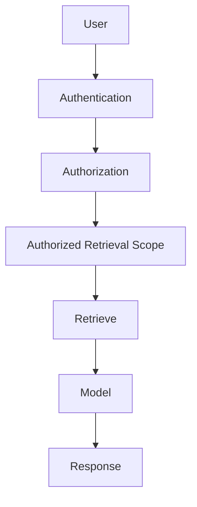

---

# 478. RAG Authorization

El retrieval debe respetar:

```text
project membership

context role

resource permissions

future domain permissions.
```

---

# 479. RAG Data Leakage

Debe prevenir:

```text
cross-project retrieval

cross-tenant retrieval if multi-tenancy exists

sensitive attachment leakage

hidden audit data exposure.
```

---

# 480. Future Evolution — Embeddings

**Estado:** EXPERIMENTAL / CONDITIONAL  
**Horizonte:** LONG-TERM

Embeddings solo son necesarios si el caso de uso requiere:

```text
semantic retrieval.
```

---

# 481. Embedding Questions

```text
What content is embedded?

Where are embeddings stored?

How are permissions represented?

How are deleted documents removed?

How are updates reindexed?

Can embeddings reveal sensitive information?
```

---

# 482. Vector Storage

No asumir automáticamente:

```text
AI
=
vector database.
```

---

# 483. Candidate Evaluation

Dependiendo del caso podrían evaluarse:

```text
database extensions

specialized vector stores

external managed services.
```

---

# 484. AI Storage Principle

```text
Choose retrieval infrastructure
after validating retrieval requirements.
```

---

# 485. Future Evolution — AI Knowledge Sources

Podrían incluir:

```text
project documentation

authorized attachments

educational content

platform help

future academic materials.
```

---

# 486. Knowledge-source Rule

Cada fuente debe definir:

```text
ownership

authorization

freshness

deletion

indexing behavior.
```

---

# 487. AI Freshness

Una respuesta generada con información obsoleta puede ser:

```text
plausible

but wrong.
```

---

# 488. Therefore

RAG debe definir:

```text
source freshness semantics.
```

---

# 489. Future Evolution — AI Auditability

**Estado:** FUTURE / TARGET IF AI ADOPTED

Capacidades AI sensibles pueden necesitar registrar:

```text
who invoked

which capability

which data scope

model/version where appropriate

result metadata

errors.
```

---

# 490. Privacy Boundary

No registrar automáticamente:

```text
full prompts

full retrieved documents

full generated responses
```

sin:

```text
validated operational or compliance need.
```

---

# 491. Future Evolution — AI Human Oversight

AI no debería realizar automáticamente operaciones críticas como:

```text
change permissions

delete resources

publish official competition results

modify inventory authority

approve reservations
```

sin:

```text
explicit product design
and appropriate controls.
```

---

# 492. AI Action Principle

```text
Recommendation

and

Authorized Mutation

are different capabilities.
```

---

# 493. Tool-using AI

Si en el futuro AI puede ejecutar acciones:

```text
AI Request

↓

User Context

↓

Tool Authorization

↓

Domain Validation

↓

Mutation

↓

Audit.
```

---

# 494. Critical Rule

La autorización debe evaluarse contra:

```text
the user

and

the requested operation.
```

---

# 495. Not Against

```text
the model's confidence.
```

---

# 496. Future Evolution — AI Cost Governance

**Estado:** FUTURE

Si se adopta AI deberán observarse:

```text
request volume

token usage

model cost

latency

failure rate

value delivered.
```

---

# 497. AI Evolution Gate

No ampliar infraestructura AI si:

```text
validated product value
does not justify
cost and complexity.
```

---

# 498. Future Evolution — AI Provider Independence

**Estado:** FUTURE / OPTIONAL

Puede ser útil evitar que el dominio dependa directamente de:

```text
one model provider API.
```

---

# 499. Possible Boundary

```text
Application AI Capability

↓

AI Adapter

↓

Provider.
```

---

# 500. Avoid Over-abstraction

No construir una plataforma universal de:

```text
provider abstraction
```

antes de:

```text
having a real AI capability.
```

---

# 501. Future Evolution — Persistence Strategy

**Estado:** CURRENT FOUNDATION / CONDITIONAL EVOLUTION

La estrategia actual permanece:

```text
SQLAlchemy

+

MariaDB.
```

---

# 502. Current Database

```text
MariaDB
    CURRENT.
```

---

# 503. PostgreSQL

```text
PostgreSQL
    FUTURE / CANDIDATE / CONDITIONAL.
```

---

# 504. No Migration Has Occurred

La evolución histórica no contiene:

```text
completed MariaDB → PostgreSQL migration.
```

---

# 505. Persistence Evolution Principle

```text
Do not migrate database engines
without a database-engine problem
or a verified product requirement.
```

---

# 506. PostgreSQL Evaluation Triggers

Podrían incluir:

```text
required database capability

verified MariaDB limitation

operational requirement

performance characteristic

future extension requirement

future search/vector requirement
only if validated.
```

---

# 507. Non-trigger

No constituye trigger suficiente:

```text
PostgreSQL is popular.
```

---

# 508. Another Non-trigger

Tampoco:

```text
many enterprise systems use PostgreSQL.
```

---

# 509. Another Non-trigger

Tampoco:

```text
future AI may need vectors.
```

si:

```text
AI itself has not been validated.
```

---

# 510. PostgreSQL Evaluation Process

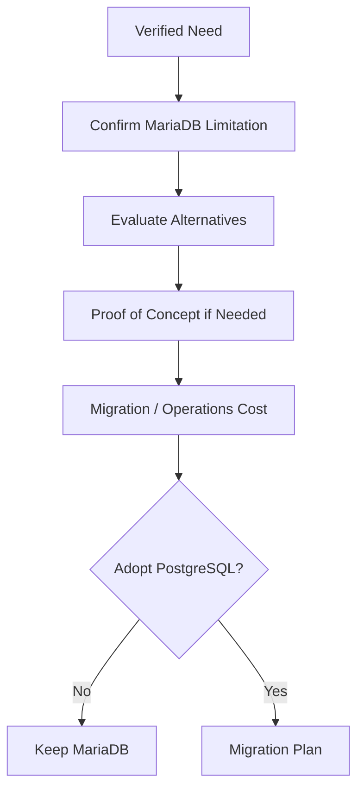

---

# 511. Important Outcome

La evaluación puede concluir:

```text
MariaDB remains the best fit.
```

---

# 512. Future Evolution — Database Migration Gate

Una migración de motor requeriría:

```text
explicit architectural approval.
```

---

# 513. Required Assessment

```text
SQLAlchemy compatibility

data types

constraints

indexes

queries

transactions

migration tooling

backup

restore

deployment

rollback

tests

operational knowledge.
```

---

# 514. Data Migration

Debe existir una estrategia para:

```text
extract

transform if necessary

load

verify.
```

---

# 515. Migration Integrity

Debe verificarse:

```text
row counts

critical relationships

constraints

domain invariants

sample business workflows.
```

---

# 516. Migration Testing

Debe realizarse sobre:

```text
representative data.
```

---

# 517. Migration Rollback

Debe definirse antes del cambio:

```text
Can we revert?

How?

Until when?

What happens to writes
after cutover?
```

---

# 518. Database Cutover

Puede requerir:

```text
maintenance window

write freeze

dual compatibility

or another controlled strategy.
```

según:

```text
actual future requirements.
```

---

# 519. Avoid Premature Dual-write

No implementar:

```text
MariaDB + PostgreSQL dual writes
```

sin una migración real que lo justifique.

---

# 520. Migration Completion Rule

Solo después de:

```text
successful production cutover

+

validation

+

operational acceptance
```

podría documentarse:

```text
PostgreSQL
    CURRENT.
```

---

# 521. Until Then

```text
MariaDB
    CURRENT.
```

---

# 522. Future Evolution — Database Portability

**Estado:** TARGET WHERE PRACTICAL  
**Horizonte:** CONTINUOUS

SQLAlchemy proporciona cierta abstracción.

---

# 523. But

```text
ORM

does not guarantee

database-engine portability.
```

---

# 524. Portability Risks

```text
vendor-specific SQL

data types

collations

locking semantics

index behavior

JSON behavior

date/time behavior.
```

---

# 525. Principle

No limitar artificialmente la aplicación para conseguir:

```text
perfect theoretical portability.
```

---

# 526. Prefer

```text
reasonable portability

without sacrificing
current correctness.
```

---

# 527. Future Evolution — Read Replicas

**Estado:** CONDITIONAL  
**Horizonte:** LONG-TERM

No existe necesidad actual confirmada de:

```text
read replicas.
```

---

# 528. Trigger

Podrían evaluarse ante:

```text
measured read pressure

reporting load

availability requirements.
```

---

# 529. Replica Complexity

Introduce:

```text
replication lag

read consistency issues

routing complexity

operational overhead.
```

---

# 530. Principle

```text
Optimize queries first.

Scale database topology
only when measured.
```

---

# 531. Future Evolution — Database Partitioning

**Estado:** CONDITIONAL  
**Horizonte:** LONG-TERM

No debe anticiparse:

```text
table partitioning
```

sin:

```text
data-volume evidence.
```

---

# 532. Trigger

Podría aparecer con:

```text
very large audit tables

large activity histories

large future event histories.
```

---

# 533. Future Evolution — Archival

**Estado:** FUTURE / CONDITIONAL  
**Horizonte:** LONG-TERM

Datos históricos voluminosos podrían requerir:

```text
archival policy.
```

---

# 534. Candidate Data

```text
old audit records

historical activity

expired operational data

old generated reports.
```

---

# 535. Archival Principle

No archivar únicamente por:

```text
record age.
```

---

# 536. Consider

```text
business value

audit requirements

legal retention

query patterns

recovery needs.
```

---

# 537. Future Evolution — Redis

**Estado:** FUTURE / CONDITIONAL  
**Horizonte:** LONG-TERM

Redis no forma parte de:

```text
current architecture.
```

---

# 538. Possible Future Roles

Podría evaluarse para:

```text
distributed realtime coordination

cache

background-job infrastructure

rate limiting

distributed locks
```

si existen:

```text
real requirements.
```

---

# 539. Important Rule

Una necesidad en una de estas áreas no implica automáticamente que Redis deba resolver:

```text
all of them.
```

---

# 540. Redis Trigger — Realtime

```text
multiple application instances

+

cross-instance realtime delivery.
```

---

# 541. Redis Trigger — Cache

```text
measured expensive repeated reads

+

well-defined cache semantics.
```

---

# 542. Redis Trigger — Jobs

```text
background processing

+

queue semantics compatible
with chosen tooling.
```

---

# 543. Redis Trigger — Rate Limiting

```text
distributed request enforcement
across multiple instances.
```

---

# 544. Redis Decision

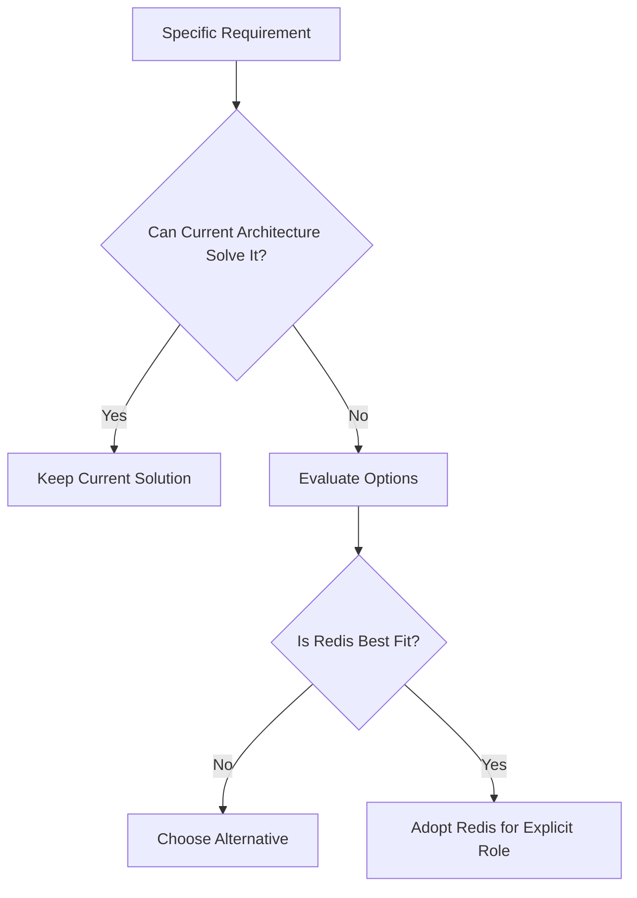

---

# 545. Redis Operational Cost

Adoption introduces:

```text
new service

persistence decisions if needed

monitoring

backup depending on role

security

availability

deployment complexity.
```

---

# 546. Redis Principle

```text
Redis is a tool,

not an architecture milestone.
```

---

# 547. Future Evolution — Object Storage

**Estado:** FUTURE / CONDITIONAL  
**Horizonte:** MEDIUM / LONG-TERM

Current:

```text
Persistent Local Attachment Storage.
```

---

# 548. Object-storage Trigger

Podría aparecer ante:

```text
horizontal scaling

large attachment growth

distributed serving

availability requirements

storage lifecycle requirements.
```

---

# 549. Storage Abstraction Direction

```text
Attachment Domain

↓

Storage Interface

├── Local Storage
│
└── Future Object Storage.
```

---

# 550. Object-storage Migration

Si se adopta deberá considerar:

```text
existing files

metadata mapping

checksums

migration verification

access control

backup policy

rollback.
```

---

# 551. Authorized Download Invariant

Cambiar almacenamiento no debe eliminar:

```text
application authorization.
```

---

# 552. Possible Delivery Models

Podrían evaluarse:

```text
application-proxied download

short-lived signed URL

controlled direct delivery.
```

---

# 553. Security Requirement

En todos los casos:

```text
authorization
must happen
before access is granted.
```

---

# 554. Signed URL

Un futuro signed URL debe ser:

```text
short-lived

scope-limited

generated only after authorization.
```

---

# 555. Storage Provider Independence

Puede ser útil evitar dependencia directa del dominio respecto a:

```text
provider-specific SDK models.
```

---

# 556. But

No construir una abstracción universal de storage si:

```text
local storage remains sufficient.
```

---

# 557. Future Evolution — Horizontal Scaling

**Estado:** FUTURE / CONDITIONAL  
**Horizonte:** LONG-TERM

La plataforma actual no debe asumir:

```text
horizontal scaling
```

como necesidad inmediata.

---

# 558. Trigger

Debe existir:

```text
capacity

availability

deployment

or resilience requirement.
```

---

# 559. Before Scaling

Primero medir:

```text
CPU

memory

database latency

request latency

WebSocket load

storage throughput.
```

---

# 560. Possible First Steps

Antes de múltiples instancias:

```text
query optimization

indexes

pagination

vertical scaling

application tuning

database tuning.
```

---

# 561. Horizontal Scaling Changes Assumptions

Afecta:

```text
WebSockets

in-memory state

attachments

scheduled jobs

background jobs

cache

deployment

observability.
```

---

# 562. Scaling Dependency Map

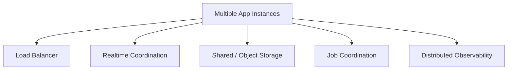

---

# 563. Future Evolution — Load Balancing

**Estado:** CONDITIONAL  
**Horizonte:** LONG-TERM

Múltiples instancias requerirían:

```text
traffic distribution.
```

---

# 564. Load-balancing Questions

```text
How are health checks performed?

How are WebSockets handled?

Is sticky routing required?

How is TLS terminated?

How are failed instances removed?
```

---

# 565. WebSocket Consideration

Un balanceador puede mantener conexiones.

Pero:

```text
broadcast between instances
```

sigue requiriendo:

```text
coordination
```

si el producto lo necesita.

---

# 566. Sticky Sessions

No asumir que:

```text
sticky sessions
```

resuelven completamente:

```text
distributed realtime.
```

---

# 567. Why

Porque usuarios conectados a diferentes instancias pueden necesitar recibir:

```text
the same project event.
```

---

# 568. Future Evolution — Stateless HTTP

**Estado:** TARGET WHERE PRACTICAL

HTTP debería mantener:

```text
minimal process-local state.
```

---

# 569. But

La plataforma completa no puede describirse simplemente como:

```text
stateless.
```

---

# 570. Current Process-local State

Incluye al menos:

```text
WebSocket connection ownership.
```

---

# 571. Current Host-local State

Incluye:

```text
persistent local attachments.
```

---

# 572. Scaling Principle

```text
Identify every state category

before

adding application instances.
```

---

# 573. Future Evolution — Kubernetes

**Estado:** FUTURE / CONDITIONAL / NOT CURRENT  
**Horizonte:** LONG-TERM

Kubernetes no forma parte de:

```text
current deployment architecture.
```

---

# 574. Current Deployment

```text
Docker

+

Docker Compose

+

Nginx

+

Ubuntu

+

Hetzner VPS.
```

---

# 575. Kubernetes Trigger

Solo evaluar ante necesidades como:

```text
many services

many instances

advanced orchestration

automated scheduling

complex deployment topology

strong self-healing requirements

organizational platform standard.
```

---

# 576. Kubernetes Benefits

Puede aportar:

```text
orchestration

scheduling

service discovery

rollout primitives

scaling primitives

self-healing primitives.
```

---

# 577. Kubernetes Costs

También introduce:

```text
cluster management

network complexity

security complexity

storage complexity

observability requirements

configuration complexity

operational learning.
```

---

# 578. Kubernetes Decision Principle

```text
Do not adopt Kubernetes
before there is
a Kubernetes-shaped problem.
```

---

# 579. Possible Alternatives

Si surge necesidad de mejorar despliegue pueden evaluarse antes:

```text
better Compose automation

managed container platforms

simpler orchestrators

deployment tooling.
```

---

# 580. Evolution Is Not Binary

No existe únicamente:

```text
Docker Compose

or

Kubernetes.
```

---

# 581. Future Evolution — Microservices

**Estado:** FUTURE / CONDITIONAL / NOT CURRENT  
**Horizonte:** LONG-TERM

La arquitectura actual permanece:

```text
Modular Monolith.
```

---

# 582. Microservice Trigger

La extracción de un servicio debe responder a:

```text
independent deployment need

independent scaling need

strong domain boundary

different lifecycle

fault-isolation requirement

independent team ownership.
```

---

# 583. Non-trigger

No extraer servicios porque:

```text
the codebase has many modules.
```

---

# 584. Another Non-trigger

Tampoco porque:

```text
microservices are considered modern.
```

---

# 585. Service Extraction Principle

```text
Module Boundary

first.

Distributed Boundary

only when justified.
```

---

# 586. Candidate Future Extractions

Dependiendo de requisitos reales podrían evaluarse capacidades como:

```text
Notifications

Attachments

AI Processing

Search

specific future domains.
```

---

# 587. But

Ninguna de ellas debe considerarse actualmente:

```text
planned microservice.
```

---

# 588. Extraction Questions

Antes de extraer:

```text
Why must this deploy independently?

What data does it own?

What contract does it expose?

How does failure affect callers?

How is it observed?

How is it secured?

How is it tested?

Who operates it?
```

---

# 589. Data Ownership

Un microservicio real debería tener:

```text
clear data ownership.
```

---

# 590. Avoid Distributed Monolith

No crear:

```text
multiple deployables

sharing the same database

with uncontrolled cross-service tables

and synchronous dependencies everywhere.
```

---

# 591. Distributed Monolith Risk

Produce:

```text
microservice operational cost

+

monolith coupling.
```

---

# 592. Future Evolution — Service Communication

**Estado:** CONDITIONAL

Si aparecen servicios independientes, comunicación puede ser:

```text
synchronous

asynchronous

or hybrid.
```

---

# 593. Synchronous Communication

Adecuada cuando:

```text
immediate response
is part of the operation.
```

---

# 594. Asynchronous Communication

Adecuada cuando:

```text
eventual reaction

decoupling

or

background processing
```

es aceptable.

---

# 595. Avoid Event-driven Everything

No convertir toda interacción en:

```text
events
```

si una llamada directa dentro del monolito sigue siendo:

```text
simpler and correct.
```

---

# 596. Future Evolution — Distributed Transactions

**Estado:** CONDITIONAL / AVOID UNTIL REQUIRED

Distribución puede introducir:

```text
cross-service consistency problems.
```

---

# 597. Principle

Evitar diseñar operaciones que requieran:

```text
global distributed transaction
```

si pueden mantenerse dentro de:

```text
one consistency boundary.
```

---

# 598. Future Pattern

Si la distribución llega a ser necesaria podrían evaluarse:

```text
sagas

compensating actions

outbox patterns

idempotent consumers.
```

---

# 599. But

Estos patrones no forman parte de:

```text
current architecture.
```

---

# 600. Future Evolution — Transactional Outbox

**Estado:** CONDITIONAL  
**Horizonte:** LONG-TERM

Puede ser útil si una futura arquitectura necesita garantizar:

```text
database mutation

+

reliable external event publication.
```

---

# 601. Current Need

No debe introducirse únicamente para:

```text
in-process WebSocket broadcasting.
```

---

# 602. Trigger

Puede aparecer con:

```text
durable external messaging

microservices

reliable integration events.
```

---

# 603. Future Evolution — Multi-tenancy

**Estado:** FUTURE / CONDITIONAL  
**Horizonte:** LONG-TERM

La plataforma no debe asumir actualmente:

```text
multi-tenancy.
```

---

# 604. Multi-tenancy Trigger

Debe existir un producto que necesite:

```text
multiple isolated organizations
inside the same platform.
```

---

# 605. Multi-tenancy Is Not

```text
add tenant_id
to every table.
```

---

# 606. It Affects

```text
identity

authorization

queries

unique constraints

audit

attachments

realtime

search

AI retrieval

operations

backup

restore.
```

---

# 607. Tenant Isolation Invariant

Si se adopta:

```text
cross-tenant data leakage
```

debe considerarse:

```text
critical security failure.
```

---

# 608. Tenant Context

Podría convertirse en una capa superior:

```text
Tenant

↓

Project

↓

Resource.
```

---

# 609. But

No debe añadirse ahora como:

```text
unused abstraction.
```

---

# 610. Multi-tenancy Models

En el futuro podrían evaluarse:

```text
shared database / shared schema

shared database / separate schema

separate databases.
```

---

# 611. Selection Criteria

```text
isolation requirements

scale

operations

cost

backup

restore

compliance.
```

---

# 612. No Premature Selection

No elegir un modelo antes de conocer:

```text
actual tenant requirements.
```

---

# 613. Multi-tenancy Authorization

Debe añadirse:

```text
tenant isolation
```

antes de:

```text
project authorization.
```

---

# 614. Conceptual Flow

```text
Authenticated User

↓

Tenant Relationship

↓

Project Relationship

↓

Resource Relationship

↓

Permission.
```

---

# 615. Multi-tenancy Realtime

Subscriptions deberían estar aisladas por:

```text
tenant

+

project

+

resource scope.
```

---

# 616. Multi-tenancy Attachments

Storage keys o paths deberán impedir:

```text
cross-tenant collision

and

cross-tenant exposure.
```

---

# 617. Multi-tenancy AI

RAG futuro deberá garantizar:

```text
tenant-scoped retrieval
```

antes de:

```text
project-scoped retrieval.
```

---

# 618. Future Evolution — Multi-region

**Estado:** FUTURE / CONDITIONAL  
**Horizonte:** LONG-TERM

Multi-region solo debe considerarse ante:

```text
geographic availability

latency

disaster-recovery

or regulatory requirements.
```

---

# 619. Multi-region Complexity

Introduce:

```text
replication

consistency

routing

failover

data residency

operational complexity.
```

---

# 620. Current Need

No existe necesidad arquitectónica de diseñar actualmente:

```text
active-active global architecture.
```

---

# 621. Multi-region Principle

```text
Single-region operational maturity

before

multi-region complexity.
```

---

# 622. Future Evolution — Availability

**Estado:** EVOLVING / REQUIREMENT-DRIVEN

Availability debe definirse mediante:

```text
actual service expectations.
```

---

# 623. Avoid Undefined High Availability

No declarar:

```text
high availability
```

sin definir:

```text
availability target

failure model

recovery behavior.
```

---

# 624. Availability Evolution

Puede avanzar desde:

```text
reliable single-instance deployment

↓

faster recovery

↓

redundant infrastructure

↓

multiple application instances

↓

conditional multi-region.
```

---

# 625. Future Evolution — Resilience

Resilience debe priorizar:

```text
failure containment

recovery

retry safety

observability

graceful degradation.
```

---

# 626. Graceful Degradation

Ejemplo:

si una futura integración de email falla:

```text
core project mutation
```

no debería necesariamente:

```text
fail entirely.
```

---

# 627. But

Depende de:

```text
business semantics.
```

---

# 628. Future Evolution — Rate Limiting

**Estado:** FUTURE / TARGET WHERE RISK REQUIRES  
**Horizonte:** MEDIUM-TERM

Puede ser necesario para:

```text
authentication endpoints

expensive operations

public integrations

future AI endpoints

webhooks.
```

---

# 629. Rate-limit Scope

Puede aplicarse por:

```text
IP

user

endpoint

tenant

API credential.
```

---

# 630. Distributed Rate Limiting

Solo requiere infraestructura compartida cuando:

```text
multiple application instances
must enforce
one common limit.
```

---

# 631. Future Evolution — Abuse Protection

**Estado:** FUTURE / CONTINUOUS

A medida que aumente exposición externa deben evaluarse:

```text
brute-force protection

request limits

payload limits

upload limits

AI usage limits

webhook abuse protection.
```

---

# 632. Security Evolution Principle

```text
Attack surface

grows with capability.
```

---

# 633. Therefore

Cada nueva capability debe incorporar:

```text
threat analysis
```

proporcional a:

```text
its risk.
```

---

# 634. Future Evolution — Scalability Model

La escalabilidad futura debe dividirse en:

```text
Application Scaling

Database Scaling

Realtime Scaling

Storage Scaling

Background Work Scaling

Search Scaling

AI Scaling.
```

---

# 635. Important Principle

No existe un único:

```text
scale the platform.
```

---

# 636. Different Bottlenecks

Cada subsistema puede requerir:

```text
different scaling strategy.
```

---

# 637. Application Scaling

Orden preferido:

```text
measure

↓

optimize

↓

vertical scale

↓

horizontal scale if required.
```

---

# 638. Database Scaling

Orden preferido:

```text
query optimization

↓

indexes

↓

pagination

↓

configuration / resource tuning

↓

topology changes if required.
```

---

# 639. Realtime Scaling

Orden preferido:

```text
optimize connection management

↓

measure concurrency

↓

multiple instances if required

↓

cross-instance coordination if required.
```

---

# 640. Storage Scaling

Orden preferido:

```text
monitor capacity

↓

manage local persistent storage

↓

storage abstraction if justified

↓

object storage if required.
```

---

# 641. Background Work Scaling

Orden preferido:

```text
identify asynchronous workload

↓

simple worker model

↓

measure

↓

increase workers / coordination if needed.
```

---

# 642. AI Scaling

Si AI se adopta:

```text
measure usage

↓

optimize prompts / retrieval

↓

select suitable model

↓

cache where safe

↓

scale provider/inference architecture
only if justified.
```

---

# 643. Future Evolution — Capacity Planning

**Estado:** FUTURE / EVOLVING  
**Horizonte:** MEDIUM-TERM

Capacity planning debe basarse en:

```text
measured usage.
```

---

# 644. Candidate Metrics

```text
active users

concurrent users

requests per second

database size

attachment volume

WebSocket connections

event rate

job volume

AI usage if introduced.
```

---

# 645. Capacity Principle

```text
Capacity decisions

should follow trends,

not guesses.
```

---

# 646. Future Evolution — Performance Budgets

**Estado:** FUTURE / OPTIONAL

Podrían definirse objetivos para:

```text
page response

API latency

database query latency

WebSocket propagation

frontend interaction.
```

---

# 647. Requirement

Los budgets deben reflejar:

```text
user experience needs.
```

---

# 648. Avoid Arbitrary Numbers

No adoptar objetivos únicamente porque:

```text
100 ms sounds fast.
```

---

# 649. Future Evolution — Cost Awareness

**Estado:** CONTINUOUS

Cada evolución debe considerar:

```text
infrastructure cost

development cost

maintenance cost

operational cost

learning cost.
```

---

# 650. Cost Principle

```text
Architecture cost

includes

human complexity.
```

---

# 651. Example

Una solución puede ahorrar:

```text
€20/month infrastructure
```

pero exigir:

```text
significant operational complexity.
```

---

# 652. Decision

Debe evaluarse:

```text
total cost of ownership.
```

---

# 653. Future Evolution — Technology Adoption Gate

Toda tecnología nueva debería responder:

```text
Which requirement does it solve?

Why can the current architecture not solve it sufficiently?

What alternatives exist?

What new failure modes appear?

Who will operate it?

How is it tested?

How is it removed if unsuccessful?
```

---

# 654. Adoption Flow

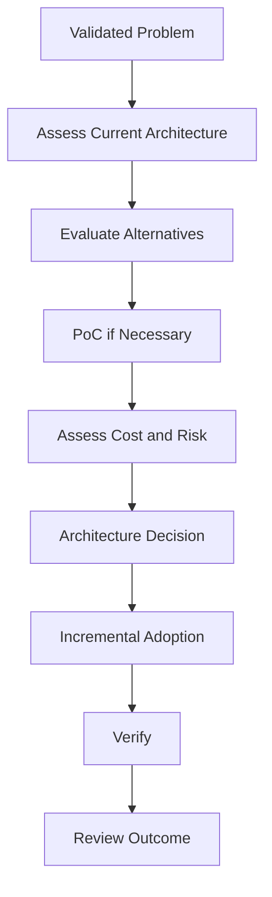

---

# 655. Technology Removal

Una tecnología futura debería poder retirarse si:

```text
it does not deliver
the expected value.
```

---

# 656. Reversibility Principle

Preferir inicialmente decisiones:

```text
reversible

incremental

bounded.
```

---

# 657. Irreversible Decisions

Decisiones de alto coste como:

```text
database-engine migration

multi-tenancy model

microservice extraction

multi-region topology
```

requieren:

```text
stronger evidence.
```

---

# 658. Future Evolution — Architecture Fitness

**Estado:** FUTURE / TARGET

La arquitectura debe poder evaluarse periódicamente contra:

```text
current requirements.
```

---

# 659. Fitness Questions

```text
Does MariaDB still satisfy persistence needs?

Does the Modular Monolith still support delivery?

Does local storage still satisfy attachment needs?

Does in-memory realtime still fit topology?

Does Docker Compose still fit operations?

Does SSR still fit product UX?
```

---

# 660. Correct Outcome

Una revisión puede concluir:

```text
Yes.

Keep the current architecture.
```

---

# 661. Architecture Review Principle

```text
No change

can be

a valid architecture decision.
```

---

# 662. Part 2 Summary

La evolución intermedia y de largo plazo puede incorporar:

```text
PWA

offline capabilities

external integrations

stable external APIs

webhooks

background jobs

AI / RAG

conditional database evolution

distributed realtime

object storage

horizontal scaling

Kubernetes

microservices

multi-tenancy

multi-region.
```

---

# 663. But

Ninguna de estas capacidades debe redefinir prematuramente:

```text
the current architecture.
```

---

# 664. Current Persistence Baseline

```text
SQLAlchemy

+

MariaDB.
```

---

# 665. Future Persistence Candidate

```text
PostgreSQL

only if

a verified trigger

+

explicit decision

+

successful migration.
```

---

# 666. Current Realtime Baseline

```text
FastAPI WebSockets

+

In-memory Connection Manager.
```

---

# 667. Future Realtime Candidate

```text
Redis / Broker

only if

distributed coordination
becomes necessary.
```

---

# 668. Current Storage Baseline

```text
Persistent Local Attachment Storage.
```

---

# 669. Future Storage Candidate

```text
Object Storage

only if

storage or topology requirements
justify it.
```

---

# 670. Current Deployment Baseline

```text
Docker

Docker Compose

Nginx

Ubuntu

Hetzner VPS.
```

---

# 671. Future Orchestration Candidate

```text
Kubernetes

only if

orchestration complexity
justifies it.
```

---

# 672. Current Application Baseline

```text
Modular Monolith.
```

---

# 673. Future Distribution Candidate

```text
Microservices

only if

independent lifecycle,
scaling,
ownership
or fault-isolation requirements
justify extraction.
```

---

# 674. Future Intelligence Baseline

```text
AI / RAG
    FUTURE / EXPERIMENTAL.
```

---

# 675. AI Adoption Gate

```text
Validated Use Case

↓

Authorized Data Scope

↓

Privacy Assessment

↓

Experiment

↓

Measure Value

↓

Architecture Decision.
```

---

# 676. Future Scale Principle

```text
Measure first.

Optimize second.

Scale third.

Distribute only when necessary.
```

---

# 677. Future Complexity Principle

```text
Every new technology

must remove

more meaningful complexity

than it introduces.
```

---

# 678. Continuation

La **Parte 3/3** continúa con:

```text
future security maturity

advanced authorization

compliance readiness

observability maturity

SLOs

incident response

operational governance

architecture governance

ADR lifecycle

dependency management

technical-debt governance

deprecation strategy

release evolution

future roadmap horizons

architecture trigger matrix

non-goals

final CURRENT / TARGET / FUTURE matrices

and

final evolution principles.
```

---

# 679. Future Evolution — Security Maturity

**Estado:** CONTINUOUS / TARGET  
**Horizonte:** ALL HORIZONS

La seguridad debe evolucionar como:

```text
continuous platform capability
```

y no como:

```text
one-time implementation milestone.
```

---

# 680. Security Evolution Model

```text
Authentication

↓

Session Security

↓

Global Authorization

↓

Contextual Authorization

↓

Resource Authorization

↓

Realtime Authorization

↓

Operational Security

↓

Continuous Verification.
```

---

# 681. Current Security Foundation

La plataforma dispone actualmente de:

```text
JWT Access Token

JWT Refresh Token

HTTPOnly Cookies

Explicit Refresh

Automatic Access Refresh

Logout Token Cleanup

Global RBAC

partial Contextual Authorization.
```

---

# 682. Security Hardening Areas

La evolución inmediata debe reforzar:

```text
CSRF

cookie policy consistency

refresh-token lifecycle security

contextual authorization

cross-project isolation

WebSocket authentication

subscription authorization

security regression testing.
```

---

# 683. Security Status Principle

No debe declararse:

```text
Security Complete.
```

---

# 684. Prefer

```text
Security Foundation:
    CURRENT

Security Hardening:
    CONTINUOUS.
```

---

# 685. Future Evolution — Defense in Depth

Las garantías sensibles deberían existir en:

```text
multiple complementary layers.
```

---

# 686. Example

Para una mutación contextual:

```text
Authentication

↓

Route-level Context Resolution

↓

Authorization Policy

↓

Service-layer Enforcement

↓

Database Integrity

↓

Audit.
```

---

# 687. Defense-in-depth Principle

```text
One security layer
must not be the only barrier
protecting critical state.
```

---

# 688. Future Evolution — Authorization Maturity

**Estado:** TARGET  
**Horizonte:** NEAR / MEDIUM-TERM

La evolución debe avanzar desde:

```text
Global RBAC
```

hacia:

```text
Global RBAC

+

Context Membership

+

Context Role

+

Resource Relationship

+

Action Policy.
```

---

# 689. Authorization Decision

Conceptualmente:

```text
can(user, action, resource, context)
```

---

# 690. Authorization Inputs

Pueden incluir:

```text
user identity

global role

project membership

contextual role

resource ownership

resource parent

resource state

requested operation.
```

---

# 691. Authorization Output

Debe producir:

```text
ALLOW

or

DENY.
```

---

# 692. Deny-by-default

Cuando no pueda demostrarse:

```text
authorization
```

el resultado debe ser:

```text
DENY.
```

---

# 693. Future Evolution — Policy Composition

Si aumenta la complejidad, pueden componerse policies:

```text
is_global_admin

is_project_member

can_manage_project

can_edit_task

can_view_attachment

can_subscribe_realtime_scope.
```

---

# 694. Composition Principle

```text
Small explicit policies

are preferable to

large opaque authorization functions.
```

---

# 695. But

No fragmentar hasta producir:

```text
untraceable authorization chains.
```

---

# 696. Future Evolution — Authorization Explainability

**Estado:** FUTURE / OPTIONAL  
**Horizonte:** MEDIUM-TERM

Para administración y debugging podría resultar útil distinguir:

```text
not authenticated

not a member

insufficient contextual role

resource outside scope

operation forbidden.
```

---

# 697. Security Boundary

La información devuelta al cliente no debe:

```text
leak sensitive resource existence.
```

---

# 698. Internal vs External Explanation

Puede existir:

```text
detailed internal reason

+

safe external response.
```

---

# 699. Future Evolution — Authorization Caching

**Estado:** CONDITIONAL  
**Horizonte:** LONG-TERM

No cachear decisiones de autorización sin definir:

```text
invalidation semantics.
```

---

# 700. Why

Permisos pueden cambiar por:

```text
membership removal

role change

resource movement

tenant change

account deactivation.
```

---

# 701. Authorization Cache Principle

```text
Stale authorization

is a security defect,
not merely a performance issue.
```

---

# 702. Future Evolution — Security Testing

**Estado:** TARGET / EXPANDING  
**Horizonte:** NEAR-TERM

Las pruebas deben evolucionar hacia matrices de:

```text
identity

role

membership

resource scope

operation

expected result.
```

---

# 703. Security Test Example

```text
User:
    authenticated

Project A:
    member

Project B:
    non-member

Resource:
    belongs to Project B

Expected:
    DENY.
```

---

# 704. Negative Testing

Debe priorizarse:

```text
what must never be allowed.
```

---

# 705. Critical Security Regression Areas

```text
cross-project access

nested-resource access

attachment downloads

context mutations

membership administration

WebSocket subscriptions

future tenant isolation.
```

---

# 706. Future Evolution — Threat Modeling

**Estado:** TARGET / CONTINUOUS  
**Horizonte:** ALL HORIZONS

Las nuevas capabilities deberían evaluar:

```text
assets

actors

trust boundaries

entry points

abuse cases

failure impact.
```

---

# 707. High-value Threat-model Candidates

```text
Authentication

ProjectMembership

Attachments

WebSockets

Invitations

Future SAML

Future PWA Offline Storage

Future Webhooks

Future AI / RAG

Future Multi-tenancy.
```

---

# 708. Threat-model Principle

```text
Security review depth

should increase

with capability risk.
```

---

# 709. Future Evolution — Dependency Security

**Estado:** CONTINUOUS

La plataforma depende de:

```text
Python packages

JavaScript libraries

container images

operating-system packages.
```

---

# 710. Dependency Security Evolution

Debe contemplar:

```text
dependency updates

vulnerability awareness

compatibility testing

controlled upgrades.
```

---

# 711. Avoid

No actualizar dependencias críticas de producción únicamente por:

```text
latest version available.
```

---

# 712. Prefer

```text
security relevance

compatibility

release notes

tests

controlled deployment.
```

---

# 713. Future Evolution — Supply-chain Security

**Estado:** FUTURE / EVOLVING  
**Horizonte:** MEDIUM-TERM

Puede reforzarse mediante:

```text
dependency pinning

trusted registries

image provenance

CI permissions

artifact integrity.
```

---

# 714. Supply-chain Principle

```text
Build pipeline

is part of

the security boundary.
```

---

# 715. Future Evolution — Security Headers

**Estado:** TARGET / VERIFY  
**Horizonte:** NEAR-TERM

La configuración web debe revisar cabeceras como:

```text
Content-Security-Policy

X-Content-Type-Options

Referrer-Policy

frame protection

HSTS when HTTPS conditions justify it.
```

---

# 716. Header Principle

No añadir cabeceras mediante:

```text
copy-paste security checklist
```

sin comprobar:

```text
application behavior.
```

---

# 717. CSP

Una futura CSP debe ser compatible con:

```text
Jinja2

AdminLTE

Bootstrap

modular JavaScript

required external assets.
```

---

# 718. Future Evolution — Upload Security

**Estado:** TARGET / CONTINUOUS

Attachments amplían superficie mediante:

```text
file uploads.
```

---

# 719. Upload Controls

Deben evolucionar según necesidad:

```text
size limits

filename normalization

content-type validation

safe storage naming

authorization

malware scanning if risk justifies it.
```

---

# 720. Upload Principle

```text
Client-provided filename

must not become

trusted storage path.
```

---

# 721. Malware Scanning

**Estado:** CONDITIONAL

Evaluarlo si:

```text
untrusted external uploads

risk profile

or institutional requirements
```

lo justifican.

---

# 722. Future Evolution — Compliance Readiness

**Estado:** CONDITIONAL  
**Horizonte:** MEDIUM / LONG-TERM

La plataforma no debe adoptar:

```text
compliance theater.
```

---

# 723. Compliance Trigger

Debe existir:

```text
legal

contractual

institutional

or regulatory requirement.
```

---

# 724. Compliance Foundations

Muchas capacidades útiles independientemente de certificaciones incluyen:

```text
access control

auditability

backup

restore

change traceability

secret management

incident response.
```

---

# 725. Compliance Principle

```text
Build real controls first.

Map them to frameworks
only when required.
```

---

# 726. Future Evolution — Privacy Governance

**Estado:** CONTINUOUS

La expansión hacia:

```text
Academic

AI

Multi-tenancy

external integrations
```

puede incrementar:

```text
privacy requirements.
```

---

# 727. Privacy Governance Areas

```text
data minimization

purpose limitation

retention

access

export

deletion

logging

AI processing.
```

---

# 728. Future Evolution — Data Classification

**Estado:** FUTURE / TARGET IF NEEDED  
**Horizonte:** MEDIUM-TERM

Puede ser útil clasificar datos como:

```text
Public

Internal

Sensitive

Highly Sensitive
```

según:

```text
actual platform information.
```

---

# 729. Classification Benefit

Puede guiar:

```text
logging

storage

access control

backup

export

AI retrieval.
```

---

# 730. Avoid Classification Theater

No crear:

```text
large classification taxonomy
```

que nadie:

```text
understands

applies

or verifies.
```

---

# 731. Future Evolution — Observability Maturity

**Estado:** PARTIAL / EVOLVING  
**Horizonte:** NEAR / MEDIUM-TERM

La observabilidad debería evolucionar desde:

```text
logs and basic operational visibility
```

hacia:

```text
measurable service behavior.
```

---

# 732. Observability Model

```text
Logs

+

Metrics

+

Health

+

Correlation

+

Alerts

+

Future Tracing if justified.
```

---

# 733. Observability Questions

La plataforma debería poder responder:

```text
What failed?

When?

For whom?

In which request?

In which project context?

How often?

How long did it take?

Did users notice?
```

---

# 734. Safe Context

El contexto operacional debe ser:

```text
useful

but

privacy-aware.
```

---

# 735. Future Evolution — Structured Logging

**Estado:** TARGET / EVOLVING

Puede evolucionar hacia eventos como:

```json
{
  "event": "request.completed",
  "request_id": "...",
  "method": "GET",
  "path": "/projects/...",
  "status": 200,
  "duration_ms": 42
}
```

---

# 736. Logging Boundary

No registrar:

```text
raw authentication credentials

JWTs

refresh tokens

cookie values.
```

---

# 737. Future Evolution — Correlation

**Estado:** TARGET / EVOLVING

Cada request podría disponer de:

```text
request_id.
```

---

# 738. Cross-component Correlation

Si en el futuro existen:

```text
workers

external calls

microservices
```

puede ampliarse hacia:

```text
correlation_id.
```

---

# 739. Correlation Benefit

Permite seguir:

```text
one logical operation

across multiple technical components.
```

---

# 740. Future Evolution — Metrics

**Estado:** TARGET / EVOLVING

Métricas deberían ser:

```text
actionable.
```

---

# 741. Application Metrics

```text
request rate

latency

error rate

active requests.
```

---

# 742. Authentication Metrics

```text
login failures

refresh failures

authentication denials.
```

---

# 743. Authorization Metrics

Podrían incluir:

```text
authorization denials
```

sin:

```text
exposing sensitive context.
```

---

# 744. Database Metrics

```text
connection usage

query latency

errors

storage growth.
```

---

# 745. Realtime Metrics

```text
active WebSocket connections

connect rate

disconnect rate

subscription failures

broadcast failures.
```

---

# 746. Attachment Metrics

```text
storage usage

upload failures

download failures

orphan cleanup results.
```

---

# 747. Future AI Metrics

Si AI se adopta:

```text
request count

latency

cost

provider errors

retrieval failures

user-visible failure rate.
```

---

# 748. Future Evolution — SLOs

**Estado:** FUTURE / TARGET WHEN OPERATIONALLY JUSTIFIED  
**Horizonte:** MEDIUM-TERM

Service Level Objectives deberían aparecer cuando:

```text
service expectations
can be meaningfully defined.
```

---

# 749. Candidate SLO Areas

```text
availability

latency

error rate

recovery.
```

---

# 750. SLO Principle

```text
SLO

must represent

a user-relevant reliability objective.
```

---

# 751. Avoid

No adoptar:

```text
99.999%
```

porque:

```text
it looks mature.
```

---

# 752. SLO Cost

Objetivos más exigentes implican:

```text
greater architecture

operations

testing

and infrastructure cost.
```

---

# 753. Future Evolution — SLIs

Los SLOs deben apoyarse en:

```text
Service Level Indicators.
```

---

# 754. Example

```text
Successful Request Ratio

=

successful eligible requests

/

total eligible requests.
```

---

# 755. Future Evolution — Error Budgets

**Estado:** FUTURE / OPTIONAL

Pueden evaluarse cuando:

```text
formal SLO management
becomes useful.
```

---

# 756. Not Required Now

No forman parte de:

```text
current architecture baseline.
```

---

# 757. Future Evolution — Alerting

**Estado:** TARGET / EVOLVING

Alerts deben señalar:

```text
conditions requiring action.
```

---

# 758. Bad Alert

```text
CPU > arbitrary threshold
```

sin contexto.

---

# 759. Better Alert

```text
sustained resource saturation

+

user-visible degradation.
```

---

# 760. Alert Fatigue

Debe evitarse:

```text
too many low-value alerts.
```

---

# 761. Future Evolution — Incident Response

**Estado:** TARGET  
**Horizonte:** MEDIUM-TERM

La madurez operacional debe incluir:

```text
incident detection

triage

containment

recovery

communication

post-incident learning.
```

---

# 762. Incident Flow

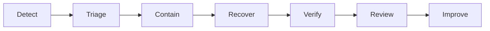

---

# 763. Incident Priority

Durante un incidente:

```text
restore safe service
```

puede tener prioridad sobre:

```text
finding the perfect root cause immediately.
```

---

# 764. Evidence Preservation

Pero debe preservarse suficiente evidencia para:

```text
later investigation.
```

---

# 765. Future Evolution — Postmortems

**Estado:** FUTURE / TARGET FOR SIGNIFICANT INCIDENTS

Los incidentes relevantes pueden producir:

```text
timeline

impact

root causes

contributing factors

recovery actions

follow-up actions.
```

---

# 766. Postmortem Principle

Debe centrarse en:

```text
system improvement.
```

---

# 767. Avoid

```text
individual blame.
```

---

# 768. Future Evolution — Runbooks

**Estado:** TARGET / EVOLVING  
**Horizonte:** NEAR / MEDIUM-TERM

Operaciones recurrentes deberían documentarse mediante:

```text
runbooks.
```

---

# 769. Candidate Runbooks

```text
deploy

rollback

database backup

database restore

attachment restore

certificate renewal

secret rotation

incident triage.
```

---

# 770. Runbook Principle

Un runbook debe ser:

```text
executable by another competent operator.
```

---

# 771. Future Evolution — Operational Ownership

Cada capability futura debería responder:

```text
Who owns it?

Who monitors it?

Who restores it?

Who updates it?
```

---

# 772. Ownership Principle

```text
If nobody can operate it,

it is not production-ready.
```

---

# 773. Future Evolution — Architecture Governance

**Estado:** CONTINUOUS

La evolución debe conservar:

```text
explicit architectural reasoning.
```

---

# 774. Governance Sources

```text
52_ARCHITECTURAL_DECISIONS.md

60_MAJOR_DECISIONS.md

57_PROJECT_EVOLUTION.md

59_IMPLEMENTATION_TIMELINE.md

62_FUTURE_EVOLUTION.md.
```

---

# 775. Governance Principle

Estos documentos deben permanecer:

```text
mutually consistent.
```

---

# 776. Architecture Decision Record

Las decisiones relevantes deberían capturar:

```text
context

problem

options

decision

status

consequences

evidence.
```

---

# 777. Decision Status

Puede utilizarse:

```text
PROPOSED

ACCEPTED

SUPERSEDED

REJECTED

DEFERRED

CONDITIONAL.
```

---

# 778. Decision Lifecycle

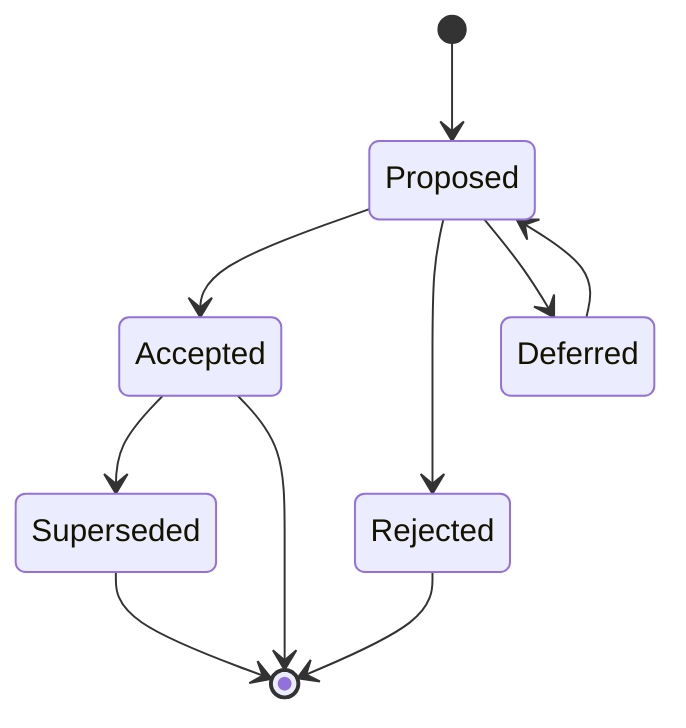

---

# 779. Accepted Does Not Mean Eternal

Una decisión aceptada puede cambiar cuando:

```text
requirements

evidence

constraints

or architecture
```

cambien.

---

# 780. Supersession Principle

No borrar la decisión antigua.

Registrar:

```text
what replaced it

why

when.
```

---

# 781. Historical Truth

Debe preservarse:

```text
what was actually implemented

at each stage.
```

---

# 782. Example

Si algún día PostgreSQL se adopta:

no reescribir:

```text
MariaDB was never current.
```

---

# 783. Correct History

Sería:

```text
MariaDB
    historical/current until migration

↓

PostgreSQL
    current after verified migration.
```

---

# 784. Future Evolution — Architecture Evidence

**Estado:** CONTINUOUS

Una afirmación arquitectónica debería apoyarse en:

```text
code

configuration

database schema

deployment configuration

tests

production behavior

explicit accepted decision.
```

---

# 785. Documentation Alone

No convierte una capacidad en:

```text
CURRENT.
```

---

# 786. Critical Rule

```text
Documented Future

≠

Implemented Present.
```

---

# 787. Future Evolution — Documentation Status Labels

Todo contenido sensible a temporalidad debería usar:

```text
CURRENT

PARTIAL

TARGET

PLANNED

FUTURE

CONDITIONAL

EXPERIMENTAL.
```

---

# 788. Benefit

Evita confundir:

```text
architecture description

with

architecture aspiration.
```

---

# 789. Future Evolution — Dependency Governance

**Estado:** CONTINUOUS

Dependencias nuevas deben evaluarse por:

```text
necessity

maintenance

security

community health

compatibility

operational impact.
```

---

# 790. Dependency Principle

```text
A dependency
must provide
more value than maintenance burden.
```

---

# 791. Avoid Dependency for Triviality

No añadir librerías para:

```text
small behavior
```

que puede implementarse:

```text
clearly and safely
```

sin ellas.

---

# 792. But

Tampoco reimplementar:

```text
security-critical standards

complex protocols

mature infrastructure primitives
```

sin necesidad.

---

# 793. Future Evolution — Upgrade Strategy

**Estado:** CONTINUOUS

Frameworks y librerías deben actualizarse mediante:

```text
incremental controlled upgrades.
```

---

# 794. Upgrade Flow

```text
Review

↓

Branch

↓

Update

↓

Automated Tests

↓

Manual Verification where needed

↓

Deploy

↓

Observe.
```

---

# 795. Major Upgrade

Debe revisar:

```text
breaking changes

security behavior

ORM behavior

template behavior

deployment behavior.
```

---

# 796. Future Evolution — Technical Debt Governance

**Estado:** CONTINUOUS

`56_TECHNICAL_DEBT.md` debe permanecer como:

```text
explicit debt register.
```

---

# 797. Technical Debt Is Not

```text
everything imperfect.
```

---

# 798. Debt Should Describe

```text
current limitation

impact

risk

desired correction

priority.
```

---

# 799. Debt Prioritization

Puede considerar:

```text
security risk

delivery friction

operational risk

defect probability

future blocking effect.
```

---

# 800. Security Debt

Debe recibir prioridad cuando:

```text
it affects actual attack surface.
```

---

# 801. Future Evolution — Deprecation Strategy

**Estado:** TARGET WHEN NEEDED  
**Horizonte:** MEDIUM-TERM

Cuando una capability sea sustituida debe existir:

```text
deprecation path.
```

---

# 802. Deprecation Flow

```text
Identify Replacement

↓

Mark Deprecated

↓

Migrate Consumers

↓

Verify No Remaining Use

↓

Remove.
```

---

# 803. Avoid Permanent Compatibility

No mantener indefinidamente:

```text
old and new behavior
```

sin necesidad.

---

# 804. Future API Deprecation

Si existen consumidores externos, puede requerir:

```text
notice period

version support

migration documentation.
```

---

# 805. Future Evolution — Feature Flags

**Estado:** CONDITIONAL  
**Horizonte:** MEDIUM-TERM

Feature flags pueden ayudar en:

```text
incremental rollout

risky migrations

experimental features.
```

---

# 806. But

Introducen:

```text
state combinations

testing complexity

cleanup requirements.
```

---

# 807. Feature Flag Principle

```text
Temporary flag

must have

an owner and removal condition.
```

---

# 808. Avoid Flag Graveyard

No mantener:

```text
obsolete flags
```

indefinidamente.

---

# 809. Future Evolution — Release Strategy

**Estado:** EVOLVING

La estrategia debe priorizar:

```text
small

reversible

observable releases.
```

---

# 810. Release Gate

Antes de desplegar:

```text
tests pass

configuration valid

migration understood

rollback understood

critical behavior verified.
```

---

# 811. Post-release Gate

Después:

```text
health

logs

errors

critical workflows

database state
```

deben verificarse.

---

# 812. Future Evolution — Database Release Safety

Cambios de schema deberían favorecer:

```text
backward-compatible sequencing
```

cuando:

```text
deployment topology
```

lo requiera.

---

# 813. Example Future Pattern

```text
Expand

↓

Deploy Compatible Application

↓

Migrate Data

↓

Contract.
```

---

# 814. Current Necessity

No toda migración actual necesita:

```text
multi-phase distributed deployment.
```

---

# 815. Principle

Aplicar complejidad de release:

```text
proportional to topology and risk.
```

---

# 816. Future Evolution — Rollback

**Estado:** TARGET

Rollback debe distinguir:

```text
application rollback

from

database rollback.
```

---

# 817. Database Reality

Algunas migraciones:

```text
cannot be safely reversed
after new writes.
```

---

# 818. Therefore

Rollback planning debe considerar:

```text
schema

data

application compatibility.
```

---

# 819. Future Evolution — Roadmap Horizons

La evolución puede organizarse en:

```text
Horizon A
    Consolidate

Horizon B
    Collaborate

Horizon C
    Expand Domains

Horizon D
    Add Advanced Capabilities

Horizon E
    Scale Conditionally.
```

---

# 820. Horizon A — Consolidate

Prioridades:

```text
ProjectMembership

Contextual Authorization

Cross-project Isolation

CSRF

Refresh-token Hardening

Cookie Policy Consistency

WebSocket Security

Subscription Authorization

Realtime Reliability

Testing

Observability

Backup / Restore.
```

---

# 821. Horizon A Architecture

Mantener:

```text
FastAPI

SQLAlchemy

MariaDB

Modular Monolith

Jinja2 SSR

Bootstrap

AdminLTE

Modular JavaScript

Docker Compose

Nginx

Ubuntu

Hetzner VPS.
```

---

# 822. Horizon B — Collaborate

Capacidades:

```text
Kanban

Authorized Status Mutation

Drag and Drop

Live Kanban

stronger Notifications

mature Activity Feed

multi-client Realtime.
```

---

# 823. Horizon B Infrastructure

No requiere automáticamente:

```text
PostgreSQL

Redis

Kubernetes

Microservices.
```

---

# 824. Horizon C — Expand Domains

Posibles dominios:

```text
Academic

Inventory

Reservations

Competition.
```

---

# 825. Horizon C Principle

Comenzar como:

```text
modules inside the Modular Monolith.
```

---

# 826. Horizon D — Advanced Capabilities

Podría incluir:

```text
PWA

external integrations

webhooks

background jobs

advanced search

analytics

AI / RAG.
```

---

# 827. Horizon D Gate

Solo incorporar capacidades con:

```text
validated product value.
```

---

# 828. Horizon E — Conditional Scale

Podría evaluar:

```text
PostgreSQL

Redis

Object Storage

Horizontal Scaling

Kubernetes

Microservices

Multi-tenancy

Multi-region.
```

---

# 829. Horizon E Principle

```text
Conditional Scale

is not

the inevitable destination.
```

---

# 830. Successful Future

Puede ser perfectamente:

```text
a well-operated Modular Monolith
on MariaDB
with Docker Compose
```

si satisface:

```text
product requirements

security

performance

availability

operability.
```

---

# 831. Future Evolution — Trigger Matrix

| Capability | Current Status | Trigger | Default Without Trigger |
|---|---|---|---|
| PostgreSQL | FUTURE / CONDITIONAL | Verified MariaDB limitation or required capability | Keep MariaDB |
| Redis | FUTURE / CONDITIONAL | Distributed coordination or another explicit Redis-shaped need | Keep current architecture |
| Object Storage | FUTURE / CONDITIONAL | Distributed/large-scale storage requirement | Keep persistent local storage |
| Kubernetes | FUTURE / CONDITIONAL | Orchestration complexity | Keep Docker Compose |
| Microservices | FUTURE / CONDITIONAL | Independent lifecycle/scaling/ownership | Keep Modular Monolith |
| PWA | FUTURE | Validated mobile/offline/installability need | Keep current web model |
| AI / RAG | FUTURE / EXPERIMENTAL | Validated AI use case | Do not introduce AI infrastructure |
| SAML | FUTURE / CONDITIONAL | Institutional federation requirement | Keep current authentication |
| OIDC | FUTURE / CONDITIONAL | External identity-provider requirement | Keep current authentication |
| Multi-tenancy | FUTURE / CONDITIONAL | Multiple isolated organizations | Keep current context model |
| Multi-region | FUTURE / CONDITIONAL | Geographic availability/latency/DR requirement | Keep current region |
| Horizontal Scaling | FUTURE / CONDITIONAL | Measured capacity/availability requirement | Keep current topology |

---

# 832. Security Trigger Matrix

| Capability | Status | Trigger |
|---|---|---|
| CSRF hardening | TARGET / PLANNED | Current cookie-authenticated browser surface |
| Cookie policy centralization | TARGET | Current policy inconsistency |
| Refresh-token rotation | VERIFY / HARDENING | Security lifecycle requirement |
| Server-side revocation | VERIFY / HARDENING | Session invalidation requirement |
| Reuse detection | FUTURE HARDENING | Stronger refresh-token compromise protection |
| Session/device management | FUTURE | User/admin session-management requirement |
| WebSocket subscription authorization | TARGET | Context-scoped realtime |
| Advanced upload scanning | CONDITIONAL | Upload threat profile |
| External policy engine | CONDITIONAL | Policy complexity beyond safe in-app management |

---

# 833. Realtime Trigger Matrix

| Capability | Status | Trigger |
|---|---|---|
| WebSockets | CURRENT | Already implemented |
| In-memory Connection Manager | CURRENT | Current single-instance topology |
| Canonical Event Contract | TARGET / IN PROGRESS | Realtime consistency |
| Reconnect | TARGET / IN PROGRESS | Connection failure recovery |
| Reconciliation | TARGET / IN PROGRESS | Missed-state recovery |
| Multi-client Tests | TARGET | Collaboration maturity |
| Redis / Broker | CONDITIONAL | Multi-instance realtime coordination |
| Durable Replay | CONDITIONAL | Refetch reconciliation becomes insufficient |

---

# 834. Persistence Trigger Matrix

| Capability | Status | Trigger |
|---|---|---|
| MariaDB | CURRENT | Current authoritative relational database |
| SQLAlchemy | CURRENT | Current persistence abstraction |
| Query Optimization | TARGET / CONTINUOUS | Measured query cost |
| Additional Indexes | TARGET / CONTINUOUS | Query-plan evidence |
| Read Replica | CONDITIONAL | Measured read pressure |
| Partitioning | CONDITIONAL | Large-table evidence |
| Archival | CONDITIONAL | Retention/volume requirement |
| PostgreSQL | FUTURE / CONDITIONAL | Verified engine-level requirement |

---

# 835. Deployment Trigger Matrix

| Capability | Status | Trigger |
|---|---|---|
| Docker | CURRENT | Current deployment |
| Docker Compose | CURRENT | Current orchestration need |
| Nginx | CURRENT | Current reverse-proxy layer |
| Ubuntu | CURRENT | Current host OS |
| Hetzner VPS | CURRENT | Current hosting |
| Horizontal Scaling | CONDITIONAL | Capacity/availability |
| Load Balancer | CONDITIONAL | Multiple instances |
| Kubernetes | CONDITIONAL | Complex orchestration |
| Multi-region | CONDITIONAL | Geographic/DR requirement |

---

# 836. Product Evolution Matrix

| Capability | Status |
|---|---|
| Projects | CURRENT |
| Tasks | CURRENT |
| Activities | CURRENT |
| Attachments | CURRENT |
| Notifications | CURRENT |
| Dashboard | CURRENT |
| Activity Feed | CURRENT |
| Audit | CURRENT |
| Kanban | PLANNED |
| Drag and Drop | PLANNED |
| Live Kanban | PLANNED |
| Academic | FUTURE |
| Inventory | FUTURE |
| Reservations | FUTURE |
| Competition | FUTURE |
| PWA | FUTURE |
| AI / RAG | FUTURE / EXPERIMENTAL |

---

# 837. Identity Evolution Matrix

| Capability | Status |
|---|---|
| JWT Access Token | CURRENT |
| JWT Refresh Token | CURRENT |
| HTTPOnly Access Cookie | CURRENT |
| HTTPOnly Refresh Cookie | CURRENT |
| Explicit `/refresh` | CURRENT |
| Automatic Access Refresh | CURRENT |
| Logout Token Cleanup | CURRENT |
| Global RBAC | CURRENT |
| Contextual Authorization | PARTIAL |
| ProjectMembership | TARGET / IN CONSOLIDATION |
| SAML | FUTURE / CONDITIONAL |
| OIDC | FUTURE / CONDITIONAL |
| Account Linking | FUTURE |
| Session/Device Management | FUTURE |

---

# 838. Infrastructure Evolution Matrix

| Layer | CURRENT | FUTURE / CONDITIONAL |
|---|---|---|
| Application | Modular Monolith | Microservices |
| Database | MariaDB | PostgreSQL |
| ORM | SQLAlchemy | Re-evaluate only if architecture changes |
| Realtime | FastAPI WebSockets | Distributed Realtime |
| Realtime Coordination | In-memory | Redis / Broker |
| File Storage | Persistent Local Storage | Object Storage |
| Containers | Docker | — |
| Orchestration | Docker Compose | Kubernetes |
| Reverse Proxy | Nginx | Re-evaluate if topology changes |
| Hosting | Ubuntu / Hetzner VPS | Multi-node / Multi-region |
| UI | Jinja2 SSR + Bootstrap/AdminLTE | PWA enhancement |
| Intelligence | None as architectural authority | AI / RAG experimental |

---

# 839. Architecture Maturity Matrix

```text
CURRENT
    FastAPI
    SQLAlchemy
    MariaDB
    Modular Monolith
    JWT Access + Refresh
    HTTPOnly Cookies
    Explicit Refresh
    Automatic Access Refresh
    Global RBAC
    Jinja2 SSR
    Bootstrap
    AdminLTE
    Modular JavaScript
    WebSockets
    In-memory Connection Manager
    Projects
    Tasks
    Activities
    Attachments
    Notifications
    Dashboard
    Activity Feed
    Audit
    Docker
    Docker Compose
    Nginx
    Ubuntu
    Hetzner VPS
    GitHub Actions
    Automated Testing
    Persistent Local Attachment Storage.
```

---

# 840. PARTIAL / EVOLVING

```text
Contextual Authorization

ProjectMembership consolidation

WebSocket security hardening

Realtime event consistency

Reconnect

Reconciliation

Testing coverage

Observability

Monitoring

Deployment maturity

Backup / Restore maturity.
```

---

# 841. TARGET / PLANNED

```text
Formal CSRF Protection

Cookie Policy Centralization

Refresh-token Security Hardening

Cross-project Authorization Tests

WebSocket Subscription Authorization

Canonical Event Contract

Reliable Reconnect

State Reconciliation

SSR Kanban

Authorized Kanban Mutations

Drag and Drop

Live Kanban

Operational Recovery Maturity.
```

---

# 842. FUTURE

```text
Academic Domain

Inventory Domain

Reservations Domain

Competition Management

PWA

Offline Capabilities

Push Notifications

Advanced Integrations

External API Productization

Webhooks

Advanced Search

Analytics

AI / RAG

SAML

OIDC

Session / Device Management.
```

---

# 843. CONDITIONAL

```text
PostgreSQL

Redis

Object Storage

Background-job Infrastructure

Distributed Cache

Read Replicas

Partitioning

Horizontal Scaling

Load Balancing

Kubernetes

Microservices

Multi-tenancy

Multi-region

Distributed Tracing

External Policy Engine.
```

---

# 844. Future Evolution — Explicit Non-goals

La arquitectura futura no tiene como objetivo:

```text
maximize technology count.
```

---

# 845. Non-goal — Microservices by Default

```text
Microservices everywhere
```

no es un objetivo.

---

# 846. Non-goal — Kubernetes by Default

```text
Kubernetes adoption
```

no es un objetivo independiente.

---

# 847. Non-goal — PostgreSQL Standardization

No existe como objetivo actual:

```text
standardize on PostgreSQL.
```

---

# 848. Persistence Goal

El objetivo es:

```text
reliable relational persistence.
```

Actualmente:

```text
MariaDB.
```

---

# 849. Non-goal — Redis Everywhere

Redis no debe convertirse en:

```text
default answer
for caching,
realtime,
jobs,
sessions
and locks.
```

---

# 850. Non-goal — SPA Rewrite

No existe necesidad arquitectónica establecida de sustituir:

```text
Jinja2 SSR
```

por:

```text
large SPA framework.
```

---

# 851. Non-goal — AI Everywhere

AI no debe añadirse a:

```text
every workflow.
```

---

# 852. AI Goal

Si se adopta:

```text
solve specific validated user problems.
```

---

# 853. Non-goal — Offline Everything

PWA no implica:

```text
full offline platform.
```

---

# 854. Non-goal — Event-driven Everything

Realtime y futuros eventos no implican:

```text
event-driven architecture
for every operation.
```

---

# 855. Non-goal — Distributed Everything

Horizontal scaling no implica automáticamente:

```text
microservices

Kubernetes

distributed database

distributed cache.
```

---

# 856. Non-goal — Premature Multi-tenancy

No añadir:

```text
tenant abstraction
```

sin:

```text
tenant product requirement.
```

---

# 857. Non-goal — Perfect Generic Abstractions

No construir anticipadamente:

```text
universal storage layer

universal auth provider layer

universal event bus

universal repository framework

universal AI provider platform.
```

---

# 858. Prefer

```text
small abstractions
around real variation points.
```

---

# 859. Future Evolution — Rejected Evolution Pattern

Evitar:

```text
Possible Future Requirement

↓

Immediate Abstraction

↓

Immediate Infrastructure

↓

Permanent Complexity.
```

---

# 860. Preferred Evolution Pattern

```text
Possible Future Requirement

↓

Wait for Evidence

↓

Validate Requirement

↓

Evaluate Options

↓

Implement Minimum Suitable Change

↓

Measure

↓

Evolve Further if Needed.
```

---

# 861. Future Evolution — Architecture Invariants

Las siguientes reglas deben sobrevivir a futuras evoluciones.

---

# 862. Invariant 1

```text
Persistent state
is authoritative.
```

---

# 863. Invariant 2

```text
Realtime events
are not authoritative persistence.
```

---

# 864. Invariant 3

```text
Authentication

≠

Authorization.
```

---

# 865. Invariant 4

```text
Global role

≠

context permission.
```

---

# 866. Invariant 5

```text
Resource identifier knowledge

≠

resource access.
```

---

# 867. Invariant 6

```text
Frontend visibility

≠

security enforcement.
```

---

# 868. Invariant 7

```text
Authorization
must protect mutations
at the server.
```

---

# 869. Invariant 8

```text
Persistence first.

Broadcast second.
```

---

# 870. Invariant 9

```text
Audit

≠

Activity Feed.
```

---

# 871. Invariant 10

```text
Notification

≠

delivery channel.
```

---

# 872. Invariant 11

```text
External identity

≠

business identity.
```

---

# 873. Invariant 12

```text
Future architecture

≠

current architecture.
```

---

# 874. Invariant 13

```text
Evaluation

≠

adoption.
```

---

# 875. Invariant 14

```text
Documentation

≠

implementation evidence.
```

---

# 876. Invariant 15

```text
Scaling

must follow

measured need.
```

---

# 877. Invariant 16

```text
Complexity

must earn its place.
```

---

# 878. Invariant 17

```text
Recovery capability

must be tested.
```

---

# 879. Invariant 18

```text
Authorization changes

must invalidate assumptions
made by clients and caches.
```

---

# 880. Invariant 19

```text
AI output

must not become

authoritative application state
without explicit validated mutation.
```

---

# 881. Invariant 20

```text
Historical truth

must not be rewritten
to match future architecture.
```

---

# 882. Future Evolution — Decision Checklist

Antes de introducir una nueva tecnología:

```text
[ ] Is there a validated problem?

[ ] Is the problem measured?

[ ] Can the current architecture solve it?

[ ] What alternatives exist?

[ ] What complexity is introduced?

[ ] What failure modes are introduced?

[ ] How is it secured?

[ ] How is it tested?

[ ] How is it observed?

[ ] How is it backed up?

[ ] How is it restored?

[ ] How is it deployed?

[ ] How is it rolled back?

[ ] Who operates it?

[ ] Can it be removed?
```

---

# 883. Future Domain Checklist

Antes de introducir un nuevo dominio:

```text
[ ] What business problem does it solve?

[ ] What are its entities?

[ ] What are its invariants?

[ ] Who owns its data?

[ ] What is its authorization context?

[ ] What transactions exist?

[ ] What must be audited?

[ ] What events are useful?

[ ] Which existing platform capabilities can be reused?

[ ] Which dependencies must remain one-way?
```

---

# 884. Future Realtime Checklist

Antes de ampliar realtime:

```text
[ ] Is persistent state authoritative?

[ ] Is subscription authorization explicit?

[ ] Is the event contract stable?

[ ] Can duplicate events be tolerated?

[ ] Can disconnects be recovered?

[ ] Can state be reconciled?

[ ] Are multiple clients tested?

[ ] Is distributed coordination actually necessary?
```

---

# 885. Future AI Checklist

Antes de adoptar AI:

```text
[ ] Is there a validated user problem?

[ ] Is AI actually necessary?

[ ] What data is exposed?

[ ] Is retrieval authorization-aware?

[ ] Are privacy boundaries defined?

[ ] Are outputs advisory or authoritative?

[ ] Are mutations independently authorized?

[ ] Can errors be detected?

[ ] Is cost measurable?

[ ] Is value measurable?
```

---

# 886. Future Scale Checklist

Antes de escalar horizontalmente:

```text
[ ] Is the bottleneck measured?

[ ] Have queries been optimized?

[ ] Has vertical scaling been considered?

[ ] Is process-local state identified?

[ ] Is file storage topology understood?

[ ] Is realtime distribution understood?

[ ] Are jobs/schedulers coordinated?

[ ] Is observability sufficient?

[ ] Is rollback possible?
```

---

# 887. Future Database Migration Checklist

Antes de considerar PostgreSQL:

```text
[ ] Is there a verified MariaDB limitation?

[ ] Is PostgreSQL the best solution?

[ ] Have alternatives been evaluated?

[ ] Are SQLAlchemy models compatible?

[ ] Are migrations compatible?

[ ] Are SQL queries compatible?

[ ] Are constraints compatible?

[ ] Are indexes compatible?

[ ] Is representative migration testing available?

[ ] Is backup verified?

[ ] Is restore verified?

[ ] Is rollback defined?

[ ] Is production cutover defined?
```

---

# 888. Future Multi-tenancy Checklist

Antes de introducir multi-tenancy:

```text
[ ] Is there a real multi-organization product requirement?

[ ] What is a tenant?

[ ] How does a user belong to a tenant?

[ ] Can a user belong to multiple tenants?

[ ] How are projects scoped?

[ ] How are queries isolated?

[ ] How are constraints tenant-aware?

[ ] How are attachments isolated?

[ ] How is realtime isolated?

[ ] How is audit isolated?

[ ] How is AI retrieval isolated?

[ ] How are backup and restore scoped?
```

---

# 889. Future Evolution — Architecture Review Cadence

La arquitectura debería revisarse:

```text
when meaningful evidence changes.
```

---

# 890. Review Triggers

```text
major product domain

security incident

significant load increase

new deployment topology

new external integration

new regulatory requirement

persistent operational problem

major technology limitation.
```

---

# 891. Avoid Calendar-driven Reinvention

No rediseñar la arquitectura cada:

```text
quarter
```

solo porque:

```text
architecture review is scheduled.
```

---

# 892. Review Outcome Options

Una revisión puede concluir:

```text
KEEP

HARDEN

SIMPLIFY

EVOLVE

REPLACE

DEFER.
```

---

# 893. KEEP

```text
Current architecture remains appropriate.
```

---

# 894. HARDEN

```text
Architecture is appropriate,
but guarantees need strengthening.
```

---

# 895. SIMPLIFY

```text
Existing complexity
no longer provides sufficient value.
```

---

# 896. EVOLVE

```text
Incremental architecture change
is justified.
```

---

# 897. REPLACE

```text
Current solution
no longer satisfies
critical requirements.
```

---

# 898. DEFER

```text
Potential change exists,
but evidence is insufficient.
```

---

# 899. Future Evolution — Preferred Decision Bias

Cuando varias soluciones cumplen:

```text
requirements
```

preferir:

```text
simpler

more understandable

more testable

more recoverable

more operable.
```

---

# 900. Future Evolution — Architecture Quality

La calidad arquitectónica no debe medirse por:

```text
number of services

number of databases

number of cloud products

number of patterns

number of technologies.
```

---

# 901. Measure Instead

```text
correctness

security

maintainability

delivery speed

reliability

recoverability

operability

fitness for product needs.
```

---

# 902. Future Evolution — Current Baseline Snapshot

```text
Application:
    FastAPI

Architecture:
    Modular Monolith

Persistence:
    SQLAlchemy
    MariaDB

Authentication:
    JWT Access + Refresh
    HTTPOnly Cookies
    Explicit Refresh
    Automatic Access Refresh

Authorization:
    Global RBAC
    Partial Contextual Authorization

Frontend:
    Jinja2 SSR
    Bootstrap
    AdminLTE
    Modular JavaScript

Realtime:
    FastAPI WebSockets
    In-memory Connection Manager

Storage:
    Persistent Local Attachment Storage

Deployment:
    Docker
    Docker Compose
    Nginx
    Ubuntu
    Hetzner VPS

CI:
    GitHub Actions

Testing:
    Automated Testing
    with expanding coverage.
```

---

# 903. Future Evolution — Active Consolidation Snapshot

```text
ProjectMembership

Contextual Authorization

Cross-project Isolation

CSRF Protection

Refresh-token Security Hardening

Cookie Policy Consistency

WebSocket Authentication Hardening

WebSocket Subscription Authorization

Realtime Event Contract

Reconnect

Reconciliation

Testing Expansion

Observability

Backup / Restore Validation.
```

---

# 904. Future Evolution — Planned Product Snapshot

```text
Kanban

Authorized Task Status Mutation

Drag and Drop

Realtime Kanban

Live Kanban.
```

---

# 905. Future Evolution — Future Product Snapshot

```text
Academic

Inventory

Reservations

Competition

PWA

Advanced Notifications

Advanced Search

Analytics

External Integrations

AI / RAG.
```

---

# 906. Future Evolution — Conditional Architecture Snapshot

```text
PostgreSQL

Redis

Object Storage

Background-job Infrastructure

Distributed Cache

Horizontal Scaling

Load Balancing

Kubernetes

Microservices

Multi-tenancy

Multi-region.
```

---

# 907. Current vs Future — Database

```text
CURRENT:
    MariaDB

FUTURE / CANDIDATE / CONDITIONAL:
    PostgreSQL.
```

---

# 908. Current vs Future — Identity

```text
CURRENT:
    JWT Access + Refresh

FUTURE / CONDITIONAL:
    SAML
    OIDC.
```

---

# 909. Current vs Future — Authorization

```text
CURRENT:
    Global RBAC

PARTIAL:
    Contextual Authorization

TARGET:
    Mature ProjectMembership
    Context Policies
    Nested-resource Authorization.
```

---

# 910. Current vs Future — Realtime

```text
CURRENT:
    FastAPI WebSockets
    In-memory Connection Manager

TARGET:
    Subscription Authorization
    Event Contract
    Reconnect
    Reconciliation

CONDITIONAL:
    Redis / Broker
    Distributed Realtime.
```

---

# 911. Current vs Future — Storage

```text
CURRENT:
    Persistent Local Attachment Storage

FUTURE / CONDITIONAL:
    Object Storage.
```

---

# 912. Current vs Future — Deployment

```text
CURRENT:
    Docker
    Docker Compose
    Nginx
    Ubuntu
    Hetzner VPS

FUTURE / CONDITIONAL:
    Horizontal Scaling
    Kubernetes
    Multi-region.
```

---

# 913. Current vs Future — Application Architecture

```text
CURRENT:
    Modular Monolith

FUTURE / CONDITIONAL:
    Microservices.
```

---

# 914. Current vs Future — Frontend

```text
CURRENT:
    Jinja2 SSR
    Bootstrap
    AdminLTE
    Modular JavaScript

PLANNED:
    richer Kanban interaction

FUTURE:
    PWA capabilities.
```

---

# 915. Current vs Future — Intelligence

```text
CURRENT:
    no AI architectural authority

FUTURE / EXPERIMENTAL:
    AI
    RAG
    semantic retrieval.
```

---

# 916. Current vs Future — Tenancy

```text
CURRENT:
    project-oriented collaboration

FUTURE / CONDITIONAL:
    Multi-tenancy.
```

---

# 917. Important Distinction

```text
Project

≠

Tenant.
```

---

# 918. Another Important Distinction

```text
Project Membership

≠

Tenant Membership.
```

---

# 919. Future Evolution — Long-term Architecture Possibility

Si múltiples triggers aparecen en el futuro, una posible arquitectura podría evolucionar hacia:

```text
Load Balancer

↓

Multiple Application Instances

↓

Shared Relational Persistence

↓

Distributed Realtime Coordination

↓

Object Storage

↓

Background Workers

↓

External Integrations.
```

---

# 920. Possible Long-term Diagram

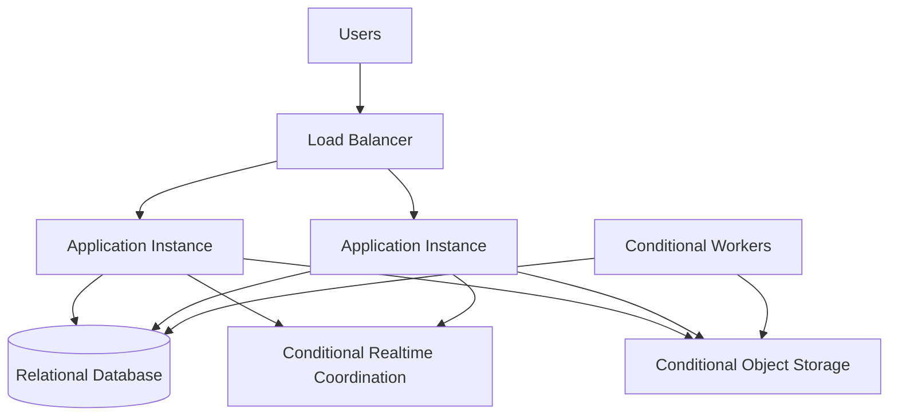

---

# 921. Diagram Status

El diagrama anterior representa:

```text
a conditional future topology.
```

---

# 922. It Does Not Represent

```text
current deployment.
```

---

# 923. Current Deployment Remains

```text
Docker

Docker Compose

Nginx

Ubuntu

Hetzner VPS.
```

---

# 924. Future Evolution — Even Longer-term Possibility

Solo si el producto, escala y organización lo justificaran:

```text
selected modules
```

podrían convertirse en:

```text
independently deployable services.
```

---

# 925. But

La evolución preferida es:

```text
Modular Monolith

↓

Stronger Module Boundaries

↓

Measured Pressure

↓

Selective Extraction.
```

---

# 926. Not

```text
Modular Monolith

↓

Rewrite Everything as Microservices.
```

---

# 927. Future Evolution — Architecture Exit Criteria

Una tecnología actual debería sustituirse únicamente cuando:

```text
its limitations materially prevent
required product or operational outcomes.
```

---

# 928. MariaDB Exit Criterion

```text
verified persistence requirement
that MariaDB cannot satisfy sufficiently.
```

---

# 929. In-memory Realtime Exit Criterion

```text
multiple application instances

+

required cross-instance realtime coordination.
```

---

# 930. Local Storage Exit Criterion

```text
storage topology or scale
requires shared/distributed storage.
```

---

# 931. Docker Compose Exit Criterion

```text
deployment topology
exceeds what Compose can operate safely
for actual requirements.
```

---

# 932. Modular Monolith Exit Criterion

```text
specific bounded capability
requires independent lifecycle
strong enough to justify distribution.
```

---

# 933. SSR Exit Criterion

No existe un objetivo de eliminar SSR.

Una capability frontend distinta solo debería aparecer si:

```text
specific UX requirements
cannot be satisfied appropriately
with current progressive enhancement.
```

---

# 934. Future Evolution — Success Criteria

La evolución será correcta si permite:

```text
more capability

without losing

security

correctness

clarity

recoverability

operability.
```

---

# 935. Failure Pattern

Una evolución es sospechosa si produce:

```text
more infrastructure

more dependencies

more failure modes

more operational work
```

sin:

```text
clear user or system benefit.
```

---

# 936. Future Evolution — Platform-first Reuse

Los futuros dominios deberían reutilizar capacidades compartidas:

```text
Identity

Authorization

Audit

Notifications

Attachments

Realtime

Operational Infrastructure.
```

---

# 937. But

La reutilización debe producir:

```text
platform capabilities.
```

---

# 938. Not

```text
one giant shared module
containing unrelated domain logic.
```

---

# 939. Future Evolution — Domain Autonomy

Cada dominio futuro debe preservar:

```text
its own invariants

its own vocabulary

its own lifecycle.
```

---

# 940. Shared Platform Boundary

```text
Platform Capability

supports

Domain Capability.
```

---

# 941. Not

```text
Platform Capability

owns every domain rule.
```

---

# 942. Future Evolution — Product Evidence

La arquitectura futura debe seguir:

```text
actual product learning.
```

---

# 943. Example

Si usuarios no necesitan:

```text
offline workflows,
```

entonces:

```text
offline synchronization architecture
```

no aporta valor.

---

# 944. Example

Si una única instancia soporta:

```text
actual realtime load,
```

entonces:

```text
Redis coordination
```

no es necesaria.

---

# 945. Example

Si MariaDB satisface:

```text
actual persistence requirements,
```

entonces:

```text
PostgreSQL migration
```

no es necesaria.

---

# 946. Example

Si el Modular Monolith permite:

```text
safe independent module evolution,
```

entonces:

```text
microservice extraction
```

no es necesaria.

---

# 947. Future Evolution — Evidence Hierarchy

Para decisiones futuras, priorizar:

```text
Production Evidence

↓

Measured Tests

↓

Code / Configuration Evidence

↓

Validated Product Requirement

↓

Prototype Evidence

↓

Reasoned Hypothesis

↓

Speculation.
```

---

# 948. Speculation Rule

La especulación puede:

```text
generate questions.
```

---

# 949. It Must Not

```text
rewrite architecture status.
```

---

# 950. Future Evolution — Documentation Discipline

Cuando una capability pase de:

```text
FUTURE

to

PLANNED
```

debe actualizarse:

```text
roadmap

status

dependencies

decision records.
```

---

# 951. When It Becomes Implemented

Al pasar a:

```text
CURRENT
```

deben existir:

```text
implementation evidence

tests

operational evidence where applicable.
```

---

# 952. When Rejected

Debe registrarse como:

```text
REJECTED
```

o:

```text
DEFERRED
```

sin borrar:

```text
historical reasoning.
```

---

# 953. Future Evolution — Cross-document Consistency

Los siguientes documentos deben permanecer alineados:

```text
47_PRODUCT_ROADMAP.md

48_PRODUCT_VISION.md

49_FEATURE_BACKLOG.md

52_ARCHITECTURAL_DECISIONS.md

53_CURRENT_TASKS.md

54_KNOWN_ISSUES.md

55_CHANGELOG.md

56_TECHNICAL_DEBT.md

57_PROJECT_EVOLUTION.md

58_TECHNICAL_CHALLENGES.md

59_IMPLEMENTATION_TIMELINE.md

60_MAJOR_DECISIONS.md

61_LESSONS_LEARNED.md

62_FUTURE_EVOLUTION.md.
```

---

# 954. Consistency Rule

Si un documento afirma:

```text
PostgreSQL = CURRENT
```

mientras la implementación sigue en:

```text
MariaDB,
```

la documentación está:

```text
temporally inconsistent.
```

---

# 955. Same Rule for SAML

No documentar:

```text
SAML = CURRENT
```

mientras siga:

```text
FUTURE / NOT IMPLEMENTED.
```

---

# 956. Same Rule for Redis

No documentar:

```text
Redis = CURRENT
```

mientras realtime siga basado en:

```text
In-memory Connection Manager.
```

---

# 957. Same Rule for Kubernetes

No documentar:

```text
Kubernetes = CURRENT
```

mientras deployment siga basado en:

```text
Docker Compose.
```

---

# 958. Same Rule for Microservices

No describir:

```text
microservice architecture
```

cuando la arquitectura sigue siendo:

```text
Modular Monolith.
```

---

# 959. Same Rule for Refresh Tokens

No describir:

```text
refresh-token workflow
```

como futuro.

Es:

```text
CURRENT.
```

---

# 960. Refresh Hardening Distinction

Lo futuro o pendiente es:

```text
rotation

revocation hardening

reuse detection

session/device management.
```

---

# 961. Future Evolution — Final Priority Order

La evolución debería priorizar:

```text
1. Correctness

2. Authorization

3. Browser Security

4. Realtime Security

5. Realtime Reliability

6. Testing

7. Recoverability

8. Observability

9. Product Collaboration

10. Domain Expansion

11. Advanced Capabilities

12. Conditional Scale.
```

---

# 962. Why This Order

Porque:

```text
scale

does not repair

incorrect authorization.
```

---

# 963. And

```text
microservices

do not repair

missing recovery procedures.
```

---

# 964. And

```text
Kubernetes

does not repair

weak tests.
```

---

# 965. And

```text
PostgreSQL

does not repair

incorrect domain invariants.
```

---

# 966. And

```text
Redis

does not repair

an undefined realtime contract.
```

---

# 967. And

```text
AI

does not repair

unclear product requirements.
```

---

# 968. Future Evolution — Architecture North Star

La arquitectura debe permanecer:

```text
secure

modular

understandable

testable

recoverable

observable

incrementally evolvable.
```

---

# 969. North Star Does Not Mean

```text
maximum distribution.
```

---

# 970. It Means

```text
maximum fitness
for validated requirements
with controlled complexity.
```

---

# 971. Future Evolution — Final CURRENT Register

```text
FastAPI

SQLAlchemy

MariaDB

Modular Monolith

JWT Access Token

JWT Refresh Token

Access + Refresh Cookies

HTTPOnly Cookies

Explicit /refresh

Automatic Access Refresh

Refresh-token Validation

Logout Token Cleanup

Global RBAC

Jinja2 SSR

Bootstrap

AdminLTE

Modular JavaScript

FastAPI WebSockets

In-memory Connection Manager

Projects

Tasks

Activities

Attachments

Persistent Local Attachment Storage

Notifications

Dashboard

Activity Feed

Audit

Docker

Docker Compose

Nginx

Ubuntu

Hetzner VPS

GitHub Actions

Automated Testing.
```

---

# 972. Final PARTIAL Register

```text
Contextual Authorization

ProjectMembership maturity

Session hardening

Realtime hardening

Reconnect / Reconciliation maturity

Testing coverage

Monitoring

Observability

Operational maturity.
```

---

# 973. Final TARGET / PLANNED Register

```text
ProjectMembership consolidation

Contextual Authorization Policies

Cross-project Authorization Tests

Formal CSRF Protection

Refresh-token Security Hardening

Cookie Policy Consistency

WebSocket Authentication Hardening

WebSocket Subscription Authorization

Canonical Realtime Event Contract

Reconnect Strategy

State Reconciliation

Kanban

Authorized Status Mutation

Drag and Drop

Live Kanban

Backup / Restore Validation.
```

---

# 974. Final FUTURE Register

```text
Academic

Inventory

Reservations

Competition Management

PWA

Offline Capabilities

Push Notifications

Advanced Notification Preferences

External API Productization

Webhooks

Advanced Search

Analytics

SAML

OIDC

Session / Device Management

AI

RAG.
```

---

# 975. Final CONDITIONAL Register

```text
PostgreSQL

Redis

Object Storage

Background-job Infrastructure

Distributed Cache

External Policy Engine

Read Replicas

Partitioning

Horizontal Scaling

Load Balancing

Kubernetes

Microservices

Multi-tenancy

Multi-region

Distributed Tracing.
```

---

# 976. Final Persistence Statement

```text
MariaDB

is the current
authoritative relational database.
```

---

# 977. PostgreSQL Statement

```text
PostgreSQL

is a future candidate
that may be evaluated
only if explicit requirements justify it.
```

---

# 978. No Migration Statement

```text
No completed MariaDB → PostgreSQL migration
is part of the current platform history.
```

---

# 979. Final Authentication Statement

```text
JWT Access + Refresh

with HTTPOnly Cookies,

explicit refresh,

and automatic access-token refresh

are current capabilities.
```

---

# 980. Authentication Hardening Statement

```text
Rotation

server-side revocation

reuse detection

and session/device management
```

belong to:

```text
hardening or future evolution,
not initial refresh-token implementation.
```

---

# 981. Final Authorization Statement

```text
Global RBAC

is current.

Contextual Authorization

is partial and evolving.

ProjectMembership

is a key consolidation target.
```

---

# 982. Final SAML Statement

```text
SAML

is FUTURE / CONDITIONAL

and

NOT CURRENT.
```

---

# 983. Final Realtime Statement

```text
FastAPI WebSockets

+

In-memory Connection Manager

are current.
```

---

# 984. Realtime Future Statement

```text
Distributed Realtime

+

Redis / Broker

remain conditional.
```

---

# 985. Final Storage Statement

```text
Persistent Local Attachment Storage

is current.
```

---

# 986. Storage Future Statement

```text
Object Storage

remains future / conditional.
```

---

# 987. Final Deployment Statement

```text
Docker

Docker Compose

Nginx

Ubuntu

Hetzner VPS

represent the current deployment baseline.
```

---

# 988. Kubernetes Statement

```text
Kubernetes

is future / conditional

and

not current.
```

---

# 989. Final Architecture Statement

```text
Modular Monolith

is the current application architecture.
```

---

# 990. Microservices Statement

```text
Microservices

remain conditional

and require explicit extraction triggers.
```

---

# 991. Final Product Evolution Statement

```text
Kanban

is the next major planned
collaboration evolution.
```

---

# 992. Future Domain Statement

```text
Academic

Inventory

Reservations

Competition
```

remain:

```text
future domains.
```

---

# 993. Future Intelligence Statement

```text
AI / RAG

remain future / experimental capabilities.
```

---

# 994. Final Evolution Rule

```text
Do not introduce
future architecture

to solve

imagined problems.
```

---

# 995. Final Evidence Rule

```text
Verify the need.

Verify the limitation.

Evaluate alternatives.

Make the decision explicit.

Implement incrementally.

Test.

Observe.

Document what actually happened.
```

---

# 996. Final Complexity Rule

```text
Complexity is not maturity.
```

---

# 997. Final Scalability Rule

```text
Scale when evidence requires scaling.
```

---

# 998. Final Historical Rule

```text
Preserve historical truth.

Never rewrite the past
to make the future
look inevitable.
```

---

# 999. Final Evolution Principle

```text
Consolidate what exists.

Harden what is incomplete.

Build what users need.

Measure what becomes constrained.

Evolve only when evidence justifies it.
```

---

# 1000. Final Status

```text
62_FUTURE_EVOLUTION.md

Status:
    AUDITED / TEMPORALLY ALIGNED

Current Database:
    MariaDB

Future Database Candidate:
    PostgreSQL
    CONDITIONAL

Current Architecture:
    Modular Monolith

Future Distribution:
    Microservices
    CONDITIONAL

Current Authentication:
    JWT Access + Refresh
    HTTPOnly Cookies
    Explicit + Automatic Refresh

Authentication Hardening:
    Rotation
    Revocation
    Reuse Detection
    Session / Device Management

Current Authorization:
    Global RBAC
    + Partial Contextual Authorization

Authorization Evolution:
    ProjectMembership
    Context Policies
    Nested-resource Authorization
    Cross-project Isolation

Federated Identity:
    SAML / OIDC
    FUTURE / CONDITIONAL

Current Realtime:
    FastAPI WebSockets
    + In-memory Connection Manager

Realtime Evolution:
    Subscription Authorization
    Event Contract
    Reconnect
    Reconciliation

Distributed Realtime:
    Redis / Broker
    CONDITIONAL

Current Storage:
    Persistent Local Attachment Storage

Future Storage:
    Object Storage
    CONDITIONAL

Current Deployment:
    Docker
    Docker Compose
    Nginx
    Ubuntu
    Hetzner VPS

Future Orchestration:
    Kubernetes
    CONDITIONAL

Planned Product Evolution:
    Kanban
    Drag and Drop
    Live Kanban

Future Domains:
    Academic
    Inventory
    Reservations
    Competition

Future Advanced Capabilities:
    PWA
    Integrations
    Analytics
    AI / RAG

Conditional Scale:
    PostgreSQL
    Redis
    Object Storage
    Horizontal Scaling
    Kubernetes
    Microservices
    Multi-tenancy
    Multi-region

Core Principle:
    Preserve current truth.

    Consolidate before expanding.

    Measure before scaling.

    Evaluate before adopting.

    Introduce complexity
    only when validated requirements
    justify it.
```
