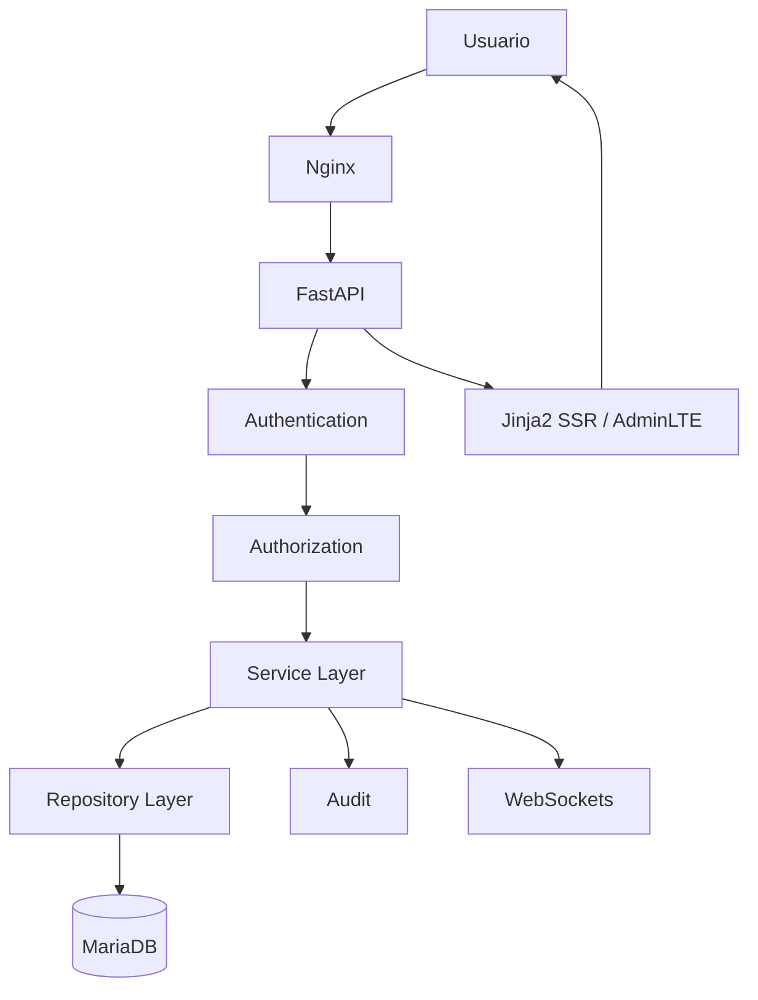

# README_USO_RAPIDO.md

# 🤖 Aula Robótica Platform — Guía de Uso Rápido

---

# 1. Introducción

Aula Robótica Platform es una plataforma web colaborativa desarrollada para la gestión del Aula de Robótica de la Escuela Politécnica Superior de la Universidad de Alcalá.

La plataforma centraliza capacidades relacionadas con:

* gestión de usuarios e identidades;
* autenticación y autorización;
* control de acceso basado en roles;
* gestión colaborativa de proyectos;
* gestión de tareas;
* actividades;
* archivos adjuntos;
* notificaciones;
* auditoría;
* dashboard;
* feed de actividad;
* comunicación realtime mediante WebSockets.

La arquitectura actual está basada principalmente en:

```text
FastAPI

+

SQLAlchemy

+

MariaDB

+

Jinja2 SSR

+

Bootstrap / AdminLTE

+

Modular JavaScript

+

JWT Access + Refresh Tokens

+

HTTPOnly Cookies

+

WebSockets.
```

A nivel arquitectónico, Aula Robótica Platform sigue actualmente un modelo:

```text
Modular Monolith.
```

Este modelo permite mantener una arquitectura modular y preparada para evolucionar sin introducir prematuramente complejidad distribuida.

---

# 2. Estado arquitectónico rápido

La arquitectura actual puede resumirse mediante:

| Capacidad | Estado |
|---|---|
| FastAPI | CURRENT |
| SQLAlchemy | CURRENT |
| MariaDB | CURRENT |
| Jinja2 SSR | CURRENT |
| Bootstrap / AdminLTE | CURRENT |
| Modular JavaScript | CURRENT |
| JWT Access Token | CURRENT |
| JWT Refresh Token | CURRENT |
| HTTPOnly Cookies | CURRENT |
| Global RBAC | CURRENT |
| Contextual Authorization | PARTIAL / IN PROGRESS |
| ProjectMembership | TARGET / IN CONSOLIDATION |
| Audit | CURRENT |
| Notifications | CURRENT |
| Activity Feed | CURRENT |
| Attachments | CURRENT |
| Dashboard | CURRENT |
| WebSockets | CURRENT |
| In-memory Connection Manager | CURRENT |
| Kanban | PLANNED |
| PostgreSQL | FUTURE / CANDIDATE / CONDITIONAL |
| Redis | FUTURE / CONDITIONAL |
| Object Storage | FUTURE / CONDITIONAL |
| SAML / SSO | FUTURE / CONDITIONAL |
| Kubernetes | FUTURE / CONDITIONAL |
| Microservices | FUTURE / CONDITIONAL |

La documentación utiliza las siguientes categorías:

```text
CURRENT
    implementación actual confirmada

PARTIAL
    capacidad implementada parcialmente

TARGET
    arquitectura objetivo aceptada

PLANNED
    evolución prevista

FUTURE
    posible evolución futura

CONDITIONAL
    capacidad que solo debe introducirse
    cuando exista un trigger real.
```

---

# 3. Acceso a la plataforma

## Login

El acceso web se realiza mediante:

```text
/auth/login
```

El usuario introduce sus credenciales.

Tras una autenticación correcta, la plataforma establece:

```text
Access Token

+

Refresh Token
```

mediante cookies:

```text
HTTPOnly.
```

El usuario puede entonces acceder a las funcionalidades autorizadas de la plataforma.

---

# 4. Sesión y autenticación

La autenticación actual utiliza:

```text
JWT Access Token

+

JWT Refresh Token

+

HTTPOnly Cookies.
```

El flujo básico es:

```text
Login

↓

Validación de credenciales

↓

Access Token + Refresh Token

↓

HTTPOnly Cookies

↓

Authenticated Session.
```

---

## Renovación de sesión

La plataforma dispone actualmente de:

```text
Explicit /refresh
    CURRENT

Automatic Access Refresh
    CURRENT.
```

Cuando el access token deja de ser válido, un refresh token válido puede utilizarse para generar un nuevo access token sin solicitar nuevamente las credenciales.

Por tanto:

```text
Refresh-token Workflow
    CURRENT.
```

No debe confundirse con mecanismos avanzados todavía sujetos a hardening, como:

```text
Refresh-token Rotation
    VERIFY / HARDENING

Server-side Revocation
    VERIFY / HARDENING

Reuse Detection
    FUTURE HARDENING

Session / Device Management
    FUTURE.
```

---

# 5. Logout

Al cerrar sesión se eliminan:

```text
Access Cookie

+

Refresh Cookie.
```

Debe distinguirse:

```text
Cookie Cleanup
    CURRENT

Server-side Token Revocation
    VERIFY / HARDENING.
```

---

# 6. Dashboard principal

El dashboard proporciona una visión general de la información relevante para el usuario.

La información disponible depende de:

```text
identidad

rol

permisos

contexto.
```

Puede incluir:

* proyectos;
* tareas;
* actividad reciente;
* notificaciones;
* información operativa;
* métricas;
* accesos a funcionalidades autorizadas.

El Dashboard es una capacidad:

```text
CURRENT.
```

Las capacidades analíticas y widgets avanzados pueden continuar evolucionando.

---

# 7. Gestión de usuarios

## Acceso

```text
/users
```

La gestión de usuarios permite trabajar con la identidad interna de los participantes de la plataforma.

Entre sus capacidades pueden encontrarse:

* listado;
* creación;
* edición;
* activación o desactivación;
* asignación de roles;
* consulta de detalle.

Las operaciones disponibles dependen de la autorización del usuario autenticado.

---

# 8. Usuarios e identidades

Aula Robótica Platform mantiene conceptualmente separadas:

```text
User

and

Authentication Identity.
```

Esta separación evita acoplar directamente:

```text
business identity

with

authentication mechanism.
```

El principio arquitectónico es:

```text
External Identity

≠

Application User

≠

Application Authorization.
```

---

# 9. Gestión de identidades

## Acceso

Cuando las rutas correspondientes estén habilitadas para el usuario:

```text
/identities
```

La arquitectura de identidad permite mantener desacoplada la identidad interna del mecanismo utilizado para autenticarse.

La plataforma está preparada arquitectónicamente para evolucionar en el futuro hacia mecanismos como:

```text
SAML 2.0

OAuth2

OpenID Connect

institutional SSO.
```

Su estado actual es:

```text
SAML
    FUTURE / CONDITIONAL
    NOT IMPLEMENTED

OAuth2 / OIDC
    FUTURE / CONDITIONAL.
```

Por tanto, la existencia de documentación sobre SAML no significa que SAML esté actualmente implementado.

---

# 10. Seguridad e IAM

La plataforma dispone actualmente de:

```text
JWT Authentication

HTTPOnly Cookies

Authentication Middleware

Global RBAC

Partial Contextual Authorization

Audit.
```

---

## Global RBAC

El control global basado en roles es:

```text
CURRENT / MATURE.
```

Permite controlar capacidades globales de la aplicación.

---

## Autorización contextual

La autorización contextual existe, pero todavía se encuentra en proceso de consolidación.

Estado:

```text
Contextual Authorization
    PARTIAL / IN PROGRESS.
```

---

## ProjectMembership

La evolución del modelo contextual se orienta hacia:

```text
ProjectMembership.
```

Estado:

```text
TARGET / IN CONSOLIDATION.
```

Su objetivo es representar de forma explícita relaciones como:

```text
User

↓

Membership

↓

Project

↓

Contextual Role / Permissions.
```

---

# 11. Regla fundamental de autorización

La plataforma mantiene la separación:

```text
Authentication

≠

Authorization.
```

Estar autenticado no significa automáticamente estar autorizado para acceder a cualquier recurso.

Asimismo:

```text
Global Role

≠

Context Permission.
```

y:

```text
Resource ID

≠

Resource Access.
```

La autorización efectiva debe realizarse en servidor.

---

# 12. Gestión de proyectos

## Acceso

```text
/projects
```

Projects constituye uno de los dominios principales de Aula Robótica Platform.

Entre sus capacidades se encuentran:

* creación;
* consulta;
* edición;
* seguimiento;
* colaboración;
* relación con usuarios;
* tareas;
* actividades;
* attachments;
* notificaciones;
* feed de actividad.

---

# 13. Colaboración en proyectos

La plataforma dispone de una base funcional para colaboración multiusuario.

La autorización contextual asociada a proyectos continúa evolucionando hacia un modelo más explícito basado en:

```text
ProjectMembership.
```

El objetivo es reforzar especialmente:

```text
cross-project isolation

contextual roles

resource authorization

WebSocket subscription authorization.
```

---

# 14. Gestión de tareas

Las tareas forman parte del dominio colaborativo de Projects.

Entre las capacidades actuales se encuentran:

* creación;
* edición;
* asignación;
* prioridades;
* estados;
* seguimiento;
* asociación a proyectos.

El modelo contempla estados como:

```text
TODO

DOING

DONE.
```

---

# 15. Kanban

La existencia de estados de tarea permite evolucionar hacia una interfaz Kanban.

Sin embargo, debe distinguirse entre:

```text
Task Domain
    CURRENT

Task Status Model
    CURRENT

Kanban
    PLANNED

Drag and Drop
    PLANNED

Live Kanban
    PLANNED.
```

Por tanto, Kanban no debe presentarse todavía como una capacidad completamente implementada.

---

# 16. Evolución Kanban prevista

La evolución prevista puede seguir:

```text
Task Domain

↓

SSR Kanban Board

↓

Authorized Status Mutation

↓

Drag and Drop

↓

Realtime Synchronization

↓

Live Kanban.
```

La base de datos seguirá siendo la autoridad del estado.

---

# 17. Registro de actividades

Activities constituye una capacidad:

```text
CURRENT.
```

Permite registrar información relacionada con la actividad desarrollada dentro de la plataforma.

Puede incluir:

* descripción;
* usuario;
* proyecto;
* información temporal;
* contexto;
* attachments;
* histórico.

---

# 18. Attachments

El sistema dispone de soporte para archivos adjuntos.

Estado:

```text
Attachments
    CURRENT

Local / Persistent Storage
    CURRENT

Object Storage
    FUTURE / CONDITIONAL.
```

Los attachments deben protegerse mediante:

```text
authentication

authorization

resource context

safe storage handling.
```

---

# 19. Sistema de notificaciones

## Acceso

Cuando corresponda:

```text
/notifications
```

La plataforma dispone de un sistema de notificaciones:

```text
CURRENT.
```

Entre las capacidades existentes se encuentran:

* persistencia de notificaciones;
* consulta;
* estado leído/no leído;
* integración con actividad;
* entrega realtime en los flujos soportados.

---

# 20. Evolución de notificaciones

Capacidades más avanzadas pueden evolucionar hacia:

```text
notification preferences

email delivery

push notifications

digests

background delivery.
```

Estas capacidades no deben considerarse implementadas por defecto.

---

# 21. Activity Feed

El Activity Feed proporciona información colaborativa sobre cambios y actividad del sistema.

Estado:

```text
CURRENT.
```

Puede evolucionar mediante:

```text
advanced filtering

reconciliation

pagination improvements

richer event contracts.
```

---

# 22. Activity Feed ≠ Audit

Debe mantenerse la separación:

```text
Activity Feed

≠

Audit.
```

El Activity Feed tiene una finalidad principalmente:

```text
collaborative / product-oriented.
```

Audit tiene una finalidad:

```text
traceability / accountability / security.
```

---

# 23. Auditoría

La plataforma dispone de un sistema de auditoría:

```text
CURRENT.
```

Su objetivo es proporcionar trazabilidad sobre operaciones relevantes.

La auditoría puede registrar información como:

```text
user

action

resource

context

timestamp.
```

Nunca deben registrarse:

```text
raw passwords

raw access tokens

raw refresh tokens

authentication cookie values.
```

---

# 24. Realtime

La plataforma dispone actualmente de una base realtime mediante:

```text
FastAPI WebSockets

+

In-memory Connection Manager.
```

Estado:

```text
WebSocket Foundation
    CURRENT.
```

---

# 25. Capacidades realtime

La infraestructura realtime permite soportar funcionalidades como:

```text
notifications

activity updates

contextual events

multiple connected clients.
```

La base realtime no implica que todas las funcionalidades colaborativas posibles estén ya implementadas.

---

# 26. Realtime pendiente de consolidación

Continúan evolucionando áreas como:

```text
WebSocket authentication hardening

subscription authorization

event contracts

reconnect

reconciliation.
```

Por tanto:

```text
Realtime Foundation
    CURRENT

Realtime Hardening
    IN PROGRESS / TARGET.
```

---

# 27. Realtime distribuido

Actualmente la plataforma utiliza:

```text
In-memory Connection Manager.
```

Esto es adecuado para la topología actual de una instancia.

Redis no forma parte actualmente del stack.

```text
Redis
    FUTURE / CONDITIONAL.
```

Solo debería introducirse cuando exista una necesidad real como:

```text
multiple application instances

distributed event propagation

distributed presence

cross-instance coordination.
```

---

# 28. Persistencia

La capa de persistencia actual utiliza:

```text
SQLAlchemy

+

MariaDB.
```

Estado:

```text
SQLAlchemy
    CURRENT

MariaDB
    CURRENT / AUTHORITATIVE.
```

---

# 29. PostgreSQL

PostgreSQL no es actualmente la base de datos de Aula Robótica Platform.

Su clasificación correcta es:

```text
PostgreSQL
    FUTURE / CANDIDATE / CONDITIONAL.
```

No se ha realizado una migración:

```text
MariaDB → PostgreSQL.
```

PostgreSQL solo debería evaluarse cuando exista un trigger técnico o funcional que justifique la migración.

---

# 30. Frontend

La interfaz actual utiliza principalmente:

```text
Jinja2 SSR

Bootstrap

AdminLTE

Modular JavaScript.
```

Esta arquitectura es:

```text
CURRENT.
```

El proyecto no necesita introducir un framework SPA únicamente por tendencia tecnológica.

---

# 31. Ejecución local

## Requisitos

El entorno concreto debe verificarse contra la configuración actual del repositorio.

La plataforma utiliza tecnologías como:

```text
Python

FastAPI

SQLAlchemy

MariaDB

uv.
```

---

## Instalación

```bash
uv sync
```

---

## Variables de entorno

Configurar:

```text
.env
```

con los valores requeridos por la aplicación.

Pueden incluir:

```text
database configuration

JWT configuration

application settings

environment-specific security configuration.
```

Los secretos no deben incorporarse directamente al código fuente.

---

# 32. Lanzar servidor

En desarrollo:

```bash
uv run uvicorn app.main:app --reload
```

La configuración concreta debe mantenerse alineada con el repositorio actual.

---

# 33. Testing

El proyecto dispone de:

```text
automated testing.
```

Para ejecutar la suite:

```bash
uv run pytest
```

---

# 34. Cobertura

Cuando la configuración del proyecto lo soporte:

```bash
uv run pytest --cov=app --cov-report=html
```

La cobertura debe utilizarse como:

```text
quality signal
```

y no como sustituto de:

```text
meaningful tests.
```

---

# 35. Estrategia de testing

La estrategia contempla progresivamente:

```text
unit tests

service tests

repository tests

API tests

authorization tests

UI tests

realtime tests

negative security tests.
```

Especialmente importantes son los tests sobre:

```text
authentication

refresh

authorization

cross-project access

nested resources

attachments

WebSocket subscriptions.
```

---

# 36. Calidad software

El proyecto incorpora prácticas de ingeniería como:

* testing automatizado;
* CI;
* análisis estático;
* arquitectura modular;
* separación por capas;
* principios SOLID;
* Clean Code;
* documentación técnica;
* control de deuda técnica;
* decisiones arquitectónicas documentadas.

Las herramientas concretas y sus estados deben consultarse en la documentación especializada correspondiente.

---

# 37. CI/CD

La plataforma dispone de automatización mediante:

```text
GitHub Actions.
```

Estado general:

```text
CI
    CURRENT

Deployment Automation
    EVOLVING.
```

No debe confundirse la existencia de pipelines con una garantía de:

```text
fully autonomous continuous deployment.
```

---

# 38. Despliegue

La infraestructura actual utiliza:

```text
Ubuntu

+

Hetzner VPS

+

Docker

+

Docker Compose

+

Nginx.
```

Estas tecnologías forman parte de la arquitectura:

```text
CURRENT.
```

---

# 39. Docker

Docker proporciona:

```text
reproducible deployment

service isolation

network separation

controlled runtime configuration.
```

Docker Compose coordina actualmente los servicios necesarios.

---

# 40. Nginx

Nginx actúa como:

```text
reverse proxy.
```

Entre sus responsabilidades se encuentran:

```text
HTTP forwarding

WebSocket forwarding

backend isolation

TLS termination when configured.
```

---

# 41. Kubernetes

Kubernetes no forma parte del deployment actual.

Estado:

```text
Kubernetes
    FUTURE / CONDITIONAL.
```

Solo debería evaluarse cuando exista una necesidad operacional real que no pueda resolverse razonablemente con la arquitectura actual.

---

# 42. Microservicios

La arquitectura actual es:

```text
Modular Monolith.
```

No:

```text
Microservices.
```

Los microservicios constituyen únicamente una posibilidad:

```text
FUTURE / CONDITIONAL.
```

Su adopción requeriría triggers claros como:

```text
independent scaling

independent deployment

organizational ownership boundaries

domain isolation requirements.
```

---

# 43. Object Storage

El almacenamiento actual de attachments es local/persistente dentro de la arquitectura desplegada.

Object Storage es:

```text
FUTURE / CONDITIONAL.
```

Puede evaluarse cuando existan necesidades relacionadas con:

```text
scale

availability

distributed deployment

storage lifecycle.
```

---

# 44. PWA

Una posible evolución futura es:

```text
Progressive Web App.
```

Estado:

```text
FUTURE.
```

No forma parte actualmente de la arquitectura base.

---

# 45. Inteligencia Artificial

La incorporación de capacidades de IA, asistentes o RAG pertenece a:

```text
FUTURE / EXPERIMENTAL.
```

Estas capacidades deben introducirse únicamente cuando exista:

```text
validated product value.
```

---

# 46. Multi-tenancy

Multi-tenancy no constituye actualmente una característica de la plataforma.

Estado:

```text
FUTURE / CONDITIONAL.
```

Solo debe introducirse si aparece una necesidad real de aislamiento entre organizaciones o tenants.

---

# 47. Seguridad actual

La base de seguridad incluye:

```text
Password Hashing

JWT Access Token

JWT Refresh Token

HTTPOnly Cookies

Authentication Middleware

Global RBAC

Audit

environment-aware security configuration.
```

---

# 48. Hardening de seguridad

La seguridad continúa evolucionando.

Entre las áreas de consolidación se encuentran:

```text
Formal CSRF Protection

Cookie Policy Centralization

Refresh-token Rotation Verification

Server-side Revocation Verification

Contextual Authorization

Cross-project Isolation

WebSocket Security

Subscription Authorization

Security Regression Tests.
```

---

# 49. Política de cookies

Existe actualmente una cuestión de hardening conocida.

El flujo de login utiliza una política sensible al entorno para atributos como:

```text
SameSite

Secure.
```

La renovación automática debe consolidarse para garantizar una política uniforme.

Por tanto:

```text
HTTPOnly Cookies
    CURRENT

Cookie Policy Centralization
    TARGET / HARDENING.
```

---

# 50. CSRF

El uso de:

```text
SameSite
```

contribuye a reducir determinados riesgos.

Pero:

```text
SameSite

≠

Formal CSRF Protection.
```

Estado:

```text
Formal CSRF Protection
    TARGET / PLANNED.
```

---

# 51. Seguridad WebSocket

Debe distinguirse:

```text
WebSocket Foundation
    CURRENT

WebSocket Authentication Hardening
    TARGET

Subscription Authorization
    TARGET.
```

Una conexión autenticada no implica automáticamente autorización sobre cualquier canal.

```text
Authenticated WebSocket

≠

Authorized Subscription.
```

---

# 52. Documentación técnica

El proyecto dispone de documentación extensa en:

```text
/docs
```

organizada por áreas arquitectónicas y funcionales.

---

# 53. Estructura documental

La documentación numerada comprende:

```text
00 → 62
```

es decir:

```text
63 documentos numerados.
```

A ellos se añade:

```text
README_USO_RAPIDO.md
```

como guía de entrada rápida.

Total:

```text
64 documentos Markdown.
```

---

# 54. Áreas documentadas

La documentación cubre:

```text
Overview

Architecture

Security

Backend

Frontend

Realtime

Database

Modules

Operations

DevOps

Testing

Product

Engineering Guidelines

Architectural Decisions

Current Status

Project History

Future Evolution.
```

---

# 55. Documentos de referencia

Entre los documentos principales se encuentran:

```text
00_MASTER_CONTEXT.md

03_ARCHITECTURE.md

07_SECURITY_ARCHITECTURE.md

08_SECURITY_IAM.md

09_AUTH_FLOW.md

21_WEBSOCKET_SYSTEM.md

25_DATABASE_SCHEMA.md

35_DEPLOYMENT.md

43_TESTING_STATUS.md

47_PRODUCT_ROADMAP.md

51_CODING_RULES.md

52_ARCHITECTURAL_DECISIONS.md

53_CURRENT_TASKS.md

55_CHANGELOG.md

56_TECHNICAL_DEBT.md

57_PROJECT_EVOLUTION.md

58_TECHNICAL_CHALLENGES.md

59_IMPLEMENTATION_TIMELINE.md

60_MAJOR_DECISIONS.md

61_LESSONS_LEARNED.md

62_FUTURE_EVOLUTION.md.
```

---

# 56. Fuente de verdad

La documentación debe interpretarse junto con:

```text
current source code

current configuration

database schema

tests

deployment configuration.
```

Cuando exista una discrepancia:

```text
verified implementation evidence
```

debe prevalecer sobre una descripción histórica obsoleta.

---

# 57. Estado actual resumido

Aula Robótica Platform dispone actualmente de:

```text
FastAPI
    CURRENT

SQLAlchemy
    CURRENT

MariaDB
    CURRENT

Jinja2 SSR
    CURRENT

Bootstrap / AdminLTE
    CURRENT

Modular JavaScript
    CURRENT

JWT Access + Refresh
    CURRENT

HTTPOnly Cookies
    CURRENT

Global RBAC
    CURRENT

Contextual Authorization
    PARTIAL

Projects
    CURRENT

Tasks
    CURRENT

Activities
    CURRENT

Attachments
    CURRENT

Notifications
    CURRENT

Dashboard
    CURRENT

Activity Feed
    CURRENT

Audit
    CURRENT

WebSockets
    CURRENT

Docker
    CURRENT

Docker Compose
    CURRENT

Nginx
    CURRENT

Ubuntu / Hetzner VPS
    CURRENT

GitHub Actions
    CURRENT.
```

---

# 58. Evolución próxima

Las principales áreas de consolidación incluyen:

```text
ProjectMembership

Contextual Authorization

Cross-project Isolation

Cookie Security Policy

Formal CSRF Protection

Refresh-token Security Hardening

WebSocket Security

Subscription Authorization

Reconnect / Reconciliation

Security Testing

Kanban.
```

---

# 59. Evolución futura o condicional

Capacidades que no forman parte del stack actual incluyen:

```text
PostgreSQL migration

Redis

Object Storage

Kubernetes

Microservices

SAML / SSO

OAuth2 / OIDC

MFA

PWA

AI / RAG

Multi-tenancy.
```

Su adopción debe depender de:

```text
validated requirements

measured limitations

operational evidence

clear architectural triggers.
```

---

# 60. Principios rápidos

```text
Authentication
    ≠ Authorization

Global Role
    ≠ Context Permission

Resource ID
    ≠ Resource Access

Frontend Visibility
    ≠ Security Enforcement

Activity Feed
    ≠ Audit

HTTPOnly
    ≠ Complete XSS Protection

SameSite
    ≠ Formal CSRF Protection

Refresh-token Workflow
    ≠ Refresh-token Hardening

Authenticated WebSocket
    ≠ Authorized Subscription

WebSocket Event
    ≠ Authoritative State

Documentation
    ≠ Implementation Evidence

Future Capability
    ≠ Current Architecture.
```

---

# 61. Arquitectura resumida



---

# 62. Flujo funcional resumido

```text
User

↓

Authentication

↓

Authenticated Context

↓

Global RBAC

↓

Contextual Authorization

↓

Application Service

↓

Persistent State

↓

Audit / Realtime / Response.
```

---

# 63. Regla de evolución

La plataforma debe evolucionar mediante:

```text
evidence

before

complexity.
```

No deben incorporarse tecnologías únicamente porque representen una arquitectura más sofisticada.

Ejemplos:

```text
MariaDB
    remains CURRENT
    until a database migration has a validated trigger.

In-memory Realtime
    remains CURRENT
    until distributed coordination is necessary.

Docker Compose
    remains CURRENT
    until orchestration requirements justify Kubernetes.

Modular Monolith
    remains CURRENT
    until independent service boundaries are justified.
```

---

# 64. Guía rápida de interpretación

Cuando la documentación indique:

```text
CURRENT
```

significa que existe evidencia de implementación actual.

Cuando indique:

```text
PARTIAL
```

significa que existe implementación, pero todavía no está completamente consolidada.

Cuando indique:

```text
TARGET
```

significa que representa una dirección arquitectónica aceptada.

Cuando indique:

```text
PLANNED
```

significa que forma parte de una evolución prevista.

Cuando indique:

```text
FUTURE
```

significa que puede incorporarse posteriormente.

Cuando indique:

```text
CONDITIONAL
```

significa que solo debe adoptarse cuando exista un trigger justificable.

---

# 65. Conclusión

Aula Robótica Platform es actualmente una plataforma basada en:

```text
FastAPI

+

SQLAlchemy

+

MariaDB

+

Jinja2 SSR

+

Bootstrap / AdminLTE

+

Modular JavaScript

+

JWT Access + Refresh

+

HTTPOnly Cookies

+

WebSockets

+

Docker / Docker Compose

+

Nginx.
```

Su arquitectura principal es:

```text
Modular Monolith.
```

Las capacidades principales de aplicación ya incluyen:

```text
Users / Identity

Projects

Tasks

Activities

Attachments

Notifications

Dashboard

Activity Feed

Audit

Realtime Foundation.
```

Las principales áreas todavía en consolidación son:

```text
ProjectMembership

Contextual Authorization

Cross-project Isolation

Security Hardening

WebSocket Security

Reconnect / Reconciliation

Kanban.
```

Y tecnologías como:

```text
PostgreSQL

Redis

Object Storage

Kubernetes

Microservices

SAML

PWA

AI / RAG
```

permanecen como:

```text
FUTURE / CONDITIONAL
```

según cada caso.

El principio general de Aula Robótica Platform es:

```text
Document what exists.

Separate current implementation
from target architecture.

Evolve from evidence.

Add complexity
only when the system
actually needs it.
```

---

# 66. Autor

**Fran Ramírez Martín**

CFGS Desarrollo de Aplicaciones Multiplataforma (DAM)

Escuela Politécnica Superior — Universidad de Alcalá

